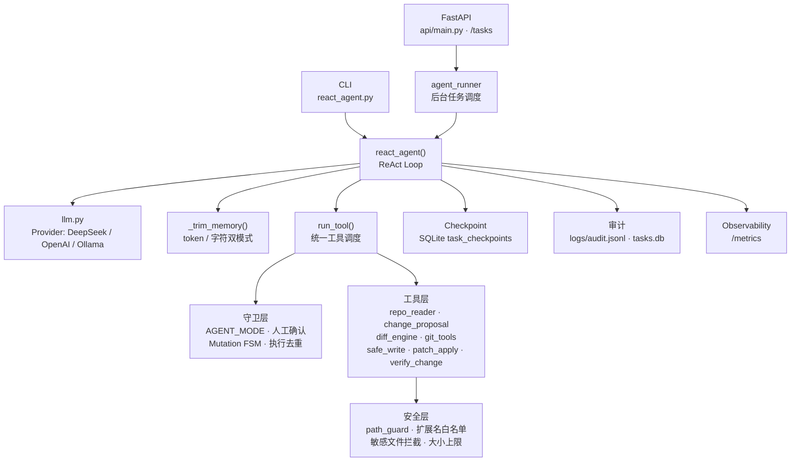
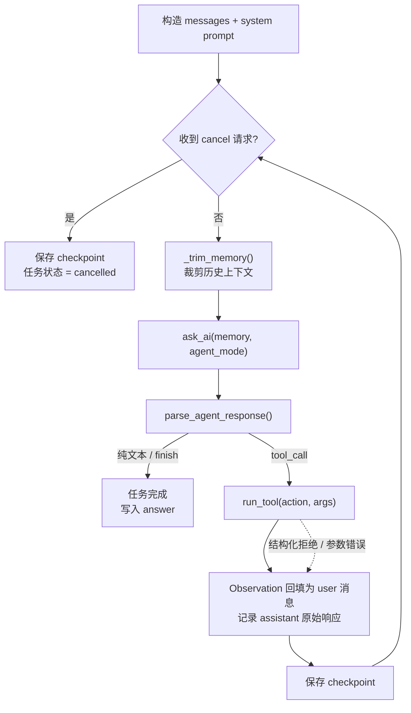
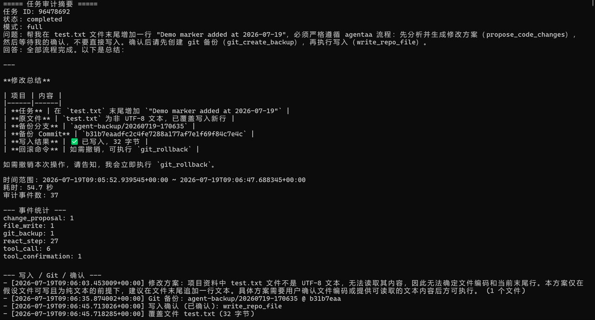

# 企业代码仓库 Agent（RepoPilot）


**当前版本：v0.12.0** · 基线 v0.10.2 · Python 3.10+ · MIT

**一个可审计、可回滚、写操作受控的代码仓库 Agent。** 基于自研 ReAct 执行引擎，支持仓库分析、结构化改码方案、Diff 预览、Git 备份、受控写入、改后验证与回滚；提供 CLI 与 FastAPI HTTP 两种入口，不依赖 LangChain / LangGraph 等编排框架。

> 面向 AI Agent 开发、LLM 应用开发、Python 后端实习岗位的作品项目。目标不是做“会聊天的编码助手”，而是把 **LLM 修改代码这件事** 变成一条有边界、有确认、有审计、可回滚的工程流程。

### 30 秒了解

- **自研 ReAct 引擎**：显式 `while` 循环、响应解析、Observation 回填与上下文裁剪，不依赖 LangChain / LangGraph。
- **15 个 ReAct 工具**：统一 `run_tool()` 调度，叠加模式权限、Pydantic 参数校验、Mutation FSM 与人工确认。
- **可回滚的写闭环**：修改方案 → Diff 预览 → Git 备份 → 人工确认 → 受控写入 → 验证 / 审计，失败可回滚。

真实 CLI 输出（示例命令与返回来自 [docs/demo.md](docs/demo.md)，字段与 v0.12.0 实现一致）：

```text
$ python react_agent.py
请输入: 计算 3 加 5

AI输出: {"action": "calculator", "args": {"a": 3, "b": 5}}

工具返回: 8

AI输出: {"action": "finish", "answer": "3 加 5 等于 8。"}

回答: 3 加 5 等于 8。
```

---

## 目录

1. [项目背景与解决的问题](#1-项目背景与解决的问题)
2. [核心功能](#2-核心功能)
3. [系统架构](#3-系统架构)
4. [ReAct 执行流程](#4-react-执行流程)
5. [工具调用与安全控制](#5-工具调用与安全控制)
6. [Mutation FSM 状态管理](#6-mutation-fsm-状态管理)
7. [SQLite Checkpoint 与任务恢复](#7-sqlite-checkpoint-与任务恢复)
8. [技术栈](#8-技术栈)
9. [项目目录结构](#9-项目目录结构)
10. [安装与运行](#10-安装与运行)
11. [测试与验证结果](#11-测试与验证结果)
12. [已知限制与设计边界](#12-已知限制与设计边界)

---

## 1. 项目背景与解决的问题

让 LLM 直接改代码，工程上至少有四个问题：

| 问题 | RepoPilot 的处理方式 |
|------|---------------------|
| 模型可能改错文件、写出仓库 | `path_guard` 路径守卫 + 读写双档扩展名白名单 + 敏感文件拦截 |
| 写入不可逆、出错难恢复 | 写前 `git_create_backup` 创建备份分支，`git_rollback` 可回滚 |
| 用户不知道 Agent 要写什么 | 结构化修改方案 + `generate_unified_diff` 只读预览 + 写入前人工确认 |
| 长任务中断后只能从头再来 | SQLite checkpoint + 协作式 cancel/resume |

同时，LangChain / LangGraph 这类框架会把 ReAct 循环、工具调度、状态流转封装起来。本项目刻意**不使用编排框架**，用一个约 650 行的执行引擎（核心循环约 110 行）和显式的工具注册表，把“模型能做什么、不能做什么”全部放在可读、可测试的代码里。

---

## 2. 核心功能

- **仓库分析**：列文件、读文件、关键字搜索、目录结构分析、Python import/symbol 依赖分析
- **结构化改码方案**：`propose_code_changes` 输出可审阅的方案，不直接落盘
- **Diff 预览**：`generate_unified_diff` 只读生成 unified diff，支持单文件与多文件 batch
- **写操作闭环**：方案 → Diff → Git 备份 → 人工确认 → `apply_patch` / `write_repo_file` → 审计
- **Git 安全网**：备份分支 + `git_rollback`，失败可恢复到修改前状态
- **改后验证**：`verify_change` 检查已修改文件是否存在、Python 语法是否合法
- **双运行模式**：`AGENT_MODE=full | readonly`，只读模式屏蔽全部写工具
- **任务状态机**：Mutation FSM 约束写操作顺序，非法顺序直接结构化拒绝
- **断点续跑**：SQLite checkpoint 持久化消息、模式、上下文与 FSM 状态，支持 cancel/resume
- **可观测**：JSONL 审计日志、SQLite 任务表、按 task_id 生成 Markdown 报告、SSE 事件流、`/metrics`
- **双入口**：CLI 交互 + FastAPI HTTP API（含 API Key 认证与写入确认端点）

---

## 3. 系统架构



分层职责：

| 层 | 职责 |
|---|---|
| 入口层 | CLI / HTTP API，负责会话、任务与人工确认 |
| 执行层 | ReAct 循环、LLM 调用、响应解析、上下文裁剪 |
| 调度层 | 工具注册表、权限校验、参数校验、FSM 守卫、结构化结果 |
| 工具层 | 读、分析、方案、Diff、Git、写入、验证 |
| 安全层 | 路径守卫、白名单、敏感文件、确认、回滚 |
| 状态层 | Mutation FSM、MilestoneToken、Checkpoint |
| 观测层 | JSONL 审计、任务报告、SSE、进程内 metrics |

---

## 4. ReAct 执行流程

主循环位于 [react_agent.py](react_agent.py) 的 `_run_react_loop()`，是一个显式的 `while` 循环，不依赖任何 Agent 框架。



关键设计：

- **响应解析**：`schemas.parse_agent_response()` 先提取 ```json 代码块，再做花括号配对扫描，兼容模型在 JSON 前后夹带自然语言；解析失败时退化为纯文本回答，不会崩溃。
- **Observation 反馈**：工具返回统一转成结构化结果，以 `user` 消息回填，同时保留 assistant 原始响应，保证多轮上下文可追溯。
- **上下文裁剪**：`_trim_memory()` 保留 system message，按保留最近 N 轮或 token 预算裁剪；`REACT_MAX_CONTEXT_TOKENS=0` 时退回字符上限模式。
- **终止条件**：模型返回纯文本、返回 `finish`、达到 `REACT_MAX_STEPS=20`、或收到取消请求。
- **LLM Provider**：`llm/providers.py` 封装 DeepSeek / OpenAI / 本地 Ollama 的 OpenAI 兼容客户端；429/5xx/连接错误做 3 次指数退避重试。
- **可观测埋点**：每次 LLM 调用、工具调用、Agent step 都记录耗时与 token 统计，暴露在 `GET /metrics`。

> 解析失败不重试，直接按纯文本收尾；这是当前的设计取舍，见[已知限制](#12-已知限制与设计边界)。

---

## 5. 工具调用与安全控制

### 5.1 15 个 ReAct 工具

工具注册表在 `tools/tool_manager.py` 的 `TOOLS` 字典中，共 **18 个注册项**；其中暴露给 LLM 的 **15 个 ReAct 工具**全部带 Pydantic `args_model`。另外 3 个（`pdf_reader`、`search`、`file_reader`）是早期学习模块，不参与 ReAct 调度。

| 类别 | 工具 | 作用 |
|---|---|---|
| 读取分析 | `list_repo_files` | 列出仓库文件，支持扩展名过滤 |
| | `read_repo_file` | 读取仓库内文本文件 |
| | `search_in_repo` | 关键字搜索 |
| | `analyze_repo_structure` | 目录树与模块结构 |
| | `find_file_dependencies` | Python import 依赖 / symbol 定义与引用（需索引） |
| 方案与预览 | `propose_code_changes` | 生成结构化修改方案，不写文件 |
| | `generate_unified_diff` | 只读生成 unified diff（单文件 / batch） |
| Git | `git_status` | 查看分支、commit、工作区状态 |
| | `git_create_backup` | 创建 `agent-backup/<时间戳>` 备份分支并 commit |
| | `git_rollback` | 回滚到最近一次备份 |
| 写入 | `apply_patch` | 通过 `git apply` 应用 diff（单文件 / batch） |
| | `write_repo_file` | 整文件覆盖（备选路径） |
| 验证 | `verify_change` | 检查已修改文件是否存在、Python 语法是否合法 |
| 基础 | `calculator` | 两数相加 |
| | `summarizer` | 文本摘要 |

> `verify_change` 只做“文件存在性 + Python 语法”两项检查，不运行项目测试，也不自动修复。

### 5.2 `run_tool()` 调度链路

`run_tool(name, args)` 是所有工具调用的唯一入口，按顺序执行：

```text
工具存在性检查
  → AGENT_MODE 权限校验（readonly 屏蔽 5 个写/验证工具）
  → Pydantic 参数校验（ValidationError → code=validation_error）
  → Mutation FSM 顺序守卫（非法顺序 → code=mutation_fsm_blocked）
  → 执行去重（默认关闭）
  → 人工确认（仅 apply_patch / write_repo_file）
  → 执行工具函数
  → 结构化结果收口 {ok, code, message, milestone, details}
  → 审计日志落盘
```

失败不会抛给模型一个模糊字符串，而是返回统一结构，便于模型自我纠正，也便于测试断言。

### 5.3 安全边界

| 机制 | 实现 |
|---|---|
| 路径守卫 | `security/path_guard.py` 对路径 `resolve()` 后做仓库前缀校验，拦截 `../`、绝对路径与指向仓库外的符号链接 |
| 读取白名单 | `.py .md .txt .json .yaml .yml .toml .js .ts .tsx .vue .html .css` |
| 写入白名单 | 整文件写入不含 `.json`；`apply_patch` 修改已存在文件时沿用读取白名单（因此已存在的 `.json` 可 patch，新建 `.json` 不允许） |
| 敏感文件 | `.env*`（指定变体）、`credentials.json`、`secrets.json`、SSH 私钥、`.pem/.key/.p12/.pfx` |
| 大小限制 | `MAX_WRITE_BYTES=100000`；patch 限制 hunk/变更行/文件数 |
| 人工确认 | CLI 终端 `y/n`；API 通过 SSE 推送 `confirmation_required` + `POST /tasks/{id}/confirm`，默认 300s 超时后拒绝 |
| 只读模式 | `AGENT_MODE=readonly` 同时从工具清单和 `run_tool` 两层屏蔽写操作 |
| 备份与回滚 | 备份分支 + `git reset --hard` 回滚（破坏性，需显式调用） |
| 审计 | 工具调用与 ReAct 步骤写入 `logs/audit.jsonl`，敏感字段脱敏、超长截断；任务报告见 `python -m audit.task_report <task_id>` |

**默认写路径**（Diff-first）：

```text
propose_code_changes
  → generate_unified_diff（只读预览）
  → git_create_backup
  → apply_patch（y/n 或 HTTP confirm）
  → verify_change
  → finish
```

任何一步失败都可以调用 `git_rollback` 回到备份状态。

---

## 6. Mutation FSM 状态管理

写操作不是“模型想调就调”，而是被一个显式状态机约束。定义在 `context/tms/types.py`：

```text
ANALYZING → PROPOSED → DIFF_PREVIEWED → BACKED_UP → PATCHED → DONE
```

| 状态 | 含义 |
|---|---|
| `ANALYZING` | 只读分析阶段 |
| `PROPOSED` | 已产出结构化修改方案 |
| `DIFF_PREVIEWED` | 已生成 Diff 预览 |
| `BACKED_UP` | 已创建 Git 备份 |
| `PATCHED` | 已应用修改 |
| `DONE` | 流程结束 |

同时记录两条路径：`DIFF_FIRST`（推荐）与 `WRITE_FALLBACK`（整文件覆盖）。

工具与状态的前置约束（`context/tms/guards.py`）：

| 工具 | 允许的前置状态 |
|---|---|
| `propose_code_changes` | `ANALYZING` / `PROPOSED` / `PATCHED` |
| `generate_unified_diff` | `PROPOSED` / `DIFF_PREVIEWED`，且非 `WRITE_FALLBACK` 路径 |
| `git_create_backup` | Diff-first：`DIFF_PREVIEWED` / `BACKED_UP`；Write 路径：`BACKED_UP`（允许再次备份）；路径未定：`PROPOSED` |
| `apply_patch` | `BACKED_UP` 且 `DIFF_FIRST` |
| `write_repo_file` | `BACKED_UP` 且 `WRITE_FALLBACK` |
| `git_rollback` | `BACKED_UP` / `PATCHED` |
| `verify_change` | `PATCHED` |
| 其他写操作 | `DONE` 一律拒绝 |

**MilestoneToken** 是工具与状态机之间的稳定协议（7 个值）：`PROPOSED / DIFF_GENERATED / BACKUP_CREATED / PATCH_APPLIED / FILE_WRITTEN / ROLLBACK_TO_BACKUP / DEDUP_SKIPPED`。工具返回 milestone，`advance_from_outcome()` 只读 milestone 推进状态，不解析自然语言。

`MUTATION_FSM_ENABLED` 默认 **1**（开启）。非法调用返回 `code=mutation_fsm_blocked` 并写审计，不会执行工具。

---

## 7. SQLite Checkpoint 与任务恢复

### 7.1 持久化内容

数据库为 `database/tasks.db`，表 `task_checkpoints`：

| 字段 | 说明 |
|---|---|
| `checkpoint_id` | 主键 |
| `task_id` | 任务 ID |
| `step` | ReAct 步数 |
| `memory_json` | 完整消息历史 |
| `agent_mode` | full / readonly |
| `repo_root` | 目标仓库根目录 |
| `context_state_json` | 上下文预算状态 |
| `execution_state_json` | 执行去重状态 |
| `mutation_state_json` | TMS v2 状态（FSM + artifacts + verification） |
| `created_at` | 创建时间 |

保存时机：每次工具调用后、任务取消时、达到最大步数时。每个任务最多保留 **5** 条 checkpoint，单条 memory 上限 500 KB。

### 7.2 cancel / resume

- **cancel（协作式）**：`POST /tasks/{id}/cancel` 写入 `tasks.cancel_requested` 标志；Agent 在每步开始和每次工具执行前轮询，命中后先保存 checkpoint，再把任务置为 `cancelled`。不会强杀线程。
- **resume**：`POST /tasks/{id}/resume`，仅对 `cancelled` / `failed` 且存在 checkpoint、`repo_root` 一致的任务生效；恢复消息历史、模式、步数与 TMS 状态后继续执行。
- **执行去重**：开启 `EXECUTION_STATE_DEDUP_ENABLED` 后，resume 时会跳过已完成的 backup / apply / write，避免重复执行。该开关**默认关闭**。

> resume 目前只有 HTTP API 入口，CLI 不提供 resume。

---

## 8. 技术栈

| 类别 | 选型 |
|---|---|
| 语言 | Python 3.10+（CI 使用 3.11 / 3.12） |
| Agent 引擎 | 自研 ReAct 循环（无 LangChain / LangGraph） |
| LLM | DeepSeek / OpenAI / 本地 Ollama（OpenAI 兼容协议） |
| API | FastAPI + Uvicorn + SSE |
| 数据模型 | Pydantic v2 |
| 状态与持久化 | SQLite（`tasks.db`）、JSONL（`audit.jsonl`）、Git 分支备份 |
| 上下文管理 | tiktoken `cl100k_base` 估算 + 字符回退 |
| 检索增强 | 轻量 RAG（默认关闭）、Repo Index Lite（symbol 索引） |
| 测试 | pytest（单元 / 集成 / Golden / Live Smoke / E2E） |
| 工程化 | GitHub Actions、ruff、Docker / Docker Compose |

---

## 9. 项目目录结构

```text
repopilot/
├── react_agent.py          # ReAct CLI 主入口与执行循环
├── llm.py                  # LLM 调用、Prompt 加载、重试、token 统计
├── llm/providers.py        # DeepSeek / OpenAI / Ollama Provider
├── schemas.py              # Pydantic 模型与响应解析
├── api/                    # FastAPI：路由、后台任务、SSE、写入确认
├── tools/                  # 15 个 ReAct 工具 + tool_manager
├── security/               # path_guard、CLI 确认
├── context/                # 上下文预算、Mutation FSM、TMS、执行状态
│   └── tms/                # TaskMutationState（状态、守卫、推进、恢复）
├── storage/                # task_store、checkpoint_store（SQLite）
├── audit/                  # JSONL 审计、任务报告
├── config/                 # 全局配置、Agent 模式、Prompt JSON
├── index/                  # Repo Index Lite（symbol 索引）
├── rag/                    # 轻量 RAG（默认关闭）
├── observability/          # 进程内 metrics
├── scripts/                # API 冒烟脚本、legacy 导入检查
├── tests/                  # live_llm 断言/用例、检索评测用例
├── test_*.py               # 根目录单元 / 集成 / Golden / E2E 测试
├── docs/                   # 架构、流程、设计文档与展示资产
├── examples/               # Demo 工作区样本
├── legacy/                 # 早期 RAG 学习助手（与主流程独立）
├── .github/workflows/      # CI
├── Dockerfile
├── docker-compose.yml
├── requirements.txt
└── .env.example
```

---

## 10. 安装与运行

**环境要求**：Python 3.10+、Git、LLM API Key（DeepSeek / OpenAI / 本地 Ollama）。

```bash
git clone https://github.com/yshhas/repopilot-showcase.git
cd repopilot-showcase
python -m venv .venv
# Windows: .venv\Scripts\activate
source .venv/bin/activate
pip install -r requirements.txt
```

创建 `.env`（模板见 `.env.example`）：

```env
LLM_PROVIDER=deepseek
LLM_MODEL=deepseek-chat
LLM_BASE_URL=https://api.deepseek.com
LLM_API_KEY=your_api_key_here
# 兼容旧变量名：DEEPSEEK_API_KEY
```

> `REPO_ROOT` 默认是项目根目录。要分析其他仓库，设置 `REPO_ROOT=/path/to/repo`。

**CLI**：

```bash
python react_agent.py
```

输入 `exit` 退出。完整演示见 [docs/demo.md](docs/demo.md) 与 [docs/GITHUB_DEMO.md](docs/GITHUB_DEMO.md)。

**HTTP API**：

```bash
python -m api.main
# 或
uvicorn api.main:app --host 127.0.0.1 --port 8000
```

| 方法 | 路径 | 说明 |
|---|---|---|
| `GET` | `/health` | 健康检查 |
| `GET` | `/metrics` | Agent / LLM / Tool 指标 |
| `GET` / `POST` | `/tasks` | 任务列表 / 提交任务 |
| `GET` | `/tasks/{task_id}` | 任务详情 |
| `GET` | `/tasks/{task_id}/stream` | SSE 事件流 |
| `GET` | `/tasks/{task_id}/report` | Markdown 审计报告 |
| `GET` | `/tasks/{task_id}/confirm/pending` | 是否有待确认写操作 |
| `POST` | `/tasks/{task_id}/confirm` | 确认 / 拒绝写操作 |
| `POST` | `/tasks/{task_id}/cancel` | 协作式取消 |
| `POST` | `/tasks/{task_id}/resume` | 从 checkpoint 恢复 |

设置 `API_KEY` 后，除 `GET /health` 外需携带 `X-API-Key` 请求头。交互式文档：`http://127.0.0.1:8000/docs`。

**Docker**：

```bash
docker compose up --build -d
python scripts/api_smoke_test.py --health-only
docker compose down
```

> `docker-compose.yml` 将宿主机仓库以**只读**方式挂载到 `/repo`（`REPO_ROOT=/repo`）。容器内可做只读分析；full 模式的写入/备份需要把挂载改为可写，或在容器内对目标目录初始化 Git。

### Demo 预览

<p align="center">
  
</p>

> 上图为**实际终端运行输出**的任务审计报告，非界面示意图。可复现命令见 [docs/demo.md](docs/demo.md) 与 [docs/GITHUB_DEMO.md](docs/GITHUB_DEMO.md)；截图采集步骤见 [docs/DEMO_RECORDING.md](docs/DEMO_RECORDING.md)。

---

## 11. 测试与验证结果

```bash
python -m pytest -q          # 完整套件
python -m pytest -q -m live_llm   # opt-in 真实模型冒烟（需 API Key）
```

**本机实测（2026-11-13，Windows / Python 3.13）**：

| 指标 | 结果 |
|---|---|
| 完整套件 | **525 passed, 4 deselected**（共收集 529 项） |
| Golden（mock LLM 编排契约） | **26** cases |
| Agent E2E | **5** cases |
| Token 上下文配置 | **5** cases |
| Live Smoke（opt-in） | **4** cases，默认 deselected |

测试覆盖：响应解析、单文件/批量 diff 与 patch、路径与写入安全、Git 备份与回滚、ReAct 循环、取消与 checkpoint、Mutation FSM、结构化拒绝、`verify_change`、HTTP API、RAG、索引、任务报告、文档守门等。

**CI 状态说明**：GitHub Actions 工作流为矩阵测试（Python 3.11 / 3.12）+ ruff + Docker 冒烟，执行完整测试套件。v0.12.0 的验证记录为 **Python 3.11 / 3.12 各 525 passed, 4 deselected**，ruff 与 Docker/API 冒烟均成功；本仓库使用同一套 CI 配置，首次运行结果见 Actions 页面。

---

## 12. 已知限制与设计边界

| 限制 | 现状 |
|---|---|
| 不是通用编码 Agent | 只处理仓库内的读、分析与受控写入；不做需求理解、架构设计 |
| 无自动修复 | `verify_change` 失败只报告，不自动重试或修复 |
| resume 仅 API | CLI 无 resume 入口 |
| 严格幂等默认关闭 | `EXECUTION_STATE_DEDUP_ENABLED=0`，resume 可能重复执行 backup |
| `DONE` 运行期不可达 | 状态定义保留，当前流程以 `PATCHED` + finish 结束 |
| 验证范围有限 | 仅文件存在性与 Python 语法，不运行 pytest / linter |
| FSM 守卫异常时 fail-open | 守卫自身抛异常会放行工具调用（记录 warning），不是 fail-closed |
| 任务级备份默认关闭 | `TASK_SCOPED_BACKUP_ENABLED=0`，`git_rollback` 回滚到“最近一次备份” |
| RAG 默认关闭 | `RAG_ENABLED=0`；默认 embedding 为确定性 mock，不是生产向量模型 |
| Docker 只读挂载 | compose 默认 `./:/repo:ro`，容器内不能执行 full 模式写入 |
| legacy 依赖较重 | `chromadb / pypdf / python-docx` 仅服务 `legacy/` 学习助手，与主流程无关 |
| 无并发隔离 | SQLite + 单进程模型，未实现多租户 / worktree 隔离 |

这些限制是当前版本的显式边界，不是“待宣传的功能”。

---

## 文档

| 文档 | 说明 |
|---|---|
| [SECURITY.md](SECURITY.md) | 安全模型、部署建议与限制 |
| [docs/architecture.md](docs/architecture.md) | 架构设计与模块分层 |
| [docs/workflow.md](docs/workflow.md) | 工作流程与确认机制 |
| [docs/design/mutation_fsm.md](docs/design/mutation_fsm.md) | Mutation FSM 设计 |
| [docs/design/task_checkpoint.md](docs/design/task_checkpoint.md) | Checkpoint 与恢复设计 |
| [docs/design/structured_tool_results.md](docs/design/structured_tool_results.md) | 结构化工具结果 |
| [docs/design/verification_loop.md](docs/design/verification_loop.md) | `verify_change` 闭环 |
| [docs/testing_golden_eval.md](docs/testing_golden_eval.md) | Golden 测试 |
| [docs/testing_live_llm_eval.md](docs/testing_live_llm_eval.md) | Live Smoke 测试 |
| [docs/demo.md](docs/demo.md) | 完整 Demo 脚本 |
| [docs/GITHUB_DEMO.md](docs/GITHUB_DEMO.md) | 5 分钟最小演示 |
| [docs/PROJECT_STATUS.md](docs/PROJECT_STATUS.md) | 版本状态与已知限制 |
| [CHANGELOG.md](CHANGELOG.md) | 版本变更记录 |

---

## 关于本仓库

本仓库是 RepoPilot **v0.12.0** 的干净历史公开展示快照，用于简历与代码审阅。早期个人学习资料与完整开发历史不在其中；核心实现、测试、文档与版本信息保持一致。

---

## License

[MIT License](LICENSE)
