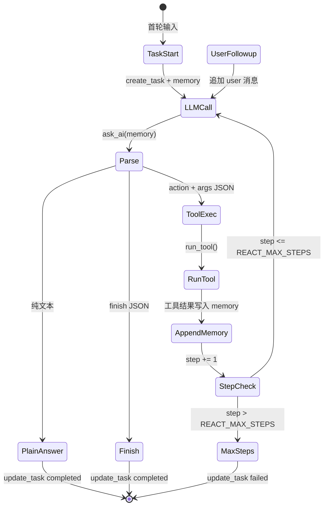
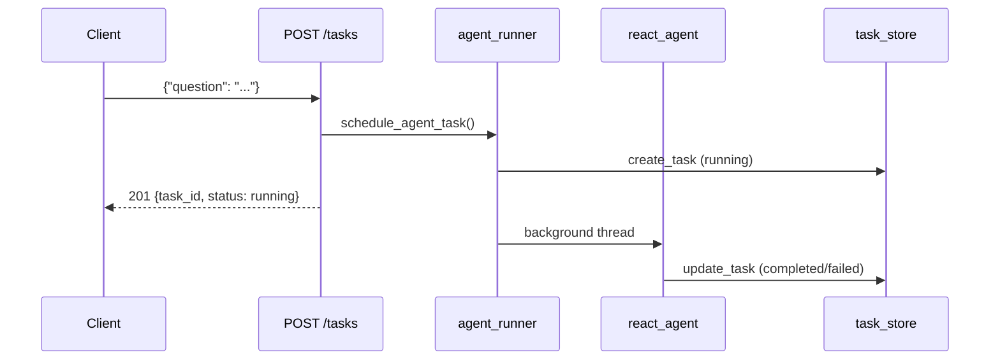
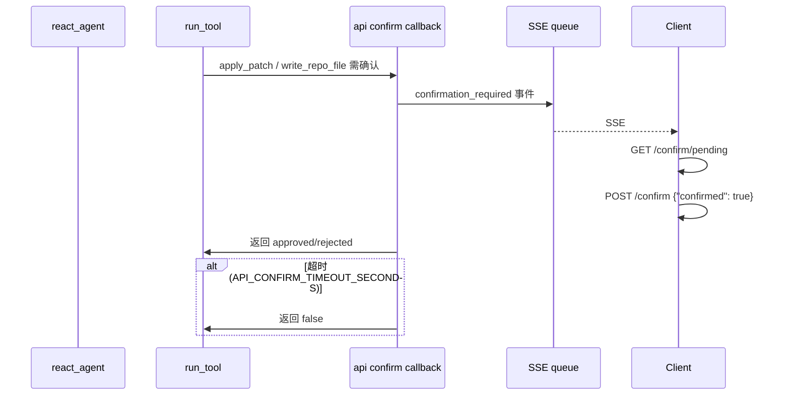
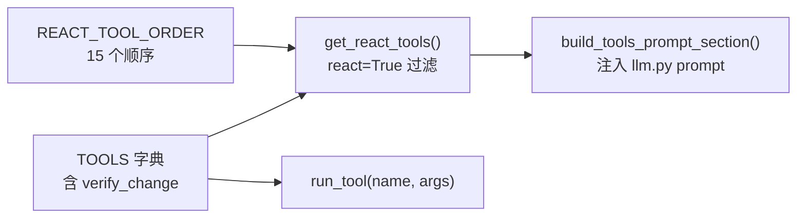
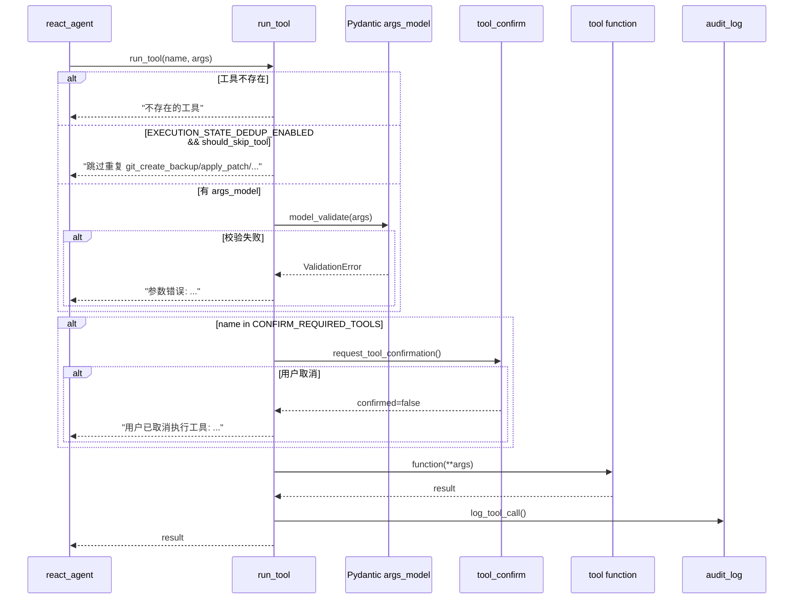
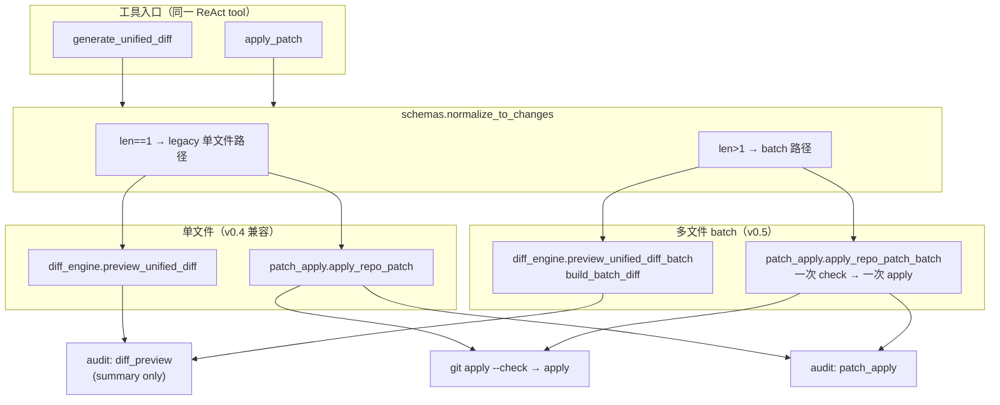
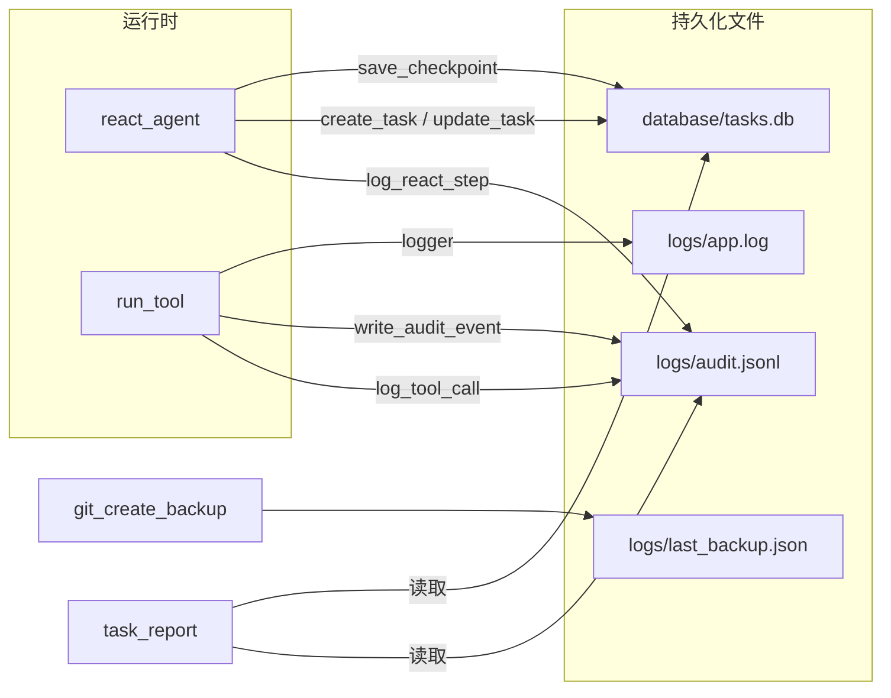
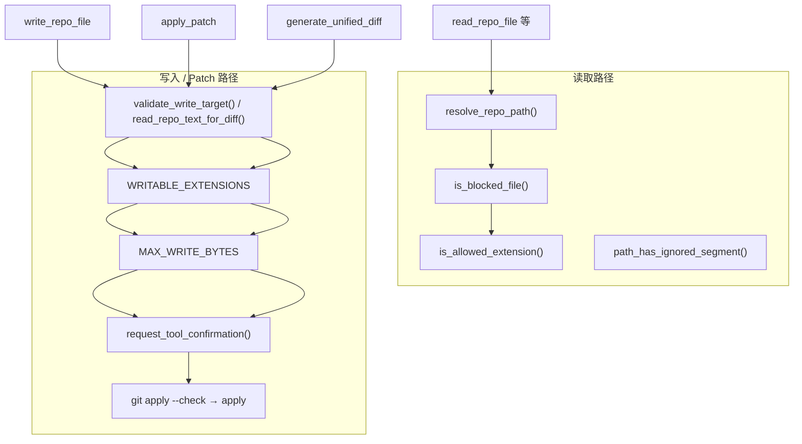

# 架构设计

> **版本**：v0.10.2（Verification loop）· **v0.10.1** Guard default-on · **v0.10.0** TMS  
> **依据**：当前代码库实际实现  
> **相关文档**：[项目状态](PROJECT_STATUS.md) · [V0.10 路线图](archive/V0.10_ROADMAP.md) · [TMS M5 设计](design/task_mutation_state_m5.md) · [Task checkpoint 设计](design/task_checkpoint.md)

---

## 1. 设计目标

RepoPilot 是一个 **CLI + HTTP API 企业研发 Agent**，目标是在企业代码仓库场景下实现：

- **可读**：安全边界内读取、搜索、分析仓库
- **可改**：结构化修改方案 + 受控 diff（单文件 legacy 或 batch `changes[]` 的 `apply_patch`）或整文件写入（`write_repo_file`）
- **可回滚**：Git 备份分支 + hard reset 恢复
- **可追溯**：JSONL 审计 + SQLite 任务 + 任务报告 + SSE 实时事件

**双入口**：

| 入口 | 命令 | 说明 |
|------|------|------|
| CLI | `python react_agent.py` | 多轮终端交互，写入确认 via **y/n** |
| HTTP | `python -m api.main` | FastAPI 服务，任务异步执行，写入确认 via **HTTP confirm** |

两者共用 ReAct 循环、工具层、审计与 SQLite 任务存储。

---

## 2. 系统分层

```mermaid
flowchart TB
    subgraph Entry["入口层"]
        CLI["react_agent.py<br/>run_react_cli()"]
        API["api/main.py<br/>FastAPI"]
        Runner["api/agent_runner.py"]
        RA["react_agent()<br/>ReAct 循环"]
    end

    subgraph APILayer["HTTP 层 (C3–C6)"]
        Stream["api/task_stream.py<br/>SSE"]
        Confirm["api/task_confirm.py<br/>API 写确认"]
    end

    subgraph LLM["LLM 层"]
        LLMMod["llm.py<br/>ask_ai() + system_prompt"]
        Schema["schemas.py<br/>parse_agent_response()"]
    end

    subgraph Tools["工具层"]
        TM["tools/tool_manager.py<br/>run_tool()"]
        Repo["repo_reader / repo_analyzer"]
        Change["change_proposal"]
        Git["git_tools"]
        Write["safe_write"]
    end

    subgraph Security["安全层"]
        PG["security/path_guard.py"]
        TC["security/tool_confirm.py"]
    end

    subgraph Index["Index 层 (v0.6 C1)"]
        IdxBuild["index/builder · store"]
        IdxQuery["index/query"]
        IdxRank["index/ranking"]
    end

    subgraph ContextLayer["Context 层 (v0.6–v0.10)"]
        Budget["context/budget_state.py"]
        TMS["context/tms/<br/>TaskMutationState shadow"]
        ExecState["context/execution_state.py<br/>(compat / tests)"]
        MutFSM["context/mutation_fsm.py<br/>(compat / tests)"]
    end

    subgraph RAG["RAG 层 (v0.7)"]
        RagBuild["rag/builder · store"]
        RagHybrid["rag/hybrid · backends"]
        RagExpand["rag/context_expand"]
    end

    subgraph Persistence["持久化层"]
        Audit["audit/audit_log.py"]
        Task["storage/task_store.py"]
        Ckpt["storage/checkpoint_store.py"]
        Ctx["context/project_context.py"]
        Report["audit/task_report.py"]
        IdxDB["database/repo_index.db"]
        RagDB["database/rag_vectors/"]
    end

    subgraph External["外部依赖"]
        DS["DeepSeek API"]
        GitBin["Git CLI"]
        FS["REPO_ROOT 文件系统"]
    end

    CLI --> RA
    API --> Runner
    Runner --> RA
    Runner --> Confirm
    Confirm -.->|confirm_callback| TM
    Stream -.->|stream_event_callback| Audit
    RA --> LLMMod
    LLMMod --> DS
    RA --> Schema
    Schema -->|ToolCall| TM
    Schema -->|FinishResponse / 纯文本| RA
    TM --> Repo & Change & Git & Write
    Repo --> IdxQuery
    Repo --> RagHybrid
    Change --> IdxRank
    Change --> Budget
    Change --> RagExpand
    RagExpand --> RagBuild
    RagHybrid --> RagBuild
    RagBuild --> RagDB
    IdxBuild --> IdxDB
    IdxQuery --> IdxDB
    IdxRank --> IdxQuery
    Change --> TMS
    TM --> TMS
    RA --> TMS
    RA --> Audit
    RA --> Task
    RA --> Ckpt
    Repo & Write --> PG
    TM --> TC
    TM --> Audit
    Git --> Ctx
    Write --> Ctx
    Report --> Audit
    Report --> Task
    Repo & Write --> FS
    Git --> GitBin
```



### 2.1 各层职责

| 层级 | 模块 | 职责 |
|------|------|------|
| 入口层 | `react_agent.py` | ReAct 循环、多轮 memory、步数限制、任务创建/更新；cancel 边界；checkpoint 保存/恢复 |
| HTTP 层 | `api/main.py` | FastAPI 路由、健康检查、任务 CRUD、报告、SSE、confirm、**cancel/resume** |
| HTTP 层 | `api/agent_runner.py` | 后台线程调度 `react_agent()`，注入 API confirm 回调 |
| HTTP 层 | `api/task_stream.py` | 按 task_id 的 SSE 事件队列与回放 |
| HTTP 层 | `api/task_confirm.py` | 写操作 pending 队列、HTTP 确认/超时 |
| LLM 层 | `llm.py` | DeepSeek 调用；组装 system prompt（规则 + 工具文档 + 修改流程） |
| 解析层 | `schemas.py` | Pydantic 工具参数模型；从 LLM 输出解析 `ToolCall` / `FinishResponse` |
| 工具层 | `tools/tool_manager.py` | 工具注册表、`run_tool()` 统一调度 |
| 安全层 | `security/` | 路径守卫、写入 y/n 确认 |
| 审计层 | `audit/` | JSONL 事件、应用日志、任务报告 |
| Index 层 | `index/` | Python AST symbol/import 索引；build/query；`INDEX_ENABLED=0` 时模块不加载 |
| Context 层 | `context/budget_state.py` | 每 task ContextVar 追踪已读 chars/files；供 propose context budget |
| Context 层 | `context/tms/` | **v0.10**：TaskMutationState shadow；`advance_from_outcome()`；checkpoint v2；guards/dedup readers |
| Context 层 | `context/execution_state.py` | **compat / tests** — v0.8 milestone module；hydrate 只读 |
| Context 层 | `context/mutation_fsm.py` | **compat / tests** — v0.9 FSM module；hydrate 只读 |
| 持久化层 | `storage/`、`storage/checkpoint_store.py`、`context/project_context.py` | SQLite 任务表与 checkpoint；Git 备份 JSON（`last_backup.json`） |
| 配置层 | `config/settings.py` | 路径、扩展名、patch/index/budget 限制、环境变量 |

### 2.2 Index 层（v0.6 C1）

| 模块 | 职责 |
|------|------|
| `index/builder.py` | 扫描 `REPO_ROOT` 下 `.py`；AST 提取 symbol definition/reference、import |
| `index/store.py` | SQLite `database/repo_index.db`；meta + symbol 表 |
| `index/query.py` | `find_symbol_*`、`get_file_import_hits`；lazy build（`INDEX_AUTO_REBUILD`） |
| `index/protocol.py` / `models.py` | 内部契约与 `IndexHit` / `IndexMeta` |
| `index/build/__main__.py` | CLI：`python -m index.build` |

**降级**：`INDEX_ENABLED=0` → 不写入 index DB；FFD symbol 模式返回提示；dependents 扫描回退 legacy walk。

### 2.3 Context budget 层（v0.6 C2）

| 模块 | 职责 |
|------|------|
| `index/ranking.py` | 候选文件打分、排序、`apply_context_budget` |
| `context/budget_state.py` | `record_context_read` / ContextVar 状态 |
| `tools/change_proposal.py` | `_load_context_with_budget`；audit `context_budget_applied`（仅元数据） |
| `tools/repo_analyzer.py` | FFD 扩展：`query_mode` + `symbol`；index 加速 dependents |

**触发路径**：`propose_code_changes` 加载项目资料时；`CONTEXT_BUDGET_ENABLED=0` 时与 v0.5 `_load_context_legacy` 一致。

**Audit 约束**：`context_budget_applied` / `index_query` / `rag_query` / `rag_context_expand` 事件不含文件全文、embedding 或 raw diff。

### 2.4 RAG 层（v0.7）

| 模块 | 职责 |
|------|------|
| `rag/chunker.py` | AST-aware 分块 + text/window fallback |
| `rag/embedder.py` | MockEmbeddingProvider（CI 默认） |
| `rag/store.py` | Chroma PersistentClient；`database/rag_vectors/` |
| `rag/builder.py` | `python -m rag.build`；lazy rebuild |
| `rag/query.py` | `semantic_search()` |
| `rag/hybrid.py` | `HybridRetriever` — grep + symbol + semantic |
| `rag/context_expand.py` | propose 路径 task → semantic 候选 |
| `tools/repo_reader.py` | `search_in_repo` hybrid 内核（签名不变） |

**降级**：`RAG_ENABLED=0`（默认）→ search/propose 与 v0.6 完全一致；`RAG_HYBRID_ENABLED=0` / `RAG_CONTEXT_EXPAND=0` 可单独关闭子功能。

### 2.5 TaskMutationState / TMS（v0.10 · production runtime）

| 模块 | 职责 |
|------|------|
| `context/tms/` | TMS shadow；`advance_from_outcome()`；guards；checkpoint v2 export/hydrate |
| `tools/tool_manager` | FSM guard + dedup skip 读 TMS（flags on） |
| `react_agent.py` | TMS advance；v2-only checkpoint save；resume → `set_shadow` |
| `storage/checkpoint_store.py` | 生产写入 `mutation_state_json`；v1 列 NULL |

详见 [task_mutation_state_m5.md](design/task_mutation_state_m5.md) · [V0.10_RELEASE_SUMMARY.md](archive/V0.10_RELEASE_SUMMARY.md)。

### 2.6 Execution state dedup（v0.8 · compat）

| 模块 | 职责 |
|------|------|
| `context/execution_state.py` | **compat / tests** — v1 hydrate；非 production runtime SoT |
| `tools/tool_manager._execution_state_dedup_skip` | v0.10：读 TMS `should_skip_tool_tms` when flag on |

**Flag**：`EXECUTION_STATE_DEDUP_ENABLED=0`（默认）→ dedup skip 不生效。

详见 [task_checkpoint 设计](design/task_checkpoint.md)。

### 2.7 Mutation workflow FSM（v0.9 · compat）

| 模块 | 职责 |
|------|------|
| `context/mutation_fsm.py` | **compat / tests** — v1 hydrate |
| `tools/tool_manager._mutation_fsm_check` | v0.10：读 TMS `check_mutation_allowed` when flag on |

**Flag**：`MUTATION_FSM_ENABLED=1`（**v0.10.1 默认**）→ ordering reject 生效；设 `=0` 可回退。

详见 [mutation_fsm.md](design/mutation_fsm.md) · [dedup_default_assessment.md](design/dedup_default_assessment.md)。

### 2.8 Structured tool reject（v0.9）

| 模块 | 职责 |
|------|------|
| `tools/result_schema.py` | `{ ok, code, message, details }` reject schema |
| `tools/tool_manager.run_tool` | gate reject 统一 helper；flag off → legacy string |

**Flag**：`STRUCTURED_TOOL_REJECT_ENABLED=1`（**v0.10.1 默认**）→ structured reject；设 `=0` 可回退为 string-only。

详见 [structured_tool_results.md](design/structured_tool_results.md)。

---

## 3. ReAct 运行时



### 3.1 关键参数

| 配置 | 默认值 | 来源 |
|------|--------|------|
| `REACT_MAX_STEPS` | 20 | `config/settings.py`，可通过环境变量覆盖 |
| 会话 `task_id` | 8 位 hex | `run_react_cli()` 启动时生成，整会话共用 |
| 单轮 `task_id` | 8 位 hex | 直接调用 `react_agent()` 且无传入时生成 |

### 3.2 上下文传递

`audit/context.py` 使用 **ContextVar** 在同一线程/协程内传递：

| ContextVar | 用途 |
|------------|------|
| `current_task_id` | 审计事件、工具调用自动关联 task_id |
| `confirm_callback` | 可注入自定义确认函数（API 模式注入 `make_api_confirm_callback`） |
| `skip_tool_confirm` | 跳过 `apply_patch` / `write_repo_file` y/n（测试用） |
| `stream_event_callback` | SSE 推送钩子（API 模式注入，审计事件实时广播） |

### 3.0 Cancel / Checkpoint 步边界（v0.6+）

每个 ReAct tool 步骤结束后（`run_tool` 返回、memory 追加后）：

| 检查 | 条件 | 行为 |
|------|------|------|
| **Cancel** | `is_cancel_requested(task_id)` | 保存 checkpoint → `mark_task_cancelled` → 返回默认取消回答 |
| **Checkpoint** | `CHECKPOINT_ENABLED=1` | `save_checkpoint`（memory、step、agent_mode、context_state、**execution_state**） |
| **Dedup 更新** | `EXECUTION_STATE_DEDUP_ENABLED=1` | `update_from_tool_result` 更新 milestone |

Cancel 为**协作式**：不中断正在执行的 tool（含 `git apply`）；仅在下一步边界生效。

---

## 3.3 HTTP API 层（C3–C6）

### 3.3.1 端点一览

| 方法 | 路径 | 阶段 | 说明 |
|------|------|------|------|
| `GET` | `/health` | C3 | 服务状态与 `APP_VERSION` |
| `GET` | `/tasks` | C3 | 列出最近任务（`limit` 1–100） |
| `GET` | `/tasks/{task_id}` | C3 | 单任务详情 |
| `POST` | `/tasks` | C4 | 提交问题，后台异步运行 Agent |
| `GET` | `/tasks/{task_id}/stream` | C5 | SSE 事件流 |
| `GET` | `/tasks/{task_id}/report` | C6 | Markdown 审计报告 |
| `GET` | `/tasks/{task_id}/confirm/pending` | C6 | 是否有待确认写操作 |
| `POST` | `/tasks/{task_id}/confirm` | C6 | 批准/拒绝 pending 写操作 |
| `POST` | `/tasks/{task_id}/cancel` | C3+ | 协作式取消 running 任务（下一步边界生效） |
| `POST` | `/tasks/{task_id}/resume` | C3+ | 从最近 checkpoint 恢复；body 可选 `question` 追问 |

启动：`python -m api.main` 或 `uvicorn api.main:app --host 127.0.0.1 --port 8000`

### 3.3.2 异步任务调度（C4）



`react_agent()` 在 API 路径下若 task 已存在则跳过重复 `create_task`。

### 3.3.3 SSE 事件流（C5）

`api/task_stream.py` 为每个 `task_id` 维护内存队列：

- **运行中任务**：审计钩子 `publish_stream_event()` 实时推送
- **已完成任务**：从 `audit.jsonl` 回放历史事件后关闭流

客户端订阅 `GET /tasks/{task_id}/stream`，响应 `Content-Type: text/event-stream`。

### 3.3.4 API 写确认流程（C6）

CLI 模式下 `apply_patch` / `write_repo_file` 通过终端 **y/n** 确认；API 模式下 `agent_runner` 注入 `make_api_confirm_callback(task_id)`：



- 无 pending 时 `POST /confirm` 返回 **409**
- 默认超时 **300 秒**（`API_CONFIRM_TIMEOUT_SECONDS`）

### 3.3.5 AGENT_MODE（C7）

| 模式 | 可见工具 | 拦截工具 |
|------|---------|---------|
| `full` | 全部 **15** 个 ReAct 工具 | — |
| `readonly` | 读/分析 + `propose_code_changes` + `git_status` + `generate_unified_diff`（**10** 个） | `git_create_backup`, `apply_patch`, `write_repo_file`, `verify_change`, `git_rollback` |

配置优先级：**API `request.mode` > `AGENT_MODE` 环境变量 > 默认 `full`**

- CLI：`AGENT_MODE=readonly python react_agent.py`
- API：`POST /tasks {"question":"...", "mode":"readonly"}`
- SQLite `tasks.agent_mode` 持久化；`GET /health` 返回环境默认模式
- `run_tool` 硬拦截 + Prompt 工具列表双层防护；C6 confirm 流程在 readonly 下不可达

### 3.3.6 Task cancel & resume（v0.6 C3）

**Cancel**（`POST /tasks/{task_id}/cancel`）：

1. API 设置 `tasks.cancel_requested = 1`（任务仍 `running`）
2. `react_agent` 在 tool 边界检测 flag → `mark_task_cancelled` → status `cancelled`
3. 审计：`cancel_requested`（API）+ `task_cancelled`（agent 边界）

**Resume**（`POST /tasks/{task_id}/resume`）：

1. `agent_runner.schedule_resume_task` 读取 `get_latest_checkpoint`
2. 后台线程调用 `react_agent(..., resume_from_step, initial_memory, initial_context_state, initial_execution_state)`
3. 恢复 context budget；注入 dedup hint（`EXECUTION_STATE_DEDUP_ENABLED=1`）
4. 审计：`task_resumed` react_step

**限制**：CLI 无 cancel/resume 等价命令；resume 不跳过 mutation 安全门（confirm/backup 规则仍由 prompt + tool gate 约束）。

---

## 4. 工具注册与调度

### 4.1 注册机制

工具在 `tools/tool_manager.py` 的 `TOOLS` 字典中注册，ReAct 可见工具由 `REACT_TOOL_ORDER` 控制顺序：



### 4.2 ReAct 工具（**15** 个）

| 工具 | 实现文件 | 类型 |
|------|----------|------|
| `summarizer` | `tools/summarizer.py` | 辅助 |
| `calculator` | `tools/calculator.py` | 辅助 |
| `list_repo_files` | `tools/repo_reader.py` | 读取 |
| `read_repo_file` | `tools/repo_reader.py` | 读取 |
| `search_in_repo` | `tools/repo_reader.py` | 读取 |
| `analyze_repo_structure` | `tools/repo_analyzer.py` | 分析 |
| `find_file_dependencies` | `tools/repo_analyzer.py` | 分析 |
| `propose_code_changes` | `tools/change_proposal.py` | 方案 |
| `git_status` | `tools/git_tools.py` | Git |
| `generate_unified_diff` | `tools/diff_engine.py` | Diff 预览（只读） |
| `git_create_backup` | `tools/git_tools.py` | Git |
| `write_repo_file` | `tools/safe_write.py` | 写入（整文件备选） |
| `apply_patch` | `tools/patch_apply.py` | 写入（diff 推荐） |
| `verify_change` | `tools/verify_change.py` | 改码后验证（soft） |
| `git_rollback` | `tools/git_tools.py` | Git |

### 4.3 注册但不暴露给 ReAct

| 工具 | 说明 |
|------|------|
| `file_reader` | 委托 `read_repo_file`，遗留兼容 |
| `pdf_reader` | 遗留 RAG 用 |
| `search` | Chroma 向量检索，遗留 RAG 用 |

### 4.4 run_tool 调度流程



当前 `CONFIRM_REQUIRED_TOOLS` 包含 **`apply_patch`** 与 **`write_repo_file`**（定义于 `config/settings.py`）。`generate_unified_diff` 不在其中。

### 4.5 Diff / Patch 模块（v0.4 单文件 · v0.5 batch）



- **单文件（默认）**：`path` + `new_content`（完整文件文本，非 LLM raw diff）
- **多文件 batch**：`changes: [{path, new_content}, ...]` — 与 legacy **二选一**；`normalize_to_changes` 路由
- **Batch 语义**：all-or-nothing preview/apply；**无 partial apply**；**无 auto rollback**（显式 `git_rollback`）
- **Audit / report**：`file_count > 1` 时 batch 摘要；单文件保持 v0.4 形状；**不含** raw diff / `new_content`
- **上限**：`PATCH_MAX_FILES`（默认 10）、`PATCH_MAX_CHANGED_LINES`（batch 总和）

---

## 5. 数据流与持久化



### 5.1 审计事件类型

| event | 写入来源 |
|-------|----------|
| `react_step` | `log_react_step()` — task_start、ai_output、tool_request 等 |
| `tool_call` | `log_tool_call()` — 每次 `run_tool` |
| `change_proposal` | `propose_code_changes` |
| `file_write` | `write_repo_file` |
| `diff_preview` | `generate_unified_diff` / `preview_unified_diff` |
| `patch_apply` | `apply_patch` / `apply_repo_patch` |
| `git_backup` | `git_create_backup` |
| `git_rollback` | `git_rollback` |
| `tool_confirmation` | `request_tool_confirmation` |
| `context_budget_applied` | `propose_code_changes` context budget |
| `index_query` | index symbol/dependency 查询 |
| `rag_query` / `rag_context_expand` | RAG hybrid search / propose expand |
| `cancel_requested` / `task_cancelled` | HTTP cancel + agent 边界 |
| `checkpoint_saved` / `checkpoint_skipped` | ReAct checkpoint hooks |
| `task_resumed` / `execution_state_restored` | HTTP resume |
| `execution_state_dedup` | dedup skip 重复 mutation tool |

审计字段超过 500 字符时截断（`AUDIT_MAX_FIELD_LENGTH`）；敏感字段经 `security/redaction.py` 脱敏。

### 5.2 SQLite 任务表

`storage/task_store.py` 管理 `database/tasks.db`：

| 字段 | 说明 |
|------|------|
| `task_id` | 主键 |
| `status` | `running` / `completed` / `failed` / **`cancelled`** |
| `question` | 首轮用户问题 |
| `answer` | 最终回答 |
| `repo_root` | 目标仓库路径 |
| `agent_mode` | `full` / `readonly` |
| `cancel_requested` | 0/1 协作式取消标志 |
| `created_at` / `updated_at` | UTC ISO 时间戳 |

### 5.2b Checkpoint 表（`task_checkpoints`）

`storage/checkpoint_store.py` 管理，与 `tasks.db` 同库：

| 字段 | 说明 |
|------|------|
| `checkpoint_id` | 主键 |
| `task_id` | 外键 |
| `step` | ReAct 步数 |
| `memory_json` | memory 快照 |
| `agent_mode` | 恢复时模式 |
| `repo_root` | 快照时 REPO_ROOT |
| `context_state_json` | context budget 状态 |
| `execution_state_json` | v0.8 mutation milestone（dedup opt-in） |
| `created_at` | UTC ISO 时间戳 |

### 5.3 Git 备份状态

`context/project_context.py` 将备份信息写入 `logs/last_backup.json`：

- `backup_branch` — 如 `agent-backup/20260719-015219`
- `backup_commit` — 备份 commit hash
- `original_branch` — 备份前所在分支
- `repo_root` — 必须与当前 `REPO_ROOT` 一致才加载

---

## 6. 安全边界（架构视角）



详细规则见 [workflow.md](workflow.md) 与 README 安全说明。

**已知限制**：

- `settings.py` 中 `SENSITIVE_*`、`REDACT_PLACEHOLDER` 已接入 `security/redaction.py`；读工具返回与审计 JSONL 均经脱敏（v0.3.0 P1）
- **v0.5 batch MVP** — 单文件 legacy + 多文件 `changes[]`；**无** merge / 冲突 UI / partial apply
- **`git apply` 非 DB 事务**；apply 内 **无 auto rollback**
- 无备份记录时 `write_repo_file` 仅警告；`apply_patch` 默认 **拒绝**（`PATCH_REQUIRE_BACKUP`）
- `diff_preview` audit **不含**完整 diff 正文
- Golden eval 为 **mock LLM 编排**，不代表真实 LLM eval

---

## 7. 目录结构

```
repopilot/
├── react_agent.py          # ReAct CLI 主入口 + ReAct 循环
├── api/                    # FastAPI HTTP 层 (C3–C7)
│   ├── main.py             # 路由 + uvicorn 入口
│   ├── agent_runner.py     # 后台 Agent 调度 + resume
│   ├── task_stream.py      # SSE 事件流
│   ├── task_confirm.py     # API 写确认
│   ├── deps.py             # task_store 薄封装
│   └── schemas.py          # Pydantic 请求/响应模型
├── scripts/
│   └── api_smoke_test.py   # 在线 API 冒烟测试
├── llm.py                  # LLM + System Prompt
├── schemas.py              # Pydantic 模型 + JSON 解析
├── config/settings.py      # 全局配置
├── tools/
│   ├── tool_manager.py     # 工具注册 + run_tool + dedup guard
│   ├── repo_reader.py      # 读/搜/列
│   ├── repo_analyzer.py    # 结构/依赖分析
│   ├── change_proposal.py  # 修改方案
│   ├── safe_write.py       # 受控写入
│   ├── diff_engine.py      # unified diff 预览
│   ├── patch_apply.py      # apply_patch
│   └── git_tools.py        # Git 操作
├── security/
│   ├── path_guard.py       # 路径安全
│   ├── tool_confirm.py     # 写入确认
│   └── redaction.py        # 审计/返回脱敏
├── audit/
│   ├── audit_log.py        # JSONL 审计
│   ├── context.py          # ContextVar
│   ├── logger.py           # 应用日志
│   └── task_report.py      # 任务报告
├── storage/
│   ├── task_store.py       # SQLite 任务
│   └── checkpoint_store.py # SQLite checkpoint (v0.6 C3)
├── context/
│   ├── budget_state.py     # context budget (v0.6 C2)
│   ├── execution_state.py  # resume dedup (v0.8 M1)
│   └── project_context.py  # Git 备份状态
├── index/                  # Repo index lite (v0.6 C1)
├── rag/                    # Repo RAG MVP (v0.7)
├── tests/
│   ├── live_llm/           # opt-in live smoke (v0.8)
│   └── eval_retrieval/     # retrieval eval fixture
├── legacy/                 # 遗留入口与手动脚本（见 legacy/README.md）
└── docs/                   # 项目文档
```

---

## 8. 遗留模块边界

以下模块与 ReAct 主流程 **独立共存**，不在 `REACT_TOOL_ORDER` 中：

| 模块 | 说明 |
|------|------|
| `legacy/agent.py` | 早期 RAG 学习助手（Chroma + PDF/Word） |
| `legacy/main.py` | 关键词路由 demo（weather / calculator） |
| `tools/vector_store.py` | Chroma 持久化，路径为 `./database`（相对 CWD） |

ReAct 主流程应使用 `read_repo_file`，不使用 `file_reader`（Prompt 中已明确禁止）。

---

## 9. 配置与环境变量

| 变量 | 默认 | 说明 |
|------|------|------|
| `DEEPSEEK_API_KEY` | — | LLM API Key（`.env`） |
| `REPO_ROOT` | 项目根目录 | 目标代码仓库 |
| `REACT_MAX_STEPS` | `20` | ReAct 步数上限 |
| `MAX_WRITE_BYTES` | `100000` | 单次写入字节上限 |
| `LOG_LEVEL` | `INFO` | 应用日志级别 |
| `AGENT_MODE` | `full` | Agent 模式（`full` / `readonly`） |
| `API_CONFIRM_TIMEOUT_SECONDS` | `300` | API 写确认等待超时（秒） |
| `API_DEFAULT_LIST_LIMIT` | `20` | `GET /tasks` 默认条数 |
| `API_MAX_LIST_LIMIT` | `100` | `GET /tasks` 最大条数 |
| `INDEX_ENABLED` | `1` | Repo index lite |
| `CONTEXT_BUDGET_ENABLED` | `1` | propose context budget |
| `CHECKPOINT_ENABLED` | `1` | checkpoint 持久化 |
| `RAG_ENABLED` | `0` | Repo RAG；`0` = v0.6 行为 |
| `RAG_HYBRID_ENABLED` | `1` | search hybrid（需 RAG_ENABLED=1） |
| `RAG_CONTEXT_EXPAND` | `1` | propose semantic expand（需 RAG_ENABLED=1） |
| `EXECUTION_STATE_DEDUP_ENABLED` | `0` | v0.8 resume dedup；`1` 跳过重复 backup/apply |
| `MUTATION_FSM_ENABLED` | `1` | v0.9+ mutation workflow FSM guard（**v0.10.1 default-on**） |
| `STRUCTURED_TOOL_REJECT_ENABLED` | `1` | v0.9+ structured gate reject（**v0.10.1 default-on**） |
| `CHECKPOINT_MAX_PER_TASK` | `5` | 每 task 保留 checkpoint 数 |
| `CHECKPOINT_MAX_MEMORY_BYTES` | `500000` | 超限 skip checkpoint |
| `RAG_EMBEDDING_MODEL` | `mock-deterministic-v1` | CI 默认 mock embedding |
| `API_KEY` | — | 可选 HTTP API Key（`.env`） |

---

## 10. 测试覆盖

架构相关自动化测试：

| 测试文件 | 覆盖点 |
|----------|--------|
| `test_file_reader_security.py` | 读取安全、file_reader 隔离 |
| `test_backup_persistence.py` | 备份持久化、跨进程回滚 |
| `test_react_max_steps.py` | 步数限制 |
| `test_task_store.py` | 任务持久化 |
| `test_task_report.py` | 审计报告 |
| `test_llm_prompt.py` | Prompt 工作流规则 |
| `test_api_c3.py` ~ `test_api_c6.py` | HTTP API 各阶段 |
| `test_api_acceptance.py` | C3–C6 集成验收 |
| `test_index_*.py` | Index build/query/disabled（v0.6 C1） |
| `test_ffd_*.py` | FFD symbol/legacy/index-disabled（v0.6 C2） |
| `test_context_*.py` · `test_propose_affected_files.py` | Context budget + affected_files（v0.6 C2） |
| `test_rag_*.py` | RAG build/query/hybrid/propose（v0.7） |
| `test_api_cancel_checkpoint.py` · `test_react_cancel_checkpoint.py` | HTTP cancel/resume + agent 边界（v0.6 C3） |
| `test_checkpoint_store.py` | checkpoint 持久化 |
| `test_execution_state_dedup*.py` | execution state dedup（v0.8 M1） |
| `test_mutation_fsm*.py` | mutation FSM + checkpoint hydrate（v0.9） |
| `test_tool_result_schema.py` | structured tool reject（v0.9） |
| `test_llm_golden.py` | Golden mock eval（**24** cases） |
| `tests/live_llm/` | Live LLM smoke（**4** opt-in cases） |
| `tests/eval_retrieval/` | Retrieval eval fixture schema |

**v0.9.0 eval 补充**：FSM runtime + checkpoint hydrate + structured reject + golden illegal-order（+6 cases）。

```powershell
python -m pytest -q
```

CI 执行 **505** 项自动化测试；完整本地套件 **525 passed**（**4 deselected** live_llm；含文档守门、default-on guard、`verify_change`；`legacy/` 由 `pytest.ini` 排除收集）。
