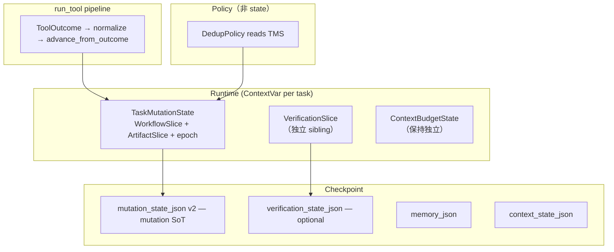
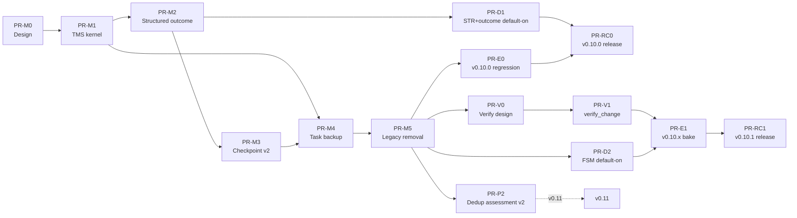

# RepoPilot v0.10.0 Roadmap

> **主题**：Runtime State Consolidation · Guard Default-on · Verification Loop  
> **基准版本**：v0.9.0（tag `v0.9.0`，424 pytest passed）  
> **状态**：**M0–M5 @ v0.10.0** · **D1/D2 @ v0.10.1** · **V0/V1 verify_change @ v0.10.2** · dedup 仍 off  
> **更新日期**：2026-07-23  
> **说明**：规划原文保留；实际节奏见 [CHANGELOG](../../CHANGELOG.md) `[0.10.0]` / `[0.10.1]` · [PROJECT_STATUS](../PROJECT_STATUS.md)。  
> **相关**：[architecture.md](../architecture.md) · [V0.9_ROADMAP.md](V0.9_ROADMAP.md) · [task_mutation_state.md](../design/task_mutation_state.md) · [mutation_fsm.md](../design/mutation_fsm.md) · [structured_tool_results.md](../design/structured_tool_results.md) · [dedup_default_assessment.md](../design/dedup_default_assessment.md) · [task_checkpoint.md](../design/task_checkpoint.md)

---

## 1. 版本目标

v0.9.0 完成了 **Runtime Mutation Control 的能力预埋**（FSM · structured reject · checkpoint FSM hydrate），但三项 guard **默认均为 off**，且 runtime 内存在 **三套并行 mutation 状态**（`mutation_fsm` · `execution_state` · `project_context` backup）。v0.10.0 的主题不是堆新工具，而是 **收敛架构债务、激活 guard、补上改码验证闭环**。

| 支柱 | v0.9 现状 | v0.10 答案 |
|------|-----------|------------|
| **State Consolidation (P0)** | FSM + execution_state + global `last_backup.json` 三轨；advance 依赖中文字符串 marker | 统一 `TaskMutationState`；checkpoint 为唯一持久化来源；structured tool outcome 驱动 FSM / dedup / audit |
| **Default-on Rollout (P0/P1)** | `MUTATION_FSM` · `STRUCTURED_TOOL_REJECT` · `EXECUTION_STATE_DEDUP` 均 default `0` | 分阶段 migration + regression；**非简单改 default** |
| **Verification Loop (P1)** | 改码后无自动验证 | 设计 + 实现 `verify_change`（或等价工具）；golden / live eval 覆盖 verify step |

**原则**：

- **基于 v0.9 实际代码演进** — 不 rewrite ReAct 内核、不引入 LangGraph / Multi-Agent
- **Checkpoint 向前兼容** — v0.9 checkpoint 必须可 resume（hydrate v1 → v2）
- **Default 变更必须有 migration plan** — 每个 flag on 对应独立 PR + 验收矩阵
- **ReAct 工具数 v0.10 主线 ≤15** — 验证闭环允许 +1（`verify_change`）；不批量加工具
- **HTTP API 签名不变** — 行为默认值可变；OpenAPI path/body 不 breaking

### 1.1 v0.10 主线优先级

| 优先级 | 目标 | 设计 doc |
|--------|------|----------|
| **P0** | TaskMutationState 统一 + structured success outcome | [task_mutation_state.md](../design/task_mutation_state.md) ✅ M0 · [tool_outcome_m2.md](../design/tool_outcome_m2.md) ✅ M2 design |
| **P0** | Checkpoint schema v2 + v0.9 hydrate | 扩展 [task_checkpoint.md](../design/task_checkpoint.md) |
| **P0** | Task-scoped backup | `design/task_mutation_state.md` §backup |
| **P0/P1** | Guard default-on migration（STR → FSM → dedup） | 本文 §12 |
| **P1** | Verification loop（`verify_change`） | 新建 `design/verification_loop.md` |
| **P1** | Failure-scenario regression + live eval 扩展 | [testing_golden_eval.md](../testing_golden_eval.md) · [testing_live_llm_eval.md](../testing_live_llm_eval.md) |
| **P2** | Production RAG · API worker · Web UI preview | defer v0.10.1+ |

### 1.2 明确不做（v0.10.0 全周期）

| 项 | 说明 |
|----|------|
| **ReAct / run_tool 全盘重写** | 收敛 state，不换 orchestrator |
| **分布式 worker / 多进程 task queue** | 单进程 thread 模型保留；worker defer P2 |
| **OAuth / RBAC / 多租户** | 仍仅可选 `API_KEY` |
| **History task RAG** | defer v0.11+ |
| **CLI cancel/resume 命令** | HTTP 路径优先；CLI parity defer |
| **Dedup default-on 先于 state consolidation** | 见 §12.3；禁止跳过 M 系列 PR |
| **14 工具 success 全量 JSON 一次迁移** | 分 PR：先 mutation tools，再 read tools（若有需要） |
| **OpenAPI breaking change** | structured outcome 经 audit/SSE，不改 `TaskResponse` |

---

## 2. 架构现状与 v0.10 目标态

### 2.1 v0.9 实际状态（代码事实）

```
react_agent loop
    ├─ memory (ReAct 对话 — 权威对话状态)
    ├─ context/budget_state.py (ContextVar)
    ├─ context/mutation_fsm.py (ContextVar, flag off 默认)
    ├─ context/execution_state.py (ContextVar, flag off 默认)
    └─ context/project_context.py (module global + logs/last_backup.json, repo-global)

checkpoint (SQLite task_checkpoints)
    ├─ memory_json
    ├─ execution_state_json   ← dedup on 时非空
    ├─ mutation_fsm_json      ← FSM on 时非空
    └─ context_state_json

state advance 触发器（三处重复）
    PROPOSAL_MARKER / BACKUP_SUCCESS_MARKER / PATCH_SUCCESS_MARKER / ...
    解析 tool 返回 **string substring**
```

### 2.2 v0.10 目标态

> 详细边界见 [task_mutation_state.md §2](../design/task_mutation_state.md#2-boundary-analysis--what-belongs-in-tms)



**TaskMutationState 内部切片（bounded aggregate，非 mega-state）**：

| 切片 | 字段 | 职责 |
|------|------|------|
| **WorkflowSlice** | `state`, `mutation_path`, `proposal_digest` | Ordering guard（原 FSM） |
| **ArtifactSlice** | `backup`, `diff_previewed_paths`, `patch_applied`, `patch_applied_paths` | 已完成 mutation 事实（原 execution_state + backup ref） |
| **epoch** | `int` | re-backup / 新 proposal 代数；dedup policy 读此字段 |

**不在 TMS 内**：`DedupPolicy`（纯函数）· `VerificationSlice` · `ContextBudgetState` · ReAct memory

**Structured tool outcome（扩展 v0.9 reject-only schema）**：

```python
# design draft — 见 design/task_mutation_state.md
class ToolSuccessResult(TypedDict):
    ok: Literal[True]
    code: str              # e.g. "backup_created", "patch_applied", "proposal_generated"
    message: str           # 注入 ReAct memory 的人类可读文本
    milestone: str | None  # 稳定 milestone token，替代中文 substring
    details: dict[str, Any]

ToolOutcome = ToolSuccessResult | ToolRejectResult
# Legacy str 仅作为 tool function 原始返回值，经 normalize_tool_outcome() 单点转换
```

**Formatter 统一出口**：`format_outcome_for_memory` · `format_outcome_for_display` · `extract_outcome_audit_fields` — CLI / memory / audit / SSE **禁止**直接 `str(result)`。

---

## 3. 关键设计决策（Roadmap 级）

### 3.1 State Consolidation：一次大 PR 还是拆分？

**结论：拆分为 5–6 个 PR（M0–M5），禁止单 PR 大爆炸。**

| 策略 | 理由 |
|------|------|
| **拆分** | 三模块 + checkpoint + 24 golden cases 交叉；单 PR review 风险过高 |
| **Parallel write 窗口** | M1 引入 `TaskMutationState` 后与旧模块双写，M5 再删旧代码 |
| **可回滚** | 每 PR 默认行为不变或显式 flag 保护 |

**推荐 PR 链**：

```
M0 design → M1 kernel + dual-write → M2 structured outcome (mutation tools)
         → M3 checkpoint v2 + hydrate v1 → M4 task-scoped backup
         → M5 remove legacy + dedup on FSM path 统一到 TMS
```

### 3.2 Structured tool outcome 是否替代 reject-only schema？

**结论：是 — v0.10 将 schema 升级为统一的 `ToolOutcome`，success 与 reject 对称。**

| 维度 | v0.9 | v0.10 |
|------|------|-------|
| Success | plain string + marker parse | `ToolSuccessResult` + `milestone` token |
| Reject | `ToolRejectResult`（opt-in） | 同 schema，default-on |
| Legacy string | 默认 | compat window：`finalize_tool_result` 仍可 strip（`STRUCTURED_TOOL_OUTCOME_ENABLED`） |
| Dedup skip | plain string `跳过重复` | `ToolSuccessResult{code=dedup_skipped}` 或专用 skip outcome；**不再是 silent string** |

**不做什么**：v0.10 不要求 14 工具全部 structured success — **mutation 6 工具 + verify 1 工具优先**；read/analyze 工具保持 string。

### 3.3 Backup task-scoped 化是否与 state consolidation 同 PR？

**结论：同一 Epic（M 系列），独立 PR（M4），依赖 M1 + M3。**

| 项 | 说明 |
|----|------|
| **为何同 Epic** | backup 是 `TaskMutationState` 字段；global `last_backup.json` 是 consistency bug 根因 |
| **为何独立 PR** | Git 副作用 + 并发 task 测试面大；与 outcome schema 解耦可单独 review |
| **过渡策略** | M4 之前：`git_create_backup` 仍写 `last_backup.json`（deprecated）；M4 后：checkpoint 为主，global file 仅 CLI 跨进程 fallback（documented） |

---

## 4. Milestone 与 PR 划分



| PR | 代号 | 交付物 | 优先级 | 依赖 |
|----|------|--------|--------|------|
| **M0** | TMS design | [task_mutation_state.md](../design/task_mutation_state.md) | **P0** | v0.9.0 tag ✅ |
| **M1** | TMS kernel | `context/tms/` adapter + dual-write | **P0** | [task_mutation_state_m1.md](../design/task_mutation_state_m1.md) ✅ design |
| **M2** | Structured outcome | [tool_outcome_m2.md](../design/tool_outcome_m2.md) | **P0** | M1 ✅ design |
| **M3** | Checkpoint v2 | `mutation_state_json` + v0.9 hydrate | **P0** | M1 |
| **M4** | Task-scoped backup | backup 写入 TMS；并发测试 | **P0** | M1 · M3 |
| **M5** | Legacy removal | 删除独立 FSM/execution_state advance 路径 | **P0** | M2 · M3 · M4 |
| **D1** | STR + outcome default-on | reject + outcome flags default `1` | **P0** | M2 · **v0.10.0** |
| **E0** | v0.10.0 regression | parity · v1 hydrate · TMS core | **P0** | M5 · D1 |
| **RC0** | **v0.10.0 Release** | TMS · ToolOutcome · STR default | — | E0 |
| **V0** | Verify design | `design/verification_loop.md` | **P1** | M0 · **v0.10.x** |
| **V1** | verify_change | +1 tool · VerificationSlice | **P1** | M5 · V0 |
| **D2** | FSM default-on | `MUTATION_FSM_ENABLED=1` | **P1** | M5 · **v0.10.1** |
| **E1** | v0.10.x bake | golden ≥30 · live ≥7 · verify | **P1** | V1 · D2 |
| **RC1** | **v0.10.1 Release** | FSM default · verify baked | — | E1 |
| **P2** | Dedup assessment v2 | default-on 结论 | **P2** | M5 · **v0.11** |

---

## 5. P0 — PR 详细说明

### PR-M0 — TaskMutationState 设计（P0）

| 项 | 内容 |
|----|------|
| **目标** | 定义统一 state 模型、ToolOutcome schema、checkpoint v2、v0.9 hydrate 规则 |
| **修改模块** | 新建 `docs/design/task_mutation_state.md`；更新 `task_checkpoint.md` §migration |
| **不做** | 运行时代码；改 default flag |
| **风险** | 设计遗漏导致 M1 返工 |
| **验收标准** | 文档覆盖：字段表 · FSM transition 映射 · dedup 规则 · backup scoping · outcome code 注册表 · v1→v2 hydrate 算法 |
| **API / 默认行为** | 无影响 |

---

### PR-M1 — TaskMutationState kernel + dual-write（P0）

| 项 | 内容 |
|----|------|
| **目标** | 引入 `TaskMutationState` ContextVar；dual-write 旧模块 + TMS；parity tests |
| **修改模块** | 新建 `context/task_mutation_state.py`；`react_agent.py`；`test_task_mutation_state.py` |
| **不做** | 删除旧模块；改 guard 读路径（M5）；改 default flags |
| **SoT（M1）** | **Legacy 读 + guard**；TMS shadow write；不一致 → legacy wins + audit + TMS resync |
| **风险** | 双写漂移 → `PARITY_STRICT=1` in pytest |
| **验收标准** | [ ] parity tests 4 组合矩阵 [ ] 零行为变更 [ ] `mutation_state_parity_mismatch` audit |
| **API / 默认行为** | 无 |

> 详见 [task_mutation_state_m1.md](../design/task_mutation_state_m1.md)

---

### PR-M2 — Structured tool outcome（mutation tools）（P0）

| 项 | 内容 |
|----|------|
| **目标** | 6 个 mutation tools + gate paths 产出 `ToolSuccessResult` / `ToolRejectResult`；**advance 读 `milestone` 不再读 substring** |
| **修改模块** | `tools/result_schema.py`；`tools/git_tools.py` · `patch_apply.py` · `safe_write.py` · `change_proposal.py` · `diff_engine.py`（preview success）；`context/task_mutation_state.py` advance；`test_tool_outcome_*.py` |
| **不做** | read/analyze 工具改 JSON；HTTP OpenAPI 变更；dedup skip 语义变更（仍 Phase M5） |
| **风险** | Golden cases 依赖 substring → 同步更新断言为 `code` / `milestone` |
| **验收标准** | [ ] Milestone code 注册表：`proposal_generated` · `diff_previewed` · `backup_created` · `patch_applied` · `file_written` · `rollback_done` [ ] `advance_from_outcome()` 仅认 structured milestone [ ] Legacy string tool return 在 compat 窗口仍可 parse（deprecated path，单测覆盖） [ ] Golden 24 cases 全绿（更新断言方式） |
| **API / 默认行为** | Memory 注入格式变：`format_tool_result_for_memory` 输出 structured JSON 或 canonical text（由 `STRUCTURED_TOOL_OUTCOME_ENABLED` 控制，default off 至 D1） |

**Milestone code 注册表（draft）**：

| Tool | `code` | `milestone` |
|------|--------|-------------|
| `propose_code_changes` | `proposal_generated` | `PROPOSED` |
| `generate_unified_diff` | `diff_previewed` | `DIFF_PREVIEWED` |
| `git_create_backup` | `backup_created` | `BACKED_UP` |
| `apply_patch` | `patch_applied` | `PATCHED` |
| `write_repo_file` | `file_written` | `PATCHED` |
| `git_rollback` | `rollback_done` | `BACKED_UP` |

---

### PR-M3 — Checkpoint schema v2 + v0.9 hydrate（P0）

| 项 | 内容 |
|----|------|
| **目标** | 新增 `mutation_state_json`（v2）；resume 时 hydrate v0.9 旧 checkpoint（`execution_state_json` + `mutation_fsm_json`）→ TMS |
| **修改模块** | `storage/checkpoint_store.py`；`context/task_mutation_state.py` hydrate v1；`api/agent_runner.py`；`test_checkpoint_migration.py` |
| **不做** | 删除旧列（保留 `execution_state_json` / `mutation_fsm_json` 作只读 legacy）；DB migration 脚本（SQLite ALTER ADD COLUMN 足够） |
| **风险** | v0.9 checkpoint 仅含 `{}` 时 hydrate 为 empty state — 需文档说明限制 |
| **验收标准** | [ ] v0.9 golden checkpoint fixtures resume 成功 [ ] v2 round-trip：save → load → TMS 等价 [ ] `derive_mismatch` audit 保留（v1 snapshot vs v1 derived 不一致时 log） [ ] `CHECKPOINT_SCHEMA_VERSION=2` 常量 |
| **API / 默认行为** | 无 HTTP 变更；resume 行为更一致（内部） |

**v0.9 → v2 hydrate 算法（摘要）**：

```
if mutation_state_json present → restore v2
elif mutation_fsm_json OR execution_state_json present → merge_to_v2(fsm, exec)
else → empty TMS
backup fields: prefer execution_state backup; fallback last_backup.json if task_id matches (M4 前)
```

---

### PR-M4 — Task-scoped backup（P0）

| 项 | 内容 |
|----|------|
| **目标** | `git_create_backup` / `git_rollback` 读写 **task-scoped** backup ref（TMS + checkpoint）；消除并发 task 互相覆盖 |
| **修改模块** | `context/task_mutation_state.py`；`tools/git_tools.py`；`tools/patch_apply.py` backup check；`context/project_context.py` deprecate；`test_task_scoped_backup.py` |
| **不做** | Git worktree 隔离（P2）；删除 `last_backup.json`（M5 或 v0.10.1 标记 deprecated） |
| **风险** | 旧 CLI 会话无 task_id 依赖 global backup → 保留 read fallback |
| **验收标准** | [ ] 两并发 API task 各 backup 不串 [ ] resume 后 rollback 指向 **本 task** backup [ ] `apply_patch` backup check 读 TMS 而非 global [ ] audit 含 `task_id` + backup ref |
| **API / 默认行为** | 多 task 并发语义 **变更**（修复 bug）；单 task 用户无感 |

---

### PR-M5 — Legacy state path removal（P0）

| 项 | 内容 |
|----|------|
| **目标** | 删除 `mutation_fsm.py` / `execution_state.py` 独立 advance 路径；dedup / FSM guard 统一读 TMS；checkpoint 只 export `mutation_state_json` |
| **修改模块** | 删除或 thin-wrap 旧模块；`tools/tool_manager.py`；`react_agent.py`；`context/mutation_fsm.py` → re-export shim（可选，一个 minor 后删）；测试合并 |
| **不做** | `EXECUTION_STATE_DEDUP_ENABLED` default 改 1（交 P2）；RAG 改动 |
| **风险** | 大量测试 import 旧模块 → 需 shim 或批量改 import |
| **验收标准** | [ ] 无代码路径调用 `advance_mutation_fsm_on_success` / `update_from_tool_result` marker parse [ ] FSM guard + dedup skip 均读 TMS [ ] Golden 24 + 新增 failure cases 全绿 [ ] 旧 checkpoint v1 hydrate 仍工作 |
| **API / 默认行为** | 内部一致性修复；flag off 时行为仍等同 v0.8.2 **仅当** compat layer 保留 |

---

## 6. P0/P1 — Default-on Migration PRs

### PR-D1 — STRUCTURED_TOOL_REJECT default-on（P0/P1）

| 项 | 内容 |
|----|------|
| **目标** | `STRUCTURED_TOOL_REJECT_ENABLED` default **`0` → `1`** |
| **修改模块** | `config/settings.py`；`tools/result_schema.py` finalize 逻辑；`test_tool_result_schema.py`；golden cases 默认断言 structured reject |
| **不做** | FSM default-on；success outcome default-on（可另设 `STRUCTURED_TOOL_OUTCOME_ENABLED`） |
| **风险** | 低 — reject 本就 structured 实现；flag on 仅影响 memory 是否 strip 为 string |
| **验收标准** | [ ] 默认 pytest 全绿 [ ] Golden cases 不依赖 substring reject [ ] CHANGELOG migration note [ ] env 显式 `=0` 可回退 v0.9 行为 |
| **API / 默认行为** | **变更** — ReAct memory 中 reject 为 JSON（若客户端 parse memory）；audit 已有 `reject_code` |

**评估结论**：**v0.10 可以 default-on** — 前提 PR-M2 完成且 golden 更新。建议在 **M5 之前** 合入 D1（reject 与 outcome 解耦）。

---

### PR-D2 — MUTATION_FSM default-on（P1 · **v0.10.1，非 v0.10.0**）

| 项 | 内容 |
|----|------|
| **目标** | `MUTATION_FSM_ENABLED` default **`0` → `1`** |
| **修改模块** | `config/settings.py`；`llm.py` prompt 简化；`test_mutation_fsm.py`；live eval |
| **不做** | dedup default-on（v0.11）；与 v0.10.0 同 tag 发布 |
| **风险** | **中** — LLM 乱序调用 hard reject；需 v0.10.0 TMS 稳定后再开 |
| **验收标准** | [ ] v0.10.0 已 release 且 bake ≥2 周 [ ] Golden ≥28 [ ] Live ≥7 [ ] env 回退 |
| **API / 默认行为** | **变更** — full mode skip propose 被 block |

**评估结论**：**可以 default-on，但放入 v0.10.1** — 与 verify_change bake 并行，降低 v0.10.0 行为跳跃。

---

### PR-P2 — EXECUTION_STATE_DEDUP default-on 评估 v2（P2 · defer default change）

| 项 | 内容 |
|----|------|
| **目标** | 在 TMS 统一后，重新评估 dedup default-on；**v0.10.0 结论预期仍为 defer** |
| **修改模块** | `docs/design/dedup_default_assessment.md` v2；可选 `EXECUTION_STATE_DEDUP_ENABLED=1` 独立 PR → **v0.10.1** |
| **不做** | 在 M5 之前改 default |
| **风险** | dedup skip 与 FSM reject 交互；marker 移除后误 skip |
| **验收标准** | [ ] 书面结论 + rollout 条件 [ ] 若 default-on：golden resume dedup ≥4 cases + concurrent task cases |
| **API / 默认行为** | v0.10.0 **预期不变** |

**评估结论**：**应等待 state consolidation 后再处理 default-on** — v0.9 [dedup_default_assessment.md](../design/dedup_default_assessment.md) 结论在 TMS 统一前仍然有效。

---

## 7. P1 — Verification Loop

### PR-V0 — Verification Loop 设计（P1）

| 项 | 内容 |
|----|------|
| **目标** | 设计改码后验证闭环；选型 `verify_change` vs 多工具 |
| **修改模块** | 新建 `docs/design/verification_loop.md` |
| **不做** | 实现代码 |

**设计选项评估**：

| 方案 | 优点 | 缺点 | 推荐 |
|------|------|------|------|
| **A. `run_tests` + `syntax_check` 两工具** | 职责清晰；LLM 易理解 | 工具数 +2；FSM 需定义 verify 状态 | 否 |
| **B. 统一 `verify_change`** | +1 工具；单一 FSM 钩子；可内部 dispatch | 实现稍复杂 | **是（v0.10 首选）** |
| **C. 隐式 verify（patch 后自动 pytest）** | 用户无感 | 不可控；难 audit；违反显式 tool 原则 | 否 |

**`verify_change` 设计 draft**：

```python
# args
{
  "checks": ["syntax", "pytest"],  # default ["syntax"]
  "paths": ["tools/foo.py"],       # optional scope
  "pytest_args": "-q",             # optional
}
# success outcome
{
  "ok": true,
  "code": "verify_passed",
  "milestone": "VERIFIED",
  "message": "...",
  "details": { "checks_run": [...], "failures": [] }
}
```

**FSM 集成（draft）**：

```
PATCHED → verify_change (optional but prompted) → VERIFIED → DONE
```

- v0.10：**soft enforcement** — prompt 引导 + FSM 允许 PATCHED 直接 finish；**v0.10.1 候选 hard gate**
- readonly mode：不提供 `verify_change`

| **验收标准** | 文档覆盖：checks 列表 · timeout · monorepo pytest 探测 · failure 时是否 suggest rollback · golden case 草案 |
| **API / 默认行为** | 无 |

---

### PR-V1 — verify_change 实现（P1 · **v0.10.x**）

| 项 | 内容 |
|----|------|
| **目标** | 新增第 **15** 个 ReAct tool；patch 后验证闭环 |
| **修改模块** | `tools/verify_change.py`；`context/verification_state.py`；`checkpoint_store` sibling JSON |
| **不做** | verify 作为 TMS WorkflowSlice 状态；verify fail 阻止 DONE（v0.10.0 soft gate） |
| **风险** | pytest 在无测试 repo 误报 → `verify_skipped` outcome |
| **验收标准** | [ ] 更新 `VerificationSlice` only，**不** advance workflow [ ] verify fail 不回滚 FSM [ ] 用户 finish 允许跳过 verify [ ] golden +2 |
| **API / 默认行为** | 新 tool；prompt 软引导 |

> verify / FSM / DONE 关系见 [task_mutation_state.md §7](../design/task_mutation_state.md#7-verification--separate-slice-cross-ref)

---

### PR-E1 — Failure-scenario regression 扩展（P1）

| 项 | 内容 |
|----|------|
| **目标** | 补齐 post-release 审计识别的测试缺口 |
| **修改模块** | `test_llm_golden.py`；`tests/live_llm/`；新建 `test_checkpoint_failure_matrix.py` · `test_concurrent_tasks.py` |
| **不做** | 性能 benchmark |

**必增 failure scenarios**：

| Scenario | 类型 |
|----------|------|
| checkpoint memory_too_large skip → resume 行为 | integration |
| TMS v1/v2 hydrate mismatch audit | unit |
| 并发两 task backup 隔离 | integration |
| FSM on + structured reject on 组合 | golden |
| verify_change fail 后 rollback 路径 | golden |
| v0.9 checkpoint resume on v0.10 code | migration |

| **验收标准** | [ ] Golden **≥30** cases [ ] Live smoke **≥7** cases [ ] 上表 scenarios 均有对应测试 [ ] 默认 pytest 全绿 |
| **API / 默认行为** | 无 |

---

## 8. P2 — 长期能力（v0.10.1+）

| PR | 目标 | 说明 |
|----|------|------|
| **R1** | Production embedding RAG | `RAG_EMBEDDING_MODEL` 真实模型；retrieval eval CI gate |
| **W1** | API task queue 原型 | 内存 queue + graceful shutdown；非分布式 |
| **U1** | Minimal Web UI spike | task list + diff view；非 v0.10 主线 |
| **D3** | Dedup default-on | 依赖 P2 评估结论 |
| **I1** | Incremental index rebuild | file-watch defer |

---

## 9. 涉及模块（预期）

| 模块 | M0 | M1 | M2 | M3 | M4 | M5 | D1 | D2 | V1 | E1 |
|------|----|----|----|----|----|----|----|----|----|----|
| `context/task_mutation_state.py`（新） | ● | ● | ● | ● | ● | ● | | | | ● |
| `context/mutation_fsm.py` | | ◐ | | | | ✕ | | | | |
| `context/execution_state.py` | | ◐ | | | | ✕ | | | | |
| `context/project_context.py` | | | | | ● | ◐ | | | | |
| `tools/result_schema.py` | | | ● | | | ● | ● | | | |
| mutation tools | | | ● | | ● | | | | | |
| `storage/checkpoint_store.py` | | | | ● | | ● | | | | ● |
| `react_agent.py` | | ● | | ● | | ● | | | | |
| `tools/tool_manager.py` | | ● | ● | | | ● | | | ● | |
| `llm.py` | | | | | | | | ● | ● | |
| `config/settings.py` | | | | | | | ● | ● | | |
| `test_llm_golden.py` | | | ● | | | ● | ● | ● | ● | ● |
| `tests/live_llm/` | | | | | | | | ● | ● | ● |

图例：● 主要修改 · ◐ dual-write/deprecate · ✕ 删除或 thin shim

---

## 10. v0.10.0 Release checklist（planning）

| 检查项 | 命令 / 标准 | 状态 |
|--------|-------------|------|
| TaskMutationState M0–M5 | 设计 + 实现 + legacy 移除 | ⏳ |
| Structured outcome（mutation tools） | milestone 替代 marker | ⏳ |
| Checkpoint v2 + v0.9 hydrate | migration tests | ⏳ |
| Task-scoped backup | concurrent task tests | ⏳ |
| STR default-on（D1） | settings default + golden | ⏳ |
| FSM default-on（D2） | post-M5 + live bake | ⏳ |
| verify_change（V1） | tools = 15 | ⏳ |
| Golden ≥30 · Live ≥7 | E1 | ⏳ |
| Dedup default | **v0.10.0 不改**（P2 评估） | ⏳ |
| 默认 pytest | `python -m pytest -q` 全绿 | ⏳ |
| v0.9 checkpoint forward compat | hydrate v1 tests | ⏳ |
| HTTP API 无 breaking | `test_api_*` | ⏳ |
| `APP_VERSION = 0.10.0` | RC PR | ⏳ |

---

## 11. 风险与 mitigations

| 风险 | Mitigation |
|------|------------|
| M 系列范围膨胀 | 严格 PR scope guard；M5 前禁止 D2/V1 合入 |
| Golden 全面重写成本高 | M2 引入 outcome 断言 helper；分批更新 |
| FSM default-on 导致 LLM 死循环 | Live bake + max_steps 监控；prompt 补充 recover from reject |
| verify pytest 在无测试 repo 误报 | detect + skip with explicit outcome `verify_skipped` |
| v0.9 checkpoint 无 milestone 数据 | hydrate 空 state + memory 为准；文档说明限制 |
| 并发 backup M4 回归 | dedicated `test_concurrent_tasks.py` |

---

## 12. v0.9 → v0.10 Migration Strategy

### 12.1 Flag rollout 时间表

| Flag | v0.9 default | 目标 default | 开启 PR | 版本 |
|------|--------------|--------------|---------|------|
| `STRUCTURED_TOOL_REJECT_ENABLED` | `0` | **`1`** | PR-D1 | **v0.10.0** |
| `STRUCTURED_TOOL_OUTCOME_ENABLED`（新） | — | **`1`** | PR-D1 | **v0.10.0** |
| `MUTATION_FSM_ENABLED` | `0` | **`1`** | PR-D2 | **v0.10.1**（非 v0.10.0） |
| `EXECUTION_STATE_DEDUP_ENABLED` | `0` | **`0`→评估 | PR-P2 | **v0.11** |
| `TASK_MUTATION_STATE_ENABLED`（M1 临时） | — | M5 后移除 | PR-M5 | v0.10.0 |

### 12.2 行为 migration（非 flag）

| 变更 | 影响 | 回退 |
|------|------|------|
| Checkpoint `mutation_state_json` v2 | 新 checkpoint 含 v2；旧列仍可读 | 读 v1 fallback |
| Task-scoped backup | 并发 task 语义修复 | 读 `last_backup.json` fallback（deprecated） |
| Milestone 从 marker → structured | 工具返回格式变 | `STRUCTURED_TOOL_OUTCOME_ENABLED=0` + string compat parse（M5 后移除） |
| verify_change 加入 prompt 流程 | 改码任务步数 +1~2 | tool 可选；FSM soft gate |

### 12.3 v0.9 checkpoint 恢复保证

**必须**：v0.10 代码 resume v0.9 写入的 checkpoint **不得 crash**。

| v0.9 checkpoint 内容 | v0.10 hydrate 行为 |
|----------------------|-------------------|
| 仅 `memory_json` + step | TMS empty；从 memory 继续 |
| `execution_state_json={}` | 同 empty |
| dedup on 时的 milestones | merge → TMS v2 |
| FSM on 时的 `mutation_fsm_json` | merge → TMS v2 |
| 两者皆有且不一致 | restore snapshot 优先 + `derive_mismatch` audit（与 v0.9 同） |
| global `last_backup.json` 来自其他 task | M4 前：best-effort；M4 后：ignore 非本 task backup |

**不需要** SQLite 数据迁移脚本 — 旧行保持只读；新 save 写 `mutation_state_json`。

### 12.4 Schema migration 摘要

| 层 | v0.9 | v0.10 | Migration |
|----|------|-------|-----------|
| SQLite `task_checkpoints` | 无 `mutation_state_json` | ADD COLUMN | `ALTER TABLE` on init（同 v0.9 FSM 列） |
| Checkpoint export | 3 JSON blobs | 1 primary + 2 legacy optional | dual-write 一版后 stop legacy write |
| Tool result | string + opt-in reject JSON | `ToolOutcome` | compat parse window |
| Backup | repo-global file | task-scoped in TMS | fallback read global |

### 12.5 推荐升级路径（用户 / 部署）

```
1. 升级代码至 v0.10.0（flags 仍可按 v0.9 显式全 off 获得旧行为 — M5 前）
2. 跑 pytest 确认环境
3. v0.10.0：新任务 benefit TMS + structured outcome（D1 default）
4. v0.10.1：FSM default-on + verify_change（可选升级）
5. 旧 task resume：v0.10.x 内 hydrate v1 checkpoint（**v0.11 起 deprecated**）
6. 回退：env 显式 `=0`；v0.10.x 支持 full flag rollback
```

### 12.6 Regression coverage 与 default-on 绑定

| Flag ON | 必须先绿的测试集 |
|---------|----------------|
| D1 STR | `test_tool_result_schema.py` · golden reject cases |
| D1b outcome | `test_tool_outcome_*.py` · golden mutation chain |
| D2 FSM | `test_mutation_fsm*.py` · golden illegal-order · live smoke disorder |
| P2 dedup（future） | `test_execution_state_dedup*.py` · golden resume dedup · concurrent |

**规则**：任何 default `0→1` PR **不得**在没有对应列测试全绿的情况下合入。

---

## 13. 测试策略

| 层级 | v0.10 新增重点 |
|------|----------------|
| **Unit** | TMS transition · outcome parse · hydrate v1→v2 |
| **Integration** | dual-write parity · concurrent backup · checkpoint migration |
| **Golden** | 24 → **≥30**；structured outcome 断言；verify step |
| **Live** | 4 → **≥7**；FSM default-on disorder · verify fail |
| **Compat** | v0.9 checkpoint fixtures on v0.10 code |
| **Regression** | flag explicit off 仍等价 v0.9（至 v0.10.0 RC） |

---

## 14. Release Strategy（分版本交付）

| 版本 | 交付 | Default 变更 | 不含 |
|------|------|--------------|------|
| **v0.10.0** | M0–M5 · ToolOutcome · D1 STR+outcome default-on · E0 regression | reject + outcome **on**；FSM **off** | verify_change · FSM default · dedup default |
| **v0.10.1** | V0–V1 verify_change · D2 FSM default-on · E1 bake | FSM **on** | dedup default · worktree |
| **v0.11** | P2 dedup default-on · worktree/`WorkspaceRef` · worker 原型 · v1 checkpoint deprecate | dedup 评估后 | Production RAG（可并行） |

**v0.10.0 刻意控制行为跳跃**：先稳 state + outcome，再开 FSM default，最后 dedup/isolation。

---

## 15. 后续预览

| 版本 | 主题 |
|------|------|
| **v0.10.0** | TMS · ToolOutcome · STR/outcome default-on |
| **v0.10.1** | FSM default-on · verify_change bake |
| **v0.11** | Dedup default · task/worktree isolation · worker 原型 |
| **不在主线** | Multi-Agent · 完整 Web UI |

---

## 16. Architecture Challenge Review（2026-07-21）

> 结论：**无 blocker**；M0 design 已吸收下列修订。详见 [task_mutation_state.md](../design/task_mutation_state.md)。

### 16.1 TaskMutationState 边界 — 有界 aggregate，非 mega-state

| 纳入 TMS | 不纳入 TMS |
|----------|------------|
| `WorkflowSlice`（ordering） | `DedupPolicy`（读 TMS 的纯函数） |
| `ArtifactSlice`（含 task-scoped backup ref） | `VerificationSlice`（sibling checkpoint 字段） |
| `epoch`（re-backup 代数） | `ContextBudgetState` |

**结论**：backup ref **属于** TMS ArtifactSlice；dedup **不是第四套 state**。

### 16.2 M1–M5 迁移 — SoT / mismatch / compat

| 问题 | 结论 |
|------|------|
| M1 dual-write SoT | **Legacy 读 + guard**；TMS shadow write |
| 不一致以谁为准 | **Legacy wins**（M1–M4）；pytest `PARITY_STRICT=1` fail |
| mismatch 处理 | audit `mutation_state_parity_mismatch` + TMS `force_sync_from_legacy` |
| M5 compat layer | 1-minor shim（`mutation_fsm.py` → TMS） |
| v0.9 checkpoint 永久兼容？ | **否** — v0.10.x 必须支持；**v0.11 deprecate** |

### 16.3 ToolOutcome — 单点 compat + 单点 advance

| 问题 | 结论 |
|------|------|
| 所有 mutation tool 必须 structured？ | **M2 起必须**；legacy string 仅 `normalize_tool_outcome()` 一处解析 |
| 兼容层位置 | `result_schema.normalize_tool_outcome()` |
| formatter 统一？ | **是** — memory / CLI / audit / SSE 全走 formatter；禁止 `str(result)` |
| 防 string marker 复发 | M5 删除一切 substring advance；legacy parse emit deprecation audit |

### 16.4 Verification Loop

| 问题 | v0.10 结论 |
|------|------------|
| verify 是 workflow state？ | **否** — `VerificationSlice` 独立 |
| 失败 FSM 回退？ | **否** — 保持 PATCHED |
| 失败阻止 DONE？ | **否**（soft gate）；v0.10.1+ 可 hard gate |
| 用户主动 finish？ | 允许；workflow → DONE，verify 可选 |

### 16.5 架构风险复检

| 风险 | 状态 |
|------|------|
| TMS 过大 | ✅ 已拆 Workflow / Artifact / 外置 Verify |
| FSM + outcome 同版本 default-on | ✅ 已拆分 v0.10.0 vs v0.10.1 |
| 永久 v1 hydrate 拖慢 evolution | ✅ 时间边界 v0.11 |
| 未来 worker/worktree 推翻 TMS | ✅ §9 extensibility — additive `WorkspaceRef` |

---

## 17. 文档历史

| 日期 | 状态 | 备注 |
|------|------|------|
| 2026-07-21 | **Draft** | Post-release architecture review 首版 |
| 2026-07-21 | **Approved (planning)** | M0–M5 拆分 · migration PR 绑定 default |
| 2026-07-21 | **M0 complete** | Architecture challenge review §16 · [task_mutation_state.md](../design/task_mutation_state.md) · Release Strategy §14 修订（FSM/verify → v0.10.1） |
