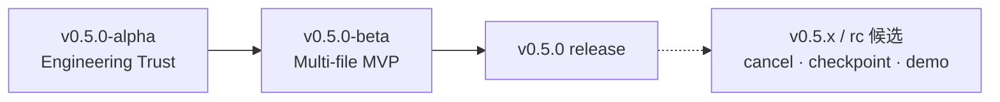
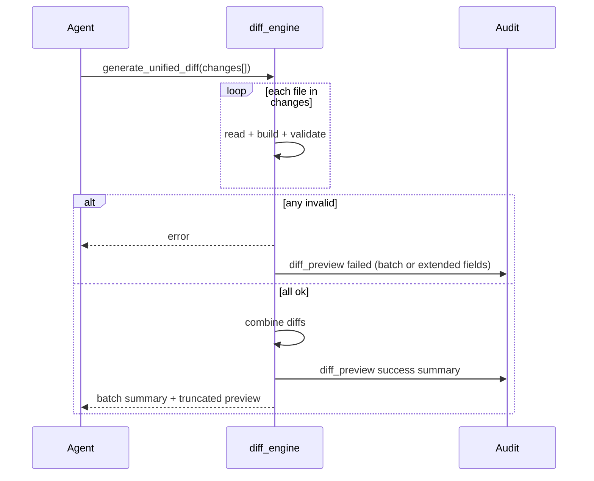
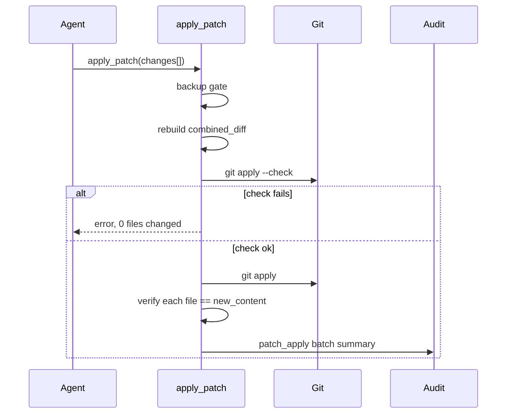

# RepoPilot v0.5.0 Roadmap

> **主题**：Engineering Trust + Multi-file Step-up  
> **基准版本**：v0.4.0（tag `v0.4.0`，master @ merge `6e52fcd`）  
> **状态**：**v0.5.0 release candidate** · A1–A4 ✅ · B1–B4 ✅ · 待 tag / GitHub Release  
> **更新日期**：2026-07-20  
> **相关**：[PROJECT_STATUS.md](../PROJECT_STATUS.md) · [CHANGELOG.md](../../CHANGELOG.md) · [architecture.md](../architecture.md)

---

## 1. 版本目标

v0.5.0 在 v0.4.0 **单文件 Unified Diff MVP** 之上，分两阶段交付：

1. **v0.5.0-alpha — Engineering Trust**  
   文档同步、LLM mock golden eval、测试隔离、多文件 patch **设计文档**。不扩展用户可见改码能力，但为 v0.5 奠定可回归、可发布的工程基础。

2. **v0.5.0-beta → v0.5.0 — Multi-file Step-up**  
   实现 **多文件 patch MVP**：一个任务内对多个文件生成 diff、整体 preview、单次 backup、**全量 check 通过后统一 apply**；失败时工作区不被破坏。

### 1.1 v0.5.0 主线（核心目标）

| 优先级 | 目标 |
|--------|------|
| **P0** | M1 文档同步 |
| **P0** | M2 LLM mock golden eval |
| **P0** | M3 测试隔离 / flaky 修复 |
| **P1** | M4 多文件 patch 设计 doc（含统一工具 schema） |
| **P1** | Multi-file atomic patch（扩展现有 preview/apply 工具） |
| **P1** | audit / task_report batch 聚合 |
| **P1** | prompt + golden 更新（**不增加** ReAct 工具数量） |

### 1.2 明确不做（v0.5.0 全周期）

| 项 | 说明 |
|----|------|
| Web UI | 继续 CLI + HTTP API |
| 长期 Agent memory | 不做跨会话无限 memory |
| 自动冲突 merge / 交互式 merge UI | 仅检测与失败报告 |
| 部分 apply 成功 | 不接受「部分文件已写入」 |
| Multi-Agent / RAG 合并 / LangGraph 重写 | 偏离主线 |
| **新增** `apply_batch_patch` / `generate_batch_unified_diff` **独立工具** | 见 §6.1；优先扩展现有工具 |

### 1.3 移出 v0.5.0 主线（v0.5.x / rc 候选）

以下能力 **不阻塞 v0.5.0 release**，可在 v0.5.0-rc 或 **v0.5.1+** 评估：

| 项 | 说明 |
|----|------|
| task cancel | API/CLI 中断 running 任务 |
| task checkpoint / resume | 步骤级持久化与续跑 |
| Demo GIF 更新（multi-file） | 展示增强 |
| CI matrix / coverage | 工程增强 |
| AST 代码理解（`find_references`） | 可 v0.5.1 |

---

## 2. Milestone 划分



| Milestone | 代号 | 交付物 | 目标 tag（建议） |
|-----------|------|--------|------------------|
| **Alpha** | Engineering Trust | PR-A1–A4 | 可选 `v0.5.0-alpha.1` 或 master 累积 |
| **Beta** | Multi-file MVP | PR-B1–B3 | `v0.5.0-beta.1` |
| **Release** | 文档 + CHANGELOG + Release | PR-B4 + RC-4 | **`v0.5.0`** |
| **后续** | v0.5.x 候选 | cancel/checkpoint、Demo、CI 等 | `v0.5.1` 或 rc tag |

**原则**：每个 PR 独立可 review；alpha **零** mutation 行为变更；beta 通过 **扩展** 现有 diff/apply 工具实现多文件，**ReAct 工具数保持 14**。

---

## 3. 第一阶段：v0.5.0-alpha（Engineering Trust）

### PR-A1 — M1 文档同步（post-v0.4.0 release）

| 项 | 内容 |
|----|------|
| **目标** | 消除 v0.4.0 发布后文档漂移，对外描述与 master 一致 |
| **范围** | 仅文档与 `test_project_docs.py` 断言（若需要） |
| **修改文件（预期）** | `docs/architecture.md`；`docs/demo.md`；`docs/workflow.md` §13；`docs/PROJECT_STATUS.md`；`README.md`（可选） |
| **不做** | 功能代码、prompt、工具行为 |

**验收标准**

- [x] docs 页眉与 v0.4.0 能力一致
- [x] `workflow.md` 不再写「Unreleased」/「不支持 diff/patch」
- [x] `PROJECT_STATUS.md` 反映 v0.4.0 **已 release** + v0.5 alpha 状态
- [x] `python -m pytest -v` 全绿

---

### PR-A2 — M2 LLM mock golden eval

| 项 | 内容 |
|----|------|
| **目标** | CI 可回归 Agent 工具选择倾向，不依赖真实 DeepSeek API |
| **范围** | `test_llm_golden.py`；mock `ask_ai` fixture |
| **场景（最少）** | readonly 不调 mutation；full diff-first prompt；readonly 阻断 apply；无 raw diff 指引 |
| **不做** | live LLM；非必要的 `llm.py` 逻辑变更 |

**验收标准**

- [x] ≥ 8 golden cases；无 API key 时 CI pass（2026-07-20：8 cases · 160 total pytest）
- [x] 覆盖 `react_agent()` 工具链顺序（`full_diff_first_chain`）
- [x] 简述如何新增 golden case → [testing_golden_eval.md](../testing_golden_eval.md)

---

### PR-A3 — M3 测试隔离 / flaky 修复

| 项 | 内容 |
|----|------|
| **目标** | 全量 pytest 不依赖全局 `logs/audit.jsonl` |
| **范围** | `test_apply_patch_tool.py` 等 audit 路径隔离；共享 fixture |
| **不做** | 生产 audit 逻辑变更 |

**验收标准**

- [x] 关键用例在 full suite 前后连跑 3 次稳定（2026-07-20：152 passed ×3）
- [x] 150+ tests 全绿（152 passed）

---

### PR-A4 — M4 多文件 patch 设计文档

| 项 | 内容 |
|----|------|
| **目标** | beta 实现前单一设计源；**明确统一工具 schema 方案** |
| **范围** | 新增 `docs/design/multi_file_patch.md`（§6 扩展 + 工具评估结论） |
| **不做** | `tools/` 实现 |

**验收标准**

- [x] 设计 doc 含：统一 `changes[]` schema、v0.4 参数兼容策略、apply 流程、失败语义、audit schema → [design/multi_file_patch.md](../design/multi_file_patch.md)
- [x] **明确不写**独立 `apply_batch_patch` 工具
- [x] 设计 doc 已确认，可开 beta PR（B1）

---

## 4. 第二阶段：v0.5.0-beta → release（Multi-file MVP）

### PR-B1 — 扩展 preview：多文件 diff 引擎

| 项 | 内容 |
|----|------|
| **目标** | 只读：一次调用预览 N 个文件合并 diff + 整体摘要 |
| **范围** | 扩展 **`generate_unified_diff`**（非新工具）；`tools/diff_engine.py`；Pydantic schema |
| **不做** | apply；不增加 ReAct 工具注册项 |

**验收标准**

- [x] `changes` 长度 1 → 行为与 v0.4 单文件一致
- [x] 2–5 文件 batch preview 正确
- [x] 任一文件校验失败 → 整体 preview 失败
- [x] audit batch 级摘要；**无** raw diff / `new_content` 全文
- [x] readonly 可调用
- [x] v0.4 单文件参数（`path` + `new_content`）仍可用
- [x] 新增 pytest ≥ 15

---

### PR-B2 — 扩展 apply：multi-file atomic batch

| 项 | 内容 |
|----|------|
| **目标** | 全部 `git apply --check` 通过后一次 `git apply`；失败则工作区不变 |
| **范围** | 扩展 **`apply_patch`**（非新工具）；`tools/patch_apply.py` |
| **不做** | partial apply；merge UI；独立 batch 工具 |

**验收标准**

- [x] `changes` 长度 1 → 与 v0.4 单文件 apply 一致
- [x] 3 文件 happy path：backup → apply → 全部更新
- [x] 任一文件 check 失败 → **0** 文件修改
- [x] 无 backup 拒绝；confirm cancel 无变更
- [x] audit batch 级摘要（§6.5）
- [x] readonly 阻断
- [x] 150 + N tests 全绿（**214** total）

---

### PR-B3 — audit / task_report 多文件聚合

| 项 | 内容 |
|----|------|
| **目标** | 报告展示 batch 摘要 |
| **范围** | `audit/task_report.py`；扩展 `diff_preview` / `patch_apply` 事件或 batch 字段 |
| **不做** | Web UI |

**验收标准**

- [x] 单文件 report 行与 v0.4 兼容
- [x] 多文件：「Patch batch (3 files): +12/-4 · success」类摘要
- [x] 失败列出 path + 截断 error

---

### PR-B4 — Prompt + 参数文档（工具数不变）

| 项 | 内容 |
|----|------|
| **目标** | Agent 知晓 `changes[]`；多文件/单文件同一工具；降低选择成本 |
| **范围** | `llm.py` prompt；`tool_manager.py` 参数说明；README/SECURITY/workflow |
| **不做** | 新增 ReAct 工具；删除 `write_repo_file` |

**验收标准**

- [x] ReAct 工具数 **仍为 14**
- [x] prompt：多文件用 `changes: [{path, new_content}, ...]`；单文件可用 `changes: [one]` 或 legacy `path`+`new_content`
- [x] `test_llm_prompt.py` + golden eval 更新（**11** golden cases）

---

### PR-RC（v0.5.0 release 前必须）

| 项 | 内容 |
|----|------|
| **目标** | 版本发布 |
| **范围** | CHANGELOG `[0.5.0]`；`APP_VERSION`；SECURITY.md batch 边界；人工验收清单 |

---

## 5. v0.5.x / rc 候选（非 v0.5.0 主线）

| 候选 PR | 内容 | 说明 |
|---------|------|------|
| X1 | task cancel | `POST /tasks/{id}/cancel` |
| X2 | task checkpoint / resume | SQLite 步骤快照 |
| X3 | Demo 更新（multi-file） | GIF / demo.md |
| X4 | CI matrix / coverage | 可选 |
| X5 | AST `find_references` | 可 v0.5.1 |

> v0.5.0 **release 不依赖**上表任一项。

---

## 6. 技术设计重点 — 多文件 patch

> M4 将展开为 `docs/design/multi_file_patch.md`。以下为 v2 设计结论。

### 6.1 工具设计评估：统一 schema，不新增 mutation 工具

#### 问题

若同时存在 `apply_patch` 与 `apply_batch_patch`，Agent 需在两个语义相近的 mutation 工具间选择，易导致：

- 多文件任务误用单文件工具（多次 apply，非 atomic）
- prompt / golden eval 分叉，回归成本翻倍
- confirm、audit、readonly 过滤重复配置

#### 结论（v0.5 采用）

| 工具 | 策略 |
|------|------|
| **`generate_unified_diff`** | **扩展**：接受统一 `changes[]`；单文件 = `changes.length === 1` |
| **`apply_patch`** | **扩展**：同上；内部实现 multi-file atomic apply |
| **`apply_batch_patch`** | **不新增**（除非 A4 评审发现无法兼容的硬约束） |
| **ReAct 工具数** | **保持 14** |

#### 若将来必须独立工具（例外条款，当前不计划）

仅在以下情况考虑独立 `*_batch_*` 工具，并需在 design doc 写明边界：

- 统一 args 导致 v0.4 客户端/API 破坏且无法 adapter
- 单文件与 batch 安全策略无法共用（当前无此迹象）

**独立工具时的强制边界**（备用，非默认）：

| 工具 | 使用场景 |
|------|----------|
| `apply_patch` | **仅** `changes.length === 1`；prompt 禁止多文件 |
| `apply_batch_patch` | `changes.length >= 2`；prompt 禁止循环单文件 apply |

> v0.5 **默认不走此分支**。

### 6.2 统一数据结构

#### FileChange（共享）

```python
class FileChange(BaseModel):
    path: str          # 仓库相对路径，posix，唯一
    new_content: str   # 完整目标 UTF-8 文本，非 raw diff
```

#### 扩展后的工具 args（对外）

```python
class GenerateUnifiedDiffArgs(BaseModel):
    # 主路径（v0.5+）
    changes: list[FileChange] | None = None
    # v0.4 兼容（adapter 归一化为 changes=[FileChange(...)]）
    path: str | None = None
    new_content: str | None = None
    # 校验：恰好一种模式 — changes 非空 XOR (path 且 new_content)

class ApplyPatchArgs(BaseModel):
    # 同 GenerateUnifiedDiffArgs 结构
    changes: list[FileChange] | None = None
    path: str | None = None
    new_content: str | None = None
```

**归一化规则**（`tool_manager` / 工具入口）：

1. 若提供 `path` + `new_content` → `changes = [FileChange(path=..., new_content=...)]`
2. 若提供 `changes` → 直接使用；`len(changes)` 1..`PATCH_MAX_FILES`
3. `path` 在 batch 内 **唯一**
4. 单文件与 v0.4 完全等价：`changes=[one]` 与 legacy 参数相同行为

#### 内部 batch 结果

```python
@dataclass
class BatchDiffResult:
    ok: bool
    combined_diff: str
    per_file_stats: dict[str, DiffStats]
    total_stats: DiffStats
    errors: list[str]
```

### 6.3 Multi-file apply 语义（已确认，硬约束）

| 规则 | 说明 |
|------|------|
| **全量 check** | 每个文件 build diff → 合并 → **一次** `git apply --check` |
| **统一 apply** | check 全部通过后 → **一次** `git apply` |
| **禁止 partial apply** | 任一 check 失败则不 apply；**0 文件变更** |
| **backup** | 整个 batch 前 **一次** `git_create_backup`；覆盖 batch 范围 |
| **audit** | **batch 级摘要**；记录 file_count、paths、+/- 行、status |
| **禁止泄露** | audit / report **不**含 raw diff、combined diff、`new_content` 全文 |

#### Apply 失败语义（与 v0.4 一致，禁止隐式自动恢复）

| 阶段 | 行为 | 工作区 | rollback |
|------|------|--------|----------|
| **`git apply --check` 失败** | 不调用 `git apply` | **保持不变** | 不需要 |
| **`git apply` 执行失败** | 标记 batch `patch_apply` **failed** | 依赖 git 单次 apply 语义；若出现不一致状态，**不**在工具内自动修复 | **不**自动 `git_rollback`；由用户 / Agent **显式**调用 `git_rollback`（同 v0.4） |
| **apply 后内容校验失败** | audit failed + 错误信息 | 提示检查工作区 | **不**自动 rollback |

> v0.5 **不得**引入隐式自动恢复或 silent rollback；与 v0.4 `apply_patch` 失败处理保持一致。

### 6.4 Preview 流程



### 6.5 Apply 流程（atomic）



### 6.6 Audit 事件（batch 级摘要）

**方案 A（推荐）**：扩展现有 `diff_preview` / `patch_apply`，当 `file_count > 1` 时增加字段：

| 字段 | 说明 |
|------|------|
| `file_count` | 文件数 |
| `paths` | 相对路径列表（或截断） |
| `lines_added` / `lines_removed` | batch 合计 |
| `status` | success / failed |
| `error` | 截断错误信息 |
| `failed_path` | 首个失败 path（若有） |

单文件时 `file_count=1`，与 v0.4 报告兼容。

**禁止写入**：`combined_diff`、`new_content`、per-file 全文 diff。

### 6.7 Agent 流程（工具数 14）

**多文件（推荐）**

```
read* → propose_code_changes → 用户确认
→ generate_unified_diff(changes=[...])
→ git_create_backup
→ apply_patch(changes=[...])     [confirm]
→ finish
```

**单文件（v0.4 兼容）**

```
→ generate_unified_diff(path, new_content)   # 或 changes=[one]
→ git_create_backup
→ apply_patch(path, new_content)
→ finish
```

**fallback**：`write_repo_file` 仍可用于整文件覆盖（非 atomic 多文件；prompt 声明 batch patch 优先）。

### 6.8 Limits（settings）

| Setting | Default | 说明 |
|---------|---------|------|
| `PATCH_MAX_FILES` | `10` | `changes` 最大长度 |
| `PATCH_MAX_HUNKS` | `20` | per file（与 v0.4 一致） |
| `PATCH_MAX_CHANGED_LINES` | `500` | **batch 总**变更行上限 |
| `PATCH_REQUIRE_BACKUP` | `1` | apply 前必须 backup |

### 6.9 测试策略

| 类型 | 内容 |
|------|------|
| Regression | v0.4 `path`+`new_content` 参数全保留 |
| Unit | `changes=[one]` ≡ legacy；combine / limits |
| Integration | 3-file happy path；1-file check fail → 0 变更 |
| Security | readonly、backup、confirm cancel |
| Golden | 多文件 prompt 示例使用 `changes[]`，无 batch 工具名 |

---

## 7. 验收与发布清单（v0.5.0）

- [x] Alpha PR-A1–A4 merge
- [x] Beta PR-B1–B4 merge
- [ ] 多文件人工验收清单 pass（RC 建议：2–3 文件 CLI smoke）
- [x] pytest **214**（≥ 180 估）
- [x] golden eval CI 稳定（**11** cases）
- [x] ReAct 工具数 = **14**
- [x] CHANGELOG `[0.5.0]`、`APP_VERSION=0.5.0`
- [ ] GitHub Release + tag **`v0.5.0`**（待最终确认）

**不包含**：cancel/checkpoint、Web UI、独立 batch 工具。

---

## 8. 决策记录

### 2026-07-20 — 方向确认（v1）

| 决策 | 结论 |
|------|------|
| 主叙事 | Engineering Trust + Multi-file Step-up |
| 多文件 apply | 全量 check → 统一 apply；禁止 partial |
| Web UI | 暂缓 |
| Alpha 优先 | M1–M4 后再 beta |

### 2026-07-20 — 设计调整（v2）

| 决策 | 结论 |
|------|------|
| 工具设计 | **扩展** `generate_unified_diff` / `apply_patch`；统一 `changes[]`；单文件 = `changes=[one]` |
| 独立 batch 工具 | **默认不新增**；例外见 §6.1 |
| ReAct 工具数 | v0.5 **保持 14** |
| cancel/checkpoint | **移出 v0.5.0 主线** → v0.5.x / rc 候选 |
| audit | batch 级摘要；无 raw diff / new_content |
| apply 语义 | 与 v1 相同，§6.3 硬约束 |

---

## 9. 下一步

1. **你确认本文档 v2**  
2. 开始 **PR-A1**（M1 文档同步）  
3. **A4 设计 doc 评审通过** 后开 **PR-B1**  

**当前状态**：Roadmap v2 待确认；**无功能实现 commit**。
