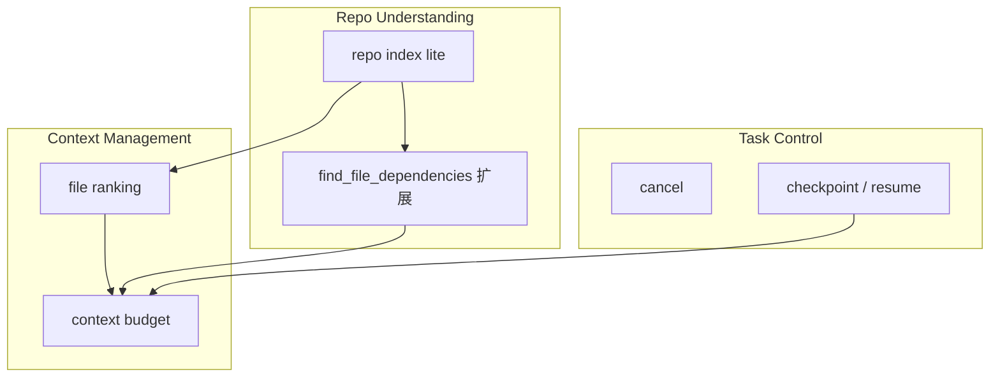
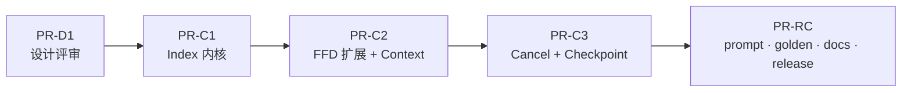

# RepoPilot v0.6.0 Roadmap

> **主题**：Agent Control + Repo Understanding  
> **基准版本**：v0.5.0（tag `v0.5.0`，commit `c626a6b`）  
> **状态**：**RC Ready** · PR-D1 ✅ · PR-C1 ✅ · PR-C2 ✅ · PR-C3 ✅ · PR-RC ✅（待 tag）  
> **更新日期**：2026-07-20  
> **相关**：[PROJECT_STATUS.md](../PROJECT_STATUS.md) · [repo_index.md](../design/repo_index.md) · [task_checkpoint.md](../design/task_checkpoint.md) · [architecture.md](../architecture.md)

---

## 1. 版本目标

v0.6.0 在 v0.5.0 **多文件 batch patch + Engineering Trust** 之上，解决 Agent **找得准、读得全、跑得稳** 三类问题。三者作为一个版本交付，不拆碎发布：

| 支柱 | 问题 | v0.6 答案 |
|------|------|-----------|
| **Task cancel / checkpoint** | HTTP/CLI 长任务不可控、失败只能重来 | 可中断、可持久、可 resume |
| **Repo index lite** | 仅靠 grep + import 扫描理解不足 | Python symbol / reference 索引 |
| **Context budget + file ranking** | 大仓库读文件无预算、无优先级 | 利用 index 做相关文件排序与截断 |

**轻量增强（同版本，非主线）**：`propose_code_changes` 可选结构化字段（`affected_files` / `risk_notes`），**不**演化为 v0.7 的完整 planning 系统。

### 1.1 v0.6.0 主线（P0）

| 优先级 | 目标 | 设计 doc |
|--------|------|----------|
| **P0** | Task cancel | [task_checkpoint.md](../design/task_checkpoint.md) §3 |
| **P0** | Task checkpoint / resume（MVP） | [task_checkpoint.md](../design/task_checkpoint.md) §4–5 |
| **P0** | Repo index lite（symbol / reference） | [repo_index.md](../design/repo_index.md) |
| **P0** | Context budget + file ranking | [repo_index.md](../design/repo_index.md) §6 · [task_checkpoint.md](../design/task_checkpoint.md) §7 |
| **P1** | Structured propose 轻量字段 | 本文 §5 · schemas 扩展 |
| **P1** | audit / task_report / prompt / golden 更新 | 各 PR 验收 |

### 1.2 明确不做（v0.6.0 全周期）

| 项 | 说明 |
|----|------|
| **RAG / embedding 检索接入主线** | 见 [repo_index.md §2](../design/repo_index.md#2-why-no-rag-in-v06) |
| **v0.7 级 planning** | 无 `create_task_plan`、无 plan step 状态机 |
| **新 patch 语义** | 仍 full-file `new_content`；无 hunk/region patch |
| **Web UI** | 继续 CLI + HTTP API |
| **Multi-Agent / LangGraph 重写** | 偏离主线 |
| **跨会话长期 memory** | checkpoint 仅限 **同 task_id** resume |
| **默认新增第 15 个 ReAct 工具** | 优先扩展 `find_file_dependencies` / `read_repo_file` 内核 |

### 1.3 移出 v0.6.0 主线（v0.6.x / v0.7+）

| 项 | 目标版本 |
|----|----------|
| Live LLM smoke harness（nightly） | v0.6.x |
| Demo GIF multi-file 更新 | v0.6.x |
| Hybrid semantic retrieval | **v0.8.0**（接口 v0.6 预留） |
| Structured planning 系统 | **v0.7.0** |
| `impact_analysis` 跨语言 | v0.7.x |
| CI matrix / coverage 门槛 | v0.6.x 候选 |

---

## 2. 为什么 v0.6 不做 RAG

RepoPilot 当前瓶颈 **不是**「知识库问答」，而是：

1. **Repo understanding** — Agent 不知道 symbol 在哪、谁引用了谁  
2. **Context management** — 读哪些文件、读多少、按什么顺序  
3. **Task control** — 长任务中断与恢复  

| 方案 | 可测性 | 贴合改码 Agent | v0.6 优先级 |
|------|--------|----------------|-------------|
| AST symbol index | 高（确定性） | 高 | **P0** |
| grep + import graph | 已有 | 中 | 增强 |
| Embedding RAG | 中（需 eval） | 中（易 hallucinate 路径） | **defer → v0.8** |

Legacy `legacy/agent.py` 的 Chroma 文档 QA **不**迁入 ReAct 主线。v0.8 hybrid retrieval 将以 **结构化 index 为 ground truth** 做对照与 merge rank，见 [repo_index.md §8](../design/repo_index.md#8-v08-hybrid-retrieval-interface-reserved)。

---

## 3. 三支柱关系



- **checkpoint** 持久化 ReAct memory + step → resume 时不重复盲目 read  
- **index** 提供 symbol/ref 查询 → 扩展 `find_file_dependencies`  
- **context budget** 在 `propose_code_changes` 加载上下文时，用 index + 依赖图做 **ranking → 截断**（`read_repo_file` 未接入）

---

## 4. Milestone 与 PR 划分



| PR | 代号 | 交付物 | 依赖 |
|----|------|--------|------|
| **D1** | Design | 本文 + 2 份 design doc | ✅ Approved 2026-07-20 |
| **C1** | Index kernel | `index/` 模块、build/query、pytest | ✅ 已实现（PR 待 merge） |
| **C2** | FFD + Context | 扩展 `find_file_dependencies`；context budget；可选 propose 字段 | ✅ 已实现（PR 待 merge） |
| **C3** | Cancel + Checkpoint | API cancel/resume、SQLite checkpoint、react_agent 钩子 | ✅ 已完成 |
| **RC** | Release | CHANGELOG、`APP_VERSION=0.6.0`、golden + docs | ✅ 就绪（待 tag） |

**原则**：

- 每个 PR 独立可 review、pytest 全绿  
- **ReAct 工具数保持 14**（扩展参数，不新增工具，除非 design exception）  
- index / checkpoint **默认不改变** v0.5 单轮 CLI 行为（opt-in resume 除外）

---

## 5. 轻量 Structured Propose（P1，不阻塞 RC）

| 项 | 内容 |
|----|------|
| **目标** | 方案输出带 **可选** 结构化 hints，便于 context budget 与 audit |
| **范围** | `ChangeProposalList` 增加可选字段；`propose_code_changes` 解析兼容 |
| **不做** | plan step 状态机、独立 plan 工具、v0.7 planning prompt 分支 |

**建议 schema 扩展（可选字段，缺省不影响 v0.5 行为）**：

```python
class ChangeProposalList(BaseModel):
    summary: str
    proposals: list[ChangeItem]
    affected_files: list[str] | None = None   # 新增，可选
    risk_notes: str | None = None             # 新增，可选
```

**验收**：旧 golden / 无新字段的 propose JSON 仍通过；有新字段时 context ranker 可优先加载 `affected_files`。

---

## 6. 工具策略

| 工具 | v0.6 策略 |
|------|-----------|
| `find_file_dependencies` | **扩展** — 增加 `query_mode` / `symbol` 等参数，返回 imports + dependents + **definitions + references**（Python） |
| `analyze_repo_structure` | 只读；可选注入 index 摘要（symbol 计数） |
| `read_repo_file` | 内部可选走 context budget（Agent 无新参数；或增加可选 `priority_hint`） |
| `search_in_repo` | 行为不变；v0.8 在此内核挂 hybrid backend |
| `propose_code_changes` | 轻量 schema 扩展（§5） |

**Exception clause**（与 v0.5 相同）：仅当扩展 `find_file_dependencies` 导致职责不可读（参数组合爆炸、readonly 策略无法统一）时，才评估新工具 `find_symbol_references`，需更新 design doc 并说明原因。**当前评估：扩展优先。**

---

## 7. 涉及模块（预期）

| 模块 | C1 Index | C2 Context | C3 Checkpoint |
|------|----------|------------|---------------|
| `index/`（新） | ● | ● | |
| `tools/repo_analyzer.py` | ● | ● | |
| `context/` 或 `index/ranking.py`（新） | | ● | |
| `tools/repo_reader.py` | | ● | |
| `tools/change_proposal.py` | | ● | |
| `schemas.py` | ● | ● | |
| `storage/task_store.py` | | | ● |
| `storage/checkpoint_store.py`（新） | | | ● |
| `react_agent.py` | | | ● |
| `api/main.py` · `api/agent_runner.py` | | | ● |
| `audit/` · `task_report.py` | ● | ● | ● |
| `llm.py` · `tool_manager.py` | | ● | |
| `config/settings.py` | ● | ● | ● |
| `tests/` · `docs/` | ● | ● | ● |

---

## 8. 验收标准（v0.6.0 release）

### 8.1 功能

- [x] **`POST /tasks/{id}/cancel`** — running 任务在下一步边界前停止；status → `cancelled`；audit `task_cancelled`
- [x] **Checkpoint** — 每 ReAct tool step 后可选持久化；`POST /tasks/{id}/resume` 从最近 checkpoint 继续（HTTP only；无 CLI `--resume`）
- [x] **Index** — `python -m index.build` 对 Python 文件产出 symbol 表；query API 可供 FFD 使用
- [x] **FFD 扩展** — symbol 查询返回 definition + reference；legacy `path`-only 行为不变
- [x] **Context budget** — 超 `CONTEXT_BUDGET_CHARS` 时按 rank 截断；audit `context_budget_applied`（无文件全文）
- [x] **Structured propose** — 可选 `affected_files` 被 ranker 使用；无字段时与 v0.5 一致

### 8.2 工程

- [x] pytest **284** 全绿（`python -m pytest -q`）
- [x] golden eval **14** cases（cancel、resume、readonly 边界 + v0.5 保留）
- [x] ReAct 工具数 **= 14**
- [x] `APP_VERSION=0.6.0` · CHANGELOG `[0.6.0]`
- [x] 设计 doc status → **Implemented**

### 8.3 非回归

- [x] v0.5 batch patch 行为不变（214 原有 cases 保留）
- [x] 无 index 时（`INDEX_ENABLED=0`）全链路退化到 v0.5 行为
- [x] 无 checkpoint 时单轮 CLI/API 行为与 v0.5 一致

---

## 9. 测试策略

| 层级 | 范围 | 命令 / 位置 |
|------|------|-------------|
| **Unit** | index 解析、rank 算法、checkpoint 序列化 | `test_index_*.py` · `test_checkpoint_*.py` |
| **Integration** | FFD 扩展 + context budget + cancel/resume | `test_ffd_*.py` · `test_api_cancel_checkpoint.py` |
| **Golden** | Agent 编排：分析 → FFD(symbol) → propose → diff chain | `test_llm_golden.py` +5~8 |
| **Regression** | v0.5 batch / patch / security | 现有 214 cases |
| **Manual smoke** | 大仓库 index build + cancel 中途 + resume | RC checklist |
| **Live LLM** | **v0.8.0 opt-in smoke** ✅ · `@pytest.mark.live_llm` · 见 [testing_live_llm_eval.md](../testing_live_llm_eval.md) |

**隔离**：index DB / checkpoint DB 与 v0.5 相同模式 — conftest `tmp_path` 隔离，不污染 `database/`、`logs/`。

**Retrieval eval**：v0.6 **不**做 embedding eval；仅预留 **symbol query eval**（query → expected paths）为 v0.8 对照基线，见 [repo_index.md §9](../design/repo_index.md#9-acceptance-criteria--testing-strategy)。

---

## 10. v0.6.0 Release checklist（模板）

| 检查项 | 状态 |
|--------|------|
| Design doc 评审通过 | ✅ Approved 2026-07-20 |
| PR-C1 Index merge | ✅ |
| PR-C2 Context merge | ✅ |
| PR-C3 merge | ✅ |
| pytest = 284 | ✅ |
| golden 14 cases | ✅ |
| 3 支柱 manual smoke | ⏳ 建议 release 前 |
| CHANGELOG / APP_VERSION | ✅ |
| Git tag `v0.6.0` | ⏳ 待确认 |

---

## 11. 后续版本预览（非 v0.6 承诺）

| 版本 | 主题 |
|------|------|
| **v0.6.x** | Live smoke、Demo、polish |
| **v0.7.0** | Structured planning 系统 |
| **v0.8.0** | Hybrid retrieval（semantic + grep + symbol） |

---

## 13. 设计评审决议（2026-07-20）

| # | 议题 | 决议 |
|---|------|------|
| 1 | Index DB 路径 | **`database/repo_index.db`**，与 `tasks.db` 分离；文档明确 build / refresh / invalidate 生命周期；`INDEX_ENABLED=0` → v0.5 行为 |
| 2 | Cancel 语义 | **协作式**；tool 边界检查 cancel flag；**不**在 mutation（尤其 `git apply`）中途硬断；audit 记录请求与生效 step |
| 3 | cancelled vs failed | **`cancelled`** = 用户主动暂停，**可 resume**；**`failed`**（异常）= 新建任务；**`failed`**（仅 `max_steps_reached`）= 可选 resume |
| 4 | FFD 扩展 | **不新增 tool**；C2 前收敛参数；职责限于 dependency / symbol / reference 三模式，过高复杂度走 exception clause |

---

## 14. 下一步

1. ~~设计 doc 评审~~ ✅  
2. **PR-C1 分析 → 确认 → 实现**（index 内核，见本文 §15 或 PR-C1 分析输出）  
3. PR-C2（FFD + context budget）· PR-C3（cancel + checkpoint）· PR-RC

---

## 15. PR-C1 范围摘要（index 内核）

| 项 | 内容 |
|----|------|
| **交付** | `index/` 模块、`database/repo_index.db` schema、build CLI、query API、单元测试 |
| **不做** | FFD 工具扩展、context budget、cancel/checkpoint、prompt/golden |
| **降级** | `INDEX_ENABLED=0` 时模块不加载、无 DB 写入 |
| **详情** | [repo_index.md](../design/repo_index.md) · PR-C1 Step 1 分析（chat） |
