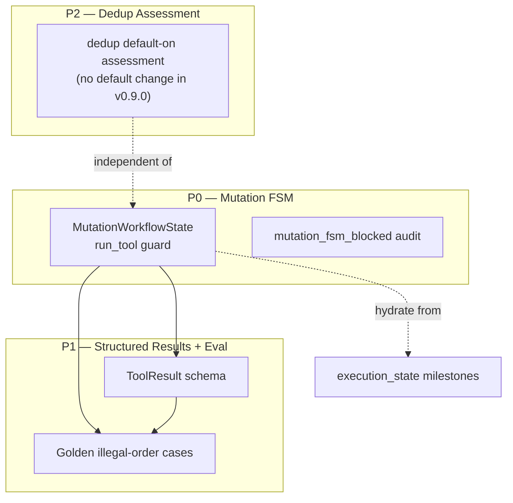
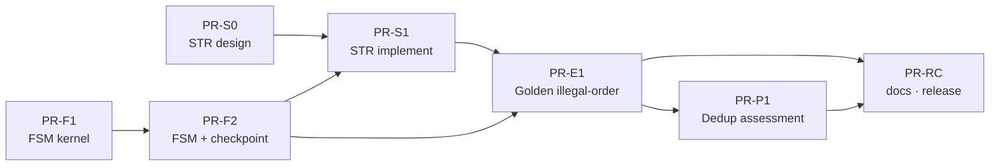

# RepoPilot v0.9.0 Roadmap

> **主题**：Runtime Mutation Control  
> **基准版本**：v0.8.2（tag `v0.8.2`，commit `1abe90e`）  
> **状态**：**Approved (planning)** · roadmap 已确认 · PR 设计进行中  
> **更新日期**：2026-07-20  
> **相关**：[PROJECT_STATUS.md](../PROJECT_STATUS.md) · [mutation_fsm.md](../design/mutation_fsm.md) · [task_checkpoint.md](../design/task_checkpoint.md) · [rag_integration.md](../design/rag_integration.md) · [architecture.md](../architecture.md) · [RELEASE_CHECKLIST.md](RELEASE_CHECKLIST.md)

---

## 1. 版本目标

v0.9.0 在 v0.8.2 **Agent Engineering Proof**（Golden 18 + Live 4 + dedup opt-in + FSM design-only）之上，解决 **改码工作流仍靠 prompt + 点状 gate** 的核心架构缺口：

| 支柱 | 问题 | v0.9 答案 |
|------|------|-----------|
| **Mutation FSM (P0)** | LLM 可乱序调用 mutation tools；SECURITY.md 已承认无 runtime ordering enforcement | `run_tool` 层状态机 guard；非法转移 **Reject** + audit |
| **Structured tool results (P1)** | Gate 拒绝返回纯文本；无 reason code；eval 难以断言 | 统一 `{ok, code, message, details}` 契约；FSM / mode / confirm 复用 |
| **FSM golden eval (P1)** | Golden 18 覆盖合法编排；无 illegal-order regression | +illegal-order cases；mock LLM 断言 FSM block |
| **Dedup 默认策略 (P2)** | `EXECUTION_STATE_DEDUP_ENABLED=0`；resume 重复 mutation 风险 | **v0.9.0 仅评估**，不改 default；书面 rollout decision |

**原则**：

- **不新增 ReAct 工具** — 工具数保持 **14**
- **不变更 HTTP API 签名** — FSM / structured result 在 Agent 内核与 audit 层
- **Opt-in rollout** — `MUTATION_FSM_ENABLED=0` 首发默认；与 v0.8 dedup/RAG 策略一致
- **FSM 与 dedup 职责分离** — FSM 管 **first-run ordering**；dedup 管 **resume idempotency**（见 [mutation_fsm.md §2](../design/mutation_fsm.md#2-core-distinction-execution_state-vs-fsm)）

### 1.1 v0.9.0 主线优先级

| 优先级 | 目标 | 设计 doc |
|--------|------|----------|
| **P0** | Mutation FSM runtime enforcement | [mutation_fsm.md](../design/mutation_fsm.md) · [mutation_fsm_pr_f1.md](../design/mutation_fsm_pr_f1.md) |
| **P1** | Structured tool results design + implementation | 本文 PR-S0 / PR-S1 · 新建 `design/structured_tool_results.md` |
| **P1** | FSM illegal-order golden eval | 本文 PR-E1 |
| **P2** | Dedup 默认开启 **评估**（v0.9.0 **不改 default**） | 本文 PR-P1 |

### 1.2 明确不做（v0.9.0 全周期）

| 项 | 说明 |
|----|------|
| **Web UI** | 继续 CLI + HTTP API；不在主线 |
| **Multi-Agent / LangGraph 重写** | 单 Agent ReAct 内核不变 |
| **History task / audit RAG** | 跨任务记忆检索；复杂度高，defer v0.10+ |
| **Production RAG / embedding** | defer **v0.9.1 / v0.10**；不进入 v0.9.0 主线 |
| **分布式部署 / 多 worker** | 单进程线程模型、SSE 内存队列不变 |
| **新 ReAct 工具（第 15 个）** | FSM / structured result 在 `run_tool` 层 |
| **OAuth / RBAC / 多租户** | 仍仅可选 `API_KEY` |
| **Incremental index/RAG rebuild** | defer v0.10+ |
| **`read_repo_file` context budget** | v0.6 遗留；不阻塞 v0.9 RC |
| **CLI cancel/resume 命令** | HTTP 路径已验证；CLI parity defer |
| **JS/TS AST chunking** | defer v0.10+ |
| **FSM degrade（warn-only）模式作默认** | v0.9 target 为 **Reject**；degrade 仅作可选 flag 讨论，非 RC 阻塞 |

### 1.3 移出 v0.9.0 主线（v0.9.x / v0.10+）

| 项 | 目标版本 |
|----|----------|
| `MUTATION_FSM_ENABLED=1` 默认开启 | v0.9.x bake 后独立 minor |
| `EXECUTION_STATE_DEDUP_ENABLED=1` 默认开启 | PR-P1 评估结论后 |
| `RAG_ENABLED=1` 默认开启 | production embedding bake 后 |
| Incremental embedding / file-watch rebuild | v0.10+ |
| History task RAG | v0.10+ |
| Live eval benchmark 扩展（>4 smoke cases） | v0.9.x 候选 |

---

## 2. 为什么 v0.9 先做 FSM 而非 RAG 默认开启

v0.8.2 审计结论：**最大架构缺口** 是 mutation workflow 无 runtime enforcement，而非 RAG 语义质量。

| 方案 | 安全/流程影响 | 可测性 | v0.9 优先级 |
|------|--------------|--------|-------------|
| Mutation FSM | **高** — 阻断乱序 apply/backup | 高（unit + golden illegal-order） | **P0** |
| Structured tool results | **中** — 统一 reject 契约、改善 Agent 自恢复 | 高 | **P1** |
| Dedup 默认 on | **中** — 仅 resume 场景 | 中（已有 34 dedup tests） | **P2 评估（v0.9.0 不改 default）** |
| Production embedding | **低**（增强层） | 中 | **defer v0.9.1 / v0.10** |

**v0.9.0 主线不含 RAG production 化** — defer v0.9.1 / v0.10；当前最大缺口是 mutation workflow enforcement。

---

## 3. 三支柱关系



**`run_tool` 评估顺序（v0.9 target，与 design doc 一致）**：

```
1. agent_mode block（existing）
2. mutation FSM guard（new，MUTATION_FSM_ENABLED=1）
3. execution_state dedup skip（existing，opt-in）
4. tool confirm（existing）
5. tool function（existing）
6. execution_state milestone update（existing，opt-in）
```

---

## 4. Milestone 与 PR 划分



| PR | 代号 | 交付物 | 优先级 | 依赖 |
|----|------|--------|--------|------|
| **F1** | FSM kernel | enum + validator + `run_tool` hook + flag | **P0** | mutation_fsm.md approved |
| **F2** | FSM integration | checkpoint hydrate + transition audit + docs | **P0** | PR-F1 |
| **S0** | STR design | `design/structured_tool_results.md` | **P1** | 可与 PR-F1 并行 |
| **S1** | STR implement | FSM/mode/confirm reject 统一 payload | **P1** | PR-F2 · PR-S0 |
| **E1** | Golden FSM eval | illegal-order golden cases | **P1** | PR-F2 · PR-S1 |
| **P1** | Dedup assessment | 评估报告 + default rollout decision（**v0.9.0 不改 default**） | **P2** | PR-E1 |
| **RC** | Release | CHANGELOG · APP_VERSION · design doc status | — | PR-E1 · PR-P1 |

**原则**：

- 每个 PR 独立可 review、默认 pytest 全绿  
- **`MUTATION_FSM_ENABLED=0` 默认** — flag off 时行为与 v0.8.2 完全一致  
- ReAct 工具数 **= 14**；HTTP API 签名不变  

---

## 5. PR 详细说明

### PR-F1 — Mutation FSM kernel（P0）

| 项 | 内容 |
|----|------|
| **目标** | 实现 runtime mutation workflow 状态机；非法 tool 调用在 `run_tool` 层 **Reject** |
| **修改范围（预期）** | 新建 `context/mutation_fsm.py`（或 `security/mutation_fsm.py`）；`tools/tool_manager.py` guard hook；`config/settings.py` 增加 `MUTATION_FSM_ENABLED`（默认 `0`）；unit tests |
| **不做** | Structured tool result schema（PR-S1）；checkpoint 持久化 FSM state（PR-F2）；golden cases（PR-E1）；修改 `llm.py` prompt 主流程；新增 ReAct 工具；`write_repo_file` backup 硬拒绝（与 v0.8 warn 行为对齐留 PR-F2 讨论） |
| **依赖** | [mutation_fsm.md](../design/mutation_fsm.md) §3–§4 transition table |

**验收标准**

- [ ] `MutationWorkflowState` enum 覆盖：`ANALYZING` · `PROPOSED` · `DIFF_PREVIEWED` · `BACKED_UP` · `PATCHED` · `DONE`
- [ ] `MUTATION_FSM_ENABLED=0`（默认）→ v0.8.2 行为 **零差异**（现有 369 pytest 全绿）
- [ ] `MUTATION_FSM_ENABLED=1` + full mode：`apply_patch` 在 `BACKED_UP` 之前调用 → **Reject**（不执行 tool function）
- [ ] diff-first 路径：`git_create_backup` 在 `DIFF_PREVIEWED` 之前 → **Reject**（严格，不降级）
- [ ] `apply_patch`：`mutation_path==DIFF_FIRST` 且 `state==BACKED_UP` → pass
- [ ] write-fallback 路径：`PROPOSED` → backup → `write_repo_file` 单独合法（见 [mutation_fsm_pr_f1.md](../design/mutation_fsm_pr_f1.md)）
- [ ] readonly mode：FSM 子集；mutation states 不可达（与现有 `run_tool` block 一致）
- [ ] ReAct 工具数 **= 14**；无 HTTP API 变更
- [ ] Unit tests：各 illegal transition ≥1 case；legal primary path happy path ≥1 case

---

### PR-F2 — FSM checkpoint / resume 集成（P0）

| 项 | 内容 |
|----|------|
| **目标** | Resume 后 FSM 状态与 `execution_state` 里程碑一致；非法转移仍被 block；audit 可观测 |
| **修改范围（预期）** | `context/mutation_fsm.py` hydrate/export；`react_agent.py` checkpoint 序列化；`api/agent_runner.py` resume 路径；`audit/audit_log.py` 或 `write_audit_event` — `mutation_fsm_blocked` · 可选 `mutation_fsm_transition`；`docs/design/mutation_fsm.md` 补充 implement notes |
| **不做** | 修改 dedup skip 逻辑顺序（FSM 仍在 dedup 之前）；structured JSON reject body（PR-S1）；fallback `write_repo_file` 路径完整 guard 细则可 Phase 2（design doc §3.3）；Live smoke 扩展 |
| **依赖** | PR-F1 |

**验收标准**

- [ ] Resume 后 FSM 可从 `execution_state` 推导（`patch_applied` → `PATCHED` 等，见 design doc §6.2）
- [ ] `MUTATION_FSM_ENABLED=1` + resume：已 `PATCHED` 的任务再次 `apply_patch` 同路径 → FSM **Reject**（dedup off 时也 block，因 FSM 在 dedup 前）
- [ ] Audit 事件 `mutation_fsm_blocked` 含：`tool` · `current_state` · `required_state` · `reason`
- [ ] Checkpoint round-trip：save → restore → FSM state 与 milestone 一致
- [ ] `EXECUTION_STATE_DEDUP_ENABLED` on/off 均不破坏 FSM guard 顺序
- [ ] 现有 cancel/checkpoint/resume tests 非回归

---

### PR-S0 — Structured tool results 设计（P1）

| 项 | 内容 |
|----|------|
| **目标** | 为 gate reject（FSM · agent_mode · confirm timeout · validation）定义统一结构化返回契约 |
| **修改范围（预期）** | 新建 `docs/design/structured_tool_results.md`；与 `mutation_fsm.md` §5 audit shape 对齐 |
| **不做** | 运行时代码变更；修改所有 tool 成功路径返回格式；OpenAPI schema 变更 |
| **依赖** | 无（可与 PR-F1 并行） |

**建议 schema（design draft）**：

```python
# design-only — 实现见 PR-S1
class ToolRejectResult(TypedDict):
    ok: Literal[False]
    code: str          # e.g. "mutation_fsm_blocked", "tool_not_allowed", "confirm_rejected"
    message: str       # human-readable，注入 ReAct memory
    details: dict      # e.g. current_state, required_state, tool
```

**验收标准**

- [ ] Design doc 覆盖：FSM block · readonly block · confirm reject · Pydantic validation error
- [ ] 明确 **success 路径** 仍为现有字符串（v0.9 不强制全 tool 结构化）
- [ ] 明确 audit 与 memory 注入规则（reject message 长度 / 脱敏）
- [ ] 文档 status：**Design · v0.9 target**

---

### PR-S1 — Structured tool results 实现（P1）

| 项 | 内容 |
|----|------|
| **目标** | FSM / mode / confirm reject 返回统一 structured payload；ReAct memory 可解析 `code` |
| **修改范围（预期）** | `tools/tool_manager.py`；可选 `schemas.py` helper；FSM guard 返回；`test_tool_result_*.py`；更新 `design/structured_tool_results.md` status |
| **不做** | 全部 14 工具 success 返回改 JSON；HTTP API response body 变更；SSE event schema  breaking change |
| **依赖** | PR-F2 · PR-S0 |

**验收标准**

- [ ] `MUTATION_FSM_ENABLED=1` illegal transition → memory 中可见 `code=mutation_fsm_blocked`（或等价 marker）
- [ ] readonly block · confirm reject 复用同一 helper（至少 FSM + mode 两路径）
- [ ] Flag off 时 reject 格式与 v0.8.2 **兼容**（现有 golden 不破坏）
- [ ] Unit tests：serialize/deserialize · memory 注入 · audit 字段一致

---

### PR-E1 — FSM illegal-order golden eval（P1）

| 项 | 内容 |
|----|------|
| **目标** | Mock LLM 编排回归：非法 mutation 顺序被 FSM block；合法路径仍通过 |
| **修改范围（预期）** | `test_llm_golden.py` + cases；可选 `tests/golden_cases/fsm_*.json`；`docs/testing_golden_eval.md` |
| **不做** | Live LLM real API 调用；修改现有 18 golden cases 的合法路径期望（除非 FSM flag 全局 on） |
| **依赖** | PR-F2 · PR-S1 |

**建议 golden cases（最少）**：

| Case ID | 场景 | 期望 |
|---------|------|------|
| `fsm_apply_before_backup` | stub LLM 直接 `apply_patch` | FSM block · 无 patch_apply audit success |
| `fsm_backup_before_propose` | stub LLM 跳过 propose | FSM block |
| `fsm_backup_before_diff_preview` | diff-first 路径跳过 preview | FSM block（full mode） |
| `fsm_legal_diff_chain` | propose → diff → backup → apply | 全链 success（flag on） |

**验收标准**

- [ ] Golden cases **+4**（或更多）· 合计 **≥22** cases
- [ ] Cases 在 `MUTATION_FSM_ENABLED=1` 下运行；默认 CI（flag off）仍 **369+ passed**
- [ ] 合法 diff-first chain golden 在 flag on 下通过
- [ ] `docs/testing_golden_eval.md` 更新 case  inventory

---

### PR-P1 — Dedup 默认开启评估（P2）

| 项 | 内容 |
|----|------|
| **目标** | 基于 FSM + golden + live smoke bake，产出 **`EXECUTION_STATE_DEDUP_ENABLED` 默认策略** 书面结论 |
| **修改范围（预期）** | `docs/V0.9_ROADMAP.md` 或 `docs/design/dedup_default_assessment.md`；**可选** 若结论为「默认 on」则单独 PR 改 `settings.py` default |
| **不做** | 在未完成 PR-E1 前改 default；将 dedup 与 FSM 合并为同一 flag；dedup 逻辑重构 |
| **依赖** | PR-E1（建议）；v0.8.2 live smoke 4 cases 手动复跑 |

**评估维度**

| 维度 | 问题 |
|------|------|
| 与 FSM 关系 | dedup 跳过 vs FSM reject 是否互补无冲突 |
| Re-backup 逃逸 | 关键词启发式是否足够 |
| Marker 脆弱性 | 中文 success marker 是否需结构化 milestone |
| 默认 on 风险 | flag on 后现有 golden / live 是否全绿 |

**验收标准**

- [ ] 书面结论：**v0.9.0 保持 `EXECUTION_STATE_DEDUP_ENABLED=0`**（已确认）+ 后续 rollout 条件
- [ ] 若未来改为 default on：须 **独立 minor** + CHANGELOG + golden 全绿
- [ ] 评估维度覆盖：marker 耦合 · re-backup 启发式 · 与 FSM 互补关系

> **Production RAG** 移出 v0.9.0 — 见 §10 后续预览（v0.9.1 / v0.10）。

---

### PR-RC — v0.9.0 Release（RC）

| 项 | 内容 |
|----|------|
| **目标** | 版本 bump · 文档 status · CHANGELOG · tag 就绪 |
| **修改范围（预期）** | `config/settings.py` `APP_VERSION=0.9.0`；`CHANGELOG.md`；`README.md` · `PROJECT_STATUS.md` · `architecture.md` · `workflow.md` · `SECURITY.md`；design doc status → **Implemented** |
| **不做** | .scope creep（Web UI · Multi-Agent · History RAG）；未评估完的 default flag 变更 |
| **依赖** | PR-E1 · PR-P1 |

**验收标准**

- [ ] `python -m pytest -q` 全绿（baseline ≥369 + v0.9 新增）
- [ ] Golden **≥22** cases；Live smoke **4** cases（opt-in）非回归
- [ ] ReAct 工具数 **= 14**
- [ ] `MUTATION_FSM_ENABLED=0` · `RAG_ENABLED=0` · `EXECUTION_STATE_DEDUP_ENABLED=0` 默认（除非 PR-P1 明确改 dedup）
- [ ] [mutation_fsm.md](../design/mutation_fsm.md) status → **Implemented**
- [ ] [structured_tool_results.md](../design/structured_tool_results.md) status → **Implemented**

---

## 6. 涉及模块（预期）

| 模块 | F1 FSM | F2 CP | S0/S1 STR | E1 Golden | P1 Dedup |
|------|--------|-------|-----------|-----------|----------|
| `context/mutation_fsm.py`（新） | ● | ● | | | |
| `tools/tool_manager.py` | ● | ● | ● | | |
| `context/execution_state.py` | | ● | | | ● |
| `react_agent.py` | ● | ● | | | |
| `api/agent_runner.py` | | ● | | | |
| `config/settings.py` | ● | | | | |
| `schemas.py` | | | ● | | |
| `audit/audit_log.py` | | ● | ● | | |
| `test_mutation_fsm.py`（新） | ● | | | | |
| `test_llm_golden.py` | | | | ● | |
| `test_execution_state_*.py` | | | | | ● |
| `docs/design/*.md` | ● | ● | ● | | ● |

---

## 7. v0.9.0 Release checklist（planning）

| 检查项 | 命令 / 标准 | 状态 |
|--------|-------------|------|
| FSM kernel + integration | PR-F1 · PR-F2 | ⏳ |
| Structured tool results | PR-S0 · PR-S1 | ⏳ |
| Golden illegal-order | PR-E1 · **≥22** cases | ⏳ |
| Dedup default assessment（不改 default） | PR-P1 书面结论 | ⏳ |
| PR-F1 design review | [mutation_fsm_pr_f1.md](../design/mutation_fsm_pr_f1.md) | ⏳ |
| 默认 pytest | `python -m pytest -q` 全绿 | ⏳ |
| Live smoke（manual） | `LIVE_LLM_EVAL_ENABLED=1 pytest -m live_llm` → **4 passed** | ⏳ |
| ReAct tools = 14 | `test_diff_security.py` | ⏳ |
| 无 HTTP API breaking | OpenAPI / `test_api_*` 非回归 | ⏳ |
| `APP_VERSION = 0.9.0` | `config/settings.py` | ⏳ |
| Git tag `v0.9.0` | GitHub Release | ⏳ |

---

## 8. 测试策略

| 层级 | 范围 | 位置 |
|------|------|------|
| **Unit** | FSM transition table · hydrate · structured reject | `test_mutation_fsm*.py`（新） |
| **Integration** | run_tool guard order · checkpoint round-trip | `test_react_cancel_checkpoint.py` 扩展 |
| **Golden** | 合法链 + **illegal-order** mock LLM | `test_llm_golden.py` |
| **Regression** | v0.8.2 369 cases · flag off 零差异 | 全 suite |
| **Live smoke** | 4 opt-in cases；可选 +1 FSM disorder（v0.9.x） | `tests/live_llm/` |

---

## 9. 风险与 mitigations

| 风险 | Mitigation |
|------|------------|
| FSM 过严导致 Agent 死循环 | Golden legal chain · live smoke 手动 bake；opt-in flag 默认 off |
| Structured reject 破坏现有 golden | PR-S1 保持 flag off 兼容；新 cases 显式 `MUTATION_FSM_ENABLED=1` |
| FSM 与 dedup 职责混淆 | 文档 + run_tool 顺序单测；design doc §2 引用 |
| write_repo_file fallback 路径 guard 不完整 | PR-F2 文档化；完整 backup 硬拒绝 defer v0.9.x |

---

## 10. 后续预览

| 版本 | 主题 |
|------|------|
| **v0.9.0** | Runtime Mutation Control（FSM + STR + golden + dedup 评估） |
| **v0.9.x** | FSM default on bake · dedup default rollout decision · live FSM disorder smoke |
| **v0.9.1 / v0.10** | Production embedding · incremental RAG · history task RAG |
| **不在主线** | Web UI · Multi-Agent · 分布式部署 |

---

## 11. 文档历史

| 日期 | 状态 | 备注 |
|------|------|------|
| 2026-07-20 | **Draft** | v0.8.2 审计后首版 roadmap |
| 2026-07-20 | **Approved** | F1/F2 拆分 · strict diff-first · dedup 评估不改 default · RAG defer v0.9.1+ |
