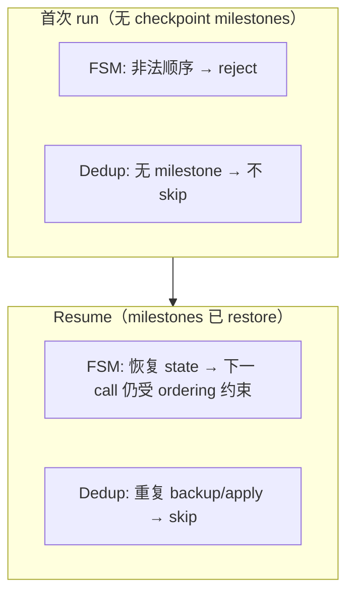

# PR-P1 — Execution State Dedup Default Assessment（评估文档）

> **Status**: **Assessment · Approved** · v0.9 PR-P1 (2026-07-21)  
> **Conclusion**: **`EXECUTION_STATE_DEDUP_ENABLED` remains `0` for v0.9.0**  
> **Baseline**: PR-E1 @ `1d48e04` · pytest **424 passed**  
> **Parent design**: [mutation_fsm.md](mutation_fsm.md) §2 · [mutation_fsm_pr_f2.md](mutation_fsm_pr_f2.md) · [task_checkpoint.md](task_checkpoint.md) · [V0.9_ROADMAP.md](../archive/V0.9_ROADMAP.md)  
> **Out of scope (PR-RC)**: `settings.py` default 变更 · `execution_state.py` 逻辑修改 · release CHANGELOG

---

## English Summary

**PR-P1** assesses whether `EXECUTION_STATE_DEDUP_ENABLED` should become the default in v0.9.0. **Conclusion: keep default `0` for v0.9.0.** Dedup (resume idempotency) and FSM (first-run ordering) are **complementary, not substitutes**. Default-on risks include Chinese success-marker coupling, checkpoint/backup consistency requirements, and behavior changes on resume without FSM co-enabled. Future default-on requires additional live bake and optional FSM default alignment — deferred to v0.9.x+.

---

## 1. PR-P1 目标与 scope guard

### 1.1 目标

| # | 交付 |
|---|------|
| G1 | 记录 **当前 dedup 实现状态**（milestones · checkpoint · skip · re-backup） |
| G2 | 明确 **FSM vs dedup 职责边界**（互补、不替代） |
| G3 | **Default on 风险分析**（marker · checkpoint · false skip · re-run） |
| G4 | **v0.9.0 书面结论**：保持 `EXECUTION_STATE_DEDUP_ENABLED=0` |
| G5 | **Future rollout 条件**（非 v0.9.0 执行项） |

### 1.2 PR-P1 不做（scope guard）

| 项 | 归属 |
|----|------|
| 修改 `config/settings.py` default | **defer** v0.9.x+ 独立 PR |
| 修改 `context/execution_state.py` | 禁止 |
| 新增 dedup / FSM 逻辑 | 禁止 |
| 新增测试 | 禁止 |
| CHANGELOG / `APP_VERSION` / tag | **PR-RC** |
| Live smoke 扩展 | defer v0.9.x |

---

## 2. 当前 dedup 实现状态（v0.9 @ `1d48e04`）

### 2.1 模块与 flag

| 项 | 状态 |
|----|------|
| 模块 | `context/execution_state.py`（v0.8 M1，v0.9 无逻辑变更） |
| Flag | `EXECUTION_STATE_DEDUP_ENABLED` — env default **`"0"`** |
| Hook | `tools/tool_manager.py` → `_execution_state_dedup_skip`（FSM **之后**、confirm **之前**） |
| ReAct 更新 | `react_agent._update_execution_state_safe` → `update_from_tool_result` |
| Checkpoint | `execution_state_json` in `task_checkpoints`（dedup on 时非空 export） |

### 2.2 数据模型（`ExecutionState`）

| 字段 | 用途 |
|------|------|
| `proposal_digest` | 16-char hex；新 proposal 变更时 `_clear_mutation_milestones` |
| `backup_branch` / `backup_commit` | 成功 `git_create_backup` 后记录 |
| `diff_previewed_paths` | `generate_unified_diff` 成功路径累积 |
| `patch_applied` / `patch_applied_paths` | `apply_patch` / `write_repo_file` 成功记录 |

Export / restore：`export_execution_state()` / `restore_execution_state()` — flag off 时 export 返回 `{}`。

### 2.3 Milestone detection（success marker 依赖）

Milestones 由 **工具返回字符串 substring** 判定，非 structured milestone：

| Tool | Marker / 条件 |
|------|----------------|
| `propose_code_changes` | `"修改方案"` in result |
| `generate_unified_diff` | `"diff"` / `"Diff"` in result + 有效 paths |
| `git_create_backup` | `"Git 备份完成"` |
| `apply_patch` | `"Patch 应用完成"` |
| `write_repo_file` | `"文件写入完成"` |

**Implication**：工具返回格式变更（含 PR-S1 structured reject）不影响 milestone update — reject 无 marker，不 advance state（与 FSM 一致）。

### 2.4 Dedup skip 规则（`should_skip_tool`）

| Tool | Skip 条件 |
|------|-----------|
| `git_create_backup` | 已有 backup milestone · patch 未 applied · `_backup_matches_persisted()`（内存 state 与 `project_context` 持久化 backup 一致） |
| `apply_patch` / `write_repo_file` | `patch_applied` · 请求 paths **完全等于** 已记录 paths |

Skip 返回 **string**（`跳过重复 ...`），**非 reject**；audit event `execution_state_dedup`；`tool_call.status=success`。

**不 skip**：paths 不同 · patch 未记录 · backup 与 persisted 不一致 · flag off。

### 2.5 Checkpoint resume 集成

```
resume → restore_execution_state(initial_execution_state)
       → build_resume_hint() 注入 memory（中文里程碑摘要 + 勿重复提示）
       → user follow-up: user_requests_rebackup() → clear_backup_milestones()
```

| 路径 | dedup off | dedup on |
|------|-----------|----------|
| `execution_state_json` | `NULL` / `{}` | milestones snapshot |
| Resume hint | 空 | 非空（若 milestones 存在） |
| Duplicate backup/apply on resume | **允许**（LLM 可能重复执行） | **skip**（若条件满足） |

Golden 覆盖：`resume_dedup_skips_duplicate_apply` · `resume_dedup_flag_off_does_not_skip_apply`（2 cases，Mode B）。

### 2.6 Re-backup heuristic

| 机制 | 实现 |
|------|------|
| 关键词 | `RE_BACKUP_KEYWORDS`: `重新备份` · `re-backup` · `rebackup` · `再次备份` |
| 触发 | `react_agent` resume / new task：`user_requests_rebackup(question)` |
| 效果 | `clear_backup_milestones()` — 清 `backup_branch` / `backup_commit`；**不**清 proposal / patch |
| 测试 | `test_user_requests_rebackup_keywords` · `test_rebackup_follow_up_clears_backup_dedup` · golden resume 路径 |

**Limitation**：纯英文自然语言 re-backup（无关键词）不会清除 milestone；依赖用户显式中文或 listed keywords。

### 2.7 测试覆盖（现有，PR-P1 不新增）

| 文件 | Cases | 范围 |
|------|-------|------|
| `test_execution_state_dedup.py` | 15 | unit：export/restore · update · skip · hint · rebackup |
| `test_execution_state_dedup_tool.py` | 9 | integration：`run_tool` skip · resume |
| `test_llm_golden.py` | 2 | golden resume dedup on/off |
| **合计** | **26** | 另含 v0.8.2 release 口径 ~34（含交叉引用） |

全 suite default flag off：**424 passed** — dedup tests 在 case 内 opt-in `EXECUTION_STATE_DEDUP_ENABLED=1`。

---

## 3. FSM vs Dedup 职责边界

### 3.1 核心区分（互补，不替代）

| 维度 | **FSM** (`mutation_fsm`) | **Dedup** (`execution_state`) |
|------|--------------------------|-------------------------------|
| **目的** | **Workflow ordering enforcement** | **Resume / idempotency protection** |
| **问题** | “这一步现在允许调用吗？” | “这一步已经成功过了吗？” |
| **典型场景** | 首次 run：apply before backup | Resume：重复 git_create_backup |
| **Violation 行为** | **Reject**（`mutation_fsm_blocked`） | **Skip**（`跳过重复`，非 error） |
| **Flag** | `MUTATION_FSM_ENABLED=0` | `EXECUTION_STATE_DEDUP_ENABLED=0` |
| **Checkpoint 字段** | `mutation_fsm_json`（F2） | `execution_state_json`（v0.8） |
| **First-run 乱序** | FSM on → block | dedup on → **不 block**（milestone 空） |
| **Resume 重复** | FSM on → 仍检查 ordering | dedup on → skip duplicate |



### 3.2 `run_tool` 评估顺序（v0.9 已实现）

```
1. agent_mode block
2. Pydantic validation
3. mutation FSM check          ← ordering（opt-in）
4. execution_state dedup skip  ← idempotency（opt-in）
5. tool confirm
6. tool function
7. FSM advance + execution_state update（ReAct 层）
```

**关键**：FSM reject **先于** dedup — 非法 transition 不会触发 dedup skip audit。

### 3.3 组合矩阵（v0.9.0 默认：双 off）

| FSM | Dedup | 首次 run 乱序 | Resume 重复 mutation |
|-----|-------|---------------|----------------------|
| 0 | 0 | 允许（v0.8 行为） | 允许重复 |
| 1 | 0 | FSM reject | 允许重复 |
| 0 | 1 | 允许乱序 | skip duplicate |
| 1 | 1 | FSM reject | FSM guard + dedup skip |

**v0.9 推荐生产组合（短期）**：显式 opt-in；不建议只开 dedup 而不评估 FSM（resume 仍可能乱序 replay 非 duplicate 步骤）。

### 3.4 与 PR-F2 FSM hydrate 关系

- FSM 可独立 persist `mutation_fsm_json`（dedup off 仍可用）
- `derive_mutation_fsm_from_execution_state` 为 **fallback only**（pre-F2 checkpoint）
- Dedup milestones **不**替代 FSM snapshot；各模块 parallel restore

---

## 4. Default on 风险分析

### 4.1 Success marker 字符串依赖

| 风险 | 严重度 | 说明 |
|------|--------|------|
| Marker 变更导致 milestone 漏记 | **中** | 工具改返回格式 → dedup 不更新 → skip 不触发或误触发 |
| i18n / 多语言 | 低 | 当前固定中文 marker |
| Structured success（future） | 中 | v0.9 success 仍为 string；future structured success 需同步 milestone 解析 |

**Mitigation（已有）**：26 dedup tests；golden resume cases。**Gap**：无 live LLM 覆盖 marker 漂移。

### 4.2 历史 checkpoint 兼容性

| 场景 | default on 影响 |
|------|-----------------|
| Pre-v0.8 checkpoint 无 `execution_state_json` | restore 空 → 无 skip（安全） |
| Checkpoint 有 milestones 但 `project_context` backup 丢失 | `_backup_matches_persisted()` false → **不 skip backup**（安全，可能重复 backup） |
| Stale milestone vs 实际 repo 状态 | dedup **信任 checkpoint**，不 re-verify git 状态 |

**Risk**：resume 后 milestone 记录 patch 已 applied，但用户手动 revert 了文件 → dedup 仍 skip re-apply。**Acceptable for idempotency**；用户需新 proposal 触发 reset。

### 4.3 False positive skip 风险

| 场景 | 是否 skip | 评估 |
|------|-----------|------|
| 同 paths 重复 apply（resume） | ✅ skip | **预期** |
| 同 paths 但 content 不同 | ✅ skip（仅比 paths） | **中风险** — digest 不比较 new_content |
| 用户意图 re-apply 同文件 | skip + hint 提示新 proposal | 依赖 LLM 理解 hint |
| backup 成功但用户换 base commit | 若 persisted 仍 match → skip | 低概率 |

**Most significant gap**：path-only dedup 不比较 `new_content` hash — 与 v0.8 设计一致，default on **放大**该语义暴露面。

### 4.4 Re-run 行为变化（default off → on）

| 行为 | off（today default） | on |
|------|---------------------|-----|
| Resume 重复 backup | 执行（可能 noop 或新 branch） | skip string |
| Resume 重复 apply 同 paths | 执行 | skip string |
| Memory 注入 | 无 resume hint | `[checkpoint]` hint 块 |
| LLM 感知 | 可能重复 mutation | 收到 skip + hint |

**User-visible change**：default on 改变 **resume 路径** Agent 行为，不影响 fresh task（无 milestones）。

### 4.5 与 FSM default on 的耦合

| 项 | 分析 |
|----|------|
| 只开 dedup default | Resume 防重复，但 **首次 run 仍无 ordering** |
| 只开 FSM default | 首次 run 有序，resume 重复仍可能发生 |
| 双 default on | 理想互补，但 **双倍 behavior change** — 需更长 bake |

**PR-P1 结论**：dedup default on **不应先于** FSM live bake 独立推进；两者 rollout 应协调规划。

### 4.6 测试与 CI 覆盖缺口

| 已有 | 缺口 |
|------|------|
| 26 dedup unit/integration + 2 golden | Live LLM resume dedup（4 smoke cases 未含 dedup on） |
| Flag off CI 424 passed | 无 CI job 默认 dedup on |
| FSM golden 24（FSM opt-in） | 无 **FSM+dedup 双 on** golden combo |

---

## 5. 建议结论

### 5.1 v0.9.0 决策（PR-P1 正式建议）

> **`EXECUTION_STATE_DEDUP_ENABLED` remains `0` for v0.9.0 release.**

| 理由 | 摘要 |
|------|------|
| Opt-in 一致性 | 与 `MUTATION_FSM_ENABLED=0` · `STRUCTURED_TOOL_REJECT_ENABLED=0` · `RAG_ENABLED=0` 同级 rollout |
| Resume-only 语义 | default on 仅影响 resume/checkpoint 路径，用户未 opt-in 时不应改变行为 |
| Marker / path-only 风险 | 无 live bake 证明 default on 在生产对话中稳定 |
| FSM 互补未完成 rollout | FSM 已实现但 default off；单独 dedup on 不完整 |
| Roadmap 承诺 | [V0.9_ROADMAP.md](../archive/V0.9_ROADMAP.md) §PR-P1：**v0.9.0 仅评估，不改 default** |

### 5.2 Future default-on 前置条件（v0.9.x+，非 v0.9.0）

| # | 条件 |
|---|------|
| F1 | Live smoke / manual bake：**dedup on** resume 场景 ≥ N 次无 false skip 报告 |
| F2 | 可选：**FSM default on** 评估完成或 documented combo rollout |
| F3 | Golden：**FSM + dedup 双 on** resume case ≥ 1 |
| F4 | 若改 default：独立 **minor** PR + CHANGELOG + 全 suite dedup-on CI job |
| F5 | 评估 structured milestone 是否替代 marker substring（defer v0.10+） |

### 5.3 不建议事项

| 不建议 | 原因 |
|--------|------|
| v0.9.0 RC 顺带改 default | 行为变更非 bugfix；需独立 release note |
| 合并 FSM + dedup 为单 flag | 职责不同；roadmap 已拒绝 |
| dedup default on 而无 resume hint 改进 | 当前 hint 已够用；default on 依赖 hint 质量 |

---

## 6. PR-RC 输入（供 release planning 引用）

PR-P1 完成后，PR-RC 可声明：

- [x] Dedup default assessment 完成 — **keep `EXECUTION_STATE_DEDUP_ENABLED=0`**
- [x] FSM vs dedup 边界 documented
- [ ] Live smoke manual re-run（4 cases，dedup off — 非回归）
- [ ] `APP_VERSION=0.9.0` · CHANGELOG · design doc status → Implemented

**v0.9.0 默认 flag 矩阵（RC 目标，无变更）**：

```
MUTATION_FSM_ENABLED=0
STRUCTURED_TOOL_REJECT_ENABLED=0
EXECUTION_STATE_DEDUP_ENABLED=0
RAG_ENABLED=0
```

---

## 7. 验收标准（PR-P1 merge = 评估 review 通过）

- [ ] 文档覆盖：implementation · FSM boundary · default-on risks · v0.9.0 结论
- [ ] 明确 **不改** `settings.py` default
- [ ] 明确 dedup / FSM **互补不替代**
- [ ] Future rollout 条件 documented
- [ ] 文档 status：**Assessment · Pending review**

---

## 8. 文档历史

| 日期 | 状态 | 备注 |
|------|------|------|
| 2026-07-21 | **Assessment · Pending review** | PR-E1 @ `1d48e04` 后首版 PR-P1 评估 |
