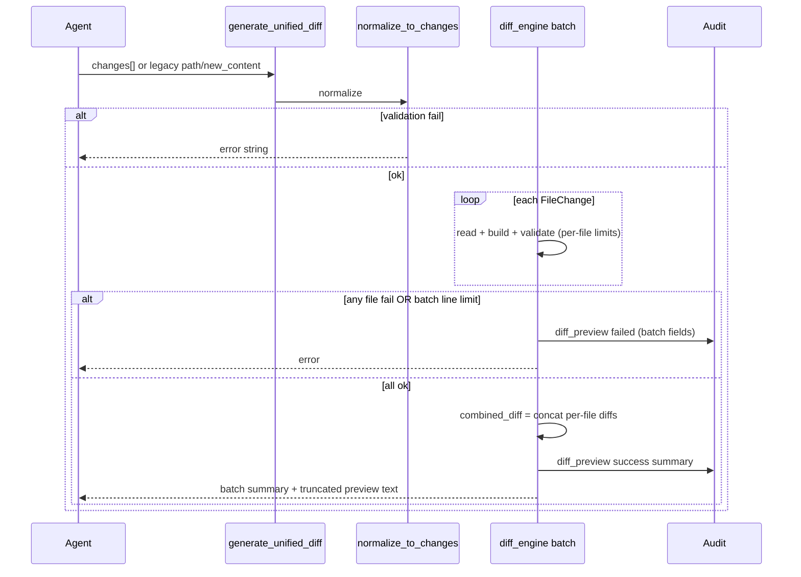

# Multi-file Patch Design (v0.5.0)

> **Status**: Approved · PR-A4 (2026-07-20)  
> **Baseline**: v0.4.0 single-file `generate_unified_diff` + `apply_patch`  
> **Implementation**: B1 (preview) → B2 (apply) → B3 (report) → B4 (prompt/golden)  
> **Related**: [V0.5_ROADMAP.md](../archive/V0.5_ROADMAP.md) §6 · [testing_golden_eval.md](../testing_golden_eval.md)

---

## English Summary

RepoPilot **v0.5.0** extends the existing **`generate_unified_diff`** and **`apply_patch`** tools (ReAct tool count stays **14**) to accept a unified **`changes[]`** array of `{path, new_content}` entries. Legacy **`path` + `new_content`** remains fully supported via normalization to `changes=[one]`.

Multi-file apply uses **one combined unified diff**, **`git apply --check`**, then **one `git apply`**. If check fails, **no apply runs** and the working tree is unchanged. This is **not** a database transaction; correctness relies on Git’s single-patch apply semantics plus post-apply per-file content verification.

One **`git_create_backup`** precedes each batch. No partial apply. Audit and task reports store **batch summaries only** (no raw diff, no `new_content`). Default **`PATCH_MAX_FILES=10`** is a safety limit, not an architectural cap.

---

## 1. Goals and non-goals

### 1.1 Goals

| Goal | Description |
|------|-------------|
| **Unified schema** | Single internal model `list[FileChange]` for preview and apply |
| **Backward compatible** | v0.4 `path` + `new_content` unchanged for callers |
| **Atomic batch (best effort)** | All files pass check → one apply; check fail → zero writes |
| **One backup per batch** | Agent calls `git_create_backup` once before `apply_patch(changes[])` |
| **Observable** | Batch-level audit + task report; per-file stats for debug only |
| **No new tools** | Extend existing tools; keep **14** ReAct tools |

### 1.2 Non-goals (v0.5.0)

| Out of scope | Notes |
|--------------|-------|
| New tool `apply_batch_patch` / `generate_batch_unified_diff` | See §2 |
| LLM-supplied raw unified diff | Rebuild from disk + `new_content` only |
| Conflict merge / interactive hunks | Fail with error |
| Partial apply (some files succeed) | Rejected |
| Multi-file `write_repo_file` | Whole-file fallback stays single-file |
| Auto-rollback inside `apply_patch` | Same as v0.4; explicit `git_rollback` |
| Per-file backup branches | One backup covers whole batch |

---

## 2. Tool strategy: extend, do not split

### 2.1 Why not a separate batch tool?

| Risk of `apply_batch_patch` | Impact |
|----------------------------|--------|
| Agent chooses wrong tool | Multiple single-file applies (non-atomic) |
| Duplicate prompt / golden / confirm / audit | Maintenance cost |
| readonly / MUTATION_TOOLS config drift | Security inconsistency |

### 2.2 Decision

| Tool | v0.5 strategy |
|------|---------------|
| `generate_unified_diff` | **Extend** args with `changes[]`; readonly-safe preview |
| `apply_patch` | **Extend** args; internal batch apply |
| ReAct tool count | **14** (unchanged) |

**Exception clause** (not planned for v0.5): add `*_batch_*` only if unified args break v0.4 clients with no adapter, or safety policies cannot be shared. Current assessment: **no need**.

---

## 3. Data model

### 3.1 `FileChange` (shared)

```python
class FileChange(BaseModel):
    path: str          # repo-relative, posix slashes, unique within batch
    new_content: str   # full target UTF-8 text; NOT raw unified diff
```

### 3.2 Public tool args (preview + apply)

```python
class GenerateUnifiedDiffArgs(BaseModel):
    changes: list[FileChange] | None = None
    path: str | None = None              # v0.4 legacy
    new_content: str | None = None       # v0.4 legacy

class ApplyPatchArgs(BaseModel):
    # identical shape to GenerateUnifiedDiffArgs
```

### 3.3 Normalization (`normalize_to_changes`)

Single function used by both tools (location: `schemas.py` or shared module called from tool entrypoints).

| Input | Result |
|-------|--------|
| Non-empty `path` + `new_content`, no `changes` | `[FileChange(path=..., new_content=...)]` |
| Non-empty `changes` | Validated list, length `1..PATCH_MAX_FILES` |
| Both modes / neither mode | `ValidationError` |
| Duplicate `path` in batch | `ValidationError` |

**Compatibility**: After normalization, `len(changes)==1` from legacy args MUST behave identically to v0.4.0.

### 3.4 Internal batch result (not exposed to LLM)

```python
@dataclass
class BatchDiffResult:
    ok: bool
    combined_diff: str                 # in-memory only; never audit/log
    per_file_stats: dict[str, dict]     # path -> {hunk_count, lines_added, ...}
    total_stats: dict                   # batch aggregates (see §3.5)
    errors: list[str]
    failed_path: str | None
```

### 3.5 Statistics rules (confirmed)

| Field | Scope | Rule |
|-------|-------|------|
| **`hunk_count` (audit/report batch)** | Batch | **Sum** of all per-file `hunk_count` |
| **`lines_added` / `lines_removed` (batch)** | Batch | Sum across files |
| **`changed_lines` (batch limit)** | Batch | Sum; must be ≤ `PATCH_MAX_CHANGED_LINES` |
| **`hunk_count` (per file)** | Per file | Enforced ≤ `PATCH_MAX_HUNKS`; stored in `per_file_stats` for debug/tests |
| Per-file stats | Internal | Used in failure messages, tests, optional report detail — **not** full diff text |

---

## 4. Configuration limits

| Setting | Default | Scope | Notes |
|---------|---------|-------|-------|
| `PATCH_MAX_FILES` | **10** | Batch | **Safety boundary** for v0.5 MVP; configurable via env — not a hard architecture limit |
| `PATCH_MAX_HUNKS` | 20 | **Per file** | Unchanged from v0.4 |
| `PATCH_MAX_CHANGED_LINES` | 500 | **Batch total** | v0.4 single-file = batch of 1 |
| `PATCH_PREVIEW_MAX_LINES` | 40 | Combined preview text | Truncated user-visible preview |
| `MAX_WRITE_BYTES` | 100000 | **Per file** `new_content` | Unchanged |
| `PATCH_REQUIRE_BACKUP` | 1 | Apply gate | Unchanged |
| `DIFF_ENGINE_VERSION` | `"2"` (planned) | Audit metadata | Bump when batch ships |

---

## 5. Preview flow (`generate_unified_diff`)



### 5.1 Rules

- **Read-only**: no git write, no file write; available in `readonly` mode.
- **All-or-nothing preview**: one invalid file → entire preview fails (no partial preview).
- **Combine**: standard unified diff concatenation (`diff1 + diff2 + ...`).
- **User output**: file count, path list (short), total +/- lines, truncated combined preview — **not** full diff.

---

## 6. Apply flow (`apply_patch`)

```mermaid
sequenceDiagram
    participant Agent
    participant PA as apply_patch batch
    participant Git

    Agent->>PA: apply_patch(changes[])
    PA->>PA: normalize + per-file rebuild/validate/size
    PA->>PA: backup gate (PATCH_REQUIRE_BACKUP)
    PA->>Git: git apply --check (combined_diff)
    alt check fails
        PA-->>Agent: error; working tree unchanged
    else check ok
        PA->>Git: git apply (combined_diff)
        PA->>PA: verify each file content == new_content
        PA->>Audit: patch_apply batch summary
    end
```

### 6.1 Atomic apply semantics (accurate wording)

| Guarantee | Mechanism |
|-----------|-----------|
| **Check failure → no apply** | On `git apply --check` failure, **`git apply` is not invoked**; working tree should remain as before check |
| **Single apply invocation** | One stdin payload (`combined_diff`) for both check and apply |
| **Not a DB transaction** | Do **not** describe as ACID/transactions; Git + OS may leave edge cases if apply aborts mid-flight — v0.4 same class of risk |
| **Post-apply verification** | Read each target file; if content ≠ expected `new_content`, report **failed** audit; **no auto-rollback** |
| **No partial batch by design** | Agent must not loop single-file `apply_patch` for one logical multi-file task |

### 6.2 Failure matrix (unchanged philosophy from v0.4)

| Stage | Apply called? | Working tree | Auto rollback? |
|-------|---------------|--------------|----------------|
| Validation / backup missing | No | Unchanged | No |
| `git apply --check` fails | No | Unchanged | No |
| `git apply` fails | Was attempted | Inspect / use `git_rollback` | **No** (explicit agent step) |
| Post-verify content mismatch | After apply | Inspect / use `git_rollback` | **No** |

### 6.3 Human confirmation

- **`apply_patch`** remains in `CONFIRM_REQUIRED_TOOLS`.
- **One confirm** covers the entire batch (CLI y/n or API confirm).
- **`tool_confirm` display**: summarize paths (first **5** + `"... +N more"`); truncate each `new_content` as today.

---

## 7. Backup and rollback

| Item | Behavior |
|------|----------|
| **When** | Agent prompt: once **`git_create_backup`** before **`apply_patch(changes[])`** |
| **Scope** | Whole repo working tree (same as v0.4) |
| **State file** | `logs/last_backup.json` — still **one recent record** |
| **Rollback** | `git_rollback` → `git reset --hard` to stored backup |
| **Batch failure** | Tool does **not** call rollback; user/agent decides |

---

## 8. Audit and task report

### 8.1 Principles

- **Never store**: `combined_diff`, raw per-file diff, full `new_content`.
- **Redact/truncate** errors via existing audit pipeline.

### 8.2 Event fields (`diff_preview` / `patch_apply`)

**When `file_count == 1`**: preserve v0.4 field shapes (`path`, stats, status).

**When `file_count > 1`**, add batch fields:

| Field | Description |
|-------|-------------|
| `file_count` | Integer |
| `paths` | Up to **5** relative paths; if more → `"path1, path2, ... +N more"` |
| `hunk_count` | **Batch sum** |
| `lines_added` / `lines_removed` | Batch sums |
| `status` | `success` / `failed` |
| `error` | Truncated message |
| `failed_path` | First failing path, if any |
| `engine_version` | `DIFF_ENGINE_VERSION` |

`path` (singular) MAY remain populated as first path for backward-compatible readers when `file_count > 1` — implementers should prefer `file_count` + `paths` in report UI.

### 8.3 Task report rendering

| Condition | Line example |
|-----------|--------------|
| Single file | Same as v0.4: `Diff 预览 foo.py: +3 / -1 行, 2 hunks` |
| Multi file | `Patch batch (3 files): a.py, b.py, c.py · +12 / -4 · success` |
| Failed batch | Include `failed_path` + truncated error |

Per-file stats: optional detail lines in report **without** diff bodies.

---

## 9. Agent workflow (reference for B4)

**Multi-file (recommended)**:

```
read* → propose_code_changes → user confirm
→ generate_unified_diff(changes=[...])
→ git_create_backup
→ apply_patch(changes=[...])   # one confirm
→ finish
```

**Single-file (v0.4 compatible)**:

```
→ generate_unified_diff(path, new_content)   # or changes=[one]
→ git_create_backup
→ apply_patch(path, new_content)
→ finish
```

**Do not**: N × single-file `apply_patch` for one logical multi-file change.

---

## 10. Module impact map (implementation phases)

| Module | Phase | Change |
|--------|-------|--------|
| `schemas.py` | B1/B2 | `FileChange`, args validators, `normalize_to_changes` |
| `tools/diff_engine.py` | B1 | `preview_unified_diff_batch`, entry wrapper |
| `tools/patch_apply.py` | B2 | `apply_repo_patch_batch`, batch audit |
| `config/settings.py` | B1 | `PATCH_MAX_FILES`, version bump |
| `audit/task_report.py` | B3 | Batch lines |
| `security/tool_confirm.py` | B2 | `changes` display summary |
| `tools/tool_manager.py` | B4 | Parameter docs / JSON examples |
| `llm.py` | B4 | Prompt examples only |
| `test_llm_golden.py` | B4+ | Optional `changes[]` orchestration case |
| `react_agent.py` | — | **No change** |

---

## 11. Testing strategy (reference)

| Layer | Focus | Fixtures |
|-------|-------|----------|
| Unit | `normalize_to_changes`, combine, limits | — |
| Integration | 3-file happy; check fail → `git status` clean | `isolated_git_repo` (A3) |
| Regression | Legacy `path`+`new_content`; `changes=[one]` ≡ legacy | Existing + A3 |
| Golden | Optional Mode A chain with `changes[]` | A2 fixtures (B4) |
| Security | readonly preview OK; apply blocked | existing + golden Mode B |

Target: **~180+** pytest after B1–B3 (roadmap estimate).

---

## 12. v0.4 compatibility matrix

| Caller input | Normalized | Expected behavior |
|--------------|------------|-------------------|
| `path` + `new_content` | `[one]` | Identical to v0.4.0 |
| `changes=[one]` | `[one]` | Identical to v0.4.0 |
| `changes=[a,b,c]` | `[a,b,c]` | **New** batch preview/apply |
| Empty / mixed invalid | — | Validation error, no side effects |

---

## 13. Review checklist (PR-A4 sign-off)

- [x] Unified `changes[]` schema documented
- [x] v0.4 adapter / compatibility matrix
- [x] No separate `apply_batch_patch` tool
- [x] Atomic apply wording (check gate + single apply; not DB transaction)
- [x] Batch `hunk_count` = sum; per-file stats for debug
- [x] Audit paths cap 5 + `+N more`; no raw diff / new_content
- [x] `PATCH_MAX_FILES=10` as configurable safety limit
- [x] Backup / rollback / confirm semantics aligned with v0.4
- [x] B1–B4 module map defined

**Approved for beta implementation (B1)** — 2026-07-20.
