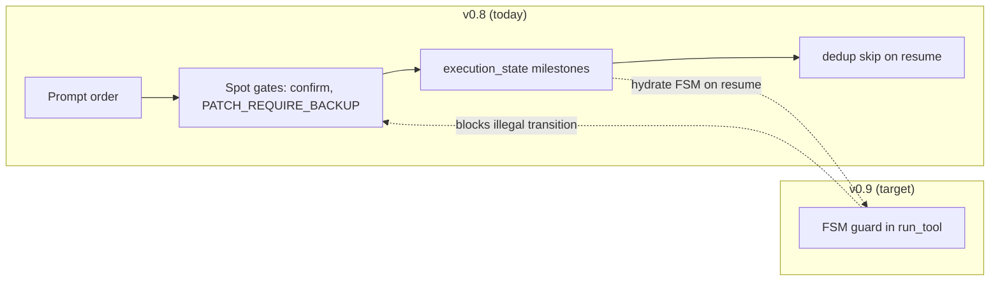
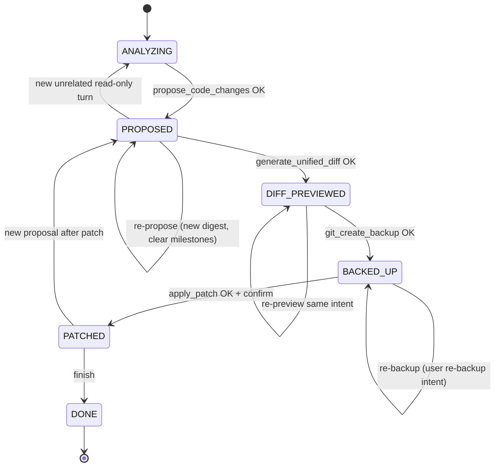

# Mutation Workflow FSM (v0.9.0)

> **Status**: **Implemented** · v0.9 PR-F1/F2 (2026-07-21)  
> **Flag**: `MUTATION_FSM_ENABLED=1`（**v0.10.1 default-on**）— set `=0` to preserve pre-0.10.1 / v0.8.2 ordering behavior  
> **Baseline**: v0.8.2 — prompt-guided workflow + partial hard gates + opt-in `execution_state` dedup  
> **Related**: [task_checkpoint.md](task_checkpoint.md) · [mutation_fsm_pr_f1.md](mutation_fsm_pr_f1.md) · [mutation_fsm_pr_f2.md](mutation_fsm_pr_f2.md) · [structured_tool_results.md](structured_tool_results.md) · [dedup_default_assessment.md](dedup_default_assessment.md)

---

## English Summary

RepoPilot **v0.9.0** implements an opt-in **mutation workflow FSM** when `MUTATION_FSM_ENABLED=1`: explicit states and transition guards in `run_tool` before mutation tools execute. With the flag off (default), behavior matches v0.8.2. This document describes the FSM design and its boundary with **`execution_state` (milestones / resume / dedup)**.

---

## 1. Problem statement

### 1.1 What works today (v0.8.1)

| Layer | Mechanism | Enforces ordering? |
|-------|-----------|------------------|
| Prompt | `llm.py` — propose → diff preview → backup → apply | **No** (soft) |
| Agent mode | `readonly` blocks mutation tools in `run_tool` | Mode only |
| Confirm | `apply_patch` / `write_repo_file` require approval | Per-tool, not sequence |
| Backup gate | `PATCH_REQUIRE_BACKUP=1` — apply without backup **rejected** | **Single edge** only |
| Milestone tracking | `context/execution_state.py` — records proposal / backup / patch | **Observe**, do not block |
| Resume dedup | `should_skip_tool` — skip duplicate backup/apply on resume | **Idempotent**, not ordering |
| Eval | Golden / live — `assert_backup_before_apply` on audit | Test layer only |

[SECURITY.md](../../SECURITY.md) states explicitly:

> The workflow step is **not** a separate code gate. A misbehaving or mis-prompted LLM could call tools out of order.

### 1.2 Examples of allowed-but-undesired behavior (today)

| Scenario | Current outcome |
|----------|-----------------|
| LLM calls `apply_patch` after backup but **never** called `propose_code_changes` | May succeed if backup + confirm OK |
| LLM skips `generate_unified_diff` and goes straight to backup → apply | May succeed (prompt says preview first; code does not enforce) |
| LLM calls `write_repo_file` without backup | **Warns** only (unlike `apply_patch` reject) |
| Resume replays duplicate `git_create_backup` | Dedup skip **if** `EXECUTION_STATE_DEDUP_ENABLED=1` |
| LLM calls tools in wrong order on **first** run | No FSM reject; only partial gates fire |

### 1.3 Why v0.9 needs an FSM

- **Agent engineering proof**: move from “prompt + spot checks” to **code-enforced workflow**
- **Complement dedup**: dedup fixes **resume replay**; FSM fixes **first-run disorder**
- **Audit clarity**: explicit `mutation_fsm_blocked` events vs inferring intent from tool order
- **Foundation** for v0.9 **structured tool results** (reject reason codes)

---

## 2. Core distinction: `execution_state` vs FSM

This is the **primary design value** of this document. The two systems solve **different problems** and must not be conflated.

| Dimension | `execution_state` (v0.8 M1) | Mutation FSM (v0.9 target) |
|-----------|------------------------------|----------------------------|
| **Purpose** | Milestone snapshot for checkpoint resume | Runtime **legal transition** enforcement |
| **Question answered** | “What mutation steps already succeeded in this task?” | “Is this tool call allowed **right now**?” |
| **When active** | After successful tool results; on resume restore | **Before** each mutation-related `run_tool` |
| **On violation** | N/A (does not block) | Reject (v0.9 target) or warn (optional degrade) |
| **Resume behavior** | `should_skip_tool` skips **duplicate** successful mutations | FSM state restored from checkpoint; guards apply to **next** call |
| **Default** | `EXECUTION_STATE_DEDUP_ENABLED=0` | **Not implemented**; proposed opt-in flag TBD (see §8) |
| **Data model** | `proposal_digest`, `backup_*`, `patch_applied`, paths lists | Explicit enum state + optional derivation from milestones |
| **Overlap** | Records that backup happened | Requires **BACKED_UP** state before apply |

**Rule of thumb:**

- **`execution_state`** = **memory of what happened** (for checkpoint + dedup)
- **FSM** = **rules for what may happen next** (for ordering)

Dedup **does not replace** FSM. Skipping a duplicate apply on resume is not the same as rejecting `apply_patch` before backup on a fresh run.



---

## 3. State machine (full mode — diff-first primary path)

### 3.1 States

| State | Meaning |
|-------|---------|
| `ANALYZING` | Task running; read/search/propose allowed; no mutation writes |
| `PROPOSED` | Successful `propose_code_changes` for current intent |
| `DIFF_PREVIEWED` | Successful `generate_unified_diff` for pending change set |
| `BACKED_UP` | Successful `git_create_backup` matching current intent |
| `PATCHED` | Successful `apply_patch` (or `write_repo_file` on fallback path) |
| `DONE` | Terminal — `finish` or task completed |

New proposal digest or explicit user re-intent → reset to `PROPOSED` (clear downstream milestones via existing `_clear_mutation_milestones` semantics).

### 3.2 Primary path (unified diff — recommended)



### 3.3 Fallback path (`write_repo_file` — describe only)

Prompt allows whole-file overwrite as an **alternative** to diff-first. Design acknowledges:

```
ANALYZING → PROPOSED → BACKED_UP → PATCHED → DONE
```

(`generate_unified_diff` optional / skipped)

v0.9 implementation may treat this as a **secondary legal path** with the same backup and confirm requirements. **PR-4 does not specify write-path guard details** — Phase 2 in v0.9.

---

## 4. Transition table (v0.9 enforcement target)

Minimum state required **before** `run_tool` invokes the tool function (full mode):

| Tool | Minimum FSM state | Other gates (unchanged) |
|------|-------------------|-------------------------|
| `propose_code_changes` | `ANALYZING` or `PROPOSED` | — |
| `generate_unified_diff` | `PROPOSED` | readonly allowed |
| `git_create_backup` | `PROPOSED` (diff-first: **`DIFF_PREVIEWED`**) | — |
| `apply_patch` | **`BACKED_UP`** | confirm + `PATCH_REQUIRE_BACKUP` |
| `write_repo_file` | **`BACKED_UP`** (fallback path) | confirm; backup warn today |
| `git_rollback` | `BACKED_UP` or `PATCHED` | — |
| Read-only tools | any non-terminal | agent_mode |

**Batch apply:** one `BACKED_UP` → one `apply_patch(changes[])` → `PATCHED` (aligns with [multi_file_patch.md](multi_file_patch.md)).

**readonly mode:** FSM subset — transitions among `ANALYZING` / `PROPOSED` / `DIFF_PREVIEWED` only; mutation states unreachable (`run_tool` already blocks).

---

## 5. Violation handling strategies

| Strategy | Behavior | Pros | Cons |
|----------|----------|------|------|
| **Prompt-only** | No FSM code; rely on `llm.py` | Zero migration cost (**v0.8 today**) | LLM can skip steps |
| **Degrade** | Allow tool but audit `mutation_fsm_violation` warning | Soft rollout | Weak guarantee; noisy audits |
| **Reject** | Block in `run_tool`; return structured error | Strong ordering guarantee | Stricter agent loops; golden updates |

### 5.1 v0.9 recommended target

**Reject + audit event `mutation_fsm_blocked`**

Example audit shape (design proposal):

```json
{
  "event": "mutation_fsm_blocked",
  "tool": "apply_patch",
  "current_state": "PROPOSED",
  "required_state": "BACKED_UP",
  "reason": "illegal_transition"
}
```

**This is a design target, not current behavior.** v0.8.x continues prompt-only ordering with existing spot gates.

---

## 6. Integration with existing v0.8 mechanisms

### 6.1 Hook location (v0.9)

Proposed evaluation order inside `run_tool` / `_invoke_registered_tool`:

```
1. agent_mode block (existing)
2. mutation FSM guard (new, when enabled)
3. execution_state dedup skip (existing, opt-in)
4. tool confirm (existing)
5. tool function (existing)
6. execution_state milestone update (existing, opt-in)
```

FSM runs **before** dedup: an illegal transition should reject even if dedup would not apply.

### 6.2 Checkpoint / resume

| Field | v0.8 | v0.9 proposal |
|-------|------|---------------|
| `execution_state` in checkpoint | proposal / backup / patch milestones | unchanged |
| Explicit FSM enum in checkpoint | — | optional `mutation_fsm_state` or derive from milestones |

**Derivation example (design sketch):**

- `patch_applied` → `PATCHED`
- `backup_branch` set, not patched → `BACKED_UP`
- `diff_previewed_paths` non-empty → `DIFF_PREVIEWED`
- `proposal_digest` set → `PROPOSED`
- else → `ANALYZING`

On resume, FSM hydrates from restored `execution_state` + memory; dedup hint (`build_resume_hint`) remains separate.

### 6.3 Relationship to eval tests

| Test layer | What it proves today | FSM adds (v0.9) |
|------------|---------------------|-----------------|
| Golden mock | Exact tool order with stub LLM | FSM unit + golden illegal-order cases |
| Live smoke | Real LLM + backup-before-apply audit | Optional live disorder detection |
| `execution_state` tests | dedup skip / restore | do not duplicate FSM transition tests |

---

## 7. Non-goals

| Out of scope | Notes |
|--------------|-------|
| **v0.8.2 implementation** | This file is design only |
| **Structured tool result schema** | v0.9 separate item; FSM reject payload may reuse it |
| **`EXECUTION_STATE_DEDUP_ENABLED` default on** | Independent release decision |
| **Production embedding / RAG** | Unrelated |
| **New ReAct tools** | Tool count stays **14** |
| **FSM for readonly analysis** | Only mutation subgraph in full mode |
| **Cross-task FSM** | Per `task_id` scope, same as checkpoint |

---

## 8. Configuration (proposal / TBD — not in v0.8.2)

A future opt-in flag may exist, for discussion only:

| Variable | Proposed default | Purpose |
|----------|------------------|---------|
| `MUTATION_FSM_ENABLED` | `0` | Master switch; `0` = v0.8 behavior |

**Status: proposal / TBD.** Not present in `config/settings.py` today. **Do not assume this flag exists in v0.8.2.**

Possible v0.9 rollout:

1. Ship FSM behind `MUTATION_FSM_ENABLED=0` default
2. Golden + unit coverage
3. Optional live smoke extension
4. Consider default `1` in a later minor after bake time

---

## 9. v0.9 implementation checklist (reference)

- [ ] `MutationWorkflowState` enum + transition validator module
- [ ] `run_tool` guard hook (respect flag)
- [ ] Hydrate / export FSM state in checkpoint (or derive from `execution_state`)
- [ ] Audit: `mutation_fsm_blocked`, optional `mutation_fsm_transition`
- [ ] Golden: illegal-order cases (apply before backup, backup before propose, etc.)
- [ ] Docs: mark this file **Implemented**; update `workflow.md` / `architecture.md` at release

---

## 10. Related documentation

| Document | Relevance |
|----------|-----------|
| [task_checkpoint.md](task_checkpoint.md) | Checkpoint/resume; `execution_state` persistence |
| [multi_file_patch.md](multi_file_patch.md) | Batch apply; one backup per batch |
| [SECURITY.md](../../SECURITY.md) | Current prompt vs code enforcement |
| [testing_golden_eval.md](../testing_golden_eval.md) | Mock orchestration contracts |
| [testing_live_llm_eval.md](../testing_live_llm_eval.md) | Opt-in smoke; backup-before-apply |

---

## 11. Document history

| Date | Status | Notes |
|------|--------|-------|
| 2026-07-20 | **Design (v0.8.2 PR-4)** | Initial FSM proposal; v0.9 implementation target |
