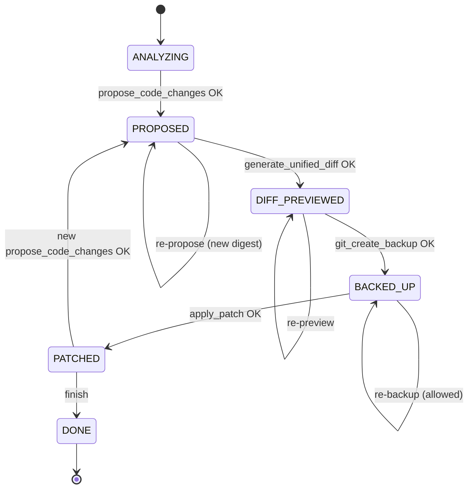
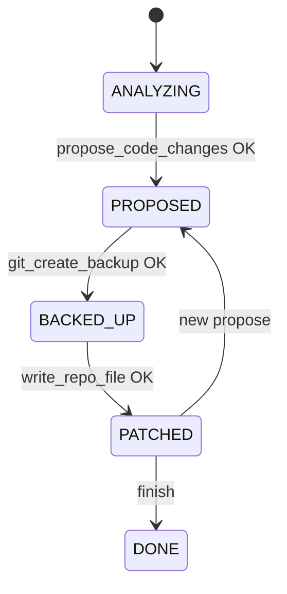
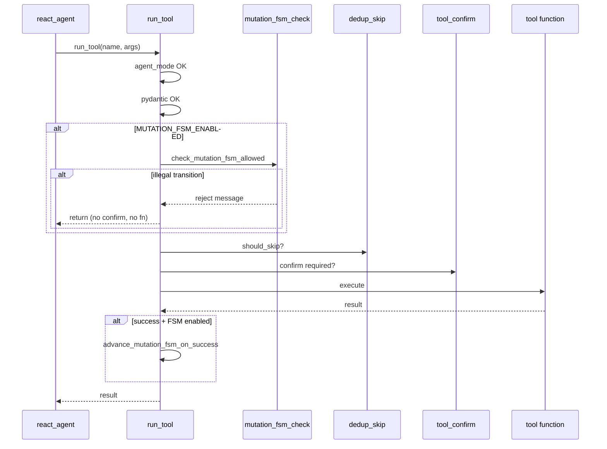

# PR-F1 — Mutation FSM Runtime Guard（详细设计）

> **Status**: **Design · Pending review** · v0.9 PR-F1  
> **Implementation target**: v0.9.0（PR-F1 merge 后进入编码）  
> **Baseline**: v0.8.2（`1abe90e`）— prompt + spot gates；`MUTATION_FSM_ENABLED` **不存在**  
> **Parent design**: [mutation_fsm.md](mutation_fsm.md) · [V0.9_ROADMAP.md](../archive/V0.9_ROADMAP.md)  
> **Out of scope (PR-F2+)**: checkpoint hydrate · audit `mutation_fsm_blocked` · structured tool result schema（PR-S1）

---

## English Summary

**PR-F1** adds an **in-memory mutation workflow FSM** evaluated in `run_tool` when `MUTATION_FSM_ENABLED=1`. Illegal mutation tool order is **rejected before** dedup, confirm, or tool execution. State advances **only after successful tool results**. Strict **diff-first** ordering is enforced for `apply_patch`; **`write_repo_file` fallback** uses a separate rail without lowering diff-first constraints.

Default **`MUTATION_FSM_ENABLED=0`** preserves v0.8.2 behavior with zero diff.

---

## 1. PR-F1 目标与 scope guard

### 1.1 目标

| # | 交付 |
|---|------|
| G1 | `MutationWorkflowState` enum + 双轨（diff-first / write-fallback）状态模型 |
| G2 | Pre-tool transition validator（`check_mutation_fsm_allowed`） |
| G3 | Post-success state advance（`advance_mutation_fsm_on_success`） |
| G4 | `run_tool` hook（flag on 时生效；顺序在 dedup / confirm 之前） |
| G5 | `MUTATION_FSM_ENABLED` feature flag（默认 `0`） |
| G6 | Unit tests（transition table + gate order + flag off 非回归） |

### 1.2 PR-F1 不做（scope guard）

| 项 | 归属 |
|----|------|
| Checkpoint / resume FSM hydrate | **PR-F2** |
| Audit event `mutation_fsm_blocked` / `mutation_fsm_transition` | **PR-F2** |
| Structured `{ok, code, message}` JSON reject（完整 schema） | **PR-S0 / PR-S1** |
| Golden illegal-order cases | **PR-E1**（本文 §10 仅定义 case 规格） |
| 修改 `llm.py` prompt 主文案 | 非 PR-F1 |
| `EXECUTION_STATE_DEDUP_ENABLED` 默认变更 | **PR-P1 评估** |
| 新增 ReAct 工具 / HTTP API 变更 | 禁止 |
| `write_repo_file` backup **硬拒绝**（仍 warn-only at tool layer） | defer；FSM 仅管顺序 |
| Production RAG | v0.9.1 / v0.10 |

### 1.3 设计决策（roadmap review 已确认）

- **FSM diff-first 严格路径**，不为兼容 v0.8 乱序 golden 降低约束  
- **F1 / F2 拆分**：F1 = 运行时 guard + 内存状态；F2 = 持久化 + audit  
- **`apply_patch`**：必须已完成 diff preview **且** 处于 `BACKED_UP`  
- **`git_create_backup`**：diff-first 轨要求 `DIFF_PREVIEWED`；write-fallback 轨允许从 `PROPOSED` 进入  
- **`write_repo_file`**：fallback 轨单独定义，不与 `apply_patch` 混轨  

---

## 2. 模块布局（预期）

```
context/
  mutation_fsm.py          # NEW — enum, ContextVar state, check + advance API
config/
  settings.py              # + MUTATION_FSM_ENABLED (default 0)
tools/
  tool_manager.py          # hook in run_tool / _invoke_registered_tool
tests/
  test_mutation_fsm.py     # NEW — unit tests (PR-F1)
```

**与 `execution_state.py` 关系**：

| 模块 | PR-F1 职责 |
|------|-----------|
| `mutation_fsm.py` | **Enforce** legal next mutation step（内存 FSM） |
| `execution_state.py` | **不变**；仍仅 dedup milestone（opt-in） |

两者 **不合并**；PR-F1 不修改 `execution_state.py` 逻辑（F2 可读取 milestone 做 hydrate 对照）。

---

## 3. State enum

```python
class MutationWorkflowState(str, Enum):
    ANALYZING = "ANALYZING"
    PROPOSED = "PROPOSED"
    DIFF_PREVIEWED = "DIFF_PREVIEWED"
    BACKED_UP = "BACKED_UP"
    PATCHED = "PATCHED"
    DONE = "DONE"
```

### 3.1 语义

| State | 含义 | 进入条件（success） |
|-------|------|---------------------|
| `ANALYZING` | 初始 / 无有效 proposal | task 开始；或 patch 完成后新一轮 read-only |
| `PROPOSED` | `propose_code_changes` 已成功 | proposal 输出含 `修改方案` marker |
| `DIFF_PREVIEWED` | diff-first 轨：`generate_unified_diff` 已成功 | preview 输出有效 |
| `BACKED_UP` | `git_create_backup` 已成功 | 备份 marker + persisted backup 记录 |
| `PATCHED` | `apply_patch` 或 `write_repo_file` 已成功 | patch/write success marker |
| `DONE` | 任务 terminal（`finish`） | PR-F1 **可选最小实现**；完整与 checkpoint 对齐留 F2 |

### 3.2 双轨模型（`MutationPath`）

FSM 除 `state` 外维护 **`mutation_path`**（内存字段，不持久化到 checkpoint — F2 从 milestone 推导）：

```python
class MutationPath(str, Enum):
    NONE = "NONE"              # 尚未进入 mutation 写轨
    DIFF_FIRST = "DIFF_FIRST"  # 已成功 generate_unified_diff
    WRITE_FALLBACK = "WRITE_FALLBACK"  # 显式 write 轨（从未 diff preview）
```

| 事件 | `mutation_path` 变化 |
|------|---------------------|
| Task / FSM reset | `NONE` |
| `propose_code_changes` OK | 仍 `NONE`（仅 state → `PROPOSED`） |
| `generate_unified_diff` OK | → **`DIFF_FIRST`**（state → `DIFF_PREVIEWED`） |
| `write_repo_file` 在 `PROPOSED`+`BACKED_UP` 轨成功 | → **`WRITE_FALLBACK`**（见 §5.3） |
| 新 proposal digest（re-propose） | `mutation_path` → `NONE`；state → `PROPOSED`；清下游 |

**互斥规则**：

- 一旦 `mutation_path == DIFF_FIRST`，**禁止** `write_repo_file`（应走 `apply_patch`）  
- 一旦 `mutation_path == WRITE_FALLBACK`，**禁止** `generate_unified_diff` / `apply_patch`（已选 write 轨）  
- `apply_patch` **仅**在 `mutation_path == DIFF_FIRST` 且 `state == BACKED_UP`  

---

## 4. 状态图（full mode）

### 4.1 Diff-first 主路径（严格）



### 4.2 Write-fallback 路径（单独定义）



**约束**：此路径 **不可** 经过 `DIFF_PREVIEWED`；与 diff-first **互斥**（§3.2）。

### 4.3 Readonly mode 子集

| State | readonly 可达 |
|-------|--------------|
| `ANALYZING` · `PROPOSED` · `DIFF_PREVIEWED` | ✅ |
| `BACKED_UP` · `PATCHED` · `DONE` | ❌（`run_tool` agent_mode 已 block） |

readonly 下 FSM validator **仍运行**（便于统一测试），但 mutation 工具在 step 1 已被 mode block。

---

## 5. Transition table（Pre-tool 准入 —  enforcement）

在 `run_tool` 调用 tool function **之前**评估。  
**Read-only / 辅助工具**（`list_repo_files` · `read_repo_file` · `search_in_repo` · `analyze_repo_structure` · `find_file_dependencies` · `git_status` · `summarizer` · `calculator`）：**任意非 `DONE` 状态允许**（与 v0.8 一致）。

### 5.1 Mutation 相关工具

| Tool | 最低 state | 额外条件 | 违反 code（PR-S1） |
|------|-----------|----------|-------------------|
| `propose_code_changes` | `ANALYZING` 或 `PROPOSED` 或 `PATCHED` | — | `mutation_fsm_blocked` |
| `generate_unified_diff` | `PROPOSED` | `mutation_path != WRITE_FALLBACK` | `mutation_fsm_blocked` |
| `git_create_backup` | diff-first：`DIFF_PREVIEWED` | `mutation_path == DIFF_FIRST` | `mutation_fsm_blocked` |
| `git_create_backup` | write-fallback：`PROPOSED` | `mutation_path != DIFF_FIRST` 且尚未 preview | `mutation_fsm_blocked` |
| `apply_patch` | `BACKED_UP` | **`mutation_path == DIFF_FIRST`**（隐含已 preview） | `mutation_fsm_blocked` |
| `write_repo_file` | `BACKED_UP` | **`mutation_path != DIFF_FIRST`**（write 轨） | `mutation_fsm_blocked` |
| `git_rollback` | `BACKED_UP` 或 `PATCHED` | — | `mutation_fsm_blocked` |

### 5.2 与现有 spot gates 关系

FSM **不替代**以下 gate；它们在 FSM pass **之后**仍生效：

| Gate | 位置 | 与 FSM 关系 |
|------|------|------------|
| `PATCH_REQUIRE_BACKUP` | `patch_apply.py` 内部 | FSM 保证 `BACKED_UP` state；backup 记录仍二次校验 |
| `request_tool_confirmation` | `_invoke_registered_tool` | FSM pass 后才弹出 confirm |
| Pydantic args validation | `run_tool` | 在 FSM **之前**（无效 args 不消耗 FSM） |

**重要**：`apply_patch` 在 FSM 视角需 `BACKED_UP`，与 `PATCH_REQUIRE_BACKUP` **冗余但互补** — FSM 防乱序，backup gate 防无 `last_backup.json`。

### 5.3 Write-fallback 轨激活规则

`mutation_path` 设为 `WRITE_FALLBACK` 的触发点（PR-F1 设计）：

- **Pre-tool**：当 `git_create_backup` 从 `PROPOSED`（无 prior preview）被 **允许** 时，设置 pending rail = `WRITE_FALLBACK`（或在 backup success 时 commit path）  
- **推荐实现**：在 `git_create_backup` **success advance** 时，若 advance 前 `state==PROPOSED` 且 `mutation_path==NONE`，则 advance 后设 `mutation_path=WRITE_FALLBACK`  

Diff-first 轨：`generate_unified_diff` success → `mutation_path=DIFF_FIRST`。

---

## 6. Post-success 状态转移（Advance）

仅当 tool function **返回 success**（非 FSM reject · 非 dedup skip · 非 confirm cancel · 非 tool 内部 error 字符串）时调用 `advance_mutation_fsm_on_success(tool, args, result)`。

### 6.1 Success 判定（与 execution_state 对齐，独立实现）

| Tool | Success heuristic |
|------|-------------------|
| `propose_code_changes` | `"修改方案" in result` |
| `generate_unified_diff` | diff preview 有效（含 `diff` / `Diff` 且 paths 可解析） |
| `git_create_backup` | `"Git 备份完成" in result` |
| `apply_patch` | `"Patch 应用完成" in result` |
| `write_repo_file` | `"文件写入完成" in result` |
| `git_rollback` | **不推进** PATCHED→…（rollback 后 state 规则见 §6.3） |

### 6.2 Advance 表

| Tool success | New state | Path / notes |
|--------------|-----------|--------------|
| `propose_code_changes` | `PROPOSED` | 新 digest → clear downstream（同 `_clear_mutation_milestones` 语义）；`path→NONE` |
| `generate_unified_diff` | `DIFF_PREVIEWED` | `path→DIFF_FIRST` |
| `git_create_backup` | `BACKED_UP` | 若 from `PROPOSED`+`path NONE` → `path→WRITE_FALLBACK` |
| `apply_patch` | `PATCHED` | `path` 保持 `DIFF_FIRST` |
| `write_repo_file` | `PATCHED` | `path→WRITE_FALLBACK` |

### 6.3 Re-propose / re-backup / rollback（PR-F1 最小规则）

| 场景 | 行为 |
|------|------|
| Re-propose（新 digest） | state → `PROPOSED`；清 `DIFF_PREVIEWED` 下游；`path→NONE` |
| Re-preview（同 digest） | state 保持 `DIFF_PREVIEWED` |
| Re-backup | state 保持 `BACKED_UP`（允许） |
| `git_rollback` success | state → `BACKED_UP`（仍已备份）或 `DIFF_PREVIEWED`（若 rollback 清空 patch）— **PR-F1 建议**：rollback 后 state=`BACKED_UP`，`patch_applied` 语义重置；细节 F2 对齐 audit |

### 6.4 `finish` → `DONE`

- **Hook 点**：`react_agent.py` 解析 `FinishResponse` 时  
- **PR-F1**：可选实现 `mark_mutation_fsm_done()`；若省略，unit test 不依赖 `DONE`  
- **PR-F2**：与 checkpoint terminal 对齐  

---

## 7. `run_tool` hook 位置与调用顺序

### 7.1 当前 v0.8.2 顺序（`tool_manager.py`）

```
run_tool(name, args):
  1. tool 存在性
  2. agent_mode block          ← is_tool_allowed
  3. Pydantic args validate
  4. _invoke_registered_tool:
       4a. execution_state dedup skip
       4b. request_tool_confirmation
       4c. tool["function"](**args)
  5. log_tool_call
```

`react_agent` 在 `run_tool` 返回后调用 `update_from_tool_result`（dedup opt-in）。

### 7.2 PR-F1 目标顺序

```
run_tool(name, args):
  1. tool 存在性
  2. agent_mode block
  3. Pydantic args validate
  4. [NEW] mutation_fsm_check(name, args)     ← MUTATION_FSM_ENABLED=1
       → reject: return error string, skip 4a–4c
  5. _invoke_registered_tool:
       5a. execution_state dedup skip
       5b. request_tool_confirmation
       5c. tool function
  6. [NEW] mutation_fsm_advance(name, args, result)   ← success only
  7. log_tool_call
```



### 7.3 Hook 实现要点

| 要点 | 说明 |
|------|------|
| **插入点** | `check` 在 `run_tool` 内、调用 `_invoke_registered_tool` **之前**（validate 之后） |
| **Advance 点** | `run_tool` 内、`_invoke_registered_tool` 返回后、`log_tool_call` 前 |
| **Skip advance  when** | result 为 FSM reject / dedup skip / confirm cancel / `"参数错误"` / tool 已知 error prefix |
| **Flag off** | `check` 与 `advance` 均为 no-op；**零分支开销**（early return at function entry） |
| **ContextVar** | `MutationFsmState` 存于 `context/mutation_fsm.py`；新 task 时 `reset_mutation_fsm()`（由 `react_agent` task start 调用 — PR-F1 需加 hook） |

### 7.4 与 confirm / backup gate 的完整顺序（full mode · flag on）

以 **`apply_patch`** 为例：

```
1. agent_mode: full → pass
2. pydantic: ApplyPatchArgs OK
3. FSM check: state==BACKED_UP, path==DIFF_FIRST → pass
4. dedup: (opt-in) maybe skip
5. tool_confirm: user/API confirm → pass
6. apply_patch():
     6a. PATCH_REQUIRE_BACKUP / last_backup.json → pass
     6b. git apply --check → apply
7. FSM advance: → PATCHED
8. log_tool_call
9. (react_agent) update_from_tool_result if dedup on
```

以 **非法 `apply_patch`（跳过 preview + backup）** 为例：

```
FSM check: state==ANALYZING → REJECT at step 3
→ confirm 与 apply_patch 内部逻辑均不执行
```

---

## 8. Error result 需求

### 8.1 PR-F1 临时格式（string — 兼容 v0.8 ReAct memory）

PR-S1 之前，FSM reject 返回 **可读字符串 + 稳定 machine token**，供后续 golden 断言：

```
Mutation workflow blocked: tool=apply_patch current=PROPOSED required=BACKED_UP path=DIFF_FIRST code=mutation_fsm_blocked
```

| 字段 | 必填 | 说明 |
|------|------|------|
| `tool` | ✅ | 被拒绝的工具名 |
| `current` | ✅ | 当前 FSM state |
| `required` | ✅ | 准入所需 state（或 `DIFF_FIRST+BACKED_UP` 组合描述） |
| `path` | 可选 | `DIFF_FIRST` / `WRITE_FALLBACK` / `NONE` |
| `code` | ✅ | 固定 `mutation_fsm_blocked` |

**约束**：

- 不调用 tool function  
- 仍写入 `log_tool_call`（result 为 reject 字符串）— audit event 详细字段 **PR-F2**  
- 与 dedup skip message、confirm cancel message **格式区分**（不同 prefix / code）

### 8.2 PR-S1 结构化目标（PR-F1 仅定义需求）

```python
# PR-S1 target — NOT implemented in PR-F1
{
    "ok": False,
    "code": "mutation_fsm_blocked",
    "message": "...",           # 人类可读，注入 memory
    "details": {
        "tool": "apply_patch",
        "current_state": "PROPOSED",
        "required_state": "BACKED_UP",
        "mutation_path": "NONE",
        "reason": "illegal_transition",
    },
}
```

PR-F1 unit test 断言 **string 中含 `code=mutation_fsm_blocked`**；PR-S1 迁移后改为 JSON parse。

### 8.3 Reject code 枚举（FSM 子集）

| code | 场景 |
|------|------|
| `mutation_fsm_blocked` | 所有 pre-tool transition 违反 |
| `mutation_fsm_path_conflict` | 可选：DIFF_FIRST 轨上调用 `write_repo_file` 等互斥 |

PR-F1 可合并为单一 `mutation_fsm_blocked`，`details.reason` 区分。

---

## 9. Configuration

| Variable | Default | PR-F1 |
|----------|---------|-------|
| `MUTATION_FSM_ENABLED` | **`0`** | 新增于 `config/settings.py` |

```python
MUTATION_FSM_ENABLED = os.getenv("MUTATION_FSM_ENABLED", "0").strip().lower() not in {
    "0", "false", "no",
}
```

| Flag | 行为 |
|------|------|
| `0` | 与 v0.8.2 **完全一致**（369 pytest 无回归） |
| `1` | 启用 §5 transition enforcement |

**Helper**：

```python
def is_mutation_fsm_enabled() -> bool: ...
def reset_mutation_fsm() -> None: ...      # task start
def get_mutation_fsm_snapshot() -> dict: ...  # F2 checkpoint 预留
```

---

## 10. Unit test cases（PR-F1 · `test_mutation_fsm.py`）

测试运行时 **`MUTATION_FSM_ENABLED=1`**（monkeypatch settings 或 env fixture）。

### 10.1 Flag off 非回归

| ID | 场景 | 期望 |
|----|------|------|
| U0 | flag off · 任意 tool 顺序 | `check` 恒 `None`；与 v0.8 行为一致 |

### 10.2 Diff-first — legal path

| ID | 步骤 | 期望 |
|----|------|------|
| U1 | propose → diff → backup → apply | 全程 pass；终态 `PATCHED` · `path=DIFF_FIRST` |
| U2 | re-preview at `DIFF_PREVIEWED` | pass；state 仍为 `DIFF_PREVIEWED` |
| U3 | re-backup at `BACKED_UP` | pass；state 仍为 `BACKED_UP` |

### 10.3 Diff-first — illegal order

| ID | 调用 | 当前 state | 期望 |
|----|------|-----------|------|
| U4 | `generate_unified_diff` | `ANALYZING` | **REJECT** |
| U5 | `git_create_backup` | `PROPOSED`（未 preview） | **REJECT** |
| U6 | `apply_patch` | `PROPOSED` | **REJECT** |
| U7 | `apply_patch` | `DIFF_PREVIEWED` | **REJECT**（未 backup） |
| U8 | `apply_patch` | `BACKED_UP` + `path=WRITE_FALLBACK` | **REJECT**（path 冲突） |

### 10.4 Write-fallback — legal / illegal

| ID | 步骤 | 期望 |
|----|------|------|
| U9 | propose → backup → write | pass；`path=WRITE_FALLBACK` · `PATCHED` |
| U10 | propose → diff preview → `write_repo_file` | **REJECT**（已在 DIFF_FIRST 轨） |
| U11 | propose → backup(write) → `apply_patch` | **REJECT**（已在 WRITE_FALLBACK 轨） |
| U12 | `generate_unified_diff` after write path started | **REJECT** |

### 10.5 Gate order

| ID | 场景 | 期望 |
|----|------|------|
| U13 | illegal `apply_patch` | `request_tool_confirmation` **未被调用**（mock spy） |
| U14 | illegal `apply_patch` | `apply_patch` function **未被调用** |
| U15 | legal chain · confirm denied | FSM state **不** advance（仍为 pre-apply state） |

### 10.6 Readonly

| ID | 场景 | 期望 |
|----|------|------|
| U16 | readonly · `generate_unified_diff` at `PROPOSED` | mode block **先于** FSM（或 FSM pass 但 mode 已 block） |

### 10.7 Re-propose

| ID | 场景 | 期望 |
|----|------|------|
| U17 | `PATCHED` → new propose (new digest) | state → `PROPOSED` · `path→NONE` |
| U18 | `DIFF_PREVIEWED` → new propose (new digest) | 清 backup/preview 下游 · `path→NONE` |

**目标 case 数**：≥ **18** unit tests（与 PR-F1 文件同 PR 交付）。

---

## 11. Golden test cases（PR-E1 规格 — PR-F1 不实现）

PR-F1 merge 后，**现有 golden 在 flag off 下必须全绿**。以下 cases 在 **PR-E1** 实现，运行时 **`MUTATION_FSM_ENABLED=1`**：

| Case ID | Stub LLM 序列 | 期望 |
|---------|--------------|------|
| `fsm_apply_before_backup` | 直接 `apply_patch` | FSM reject · 无 successful patch audit |
| `fsm_backup_before_propose` | 直接 `git_create_backup` | FSM reject |
| `fsm_backup_before_diff_preview` | propose → backup（跳过 preview） | FSM reject on backup |
| `fsm_skip_propose_diff_chain` | diff → backup → apply（无 propose） | reject at first mutation tool |
| `fsm_legal_diff_first_chain` | propose → diff → backup → apply → finish | 全链 success |
| `fsm_write_fallback_chain` | propose → backup → write → finish | write 轨 success |

### 11.1 现有 golden 影响（flag off 不变）

| 现有 case | 注意 |
|-----------|------|
| `test_golden_full_diff_first_chain` | stub **跳过 propose**；flag off 仍 pass；**PR-E1** 新增 `fsm_legal_*` 含 propose |
| `test_golden_full_batch_diff_first_chain` | 同上 |

---

## 12. API surface（`context/mutation_fsm.py`）

```python
class MutationWorkflowState(str, Enum): ...
class MutationPath(str, Enum): ...

@dataclass
class MutationFsmContext:
    state: MutationWorkflowState = MutationWorkflowState.ANALYZING
    mutation_path: MutationPath = MutationPath.NONE
    proposal_digest: str | None = None  # 用于 re-propose 检测

def is_mutation_fsm_enabled() -> bool: ...
def reset_mutation_fsm() -> None: ...
def get_mutation_fsm_context() -> MutationFsmContext: ...

def check_mutation_fsm_allowed(
    tool: str,
    args: dict | None,
    *,
    agent_mode: str,
) -> str | None:
    """Return reject message or None."""

def advance_mutation_fsm_on_success(
    tool: str,
    args: dict | None,
    result: str,
) -> None:
    """No-op if not success or flag off."""

def export_mutation_fsm_snapshot() -> dict:
    """F2 checkpoint — PR-F1 stub OK."""
```

---

## 13. PR-F2  handoff checklist

PR-F1 review 通过后，PR-F2 承接：

- [ ] `export_mutation_fsm_snapshot` / hydrate from checkpoint + `execution_state`  
- [ ] Audit `mutation_fsm_blocked` event（`write_audit_event`）  
- [ ] `react_agent` task start / resume 调用 `reset` / `hydrate`  
- [ ] `mark_mutation_fsm_done` on finish  
- [ ] 文档：`mutation_fsm.md` → Partially implemented (F1) → F2 complete  

---

## 14. 验收标准（PR-F1 merge）

- [ ] `MUTATION_FSM_ENABLED=0`：`python -m pytest -q` **369+ passed**（零行为变更）
- [ ] `MUTATION_FSM_ENABLED=1`：`test_mutation_fsm.py` **≥18 passed**
- [ ] Strict diff-first：U5 · U6 · U7 覆盖
- [ ] Write-fallback 独立：U9 · U11
- [ ] Gate order：U13 · U14 · U15
- [ ] ReAct tools = **14**；无 HTTP API 变更
- [ ] 无 audit schema 变更要求（F2）

---

## 15. 文档历史

| 日期 | 状态 | 备注 |
|------|------|------|
| 2026-07-20 | **Design · Pending review** | v0.9 roadmap 确认后首版 PR-F1 详细设计 |
