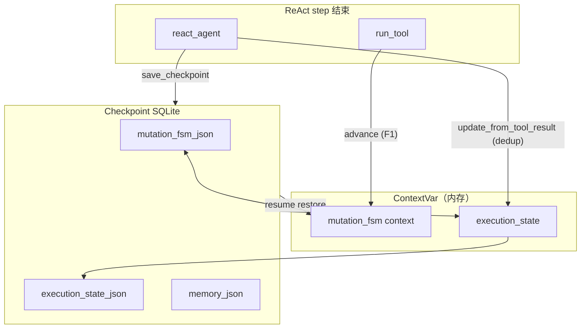
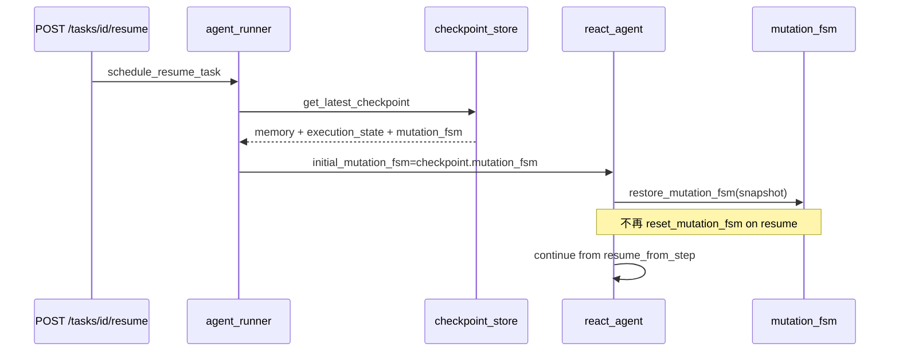

# PR-F2 — Mutation FSM Checkpoint Hydrate & Audit（详细设计）

> **Status**: **Design · Pending review** · v0.9 PR-F2  
> **Implementation target**: v0.9.0（PR-F2 merge；**待 review 后编码**）  
> **Baseline**: PR-F1 @ `5dd1e2a` — in-memory FSM guard；resume 时 **reset → ANALYZING**（已知限制）  
> **Parent design**: [mutation_fsm.md](mutation_fsm.md) · [mutation_fsm_pr_f1.md](mutation_fsm_pr_f1.md) · [task_checkpoint.md](task_checkpoint.md) · [V0.9_ROADMAP.md](../archive/V0.9_ROADMAP.md)  
> **Out of scope (PR-S0/S1 · PR-E1)**: structured tool result JSON · golden illegal-order cases

---

## English Summary

**PR-F2** persists and restores **mutation FSM state** across checkpoint save/resume when `MUTATION_FSM_ENABLED=1`. It adds explicit **`mutation_fsm_json`** checkpoint storage, coordinates **hydrate** with existing **`execution_state`** (dedup milestones), emits **`mutation_fsm_blocked`** audit events on FSM reject, and fixes the PR-F1 resume gap (no longer reset FSM to `ANALYZING` on resume).

**Does not** change dedup logic, structured reject payloads, or golden eval.

---

## 1. PR-F2 目标与 scope guard

### 1.1 目标

| # | 交付 |
|---|------|
| G1 | Checkpoint **export / restore** FSM snapshot（`state` · `mutation_path` · `proposal_digest`） |
| G2 | Resume 后 FSM 与 checkpoint 一致；**移除** resume 路径 `reset_mutation_fsm()` |
| G3 | `execution_state` ↔ FSM **映射规则**（显式 snapshot 优先；milestones 推导 fallback） |
| G4 | Audit：`mutation_fsm_blocked`（FSM reject）；`mutation_fsm_restored`（resume hydrate） |
| G5 | Unit / integration tests（hydrate round-trip · resume · audit · flag off 非回归） |

### 1.2 PR-F2 不做（scope guard）

| 项 | 归属 |
|----|------|
| Structured `{ok, code, message}` reject | **PR-S0 / PR-S1** |
| Golden illegal-order cases | **PR-E1** |
| 修改 `execution_state` dedup 逻辑 / 默认 flag | **PR-P1** |
| 新 SQLite 表；HTTP API 签名变更 | 禁止 |
| `mutation_fsm_transition` 逐步 audit（可选 P2；默认 **不做**） |
| CLI cancel/resume 命令 | defer |
| FSM 默认 `MUTATION_FSM_ENABLED=1` | defer v0.9.x |

### 1.3 PR-F1 已知限制（F2 必须修复）

| 问题 | PR-F1 行为 | PR-F2 目标 |
|------|-----------|-----------|
| Resume FSM 丢失 | `react_agent` resume 分支调用 `reset_mutation_fsm()` | `restore_mutation_fsm(snapshot)` |
| Checkpoint 无 FSM 字段 | 仅 `execution_state_json`（dedup opt-in） | + `mutation_fsm_json` |
| FSM reject 无可观测 audit | 仅 `log_tool_call` result 字符串 | + `mutation_fsm_blocked` event |
| dedup off 时 milestone 空 | `export_execution_state()` → `{}` | FSM **不依赖** dedup export；独立 persist |

---

## 2. 架构：FSM vs execution_state（F2 边界）

PR-F1 已确立职责分离；F2 **不合并模块**，只做 **checkpoint 层协调**。

| 维度 | `execution_state` (v0.8) | `mutation_fsm` (v0.9 F1) |
|------|--------------------------|---------------------------|
| **目的** | Resume **dedup** milestones | **Ordering enforcement** |
| **Flag** | `EXECUTION_STATE_DEDUP_ENABLED` | `MUTATION_FSM_ENABLED` |
| **Checkpoint 字段** | `execution_state_json`（已有） | `mutation_fsm_json`（**F2 新增**） |
| **F2 修改 execution_state.py?** | **否**（只读推导 / 并行 restore） | **是**（+ restore API） |



**Resume 恢复顺序（F2）**：

```
1. restore_context_budget_state
2. restore_execution_state(initial_execution_state)     # 已有；dedup opt-in
3. restore_mutation_fsm(initial_mutation_fsm)         # F2 新增
4. （可选）consistency check / derive fallback
5. build_resume_hint（dedup）+ build_fsm_resume_hint（F2 可选，非阻塞）
6. append memory · continue ReAct loop
```

---

## 3. Checkpoint 持久化设计

### 3.1 存储策略：**显式 snapshot 优先**

| 策略 | 说明 |
|------|------|
| **Primary** | 每步 checkpoint 写入 **`mutation_fsm_json`**（仅 `MUTATION_FSM_ENABLED=1`） |
| **Fallback hydrate** | snapshot 缺失时，从 **`execution_state_json`** 推导 FSM（见 §4） |
| **不采用** | 仅推导、不 persist — dedup off 时 execution_state 为空，resume 无法恢复 FSM |

### 3.2 SQLite schema 扩展

**新增列**（向后兼容 migration）：

```sql
ALTER TABLE task_checkpoints ADD COLUMN mutation_fsm_json TEXT;
```

| 字段 | 类型 | 说明 |
|------|------|------|
| `mutation_fsm_json` | TEXT nullable | FSM snapshot JSON；`MUTATION_FSM_ENABLED=0` 或未启用 FSM 时为 `NULL` |

**`CheckpointRecord` 扩展**：

```python
@dataclass(frozen=True)
class CheckpointRecord:
    ...
    mutation_fsm: dict[str, Any] | None  # deserialized from mutation_fsm_json
```

**Migration 策略**：

- `init_checkpoint_db()` 内 `PRAGMA table_info` 检测列；缺失则 `ALTER TABLE`
- 旧 checkpoint 行 `mutation_fsm_json IS NULL` → hydrate 走 §4 fallback

### 3.3 Snapshot JSON schema（v1）

```json
{
  "version": 1,
  "state": "BACKED_UP",
  "mutation_path": "DIFF_FIRST",
  "proposal_digest": "a1b2c3d4e5f67890"
}
```

| 字段 | 必填 | 约束 |
|------|------|------|
| `version` | ✅ | 固定 `1`（F2） |
| `state` | ✅ | `MutationWorkflowState` enum value |
| `mutation_path` | ✅ | `MutationPath` enum value |
| `proposal_digest` | 可选 | 16-char hex；与 F1 `MutationFsmContext` 一致 |

**Export API（F2 实现 `export_mutation_fsm_snapshot` 扩展）**：

```python
def export_mutation_fsm_snapshot() -> dict[str, Any]:
    if not is_mutation_fsm_enabled():
        return {}
    ctx = get_mutation_fsm_context()
    return {
        "version": 1,
        "state": ctx.state.value,
        "mutation_path": ctx.mutation_path.value,
        "proposal_digest": ctx.proposal_digest,
    }
```

**Restore API（F2 新增）**：

```python
def restore_mutation_fsm(raw: dict[str, Any] | None) -> None:
    if not is_mutation_fsm_enabled():
        reset_mutation_fsm()
        return
    if not raw:
        reset_mutation_fsm()
        return
    # validate enums · set ContextVar
```

无效 enum / 未知 version → **reset_mutation_fsm()** + audit `mutation_fsm_restore_failed`（react_step，非 JSONL 新 event 类型亦可，见 §6）

### 3.4 `save_checkpoint` API 扩展

```python
def save_checkpoint(
    task_id: str,
    step: int,
    memory: list[dict[str, Any]],
    agent_mode: str,
    repo_root: str | None = None,
    *,
    context_state: dict[str, Any] | None = None,
    execution_state: dict[str, Any] | None = None,
    mutation_fsm: dict[str, Any] | None = None,  # F2 新增
) -> SaveCheckpointResult:
```

**写入规则**：

| 条件 | `mutation_fsm_json` |
|------|---------------------|
| `MUTATION_FSM_ENABLED=0` | `NULL`（不写） |
| `MUTATION_FSM_ENABLED=1` | `export_mutation_fsm_snapshot()` |
| export 返回 `{}` | `NULL` |

**`react_agent._save_checkpoint_safe`**：

```python
mutation_fsm = _export_mutation_fsm_for_checkpoint()  # wraps export_mutation_fsm_snapshot
save_checkpoint(..., execution_state=..., mutation_fsm=mutation_fsm or None)
```

### 3.5 Resume 数据流



**`react_agent` 签名扩展**（kwargs，HTTP 兼容）：

```python
def react_agent(
    ...,
    initial_execution_state=None,
    initial_mutation_fsm=None,  # F2 新增
):
```

**`agent_runner.schedule_resume_task`**：

```python
kwargs={
    ...
    "initial_execution_state": checkpoint.execution_state,
    "initial_mutation_fsm": checkpoint.mutation_fsm,
}
```

---

## 4. execution_state ↔ FSM 映射

### 4.1 原则

| 原则 | 说明 |
|------|------|
| **显式优先** | checkpoint 含 `mutation_fsm_json` → 直接 restore |
| **推导补充** | snapshot 缺失 + `execution_state` 非空 → derive（兼容 pre-F2 / 部分失败） |
| **独立 persist** | FSM enabled + dedup disabled → 仍 persist FSM；**不**要求改 execution_state export |
| **不双向写** | F2 **不**在 restore 时回写 execution_state；各模块各自 restore |

### 4.2 推导算法（fallback hydrate）

当 `mutation_fsm_json` 为 `NULL` 且 `MUTATION_FSM_ENABLED=1`：

输入：`execution_state` dict（dedup milestones）

```python
def derive_mutation_fsm_from_execution_state(es: dict) -> dict:
    """Returns snapshot-shaped dict for restore_mutation_fsm."""
```

| 条件（按优先级） | `state` | `mutation_path` |
|------------------|---------|-----------------|
| `patch_applied == true` | `PATCHED` | `DIFF_FIRST` if `diff_previewed_paths` 非空 else `WRITE_FALLBACK` |
| `backup_branch` 非空 | `BACKED_UP` | `DIFF_FIRST` if `diff_previewed_paths` 非空 else `WRITE_FALLBACK` |
| `diff_previewed_paths` 非空 | `DIFF_PREVIEWED` | `DIFF_FIRST` |
| `proposal_digest` 非空 | `PROPOSED` | `NONE` |
| else | `ANALYZING` | `NONE` |

**`proposal_digest`**：从 `execution_state.proposal_digest` 复制。

**限制（文档化，非 F2 bug）**：

- 推导无法恢复 `DONE`（finish 不写 checkpoint）
- Pre-F2 checkpoint + dedup off + FSM on → 推导无输入 → **ANALYZING**（与 F1 相同，可接受）
- `PATCHED` 后 rollback 仅 FSM 内存知悉；若 checkpoint 在 rollback **前**保存，resume 可能不一致 — F2 不修复历史 checkpoint，仅保证 save 点一致

### 4.3 一致性检查（可选 · F2 建议实现）

Restore 后若 **同时** 有 explicit snapshot 与 execution_state：

```python
derived = derive_mutation_fsm_from_execution_state(execution_state)
if derived and snapshot and not _snapshots_compatible(snapshot, derived):
    log_react_step("mutation_fsm_hydrate_mismatch", ...)
    # 策略：explicit snapshot wins（不覆盖）
```

不匹配 **不 block** resume；仅 `react_step` 日志，便于 debug。

### 4.4 PR-F1 resume 行为变更

| 位置 | PR-F1 | PR-F2 |
|------|-------|-------|
| `react_agent` new task (`memory is None`) | `reset_mutation_fsm()` | **不变** |
| `react_agent` resume | `reset_mutation_fsm()` | **`restore_mutation_fsm(initial_mutation_fsm)`** |
| `react_agent` follow-up (`memory` 已有) | 无 FSM reset | **不变** |

---

## 5. Audit event 设计边界

### 5.1 F2 纳入的 audit events

#### `mutation_fsm_blocked`

**触发**：`MUTATION_FSM_ENABLED=1` 且 `check_mutation_fsm_allowed` 返回 reject（在 `run_tool` 内，**confirm 前**）

**写入**：`write_audit_event`（与 `execution_state_dedup` 同级）

**Schema**：

```json
{
  "event": "mutation_fsm_blocked",
  "task_id": "abc12345",
  "tool": "apply_patch",
  "current_state": "PROPOSED",
  "required_state": "BACKED_UP",
  "mutation_path": "NONE",
  "reason": "illegal_transition",
  "code": "mutation_fsm_blocked"
}
```

| 字段 | 说明 |
|------|------|
| `tool` | 被拒绝的工具名 |
| `current_state` | FSM state at check time |
| `required_state` | 人类可读准入描述（与 reject string 一致） |
| `mutation_path` | `NONE` / `DIFF_FIRST` / `WRITE_FALLBACK` |
| `reason` | 固定 `illegal_transition`（F2） |
| `code` | 固定 `mutation_fsm_blocked`（PR-S1 复用） |

**约束**：

- **不含** args · diff · file content
- 仍保留 `log_tool_call`（F1 行为不变）
- Flag off → **不 emit**

**Hook 位置**（`tool_manager._mutation_fsm_check` 或 `run_tool` reject 分支）：

```python
if fsm_reject:
    _audit_mutation_fsm_blocked(name, fsm_reject, ctx_snapshot)
    return fsm_reject
```

#### `mutation_fsm_restored`

**触发**：HTTP/CLI resume 成功 `restore_mutation_fsm` 后

**写入**：`log_react_step`（与 `execution_state_restored` 同级）— **非** `write_audit_event` JSONL 新类型

**理由**：resume 元数据已用 react_step；避免 audit.jsonl event 类型膨胀。若需 JSONL 可查 `task_resumed` + `execution_state_restored` 同级新增 step。

**Payload（react_step）**：

```json
{
  "step": "mutation_fsm_restored",
  "task_id": "...",
  "state": "BACKED_UP",
  "mutation_path": "DIFF_FIRST",
  "source": "snapshot|derived|reset",
  "has_proposal_digest": true
}
```

| `source` | 含义 |
|----------|------|
| `snapshot` | 来自 `mutation_fsm_json` |
| `derived` | fallback derive from execution_state |
| `reset` | 无 snapshot 且无 derive 输入 |

### 5.2 F2 明确不做的 audit

| Event | 原因 | 归属 |
|-------|------|------|
| `mutation_fsm_transition` | 每步 success 噪声大 | defer / optional flag |
| `mutation_fsm_violation` warn-only | F2 target reject-only | — |
| Structured reject in audit | 仍为 string | **PR-S1** |

### 5.3 与 dedup audit 关系

| 场景 | Events |
|------|--------|
| FSM reject | `mutation_fsm_blocked` only；**无** dedup · confirm · tool_call side effect |
| FSM pass → dedup skip | `execution_state_dedup`（existing） |
| FSM pass → confirm deny | `tool_confirmation`（existing） |

FSM blocked **先于** dedup；dedup event **不**与 FSM blocked 同一步共存。

---

## 6. 模块改动范围（预期）

| 模块 | F2 变更 |
|------|---------|
| `context/mutation_fsm.py` | `restore_mutation_fsm` · `derive_from_execution_state` · export version field |
| `storage/checkpoint_store.py` | schema migration · `mutation_fsm_json` · API param |
| `react_agent.py` | export on save · restore on resume · remove resume reset · react_step |
| `api/agent_runner.py` | pass `initial_mutation_fsm` |
| `tools/tool_manager.py` | `_audit_mutation_fsm_blocked` on reject |
| `test_mutation_fsm.py` | + hydrate / derive cases |
| `test_checkpoint_store.py` | + mutation_fsm round-trip |
| `test_react_cancel_checkpoint.py` or new `test_mutation_fsm_checkpoint.py` | resume integration |
| `docs/design/mutation_fsm.md` | status → Partially implemented (F1+F2) |

**不修改**：

- `context/execution_state.py` 业务逻辑
- `test_llm_golden.py`
- HTTP route signatures

---

## 7. 测试计划（PR-F2）

### 7.1 Unit — `context/mutation_fsm.py`

| ID | 场景 | 期望 |
|----|------|------|
| H1 | export → restore round-trip | state/path/digest 一致 |
| H2 | invalid enum on restore | reset to ANALYZING |
| H3 | derive: preview + backup + no patch | `DIFF_PREVIEWED`/`BACKED_UP` + `DIFF_FIRST` |
| H4 | derive: backup only (write path) | `BACKED_UP` + `WRITE_FALLBACK` |
| H5 | derive: patch_applied + no preview paths | `PATCHED` + `WRITE_FALLBACK` |
| H6 | snapshot wins over mismatched derive | explicit state kept |

### 7.2 Integration — checkpoint

| ID | 场景 | 期望 |
|----|------|------|
| I1 | save_checkpoint with FSM on | row has `mutation_fsm_json` |
| I2 | load latest → restore → check allows correct next tool | e.g. BACKED_UP allows apply (DIFF_FIRST) |
| I3 | resume thread: no reset to ANALYZING | FSM state from checkpoint |
| I4 | FSM off: column NULL · behavior = pre-F2 | 393+ tests green |

### 7.3 Audit

| ID | 场景 | 期望 |
|----|------|------|
| A1 | illegal apply → audit file contains `mutation_fsm_blocked` | fields present |
| A2 | FSM off → no `mutation_fsm_blocked` | |
| A3 | resume → react_step `mutation_fsm_restored` | source=snapshot |

**目标新增测试**：≥ **12** cases（可与 F1 同文件或 `test_mutation_fsm_checkpoint.py`）

**全量回归**：`MUTATION_FSM_ENABLED=0` default → **393+ passed, 4 deselected**（F1 baseline + F2 additions）

---

## 8. 验收标准（PR-F2 merge）

- [ ] `MUTATION_FSM_ENABLED=0`：零行为变更；全量 pytest 非回归
- [ ] `MUTATION_FSM_ENABLED=1` + checkpoint save/resume：FSM state 一致
- [ ] Resume **不再** reset FSM to `ANALYZING` when snapshot present
- [ ] `mutation_fsm_blocked` audit on FSM reject（flag on）
- [ ] `mutation_fsm_restored` react_step on resume（flag on）
- [ ] dedup off + FSM on：checkpoint 仍 persist FSM
- [ ] 无 structured JSON reject · 无 golden illegal-order · 无 execution_state.py 逻辑变更
- [ ] ReAct tools = **14**；HTTP API 签名不变

---

## 9. 风险与 mitigations

| 风险 | Mitigation |
|------|------------|
| Schema migration 失败 | `ALTER TABLE` guarded by column probe；单测 cover fresh + migrated DB |
| Old checkpoints without FSM JSON | derive fallback + source=derived audit |
| Snapshot / execution_state drift | explicit wins · mismatch react_step only |
| Audit 字段与 PR-S1 重复 | 固定 `code=mutation_fsm_blocked` 对齐 S1 design |

---

## 10. PR-F2 与后续 PR 边界

| 后续 | 关系 |
|------|------|
| **PR-S1** | Reject string → JSON；audit 可 embed structured `details` |
| **PR-E1** | Golden illegal-order；依赖 F2 resume hydrate 正确性 |
| **PR-P1** | Dedup default 评估；独立于 F2 |

---

## 11. 文档历史

| 日期 | 状态 | 备注 |
|------|------|------|
| 2026-07-20 | **Design · Pending review** | PR-F1 @ `5dd1e2a` push 后首版 F2 设计 |
