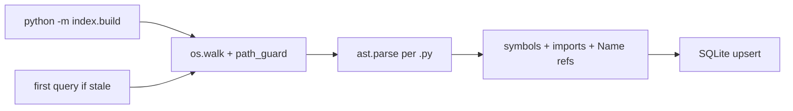

# Repo Index Lite Design (v0.6.0)

> **Status**: **Implemented** · PR-D1 Approved 2026-07-20 · v0.6.0 RC  
> **Baseline**: v0.5.0 · 214 pytest at tag · `find_file_dependencies` extended in C2  
> **Implementation**: C1 (index kernel) ✅ · C2 (FFD + context budget) ✅  
> **Related**: [V0.6_ROADMAP.md](../archive/V0.6_ROADMAP.md) · [task_checkpoint.md](task_checkpoint.md)

---

## English Summary

RepoPilot **v0.6.0** adds a **deterministic, AST-based repo index** for Python symbols (definitions + references) and import relationships. It **extends** the existing **`find_file_dependencies`** tool rather than adding a new ReAct tool when possible.

A **context budget + file ranking** layer uses index output to prioritize which files enter LLM context before truncation. **No embedding RAG** in v0.6; interfaces are reserved for **v0.8 hybrid retrieval** behind the same search/analysis entrypoints.

---

## 1. Goals and non-goals

### 1.1 Goals

| Goal | Description |
|------|-------------|
| **Symbol index** | For `.py` files under `REPO_ROOT`: classes, functions, methods (top-level + class body) |
| **Reference lookup** | Given symbol name or `path` + optional `symbol`, return definition site(s) + referencing files/lines |
| **Import graph reuse** | Keep v0.5 import/dependent scan; merge results with symbol index in one tool response |
| **Extend, don't split** | Prefer extending **`find_file_dependencies`**; ReAct tools stay **14** |
| **Context ranking** | Rank candidate files for read/propose using index + deps + optional `affected_files` |
| **Context budget** | Enforce char/token budget with auditable truncation (no full file content in audit) |
| **v0.8 hook** | Stable internal query interface for future semantic backend |

### 1.2 Non-goals (v0.6.0)

| Out of scope | Notes |
|--------------|-------|
| Embedding / vector RAG | See §2 |
| Cross-language AST (JS/Go) | v0.7.x candidate |
| Full type inference / LSP | Out of scope |
| Persistent index across unrelated repos without rebuild | Index keyed by `repo_root` + commit |
| Index mutation from Agent tools | Index is read-only; build via CLI or lazy refresh |
| Replacing `search_in_repo` grep | grep remains; semantic deferred to v0.8 |

---

## 2. Why no RAG in v0.6

### 2.1 Problem diagnosis

After v0.5.0, failed or weak Agent runs usually trace to:

1. **Wrong file set** — Agent grepped keywords but missed structurally related code  
2. **Context overflow** — Too many `read_repo_file` calls or oversized reads  
3. **Not retrieval gap** — Users rarely need “documentation QA over PDFs”

RAG optimizes **semantic similarity**; v0.6 needs **structural correctness** (symbol exists at line X, imported by file Y).

### 2.2 RAG risks if rushed

| Risk | Impact |
|------|--------|
| Non-deterministic retrieval | Hard to regression-test in CI |
| Stale embeddings after edits | Wrong file suggestions mid-task |
| Extra dependencies | Chroma/embeddings not in current CI path |
| Tool proliferation | Temptation to add `semantic_search` tool |
| Audit leakage | Chunks may contain secrets; needs redaction review |

### 2.3 What we do instead

| Layer | v0.6 | v0.8 |
|-------|------|------|
| Exact text | `search_in_repo` (grep) | Same |
| Structure | **AST index** | Same + rank boost |
| Similarity | — | Optional embeddings |
| Merge | — | Hybrid rank in search kernel |

**Decision**: Ship **index + budget** first; measure symbol query eval; then decide on semantic layer with data.

---

## 3. Tool strategy: extend `find_file_dependencies`

### 3.1 Current behavior (v0.5)

- Input: `path` (Python file)  
- Output: imports extracted from file + repo-wide scan for files that import target module  
- No symbol-level definition/reference  

### 3.2 Proposed extension

**Option A (preferred)** — extend args on same tool:

```python
class FindFileDependenciesArgs(BaseModel):
    path: str = ""                    # legacy: required for import/deps mode
    symbol: str | None = None         # new: e.g. "react_agent", "FileChange"
    query_mode: Literal[
        "dependencies",               # default / legacy: imports + dependents
        "symbol",                     # definition + references for symbol
        "auto",                       # if symbol set → symbol; elif path → dependencies
    ] = "auto"
    max_results: int = 100
```

**Response shape (symbol mode)** — human-readable text (Agent-facing), structured sections:

```
Symbol 查询: react_agent
定义:
  - react_agent.py:29  def react_agent(...)
引用 (最多 N 条):
  - api/agent_runner.py:14  react_agent(
  - test_llm_golden.py:...  patch react_agent
Import 关系 (可选摘要):
  - react_agent.py imports: llm, schemas, tools.tool_manager, ...
```

**Backward compatibility**: `path` + no `symbol` + default `query_mode` → **identical** to v0.5 output format (golden tests unchanged).

### 3.3 Exception clause — new tool

Add **`find_symbol_references`** only if:

- Combined parameter matrix makes prompt/docs unmaintainable, **and**  
- readonly / `AGENT_MODE` policies cannot be shared cleanly  

**Current assessment (2026-07-20, Approved)**: **Option A sufficient.** Three logical modes only — **dependency**, **symbol**, **reference** — share one tool entrypoint. Re-evaluate during C2 if combined surface becomes unmaintainable (exception clause).

---

## 4. Index architecture

### 4.1 Module layout

```
index/
  __init__.py
  builder.py          # walk repo, parse, persist
  store.py            # SQLite read/write
  query.py            # symbol/ref/import queries
  models.py           # SymbolRecord, ReferenceRecord
  ranking.py          # file ranking for context budget (C2)
  protocol.py         # RetrievalBackend protocol (v0.8 hook)
```

### 4.2 Index store

| Field | Value |
|-------|-------|
| **Location** | **`database/repo_index.db`** — separate from `database/tasks.db` |
| **Gitignore** | Same as `database/` directory |
| **Key** | `repo_key` = SHA256(normalized absolute `REPO_ROOT`) |
| **Provenance** | `built_at`, `head_commit` (or empty if no git), `file_count`, `symbol_count`, `index_version` |
| **Scope** | Same path rules as `path_guard`: allowed extensions, ignored dirs, blocked files skipped |

### 4.2.1 Lifecycle（build / refresh / invalidate）

| Phase | Trigger | Behavior |
|-------|---------|----------|
| **Build** | `python -m index.build [--force]` | Full walk + AST parse → populate / replace rows for `repo_key` |
| **Refresh** | Lazy on first query when `INDEX_AUTO_REBUILD=1` and stored `head_commit` ≠ current `git rev-parse HEAD` | Rebuild index for current `repo_key`; audit `index_refreshed` (summary only) |
| **Invalidate** | `REPO_ROOT` change · manual `--force` · `INDEX_ENABLED` toggled 0→1 | Old `repo_key` rows retained but unused; queries use new key |
| **Disabled** | `INDEX_ENABLED=0` | **No DB open/write**; FFD symbol modes unavailable; dependency mode uses **v0.5 walk-only** path |

**v0.5 compatibility**: With `INDEX_ENABLED=0`, all v0.5 behavior unchanged — no requirement to create `repo_index.db`.

### 4.2.2 Separation from task SQLite

| DB | Path | Purpose |
|----|------|---------|
| `tasks.db` | `database/tasks.db` | Task status, question, answer |
| `repo_index.db` | **`database/repo_index.db`** | Symbol/import/reference index (read-only to Agent) |

No foreign keys between the two. Tests isolate both under `tmp_path/database/`.

**Tables (SQLite, draft)**:

```sql
-- symbols
CREATE TABLE symbols (
  id INTEGER PRIMARY KEY,
  repo_key TEXT NOT NULL,
  path TEXT NOT NULL,           -- repo-relative posix
  name TEXT NOT NULL,
  kind TEXT NOT NULL,           -- function | class | method
  lineno INTEGER NOT NULL,
  end_lineno INTEGER,
  qualname TEXT                 -- e.g. FileChange.validate_input_mode
);

CREATE INDEX idx_symbols_repo_name ON symbols(repo_key, name);
CREATE INDEX idx_symbols_repo_path ON symbols(repo_key, path);

-- references (textual / ast Name loads — best effort)
CREATE TABLE references (
  id INTEGER PRIMARY KEY,
  repo_key TEXT NOT NULL,
  symbol_name TEXT NOT NULL,
  path TEXT NOT NULL,
  lineno INTEGER NOT NULL,
  col_offset INTEGER,
  context TEXT                  -- truncated line text, max 200 chars
);

-- imports (per file, normalized)
CREATE TABLE imports (
  id INTEGER PRIMARY KEY,
  repo_key TEXT NOT NULL,
  path TEXT NOT NULL,
  imported_module TEXT NOT NULL,
  imported_name TEXT,
  lineno INTEGER
);
```

### 4.3 Build pipeline



| Mode | Trigger | When |
|------|---------|------|
| **CLI build** | `python -m index.build [--force]` | Manual / CI fixture |
| **Lazy refresh** | First `find_file_dependencies(symbol=...)` if `head_commit` ≠ indexed | Default on |
| **Disabled** | `INDEX_ENABLED=0` | Tests / fallback to v0.5 |

**Parser**: stdlib `ast` only (no external deps). SyntaxError file → skip with warning in build log (not fatal).

### 4.4 Query API (internal)

```python
# index/query.py — not exposed as ReAct tool directly

def find_symbol_definitions(repo_key: str, name: str, *, limit: int) -> list[SymbolRecord]: ...

def find_symbol_references(repo_key: str, name: str, *, limit: int) -> list[ReferenceRecord]: ...

def get_file_imports(repo_key: str, path: str) -> list[ImportRecord]: ...

def get_dependents(repo_key: str, path: str, *, limit: int) -> list[str]: ...  # reuse v0.5 logic or index
```

`find_file_dependencies()` in `repo_analyzer.py` calls these based on `query_mode`.

---

## 5. Symbol / reference semantics (Python MVP)

### 5.1 Indexed definitions

| AST node | Indexed as |
|----------|------------|
| `FunctionDef` / `AsyncFunctionDef` | `kind=function`, `name`, `qualname=name` |
| `ClassDef` | `kind=class` |
| Methods in class body | `kind=method`, `qualname=Class.method` |

### 5.2 References (best effort)

- Walk AST for `ast.Name` where `id == symbol_name`  
- Exclude definition lines of same symbol in same scope (basic)  
- **Known limitation**: conflates homonyms (`id`, `path`) — response must include **path + lineno** for Agent disambiguation  
- No type-aware resolution (no mypy/pyright)

### 5.3 Import / dependent graph

- **Imports**: reuse `_extract_imports` logic; persist to `imports` table on build  
- **Dependents**: prefer index-backed lookup; fall back to v0.5 walk if index missing  

---

## 6. Context budget + file ranking

### 6.1 Problem

- `DEFAULT_READ_MAX_CHARS = 20000` per read; propose loads multiple files  
- Agent may read low-value files first; hits step limit before mutation  

### 6.2 Ranking inputs

| Signal | Weight (draft) | Source |
|--------|----------------|--------|
| User / propose `affected_files` | Highest | propose optional field |
| Symbol query result paths | High | index query |
| Direct import / dependents of target | Medium | index / FFD |
| `analyze_repo_structure` key files | Medium | repo_analyzer KEY_FILES |
| grep hit order | Low | search_in_repo |
| Lexicographic tie-break | — | stable sort |

### 6.3 Budget application points

| Call site | Behavior |
|-----------|----------|
| `propose_code_changes` `_load_context()` | Rank `target_files` + index-expanded neighbors; truncate with summary |
| `read_repo_file` (optional internal) | If cumulative task read exceeds `CONTEXT_BUDGET_CHARS`, return truncated + notice |
| **Checkpoint resume** | Restore ranked file list hint from checkpoint metadata (see [task_checkpoint.md §7](task_checkpoint.md#7-integration-with-context--index)) |

### 6.4 Settings

```python
# config/settings.py (proposed)
INDEX_ENABLED = env bool, default "1"
INDEX_AUTO_REBUILD = env bool, default "1"
INDEX_DB_FILE = DATABASE_DIR / "repo_index.db"   # confirmed path
CONTEXT_BUDGET_CHARS = env int, default "80000"   # per-task cumulative read budget
CONTEXT_RANK_MAX_FILES = env int, default "20"    # max files considered for propose load
```

### 6.5 Audit events（v0.8 retrieval eval 基线数据）

Every budget application writes **`context_budget_applied`** with **counts and reasons** — no file bodies:

```json
{
  "event": "context_budget_applied",
  "task_id": "...",
  "candidates_count": 12,
  "selected_count": 8,
  "truncated_count": 4,
  "truncation_reason": "budget_exceeded",
  "budget_chars": 80000,
  "chars_used": 78500,
  "truncated_paths": "tools/tool_manager.py, ...",
  "rank_source": "affected_files+index"
}
```

| Field | Meaning |
|-------|---------|
| `candidates_count` | 原始候选文件数（rank 输入全集） |
| `selected_count` | 最终纳入上下文文件数 |
| `truncated_count` | `candidates_count - selected_count` |
| `truncation_reason` | `budget_exceeded` · `rank_cut`（超 `CONTEXT_RANK_MAX_FILES`）· `file_too_large` · `none` |
| `budget_chars` | 配置的 budget 上限 |
| `chars_used` | 本次应用后累计用量 |
| `truncated_paths` | 被截断路径列表（截断至 audit 字段上限） |
| `rank_source` | 排序依据摘要（便于 v0.8 eval 对照） |

**No** file content in audit — paths and counts only (same policy as batch patch).

---

## 7. Integration with checkpoint

When task resumes from checkpoint:

1. Restore ReAct `memory` from snapshot  
2. Restore `context_state`: `{ files_read, chars_used, rank_snapshot }`  
3. Ranker **does not** re-read files already in memory unless user question changes scope  

Details: [task_checkpoint.md](task_checkpoint.md).

---

## 8. v0.8 hybrid retrieval interface (reserved)

### 8.1 Design principle

Agent **still** calls `search_in_repo` and extended `find_file_dependencies`. Semantic search is a **backend**, not a new ReAct tool.

### 8.2 Protocol (draft)

```python
# index/protocol.py

from typing import Protocol

class RetrievalBackend(Protocol):
    name: str  # "grep" | "symbol" | "semantic"

    def search(
        self,
        query: str,
        *,
        repo_key: str,
        limit: int,
    ) -> list[RetrievalHit]:
        """RetrievalHit: path, line, score, snippet (truncated), backend"""
        ...

class HybridRetriever:
    def __init__(self, backends: list[RetrievalBackend]): ...

    def merge_rank(self, query: str, *, limit: int) -> list[RetrievalHit]:
        """Weighted merge; symbol exact match boosts; semantic fills gaps"""
        ...
```

### 8.3 v0.6 deliverables for v0.8

| Artifact | Purpose |
|----------|---------|
| `RetrievalHit` dataclass | Unified result shape |
| `SymbolBackend` implements protocol | Ships in v0.6 |
| `GrepBackend` wrapper | Wraps existing `search_in_repo` kernel |
| `HybridRetriever.merge_rank` stub | Raises `NotImplementedError` or grep-only pass-through |
| Eval fixture format | `tests/eval_retrieval/cases.json` schema documented, **empty or symbol-only cases in v0.6** |

### 8.4 v0.8 activation gate (reminder)

Ship semantic when **all**:

1. Symbol eval baseline exists (v0.6)  
2. ≥20 hybrid eval cases with top-5 path hit rate documented  
3. `SEMANTIC_SEARCH_ENABLED=0` default; index staleness policy defined  
4. No embedding vectors in audit JSONL  

---

## 9. Acceptance criteria & testing strategy

### 9.1 Functional acceptance

- [x] `python -m index.build` on fixture repo produces `repo_index.db` with expected symbol counts  
- [x] `find_file_dependencies(path="schemas.py")` output **unchanged** vs v0.5 golden baseline  
- [x] `find_file_dependencies(symbol="FileChange")` returns definition + ≥1 reference in indexed files  
- [x] `find_file_dependencies(symbol="NonExistentSymbolX")` → clear empty result (not exception)  
- [x] `INDEX_ENABLED=0` → symbol mode returns graceful message; deps mode uses v0.5 walk-only  
- [x] Context budget truncates when loading >N files in propose fixture; audit event present  
- [x] `affected_files` in propose JSON prioritizes those paths in load order  
- [x] readonly mode: all index/query paths allowed; no writes to index from Agent  
- [ ] `read_repo_file` context budget truncate（deferred · 未实现）

### 9.2 Unit tests

| File | Covers |
|------|--------|
| `test_index_builder.py` | AST extract, SyntaxError skip, ignored dirs |
| `test_index_query.py` | symbol def/ref, import table |
| `test_index_ranking.py` | rank order stability, budget math |
| `test_context_ranking.py` · `test_ffd_*.py` | rank order; FFD extended args, backward compat |

### 9.3 Integration tests

- Build index in `tmp_path` repo; call `run_tool("find_file_dependencies", {...})`  
- End-to-end: propose with `affected_files` → verify truncated context message  
- Parallel with v0.5 security tests (`path_guard`, blocked files not indexed)  

### 9.4 Golden eval (orchestration)

| Case (proposed) | Mode | Assert |
|-----------------|------|--------|
| `symbol_lookup_before_propose` | A | FFD(symbol) → propose → no mutation |
| `readonly_allows_symbol_query` | B | real run_tool symbol mode ok |
| `context_budget_does_not_skip_propose` | A | propose still called after rank |

### 9.5 Manual smoke (RC)

1. Index build on RepoPilot self-repo  
2. Ask Agent to find who calls `apply_patch` via FFD symbol/ref  
3. Large `target_files` propose — confirm truncation notice in output  

### 9.6 Non-goals for test suite

- No network / embedding tests in v0.6 CI  
- No live LLM requirement  

---

## 10. Security & privacy

| Rule | Implementation |
|------|----------------|
| Same path guard as read tools | Index builder uses `resolve_repo_path`, `is_blocked_file`, `is_ignored_dir` |
| No secrets in index | Reference `context` truncated 200 chars; apply redaction if needed |
| Index DB gitignored | Like `tasks.db` |
| readonly safe | Index build/query never mutates repo |

---

## 11. Design decisions (Approved 2026-07-20)

| # | Question | Decision |
|---|----------|----------|
| Q1 | Index DB path | **`database/repo_index.db`** (separate from `tasks.db`) |
| Q2 | Lazy rebuild policy | Rebuild when stored `head_commit` ≠ current HEAD (if `INDEX_AUTO_REBUILD=1`) |
| Q3 | Method references | Bare `symbol` query + `qualname` in detail lines for disambiguation |
| Q4 | `read_repo_file` budget | Truncate with header notice (do not hard-reject) |
| Q5 | FFD parameter names | Converge in **C2**; three modes: dependency / symbol / reference |

---

## 12. Document history

| Date | Status | Notes |
|------|--------|-------|
| 2026-07-20 | Draft | Initial design for v0.6.0 review |
| 2026-07-20 | **Approved** | Review resolutions: DB path, lifecycle, audit fields, FFD strategy |
