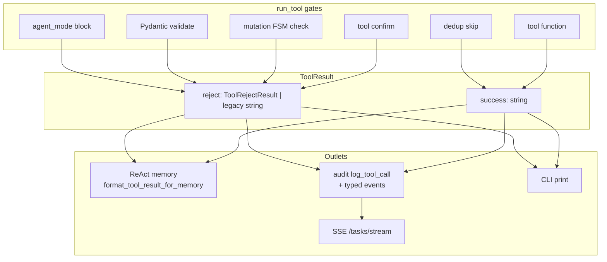

# PR-S0 — Structured Tool Results Design（详细设计）

> **Status**: **Implemented** · v0.9.0 PR-S1 (2026-07-21)  
> **Flag**: `STRUCTURED_TOOL_REJECT_ENABLED=0`（default）  
> **Baseline**: PR-F2 @ `47881d2` · PR-S1 @ `77cb6c5`  
> **Parent design**: [mutation_fsm.md](mutation_fsm.md) §5 · [mutation_fsm_pr_f2.md](mutation_fsm_pr_f2.md) · [V0.9_ROADMAP.md](../archive/V0.9_ROADMAP.md)  
> **Out of scope (PR-S1 · PR-E1)**: 运行时代码 · golden cases · OpenAPI breaking change

---

## English Summary

**PR-S0** defines a unified **structured reject schema** for `run_tool` gate failures (FSM · agent mode · confirm · validation). Success paths remain plain strings in v0.9. The design specifies schema fields, compatibility with today's string returns, hook points in `run_tool` / ReAct memory / audit / SSE, and a migration path from PR-F2 FSM string rejects to structured payloads — **without** changing HTTP API response shapes or default flags.

---

## 1. PR-S0 目标与 scope guard

### 1.1 目标

| # | 交付 |
|---|------|
| G1 | 统一 **reject** schema：`{ ok, code, message, details }` |
| G2 | 明确与现有 **string tool return** 的兼容策略（flag off = v0.8.2 行为） |
| G3 | 定义 `run_tool` → ReAct memory → audit → SSE/CLI 四段数据流 |
| G4 | FSM reject 从 PR-F2 string 迁移到 structured 的设计路径（S1 实现） |
| G5 | Reject **code 注册表** + audit 字段对齐（含 PR-F2 `mutation_fsm_blocked`） |

### 1.2 PR-S0 不做（scope guard）

| 项 | 归属 |
|----|------|
| 运行时代码变更 | **PR-S1** |
| FSM 状态机 / checkpoint 逻辑修改 | **PR-F1/F2**（已完成） |
| Golden illegal-order cases | **PR-E1** |
| OpenAPI / `TaskResponse` schema breaking change | 禁止 |
| 14 工具 **success** 路径改 JSON | defer v0.9+ |
| 默认 flag 修改（`MUTATION_FSM_ENABLED` · dedup · 新 flag） | defer PR-P1 / v0.9.x |
| dedup skip 改为 structured reject | **不做**（见 §4.4） |

### 1.3 当前 baseline（PR-F2 @ `47881d2`）

| 场景 | 当前 `run_tool` 返回 | 当前 audit |
|------|------------------------|------------|
| FSM illegal transition | `Mutation workflow blocked: tool=... current=... required=... code=mutation_fsm_blocked` | `mutation_fsm_blocked` event（F2）+ `tool_call` |
| Readonly mode block | `工具 {tool} 在 readonly 模式下不可用` | `tool_call` only |
| Confirm deny | `用户已取消执行工具: {tool}` | `tool_call` only |
| Pydantic validation | `参数错误: {field} - {msg}` | `tool_call`（status=error） |
| Unknown tool | `不存在的工具` | `tool_call`（status=error） |
| Dedup skip | `跳过重复 ...`（string） | `execution_state_dedup` + `tool_call` |
| Tool success | 业务 string（如 `Patch 应用完成\n...`） | `tool_call`（status=success） |

ReAct memory 注入（所有路径统一）：

```
工具执行结果:
{str(result)}
```

---

## 2. 问题陈述

### 2.1 为何需要 structured reject

| 痛点 | 说明 |
|------|------|
| **不可机器解析** | Golden / eval 靠 substring 匹配 `code=mutation_fsm_blocked` 或中文前缀，脆弱 |
| **audit 与 memory 重复解析** | F2 从 reject string 反向解析 `required_state` 写入 audit |
| **三出口不一致** | CLI `print`、memory 注入、SSE `tool_call.result` 均为同一 string，但 HTTP 客户端无法区分 reject **类型** |
| **扩展成本高** | 每新增 gate（mode · confirm · validation）各自 string 格式，无统一 `code` |

### 2.2 v0.9 边界

- **仅 reject 结构化** — success 仍为 string（14 工具零迁移）
- **不 breaking HTTP** — `GET /tasks/{id}`、`TaskResponse` 不变；structured 信息经 **audit SSE** 与 **memory 内嵌 marker** 暴露
- **flag gated** — 新 flag 默认 off，golden CI 非回归

---

## 3. Result schema

### 3.1 类型模型（design-only）

```python
# design-only — PR-S1 实现于 schemas.py 或 tools/result_schema.py
from typing import Any, Literal, TypedDict


class ToolRejectDetails(TypedDict, total=False):
    tool: str
    agent_mode: str
    current_state: str
    required_state: str
    mutation_path: str
    field: str
    validation_msg: str
    reason: str


class ToolRejectResult(TypedDict):
    ok: Literal[False]
    code: str
    message: str
    details: dict[str, Any]  # ToolRejectDetails subset


# Success path (v0.9): unchanged
ToolResult = str | ToolRejectResult
```

### 3.2 顶层字段

| 字段 | 必填 | 类型 | 说明 |
|------|------|------|------|
| `ok` | ✅ | `false` | reject 固定为 `false`；success 无此字段（仍为 string） |
| `code` | ✅ | `str` | 稳定机器码；见 §3.3 |
| `message` | ✅ | `str` | 人类可读；**注入 ReAct memory 的主文本** |
| `details` | ✅ | `object` | 结构化上下文；audit 可嵌入；**不含** diff / file content / 完整 args |

### 3.3 Reject code 注册表（v0.9 S1 首批）

| `code` | 触发场景 | 当前 string 等价 |
|--------|----------|------------------|
| `mutation_fsm_blocked` | FSM illegal transition（`MUTATION_FSM_ENABLED=1`） | `Mutation workflow blocked: ...` |
| `tool_not_allowed` | `agent_mode` 禁止该工具（readonly block mutation tools） | `工具 X 在 readonly 模式下不可用` |
| `confirm_rejected` | 用户/API confirm deny | `用户已取消执行工具: X` |
| `validation_error` | Pydantic `args_model` 校验失败 | `参数错误: field - msg` |
| `tool_not_found` | `name not in TOOLS` | `不存在的工具` |

**Reserved（S1 不实现，文档占位）**：

| `code` | 场景 | 备注 |
|--------|------|------|
| `confirm_timeout` | API confirm 超时 | 现有 timeout 行为待 S1 对齐 |
| `backup_required` | `PATCH_REQUIRE_BACKUP` 硬拒绝 | v0.8 spot gate；非 FSM |

### 3.4 示例 payload

#### FSM reject（迁移目标）

```json
{
  "ok": false,
  "code": "mutation_fsm_blocked",
  "message": "Mutation workflow blocked: apply_patch requires BACKED_UP (current=PROPOSED, path=NONE)",
  "details": {
    "tool": "apply_patch",
    "current_state": "PROPOSED",
    "required_state": "BACKED_UP",
    "mutation_path": "NONE",
    "reason": "illegal_transition"
  }
}
```

#### Readonly block

```json
{
  "ok": false,
  "code": "tool_not_allowed",
  "message": "工具 apply_patch 在 readonly 模式下不可用",
  "details": {
    "tool": "apply_patch",
    "agent_mode": "readonly"
  }
}
```

#### Confirm reject

```json
{
  "ok": false,
  "code": "confirm_rejected",
  "message": "用户已取消执行工具: apply_patch",
  "details": {
    "tool": "apply_patch"
  }
}
```

#### Validation error

```json
{
  "ok": false,
  "code": "validation_error",
  "message": "参数错误: path - Field required",
  "details": {
    "tool": "read_repo_file",
    "field": "path",
    "validation_msg": "Field required"
  }
}
```

### 3.5 `message` 与 PR-F2 string 兼容

S1 启用 structured reject 时，`message` **应保留** PR-F2 FSM string 的可读格式（或超集），以便：

- CLI 打印体验不变
- 过渡期测试可 `assert code in str(result)` 或解析 JSON

FSM `message` 推荐格式（与 F1/F2 `_reject_message` 对齐）：

```
Mutation workflow blocked: tool={tool} current={state} required={required} [path={path}] code=mutation_fsm_blocked
```

`details` 承载结构化字段；`message` 不再作为唯一数据源。

---

## 4. 与现有 string return 的兼容策略

### 4.1 核心原则

| 原则 | 说明 |
|------|------|
| **Success = string** | v0.9 全部 14 工具成功路径保持 string |
| **Reject = dual representation** | S1：`run_tool` 内部可返回 `ToolRejectResult`；边界统一 serialize |
| **Flag off = string only** | `STRUCTURED_TOOL_REJECT_ENABLED=0`（默认）→ 与 v0.8.2 **字节级 reject 格式兼容** |
| **No HTTP breaking** | API response body 不新增 structured 字段 |

### 4.2 新 flag（S1 实现，S0 仅设计）

```python
# config/settings.py — design proposal
STRUCTURED_TOOL_REJECT_ENABLED = os.getenv(
    "STRUCTURED_TOOL_REJECT_ENABLED", "0"
).strip().lower() not in {"0", "false", "no", "off"}
```

| Flag | 行为 |
|------|------|
| `STRUCTURED_TOOL_REJECT_ENABLED=0`（**默认**） | 所有 reject 返回 **legacy string**（与 v0.8.2 一致） |
| `STRUCTURED_TOOL_REJECT_ENABLED=1` | reject 返回 **`ToolRejectResult` dict**（Python 层）；边界 serialize |

**与 `MUTATION_FSM_ENABLED` 关系**：

| FSM | STR | FSM reject 形态 |
|-----|-----|-----------------|
| 0 | 0 | 无 FSM guard |
| 1 | 0 | legacy FSM string（PR-F2  today） |
| 1 | 1 | structured `mutation_fsm_blocked` |
| 0 | 1 | 其他 gate structured；FSM 不触发 |

FSM audit `mutation_fsm_blocked`：**FSM flag on 即 emit**（与 STR flag 无关，PR-F2 行为保持）。

### 4.3 Serialize / deserialize helper（S1 接口 sketch）

```python
def is_tool_reject(result: ToolResult) -> bool:
    return isinstance(result, dict) and result.get("ok") is False


def tool_reject(
    code: str,
    message: str,
    *,
    details: dict[str, Any] | None = None,
) -> ToolRejectResult:
    ...


def format_tool_result_for_memory(result: ToolResult) -> str:
    """Always returns str for ReAct memory injection."""
    if is_tool_reject(result):
        if is_structured_tool_reject_enabled():
            # Machine marker + human message for eval parsing
            payload = json.dumps(result, ensure_ascii=False)
            return result["message"] + "\n<!-- tool_reject:" + payload + " -->"
        return result["message"]  # flag off: legacy path uses str directly
    return str(result)


def format_tool_result_for_display(result: ToolResult) -> str:
    """CLI print — human message only."""
    if is_tool_reject(result):
        return result["message"]
    return str(result)


def legacy_string_for_reject(reject: ToolRejectResult) -> str:
    """Flag-off serialization at run_tool return boundary."""
    return reject["message"]
```

**Memory 内嵌 marker 策略（S1）**：

- 在 user memory 追加 `<!-- tool_reject:{json} -->` suffix（HTML comment 风格，LLM 通常忽略）
- Golden / E1 可解析 `code` 而不依赖 fragile substring
- Flag off 时不追加 marker

### 4.4 明确不 struct 化的路径

| 路径 | 类型 | 理由 |
|------|------|------|
| Tool **success** | string | scope；14 工具零改动 |
| **dedup skip** | string (`跳过重复 ...`) | 非 error；是 idempotent skip；已有 `execution_state_dedup` audit |
| **cancel mid-loop** | task status | 非 tool result |

---

## 5. 架构与接入位置

### 5.1 数据流总览



### 5.2 `run_tool` 评估顺序（不变）

与 [mutation_fsm.md](mutation_fsm.md) §6.1 一致：

```
1. tool exists
2. agent_mode block          → tool_not_allowed
3. Pydantic args validate    → validation_error
4. mutation FSM check        → mutation_fsm_blocked  (FSM flag)
5. _invoke_registered_tool:
   a. execution_state dedup  → skip string (not reject)
   b. tool confirm           → confirm_rejected
   c. tool function          → success string
6. FSM advance on success
7. log_tool_call + return
```

**S1 改动点**：步骤 2/3/5b 及 unknown tool 改调用 `tool_reject(...)` helper；return 前按 flag 选择 dict vs legacy string。

### 5.3 ReAct agent loop

| 位置 | 当前 | S1 目标 |
|------|------|---------|
| `react_agent` L550 `run_tool(...)` | 接收 `str` | 接收 `ToolResult` |
| memory append L602 | `"工具执行结果:\n" + str(result)` | `"工具执行结果:\n" + format_tool_result_for_memory(result)` |
| `log_react_step("tool_result", result=...)` | raw string | `format_tool_result_for_display(result)` 或 sanitized |
| `_update_execution_state_safe` | 传入 str | **skip update on reject**（现有：FSM reject 不含 success marker，已不 advance） |
| CLI `print("\n工具返回:", result)` | raw | `format_tool_result_for_display(result)` |

**Reject 不 advance FSM / execution_state** — 与 PR-F1/F2 一致。

### 5.4 FSM reject 迁移（PR-F2 → S1）

| 层 | PR-F2（today） | S1 target |
|----|----------------|-----------|
| `check_mutation_fsm_allowed` | 返回 `str \| None` | 返回 `ToolRejectResult \| None`（内部） |
| `_mutation_fsm_check` | 传 string 给 audit builder | 从 `ToolRejectResult.details` 构建 audit |
| `build_mutation_fsm_blocked_audit` | 解析 reject **string** 取 `required_state` | 直接读 `details.required_state` |
| `is_fsm_reject_result(result)` | `startswith(FSM_REJECT_PREFIX)` | `is_tool_reject(r) and r["code"]=="mutation_fsm_blocked"` **或** legacy prefix（flag off） |
| `run_tool` return | FSM string | flag on: dict；flag off: legacy string |

**迁移步骤（S1，非 S0）**：

1. 新增 `tool_reject()` / `is_tool_reject()` helpers
2. FSM `_reject_message` → `tool_reject("mutation_fsm_blocked", message, details={...})`
3. `build_mutation_fsm_blocked_audit` 接受 `ToolRejectResult`
4. 保留 `is_fsm_reject_result` dual check（structured + legacy string）供 FSM advance guard
5. 单测：flag on/off 双路径

---

## 6. Audit / HTTP / CLI 三出口一致性

### 6.1 设计目标

| 出口 | 消费者 | 一致性规则 |
|------|--------|------------|
| **Audit JSONL** | 运维 / 合规 / 离线分析 | typed event + `tool_call.result` 含 sanitize 后文本 |
| **HTTP SSE** | Web UI / 集成方 | mirror audit record（现有 `publish_stream_event`） |
| **CLI stdout** | 开发者 | `message` 文本；structured 不打印 raw JSON（除非 `--verbose` defer） |

**不新增** HTTP response body 字段 — SSE 订阅者从 `tool_call` / `mutation_fsm_blocked` events 获取 structured 信息。

### 6.2 `tool_call` audit event（S1 扩展）

现有 shape（[audit_log.py](../../audit/audit_log.py) `log_tool_call`）：

```json
{
  "event": "tool_call",
  "task_id": "...",
  "tool": "apply_patch",
  "args": { "...": "sanitized" },
  "result": "...",
  "duration_ms": 1.23,
  "status": "success" | "error"
}
```

S1  proposed extensions（**additive, non-breaking**）：

```json
{
  "event": "tool_call",
  "tool": "apply_patch",
  "result": "Mutation workflow blocked: ...",
  "status": "error",
  "reject_code": "mutation_fsm_blocked",
  "reject_details": {
    "current_state": "PROPOSED",
    "required_state": "BACKED_UP",
    "mutation_path": "NONE"
  }
}
```

| 字段 | 条件 | 说明 |
|------|------|------|
| `reject_code` | reject only | 与 `ToolRejectResult.code` 相同 |
| `reject_details` | reject only | sanitize + truncate；**不含** raw args / diff |
| `result` | always | 始终为 `message` 文本（SSE/CLI 可读） |
| `status` | reject | **`error`**（扩展：FSM/mode/confirm reject 均标 error） |

**status 规则更新（S1）**：

| result 类型 | `status` |
|-------------|----------|
| success string | `success` |
| any structured reject | `error` |
| dedup skip string | `success`（idempotent skip，非 failure） |
| legacy reject string | 按 prefix 表推断（与 today 兼容） |

### 6.3 Typed audit events 与 structured reject 关系

| Event | 与 STR 关系 |
|-------|-------------|
| `mutation_fsm_blocked` | **保留**（PR-F2）；字段与 `reject_details` **对齐**；FSM flag on 时 emit |
| `execution_state_dedup` | 不变；非 reject |
| `tool_confirmation` | 不变；confirm flow 已有 |

**Dedup 原则**：`mutation_fsm_blocked` 与 `tool_call.reject_code` **共存** — 前者为 typed domain event，后者为通用 tool_call 索引。

### 6.4 HTTP SSE 路径

```
run_tool → log_tool_call → write_audit_event → publish_stream_event → /tasks/{id}/stream
```

- 无新 endpoint
- SSE payload = audit record（含 optional `reject_code` / `reject_details`）
- Web client：**优先读 `reject_code`**；fallback 解析 `result` string（兼容 flag off）

### 6.5 CLI 路径

```
run_tool → react_agent print(format_tool_result_for_display(result))
         → memory(format_tool_result_for_memory(result))
```

CLI 与 memory **分离**：CLI 不暴露 HTML comment marker；memory 含 marker 供 eval。

---

## 7. 模块改动范围（PR-S1 预期，S0 仅列出）

| 模块 | S1 变更 |
|------|---------|
| `schemas.py` 或 `tools/result_schema.py` | `ToolRejectResult` · helpers |
| `config/settings.py` | `STRUCTURED_TOOL_REJECT_ENABLED`（default **0**） |
| `tools/tool_manager.py` | gate 返回 · `log_tool_call` status · run_tool boundary |
| `context/mutation_fsm.py` | `_reject_message` → `tool_reject`；audit builder 输入 |
| `config/agent_mode.py` | `tool_blocked_message` → wrapper |
| `react_agent.py` | memory / display formatters |
| `audit/audit_log.py` | `log_tool_call` reject fields |
| `test_tool_result_*.py` | serialize · memory · audit · flag off regression |

**S0 / S1 均不修改**：

- `api/schemas.py` · route handlers
- `execution_state.py` dedup 逻辑
- Golden cases（**PR-E1**）
- 默认 flag

---

## 8. 测试计划（PR-S1 预览，供 S0 review 对齐）

### 8.1 Unit — result schema

| ID | 场景 | 期望 |
|----|------|------|
| U1 | `tool_reject(...)` 构造 | 必填字段齐全 |
| U2 | `is_tool_reject` | dict / string 判别 |
| U3 | `format_tool_result_for_memory` flag on | message + marker 含 `code` |
| U4 | `format_tool_result_for_memory` flag off | 纯 legacy string |
| U5 | `legacy_string_for_reject` | 仅返回 `message` |

### 8.2 Integration — gates

| ID | 场景 | 期望 |
|----|------|------|
| I1 | FSM block · STR on | dict + audit `reject_code` + `mutation_fsm_blocked` |
| I2 | FSM block · STR off | PR-F2 string 不变 |
| I3 | readonly block · STR on | `tool_not_allowed` |
| I4 | confirm reject · STR on | `confirm_rejected` |
| I5 | validation error · STR on | `validation_error` |

### 8.3 Regression

| ID | 场景 | 期望 |
|----|------|------|
| R1 | `STRUCTURED_TOOL_REJECT_ENABLED=0` 全量 pytest | **403+ passed**（与 F2 baseline 一致） |
| R2 | Golden 18 cases · flag off | 无回归 |
| R3 | dedup skip · STR on | 仍为 string；无 `reject_code` |

**E1 依赖 S1**：golden 解析 `<!-- tool_reject:... -->` 或 audit `reject_code`。

---

## 9. 验收标准（PR-S0 merge = 设计 review 通过）

- [ ] Design doc 覆盖 FSM · readonly · confirm · validation 四类 reject
- [ ] Success 路径明确仍为 string
- [ ] Flag off 与 v0.8.2 / PR-F2 string reject **兼容**
- [ ] Audit / memory / CLI 三出口规则明确；**无 HTTP breaking**
- [ ] FSM `mutation_fsm_blocked` audit 与 `ToolRejectResult.details` 字段对齐
- [ ] dedup skip 不纳入 structured reject
- [ ] 文档 status：**Design · Pending review**

---

## 10. 风险与 mitigations

| 风险 | Mitigation |
|------|------------|
| LLM 被 memory marker 干扰 | HTML comment 后缀；message 主体完整可读 |
| Golden 依赖旧 substring | E1 显式 `MUTATION_FSM_ENABLED=1` + STR on cases；默认 CI flag off |
| `tool_call.status` 语义变更 | FSM reject 已应为 error；S1 统一 reject → error |
| Audit 体积增大 | `reject_details` sanitize + truncate（复用 `_sanitize`） |
| 双 flag 组合爆炸 | 文档矩阵 §4.2；测试 cover 4 组合 |

---

## 11. PR-S0 与后续 PR 边界

| 后续 | 关系 |
|------|------|
| **PR-S1** | 实现本 schema + helpers + flag；FSM/mode/confirm/validation 四路径 |
| **PR-E1** | Golden illegal-order；解析 structured reject / audit `reject_code` |
| **PR-P1** | 默认 flag 评估；独立于 STR |
| **PR-F2** | 已完成；S1 **替换** string audit 解析，不删 `mutation_fsm_blocked` event |

---

## 12. 文档历史

| 日期 | 状态 | 备注 |
|------|------|------|
| 2026-07-20 | **Implemented · Pending review** | PR-S1 implementation @ pending commit |
| 2026-07-20 | **Design · Pending review** | PR-F2 @ `47881d2` 完成后首版 S0 设计 |
