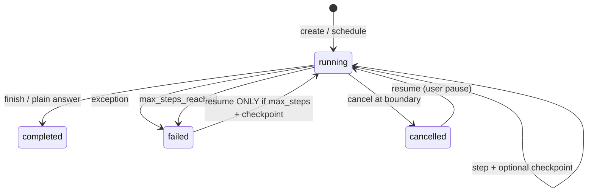

# Task Cancel & Checkpoint Design (v0.6.0)

> **Status**: **Implemented** · PR-D1 (2026-07-20) · v0.6.0 RC  
> **Baseline**: v0.5.0 · extended with `cancelled` status and checkpoint/resume  
> **Implementation**: C3-a/b/c storage + agent hooks ✅ · C3-d HTTP cancel/resume ✅ · Phase 2 audit/golden ✅  
> **Related**: [V0.6_ROADMAP.md](../archive/V0.6_ROADMAP.md)

---

## English Summary

RepoPilot **v0.6.0** adds **task cancellation** and **checkpoint/resume** for the ReAct loop. Checkpoints persist **memory snapshot + step counter + optional context budget state** to SQLite so HTTP and CLI long tasks can stop safely and continue without replaying from scratch.

This is **task-scoped** persistence — not cross-session “Agent memory”. **No RAG** involvement. Cancel/checkpoint events are auditable; snapshots **exclude** raw file contents where possible.

---

## 1. Goals and non-goals

### 1.1 Goals

| Goal | Description |
|------|-------------|
| **Cancel** | Stop a running task cooperatively at step boundary |
| **Checkpoint** | After each ReAct step, optionally persist resumable state |
| **Resume** | Continue same `task_id` from latest checkpoint |
| **API + CLI parity** | `POST /tasks/{id}/cancel`, `POST /tasks/{id}/resume` (or equivalent) |
| **Audit / report** | `task_cancelled`, `checkpoint_saved`, `task_resumed` events |
| **Context carry-over** | Save context budget counters for ranker on resume |

### 1.2 Non-goals (v0.6.0)

| Out of scope | Notes |
|--------------|-------|
| Cross-task / cross-session memory | One `task_id` = one checkpoint chain |
| Checkpoint inside `git apply` | Cancel waits for current tool to finish |
| Distributed / multi-worker cancel | Single-process threading model unchanged |
| Auto-checkpoint policy engine | Fixed: every step when enabled |
| Plan step machine | v0.7 planning |
| RAG index in checkpoint | Only store context **metadata**, not embeddings |

---

## 2. Why v0.6 needs cancel + checkpoint (with index & budget)

| Capability | Without checkpoint | With checkpoint |
|------------|-------------------|-----------------|
| 20-step ReAct on large repo | Fails at step 20 → user re-asks from 0 | Resume from step 20 with memory |
| HTTP client disconnect | Thread keeps running | User can cancel explicitly |
| Context budget mid-task | Re-read files after restart | Restore `chars_used` + rank hints |
| Index-assisted analysis | Re-query symbols after failure | Memory retains prior tool results |

**Together with repo index**: checkpoint makes **expensive analysis durable**; index makes **resume analysis consistent** without redundant FFD calls (tool results already in memory).

---

## 3. Task cancel

### 3.1 Semantics（Approved）

- **Cooperative cancel**: set flag on task record; `react_agent` checks **at tool boundary** — after previous tool returns, **before** next `ask_ai` or next `run_tool`  
- **No forced interrupt**: do **not** kill threads, inject exceptions into `run_tool`, or abort mid-`subprocess` / **`git apply`**  
- **Mutation safety**: cancel checked **before** mutation tools (`apply_patch`, `write_repo_file`); if mutation already running, it completes; cancel prevents **subsequent** steps only  
- **Confirm / backup unchanged**: resume path still requires propose → confirm → backup → apply order per prompt; checkpoint does not skip safety gates for **new** mutation intent  
- **Terminal status**: `TASK_STATUS_CANCELLED = "cancelled"`  

### 3.1.1 Cancel audit（request vs effective）

Two events when applicable:

```json
{ "event": "cancel_requested", "task_id": "...", "requested_at_step": 7, "reason": "user_request" }
{ "event": "task_cancelled", "task_id": "...", "effective_at_step": 8, "reason": "user_request" }
```

| Event | When |
|-------|------|
| `cancel_requested` | API/CLI sets flag (task still `running`) |
| `task_cancelled` | Loop observes flag at boundary; status → `cancelled` |

If cancel requested and observed at same boundary, emit both with same step.

### 3.2 State machine



**v0.6 MVP policy（Approved — avoid status confusion）**:

| Status | Meaning | Resume? |
|--------|---------|---------|
| **`cancelled`** | User-initiated pause (`cancel_requested` → boundary) | **Yes** → `running` |
| **`failed`** (exception) | Bug, I/O, LLM error, confirm pipeline error | **No** — create **new** `task_id` |
| **`failed`** (`max_steps_reached`) | Step limit hit | **Yes** if checkpoint exists |
| **`completed`** | Normal finish | **No** |

### 3.3 API

```
POST /tasks/{task_id}/cancel
→ 200 { "task_id", "status": "cancelled" }
→ 409 if not running
```

**CLI** (optional C3 or RC):

```bash
python react_agent.py --cancel-task <task_id>
```

### 3.4 Implementation hooks

```python
# storage/task_store.py
cancel_requested: bool  # or status transition only

def request_cancel(task_id: str) -> bool: ...

def is_cancel_requested(task_id: str) -> bool: ...
```

```python
# react_agent.py — check order at loop top (after step += 1)
if is_cancel_requested(task_id):
    ...

# react_agent.py — before run_tool for mutation tools (defense in depth)
if name in MUTATION_TOOLS and is_cancel_requested(task_id):
    return "任务已取消，跳过写入工具"
```

```python
# react_agent.py — top of while loop, after step += 1
if is_cancel_requested(task_id):
    log_react_step("task_cancelled", task_id=task_id, step=step, ...)
    update_task(task_id, status=TASK_STATUS_CANCELLED, answer="任务已取消")
    return "任务已取消", memory
```

```python
# api/agent_runner.py — thread remains joinable; cancel does not kill thread
# Optional: store thread ref in registry for diagnostics (not required v0.6)
```

### 3.5 Audit

```json
{
  "event": "task_cancelled",
  "task_id": "abc123",
  "step": 7,
  "reason": "user_request"
}
```

---

## 4. Checkpoint data model（Approved）

### 4.1 ReAct state — saved

| Field | Content | Purpose |
|-------|---------|---------|
| `task_id` | FK to tasks | Resume scope |
| `checkpoint_id` | UUID | Pointer / audit |
| `step` | ReAct step **after** last completed loop iteration | Continue counter |
| `memory_json` | Full LLM message list: `{role, content}`[] including **tool results as assistant/user messages** | Restores conversation + implicit tool history |
| `agent_mode` | `full` / `readonly` | Mode guard |
| `repo_root` | Absolute path at save time | Mismatch → reject resume |
| `context_state_json` | Budget + rank snapshot (see [repo_index.md §6](repo_index.md#6-context-budget--file-ranking)) | Avoid re-read / re-rank cold start |
| `execution_state_json` | Mutation pipeline markers (§4.1.1) | Avoid duplicate backup/apply |
| `created_at` | UTC ISO | Report ordering |

**`memory_json` includes** (via message content):

- User questions and follow-ups  
- AI raw outputs (tool JSON or text)  
- Tool result strings returned to LLM  
- **Not** a separate `tool_calls[]` table in v0.6 — tool history is recoverable from memory transcript  

### 4.1.1 `execution_state_json` — avoid duplicate backup / apply

Tracks **completed safety-chain milestones** for the current logical edit (reset when new `propose_code_changes` is accepted in memory after resume):

```json
{
  "proposal_digest": "sha256-of-last-propose-summary",
  "backup_branch": "agent-backup/20260720-125945",
  "backup_commit": "c626a6b...",
  "diff_previewed_paths": ["src/a.txt", "src/b.txt"],
  "patch_applied": false,
  "patch_applied_paths": []
}
```

| Resume scenario | Behavior |
|-----------------|----------|
| Memory already contains successful `git_create_backup` result **and** `execution_state.backup_branch` matches `last_backup.json` | Prompt hint: **do not** call backup again unless user explicitly requests re-backup |
| Memory already contains successful `apply_patch` for current `proposal_digest` | **Do not** re-apply; proceed to `finish` or await new user instruction |
| User sends **new** confirm after resume with **different** proposal scope | Reset `execution_state` · normal backup → apply flow |
| Cancelled mid-chain (backup done, apply not done) | Resume continues from memory; apply allowed **once** with confirm |

**Implementation note (C3)**: inject short **system hint** into memory on resume (not user-visible in audit) summarizing milestones — e.g. `"[checkpoint] backup exists: agent-backup/...; patch not yet applied"`. Golden eval asserts no duplicate backup when state valid.

### 4.2 ReAct state — NOT saved

| Excluded | Reason |
|----------|--------|
| Pending API confirm handles / queue tokens | Unsafe stale confirm — cleared on resume ([§5.3](#53-pending-confirmation-edge-case)) |
| `confirm_callback` / stream SSE callbacks | Runtime-only ContextVar |
| Raw unified diffs | Never in audit/checkpoint |
| Full `new_content` / patch args | Same as batch audit policy |
| Redacted-secret **raw** values before redaction | Store post-redaction memory only; optional redaction pass on save |
| Thread identifiers | Non-portable |
| Embedding / RAG vectors | v0.8 separate store |
| Ephemeral index build locks | Rebuilt from `repo_index.db` lifecycle |

### 4.3 SQLite schema (draft)

```sql
CREATE TABLE task_checkpoints (
    checkpoint_id TEXT PRIMARY KEY,
    task_id TEXT NOT NULL,
    step INTEGER NOT NULL,
    memory_json TEXT NOT NULL,
    agent_mode TEXT NOT NULL,
    repo_root TEXT NOT NULL,
    context_state_json TEXT,
    execution_state_json TEXT,
    created_at TEXT NOT NULL,
    FOREIGN KEY (task_id) REFERENCES tasks(task_id)
);

CREATE INDEX idx_checkpoints_task ON task_checkpoints(task_id, step DESC);
```

**Retention**: keep **latest N=5** per task_id; prune on insert.

### 4.4 When to save

| Trigger | Default |
|---------|---------|
| After each successful tool result appended to memory | ON if `CHECKPOINT_ENABLED=1` |
| After plain text answer (before return) | OFF — task completes |
| After `finish` | OFF — task completes |
| On cancel at boundary | Save **final** snapshot (enables pause → resume) |

### 4.5 Settings

```python
CHECKPOINT_ENABLED = env, default "1"
CHECKPOINT_MAX_PER_TASK = env int, default "5"
CHECKPOINT_MAX_MEMORY_BYTES = env int, default "500000"  # reject save if exceeded, log warning
```

---

## 5. Resume flow

### 5.1 API

```
POST /tasks/{task_id}/resume
Body: { "question": "optional follow-up or empty to continue" }
→ 200 { "task_id", "status": "running", "resumed_from_step": 7 }
→ 404 no checkpoint
→ 409 repo_root mismatch
```

Schedule agent on **same thread model** as new task but pass `memory` + `start_step` into `react_agent`.

### 5.2 `react_agent` signature extension

```python
def react_agent(
    question,
    memory=None,
    task_id=None,
    confirm_callback=None,
    max_steps=None,
    agent_mode=None,
    *,
    resume_from_step: int | None = None,   # new
    initial_context_state: dict | None = None,  # new
):
```

When resuming:

- Skip `create_task` if task exists  
- Set `step = resume_from_step` before loop  
- Restore `initial_context_state` into context module ContextVar  
- Append new user message if `question` non-empty  

### 5.3 Pending confirmation edge case

If task cancelled while **waiting for API confirm**:

| State | Resume behavior |
|-------|-----------------|
| Pending confirm in API queue | **Clear** pending; user must re-run mutation after resume |
| Audit | `confirm_cleared_on_resume` |

Rationale: stale confirm is unsafe; aligns with v0.5 confirm semantics.

### 5.4 Audit

```json
{ "event": "checkpoint_saved", "task_id": "...", "step": 7, "checkpoint_id": "...", "memory_bytes": 12345 }
{ "event": "task_resumed", "task_id": "...", "from_step": 7, "checkpoint_id": "..." }
```

---

## 6. Task store changes

### 6.1 New status

```python
TASK_STATUS_CANCELLED = "cancelled"
```

Update `get_task`, list filters, SSE `stream_end`, report rendering.

### 6.2 New columns (optional on `tasks` table)

| Column | Purpose |
|--------|---------|
| `last_checkpoint_id` | Quick resume pointer |
| `cancel_requested_at` | Debugging |

Or derive latest checkpoint via query — prefer **query** to minimize migration.

---

## 7. Integration with context & index

See [repo_index.md §6–7](repo_index.md#6-context-budget--file-ranking).

### 7.1 `context_state` JSON shape

```json
{
  "chars_used": 45000,
  "files_read": ["schemas.py", "tools/patch_apply.py"],
  "rank_snapshot": ["schemas.py", "tools/diff_engine.py", "tools/patch_apply.py"],
  "index_repo_key": "sha256-of-repo-root",
  "index_head_commit": "c626a6b..."
}
```

On resume:

1. If `index_head_commit` ≠ current HEAD → log warning; ranker may rebuild hints  
2. `chars_used` continues from saved value  
3. Files in `memory` tool results **not** re-read unless user asks to refresh  

### 7.2 Why no RAG in checkpoint

Embedding stores are large, stale-sensitive, and not needed to restore ReAct memory. v0.8 semantic index will use **separate** store keyed by commit; checkpoint only holds **pointers**, not vectors.

---

## 8. v0.8 hybrid retrieval interface (reserved)

Checkpoint / cancel do **not** call retrieval directly. Reserved integration:

| v0.8 feature | v0.6 hook |
|--------------|-----------|
| Hybrid search results in memory | Already in tool result messages |
| Re-run retrieval on resume | New optional `question` on resume triggers fresh search — **no checkpoint schema change** |
| Eval | Resume golden case can assert search not duplicated when question empty |

Document only — no v0.6 implementation.

---

## 9. task_report updates

New summary lines:

```
- [time] 任务取消 · step 7
- [time] Checkpoint 保存 · step 5
- [time] 任务恢复 · 从 step 5 继续
```

No memory blob or checkpoint JSON in report.

---

## 10. Acceptance criteria & testing strategy

### 10.1 Cancel

- [x] `POST /tasks/{id}/cancel` on running task → status `cancelled` within 1 step latency  
- [x] Cancel during readonly analysis → no mutation tools run after cancel flag  
- [x] Cancel idempotent: second cancel → 409  
- [x] audit contains `task_cancelled`  
- [x] task_report shows cancel line  

### 10.2 Checkpoint / resume

- [x] After checkpoint at step N, resume continues from step N+1 with same memory length  
- [x] Resume with new user message appends to memory  
- [x] `repo_root` mismatch → resume rejected with clear error  
- [x] Memory snapshot > `CHECKPOINT_MAX_MEMORY_BYTES` → skip save + audit warning (task continues)  
- [x] Latest checkpoint wins; older pruned to max 5  
- [x] Pending API confirm cleared on resume  
- [ ] CLI `--cancel-task` / `--resume`（deferred · HTTP only in v0.6.0）

### 10.3 Integration with index/context

- [x] Resume restores `chars_used` via `context_state`  
- [ ] Resume golden: FFD not called again when memory sufficient（optional · 未单独 golden）

### 10.4 Unit tests

| File | Covers |
|------|--------|
| `test_checkpoint_store.py` | save/load/prune/serialize |
| `test_task_cancel.py` | flag, status transitions |
| `test_api_cancel_checkpoint.py` | HTTP cancel/resume 200/409/404 |
| `test_react_cancel_checkpoint.py` | agent boundary + resume unit |

### 10.5 Golden eval

| Case | Assert | Status |
|------|--------|--------|
| `cancel_before_mutation` | propose ok → cancel → no apply | ✅ |
| `resume_continues_step` | resume from checkpoint → continues | ✅ |
| `readonly_cancel_safe` | cancel never escalates to apply | ✅ |
| `resume_diff_chain` | checkpoint mid-chain → backup → apply order | ⏳ deferred |

### 10.6 Non-regression

- [x] Default `CHECKPOINT_ENABLED=0` in tests not using fixture → v0.5 behavior  
- [x] CLI single-shot session without resume unchanged  
- [x] v0.5 tests remain green（284 total incl. v0.6）

### 10.7 Manual smoke (RC)

1. Start API task with long analysis question  
2. Cancel at step ~5 via API  
3. Resume with empty question → continues  
4. Verify audit + report  

---

## 11. Security

| Concern | Mitigation |
|---------|------------|
| Checkpoint contains repo file excerpts in memory | Same redaction as audit on save (optional pass) |
| Resume on wrong repo | `repo_root` equality check |
| Cancel other user's task | API key scope unchanged (single-tenant v0.6) |
| SQLite injection | Parameterized queries only |

---

## 12. Why v0.6 does not use RAG for checkpoint

Checkpoints must be **deterministic and small**. RAG indexes are non-deterministic across rebuilds and unsuitable to embed in checkpoint blobs. v0.6 stores **conversation + budget metadata** only; v0.8 may add optional “refresh retrieval on resume” without changing checkpoint schema.

---

## 13. Design decisions (Approved 2026-07-20)

| # | Question | Decision |
|---|----------|----------|
| Q1 | Resume API shape | Separate `POST /tasks/{id}/resume` (v0.6) |
| Q2 | CLI `--resume` | Yes for parity |
| Q3 | Memory serialization | Verbatim tool results in `memory_json`; size limit only |
| Q4 | Hard thread kill | **No** — cooperative boundary only |
| Q5 | cancelled vs failed | See §3.2 — distinct semantics, resume rules differ |
| Q6 | Duplicate backup/apply | `execution_state_json` + resume hint (§4.1.1) |

---

## 14. Document history

| Date | Status | Notes |
|------|--------|-------|
| 2026-07-20 | Draft | Initial design for v0.6.0 review |
| 2026-07-20 | **Approved** | Checkpoint model, cancel audit, cancelled/failed policy |
