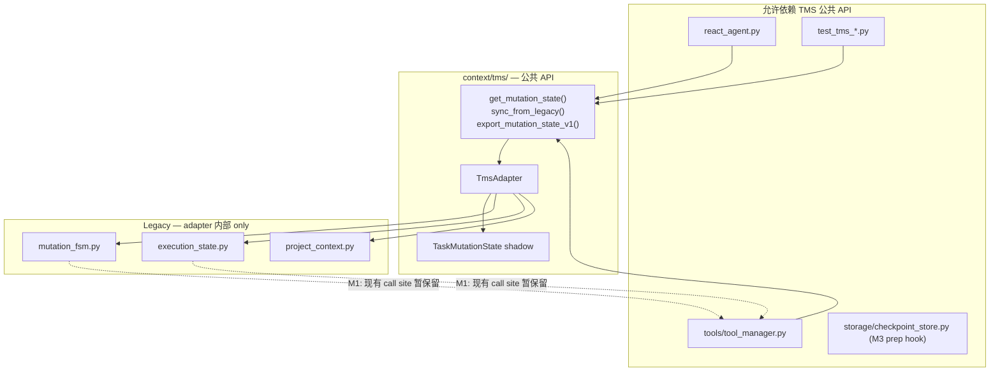
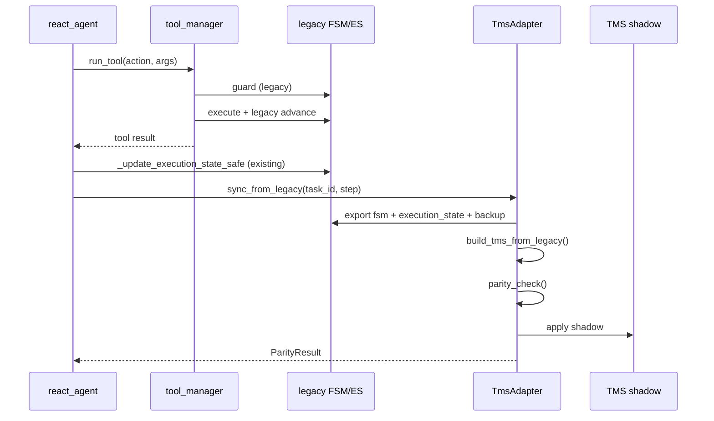
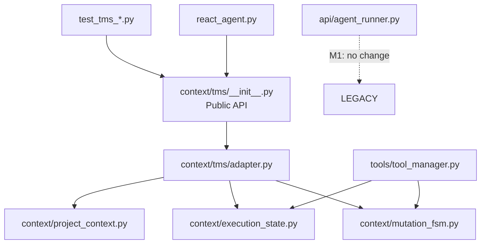

# PR-M1 — TaskMutationState Kernel & Legacy Adapter Design

> **Status**: **Design · v0.10 PR-M1** · M1 (2026-07-21)  
> **Parent**: [task_mutation_state.md](task_mutation_state.md) (M0) · [V0.10_ROADMAP.md](../archive/V0.10_ROADMAP.md)  
> **Baseline**: v0.9.0 @ `v0.9.0` · 424 pytest passed  
> **Out of scope (M1)**: 运行时代码 · checkpoint v2 持久化（M3）· ToolOutcome / normalize（M2）· legacy 删除（M5）· verification（V0）

---

## English Summary

**PR-M1** introduces `TaskMutationState` schema v1 and a **`TmsAdapter` facade** — the **only** mutation-state entry point for new code. During M1–M4, **legacy modules remain the runtime source of truth** for guards and advances; the adapter **mirrors** legacy into TMS after each mutation. Parity tests fail on drift (`PARITY_STRICT=1`). **No new imports of `mutation_fsm` / `execution_state` outside the adapter package** — this is the precondition for deleting legacy in M5.

---

## 1. PR-M1 目标与 scope guard

### 1.1 目标

| # | 交付 |
|---|------|
| G1 | `TaskMutationState` schema v1（内存模型 + JSON export shape） |
| G2 | `TmsAdapter` — legacy ↔ TMS 唯一转换层；**新代码只依赖 adapter** |
| G3 | Dual-write 生命周期：legacy advance → adapter sync → TMS shadow |
| G4 | Parity check 机制 + migration test cases |
| G5 | Rollback strategy（flag / revert / 零用户行为变更） |

### 1.2 M1 不做

| 项 | 归属 |
|----|------|
| 修改 guard 读路径（仍走 legacy） | M5 |
| `mutation_state_json` checkpoint 列 | M3 |
| `normalize_tool_outcome` / milestone enum advance | M2 |
| 删除 `mutation_fsm.py` / `execution_state.py` | M5 |
| Task-scoped backup 写入 TMS | M4 |
| Default flag 变更 | D1（v0.10.0） |
| VerificationSlice | V0 |

### 1.3 M1 完成后的系统性质

| 属性 | M1 后状态 |
|------|-----------|
| **用户可见行为** | 与 v0.9.0 **零差异**（flags 默认 off） |
| **Runtime SoT** | Legacy（guard + advance） |
| **TMS 角色** | Shadow mirror + export for parity / future checkpoint |
| **新代码依赖规则** | 仅 `context/tms/` 公共 API；**禁止**新 import legacy |
| **Legacy 直接调用方** | 仅 adapter 内部 + 现有未改动的 v0.9 路径（M1 不迁移 call site） |

---

## 2. 模块布局与依赖规则

### 2.1 目录结构（M1 target）

```
context/
  tms/                              # 新 package — 公共 API 边界
    __init__.py                     # re-export public API
    types.py                        # TaskMutationState, slices, enums
    adapter.py                      # TmsAdapter — legacy ↔ TMS
    parity.py                       # compare + audit mismatch
    context.py                      # ContextVar[get_tms_shadow]
  mutation_fsm.py                   # legacy — adapter-only consumer (M1 不改签名)
  execution_state.py                # legacy — adapter-only consumer
  project_context.py                # legacy — adapter reads backup for mirror
```

**M1 不移动 legacy 文件**；仅在 adapter 内 import legacy。

### 2.2 依赖方向（硬规则）



| 规则 | 说明 |
|------|------|
| **R1** | M1 新增的 **任何** 代码不得 `from context.mutation_fsm import …` |
| **R2** | M1 新增的 **任何** 代码不得 `from context.execution_state import …` |
| **R3** | 现有 v0.9 call site（`tool_manager`, `react_agent`）M1 **暂不改动** — 避免行为回归；M2 起逐步改 import 到 `context.tms` |
| **R4** | Adapter 是唯一允许同时 touch legacy + TMS 的模块 |
| **R5** | M5 删除 legacy 的条件：`grep` 无 legacy import outside `context/tms/adapter.py` |

> **M1 与 M2 的分工**：M1 建立 adapter + shadow + parity；M2 将 `tool_manager` / `react_agent` 的 **新增** hook 改为经 adapter，并开始 `advance_from_outcome`（仍 dual-write legacy）。

---

## 3. TaskMutationState schema v1

### 3.1 Schema version

```python
TMS_SCHEMA_VERSION = 1
```

Checkpoint 持久化在 M3；M1 定义 **内存 + JSON export** 形状，供 parity 与未来 `mutation_state_json` 对齐。

### 3.2 JSON export shape（v1）

```json
{
  "schema_version": 1,
  "workflow": {
    "state": "BACKED_UP",
    "path": "DIFF_FIRST",
    "proposal_digest": "a1b2c3d4e5f67890"
  },
  "artifacts": {
    "backup": {
      "backup_branch": "agent-backup/20260721-120000",
      "backup_commit": "abc1234",
      "original_branch": "main",
      "created_at_step": null
    },
    "diff_previewed_paths": ["tools/foo.py"],
    "patch_applied": false,
    "patch_applied_paths": []
  },
  "epoch": 0,
  "meta": {
    "synced_from": "legacy",
    "synced_at_step": 6,
    "task_id": "a1b2c3d4"
  }
}
```

| 字段 | M1 | 说明 |
|------|-----|------|
| `schema_version` | ✅ | 固定 `1` |
| `workflow` | ✅ | 来自 legacy FSM export / derive |
| `artifacts` | ✅ | 来自 legacy execution_state + project_context backup |
| `epoch` | ✅ | M1 恒 `0`；M2+ re-backup 递增 |
| `meta` | ✅ | parity / debug；**不**参与 guard |
| `artifact` payload in ToolOutcome | — | M2；非 schema v1 字段 |

### 3.3 Python 类型（design）

```python
class MutationWorkflowState(str, Enum):
    ANALYZING = "ANALYZING"
    PROPOSED = "PROPOSED"
    DIFF_PREVIEWED = "DIFF_PREVIEWED"
    BACKED_UP = "BACKED_UP"
    PATCHED = "PATCHED"
    DONE = "DONE"

class MutationPath(str, Enum):
    NONE = "NONE"
    DIFF_FIRST = "DIFF_FIRST"
    WRITE_FALLBACK = "WRITE_FALLBACK"

@dataclass(frozen=True)
class BackupRef:
    backup_branch: str
    backup_commit: str
    original_branch: str
    created_at_step: int | None = None

@dataclass
class WorkflowSlice:
    state: MutationWorkflowState = MutationWorkflowState.ANALYZING
    path: MutationPath = MutationPath.NONE
    proposal_digest: str | None = None

@dataclass
class ArtifactSlice:
    backup: BackupRef | None = None
    diff_previewed_paths: list[str] = field(default_factory=list)
    patch_applied: bool = False
    patch_applied_paths: list[str] = field(default_factory=list)

@dataclass
class TaskMutationState:
    workflow: WorkflowSlice
    artifacts: ArtifactSlice
    epoch: int = 0
    schema_version: int = TMS_SCHEMA_VERSION
```

### 3.4 MilestoneToken（M2 预注册 · M1 仅定义 enum）

M1 **不**接入 advance；但 types 模块定义 **稳定枚举**，禁止自由字符串：

```python
class MilestoneToken(str, Enum):
    """Machine-only tokens for advance_from_outcome (M2+). Never parse message."""
    PROPOSED = "PROPOSED"
    DIFF_PREVIEWED = "DIFF_PREVIEWED"
    BACKUP_CREATED = "BACKUP_CREATED"
    PATCH_APPLIED = "PATCH_APPLIED"
    FILE_WRITTEN = "FILE_WRITTEN"
    ROLLBACK_TO_BACKUP = "ROLLBACK_TO_BACKUP"
    DEDUP_SKIPPED = "DEDUP_SKIPPED"   # policy outcome, no workflow advance

MILESTONE_TO_WORKFLOW: dict[MilestoneToken, MutationWorkflowState] = {
    MilestoneToken.PROPOSED: MutationWorkflowState.PROPOSED,
    MilestoneToken.DIFF_PREVIEWED: MutationWorkflowState.DIFF_PREVIEWED,
    MilestoneToken.BACKUP_CREATED: MutationWorkflowState.BACKED_UP,
    MilestoneToken.PATCH_APPLIED: MutationWorkflowState.PATCHED,
    MilestoneToken.FILE_WRITTEN: MutationWorkflowState.PATCHED,
    MilestoneToken.ROLLBACK_TO_BACKUP: MutationWorkflowState.BACKED_UP,
}
```

| 约束 | 说明 |
|------|------|
| **枚举 closed set** | runtime 收到未知 token → reject + audit `invalid_milestone_token` |
| **message 不参与** | audit / FSM / dedup **禁止**读 `ToolSuccessResult.message` |
| **M1** | enum 定义 + mapping 单测；**无** runtime advance |

---

## 4. Legacy ↔ TMS Adapter 设计

### 4.1 核心数据流

```
                    ┌─────────────────────────────────────┐
                    │  Existing v0.9 path (unchanged M1)   │
                    │  tool_manager → legacy advance       │
                    │  mutation_fsm / execution_state      │
                    └─────────────────┬───────────────────┘
                                      │ legacy mutated
                                      ▼
                    ┌─────────────────────────────────────┐
                    │         TmsAdapter                   │
                    │  build_tms_from_legacy()             │
                    │  apply_shadow(tms)                    │
                    │  run_parity_check()                  │
                    └─────────────────┬───────────────────┘
                                      │
                                      ▼
                    ┌─────────────────────────────────────┐
                    │   TaskMutationState (shadow)         │
                    │   ContextVar per task                │
                    └─────────────────────────────────────┘
```

**读路径（M1）**：

- Guard / dedup / skip：**仍读 legacy**（行为不变）
- 新 observability hook（react_agent parity）：`get_mutation_state()` → 返回 **shadow**（上次 sync 后）

**写路径（M1）**：

- Legacy advance 后调用 `sync_from_legacy(task_id, step)` → adapter 从 legacy export 构建 TMS → 写入 shadow → parity check

### 4.2 TmsAdapter API（公共面）

```python
# context/tms/__init__.py — 唯一对外 exports

def get_mutation_state() -> TaskMutationState:
    """Return TMS shadow. Raises if never synced (returns empty initial on task start)."""

def reset_mutation_state() -> None:
    """Task start: clear shadow + delegate legacy reset (via adapter)."""

def sync_from_legacy(*, task_id: str, react_step: int) -> ParityResult:
    """
    Post-tool hook (M1):
    1. build_tms_from_legacy()
    2. write shadow
    3. parity vs previous shadow (optional) + vs canonical legacy build
    4. on mismatch: audit + resync shadow from legacy (legacy wins)
    """

def export_mutation_state_v1() -> dict:
    """JSON-serializable blob for future checkpoint (M3). Empty {} if TMS disabled."""

def restore_mutation_state_v1(blob: dict | None) -> None:
    """M3+: hydrate shadow. M1: stub or test-only."""

class ParityResult:
    ok: bool
    mismatches: list[str]
    legacy_snapshot: dict
    tms_snapshot: dict
```

### 4.3 `build_tms_from_legacy()` 映射

| TMS 字段 | Legacy 来源 | 规则 |
|----------|-------------|------|
| `workflow.state` | `mutation_fsm` export 或 derive from execution_state | FSM enabled: export；else: derive 算法同 v0.9 `derive_mutation_fsm_from_execution_state` |
| `workflow.path` | 同上 | |
| `workflow.proposal_digest` | FSM export 或 execution_state | prefer FSM |
| `artifacts.diff_previewed_paths` | execution_state | |
| `artifacts.patch_applied` / paths | execution_state | |
| `artifacts.backup` | execution_state backup fields；若空则 `project_context.get_backup_*()` | M1 仍 global backup；M4 改 task-scoped write |
| `epoch` | M1 恒 `0` | M2+ 从 execution_state re-backup 事件映射 |

**Adapter 内聚 v0.9 derive 逻辑** — M5 删除 legacy 时整体迁入 TMS，不散落 call site。

### 4.4 Sync 触发点（M1 新增 hook）

| 触发 | 位置 | 动作 |
|------|------|------|
| Task start | `react_agent` fresh task | `reset_mutation_state()` |
| Task resume | `react_agent` resume path | legacy restore 后 `sync_from_legacy` |
| Post tool | `react_agent` after `_update_execution_state_safe` | `sync_from_legacy(task_id, step)` |
| Task end | optional | final parity audit |

**M1 不改** `_update_execution_state_safe` 内部 — 仅在其后追加 adapter sync。

### 4.5 禁止模式（M1 code review checklist）

```python
# ❌ 新代码禁止
from context.mutation_fsm import get_mutation_fsm_context
from context.execution_state import get_execution_state

# ✅ 新代码允许
from context.tms import get_mutation_state, sync_from_legacy
```

---

## 5. Dual-write 生命周期

### 5.1 阶段定义

| Phase | PR | Write | Read (guard) | Read (new code) |
|-------|-----|-------|--------------|-----------------|
| **Shadow** | M1 | legacy + adapter sync | legacy | adapter shadow |
| **Outcome** | M2 | legacy + TMS advance-from-outcome (dual) | legacy | adapter |
| **Checkpoint** | M3 | export shadow to SQLite v2 | legacy | adapter |
| **Backup** | M4 | TMS artifacts backup primary | legacy → adapter | adapter |
| **Cutover** | M5 | TMS only | adapter | adapter |

### 5.2 M1 dual-write 时序



### 5.3 M1 不是永久双写

| 里程碑 | 动作 |
|--------|------|
| M1 | 建立 shadow + parity；legacy 100% SoT |
| M2 | 新增 `advance_from_outcome` 写 TMS；**mirror 回 legacy**（反向 dual-write，仍为迁移期） |
| M3 | checkpoint 写 `mutation_state_json`；resume hydrate shadow |
| M5 | 删除 legacy advance；adapter 仅读写 TMS |

---

## 6. Parity check 机制

### 6.1 比较维度

```python
def parity_equal(legacy_built: TaskMutationState, shadow: TaskMutationState) -> list[str]:
    """
    Compare canonical fields only (ignore meta).
    Returns list of mismatch field paths, empty if ok.
    """
```

| 比较项 | 容差 |
|--------|------|
| `workflow.state` | 精确 |
| `workflow.path` | 精确 |
| `workflow.proposal_digest` | 精确 |
| `artifacts.backup` | branch + commit 精确；step 可空 |
| `artifacts.diff_previewed_paths` | 集合相等（排序无关） |
| `artifacts.patch_applied` | 精确 |
| `artifacts.patch_applied_paths` | 集合相等 |
| `epoch` | M1 恒 0 |

### 6.2 双轨 parity（M1）

| 检查 | 目的 |
|------|------|
| **Legacy-built vs shadow** | 验证 adapter 映射正确 |
| **Shadow-before vs shadow-after** | 检测 sync 遗漏（可选 warn） |

### 6.3 Mismatch 处理

```
on sync_from_legacy:
    canonical = build_tms_from_legacy()
    mismatches = parity_equal(canonical, shadow_before)  # if shadow exists

    if mismatches:
        audit event mutation_state_parity_mismatch {
            task_id, react_step, mismatches,
            legacy_snapshot, shadow_snapshot
        }
        if settings.PARITY_STRICT:      # pytest always True
            raise ParityMismatchError
        else:                           # runtime M1-M4
            shadow = canonical          # legacy wins — force resync

    shadow = canonical
```

| 环境 | `PARITY_STRICT` | 行为 |
|------|-----------------|------|
| pytest | `1`（conftest autouse） | mismatch **fail test** |
| dev/prod runtime | `0`（default） | legacy wins + audit |

### 6.4 Audit 事件

```json
{
  "event": "mutation_state_parity_mismatch",
  "task_id": "abc123",
  "react_step": 5,
  "mismatches": ["workflow.state", "artifacts.backup.backup_commit"],
  "resolution": "legacy_wins"
}
```

```json
{
  "event": "mutation_state_synced",
  "task_id": "abc123",
  "react_step": 5,
  "schema_version": 1,
  "workflow_state": "BACKED_UP"
}
```

---

## 7. Migration test cases（M1 必测）

### 7.1 Unit — adapter mapping

| ID | 场景 | 输入 legacy | 期望 TMS |
|----|------|-------------|----------|
| U1 | empty legacy | FSM off, ES empty | ANALYZING / empty artifacts |
| U2 | proposal only | ES digest set | PROPOSED |
| U3 | diff preview | ES paths + FSM DIFF_PREVIEWED | DIFF_PREVIEWED + paths |
| U4 | backup | ES backup + FSM BACKED_UP | BACKED_UP + BackupRef |
| U5 | patched | ES patch_applied | PATCHED |
| U6 | FSM derive fallback | ES only, FSM off | derive 同 v0.9 algorithm |
| U7 | FSM snapshot vs derive mismatch | 故意不一致 export | adapter 用 FSM export + audit flag（同 v0.9 hydrate） |

### 7.2 Unit — parity

| ID | 场景 | 期望 |
|----|------|------|
| P1 | identical snapshots | `ok=True` |
| P2 | state drift | mismatch list 含 `workflow.state` |
| P3 | paths order differs | `ok=True`（集合比较） |
| P4 | PARITY_STRICT=1 | raises |

### 7.3 Integration — dual-write hook

| ID | 场景 | 步骤 | 期望 |
|----|------|------|------|
| I1 | propose happy path | run_tool propose → sync | shadow.workflow.state=PROPOSED |
| I2 | full chain stub | backup+patch markers → sync | shadow PATCHED + backup ref |
| I3 | FSM off dedup off | 默认 flags | 与 v0.9 export 字节级等价（canonical fields） |
| I4 | resume restore | legacy restore → sync | shadow 匹配 legacy export |
| I5 | sync idempotent | 连续两次 sync 无 legacy 变化 | 第二次 parity ok |

### 7.4 Regression — zero behavior

| ID | 场景 | 期望 |
|----|------|------|
| R1 | 全 suite default flags | 424 passed（M1 合入后 ≥424+N） |
| R2 | golden 24 cases | 无断言变更 |
| R3 | FSM on golden subset | 行为不变；仅新增 parity audit 事件 |

### 7.5 Flag 矩阵（parity integration）

| FSM | Dedup | 必跑 |
|-----|-------|------|
| 0 | 0 | ✅ default |
| 1 | 0 | ✅ |
| 0 | 1 | ✅ |
| 1 | 1 | ✅ |

---

## 8. Rollback strategy

### 8.1 M1 合入 rollback

| 层级 | 方式 |
|------|------|
| **Code revert** | 删除 `context/tms/` + react_agent sync hook；零 legacy 变更 |
| **Runtime flag** | `TMS_ADAPTER_ENABLED=0`（M1 新增，**default 1**）— 关闭 sync hook，完全 v0.9 |
| **Behavior** | flag off → 无 shadow、无 parity audit、无新 import 路径执行 |

### 8.2 `TMS_ADAPTER_ENABLED`（M1 临时 flag）

| 值 | 行为 |
|----|------|
| `0` | adapter hook no-op；**精确 v0.9** |
| `1`（default） | dual-write sync + parity audit |

**Important**：`TMS_ADAPTER_ENABLED=1` 仅开启 **legacy → TMS shadow 同步**；**不等于** TMS 成为 runtime source of truth。M1–M4 下 guard/advance 仍由 legacy 驱动；TMS 为 shadow mirror，SoT 切换在 M5。

M5 后移除此 flag（adapter 恒 on）。

### 8.3 合入风险 mitigations

| 风险 | Mitigation |
|------|------------|
| Sync hook 性能 | 每 tool step 一次 O(1) export；benchmark <1ms |
| Sync 异常 crash loop | `sync_from_legacy` try/except → audit error，**不** fail task |
| Parity noise in prod | runtime `PARITY_STRICT=0`；仅 audit |
| Legacy import 扩散 | CI grep gate：`scripts/check_no_legacy_imports.sh` |

### 8.4 CI gate（M1 交付）

```bash
# 允许 legacy import 的文件 whitelist:
#   context/mutation_fsm.py
#   context/execution_state.py
#   context/tms/adapter.py
#   tools/tool_manager.py      # until M2 migration
#   react_agent.py             # until M2 migration
#   test_*.py referencing legacy directly (existing only)
```

M2 后 whitelist 缩小；M5 仅 adapter 测试 fixtures。

---

## 9. M1 实现 checklist（sign-off 后编码）

### 9.1 文件清单

| 文件 | 动作 |
|------|------|
| `context/tms/types.py` | 新建 — schema v1 + enums |
| `context/tms/adapter.py` | 新建 — build/sync/restore |
| `context/tms/parity.py` | 新建 — compare + audit |
| `context/tms/context.py` | 新建 — ContextVar shadow |
| `context/tms/__init__.py` | 新建 — public API |
| `config/settings.py` | 新增 `TMS_ADAPTER_ENABLED`, `PARITY_STRICT` |
| `react_agent.py` | 追加 sync hook（3 处） |
| `test_tms_adapter.py` | 新建 — U* cases |
| `test_tms_parity.py` | 新建 — P* + I* cases |
| `scripts/check_no_legacy_imports.sh` | 新建 — CI gate |

### 9.2 验收标准

- [ ] `TaskMutationState` schema v1 export/import round-trip
- [ ] `MilestoneToken` enum 定义 + invalid token 单测（M2 prep）
- [ ] Adapter mapping U1–U7 passed
- [ ] Parity P1–P4 + flag matrix 4 组合 passed
- [ ] `TMS_ADAPTER_ENABLED=0` → 424 baseline 零差异
- [ ] `TMS_ADAPTER_ENABLED=1` → golden 24 非回归
- [ ] 无 **新增** legacy import outside whitelist
- [ ] Mismatch audit 事件可被 task report 消费（optional field）

### 9.3 不验收（M1）

- [ ] checkpoint `mutation_state_json` 列
- [ ] ToolOutcome normalize
- [ ] Guard 读 TMS
- [ ] Task-scoped backup

---

## 10. M1 → M2  handoff

| M1 交付 | M2 消费 |
|---------|---------|
| `TmsAdapter` public API | `advance_from_outcome` 写 shadow + mirror legacy |
| `MilestoneToken` enum | `ToolSuccessResult.milestone: MilestoneToken` |
| shadow ContextVar | normalize 后 advance |
| parity infra | outcome advance 后 dual parity |

M2 第一步：将 `tool_manager` **新增** outcome 路径经 adapter；legacy advance 保留为 mirror target。

---

## 11. Document history

| Date | Status | Notes |
|------|--------|-------|
| 2026-07-21 | **Design · PR-M1** | M0 challenge review 通过后首版 · adapter-first · parity · rollback |
| 2026-07-21 | **Design · PR-M1 approved** | 单向 sync · stable API · schema migration policy §12 · dependency target §13 |

---

## 12. TMS schema v1 migration policy（编码前补充 A）

### 12.1 Version field

持久化 JSON **顶层**使用 `schema_version`（整数），M1 export 固定为 **`1`**。

```json
{
  "schema_version": 1,
  "workflow": { "state": "ANALYZING", "path": "NONE", "proposal_digest": null },
  "artifacts": {
    "backup": null,
    "diff_previewed_paths": [],
    "patch_applied": false,
    "patch_applied_paths": []
  },
  "epoch": 0,
  "meta": { "synced_from": "legacy", "synced_at_step": 0, "task_id": null }
}
```

### 12.2 Unknown field 行为

| 方向 | 规则 |
|------|------|
| **Import / hydrate** | **Ignore unknown fields**（forward-compatible）；缺少 optional 字段用 default |
| **Unknown `schema_version`** | `> 1` → hydrate 失败 + audit `tms_schema_unsupported` + 使用 empty TMS；`< 1` 或缺失 → 按 v1 缺省字段处理 |
| **Export** | 仅写已知字段；不写入 consumer 自定义 extension |

### 12.3 Future migration strategy

| 版本 | 变更 | 策略 |
|------|------|------|
| v1 → v2 (M3) | checkpoint 列 `mutation_state_json` | ADD COLUMN；hydrate v1 legacy columns via adapter |
| v2 → v3 (v0.11) | `workspace_ref` | optional field；unknown ignore |
| Breaking | 删除 workflow enum 值 | **禁止**；仅 additive enum |

Migration 函数命名（M3+ 实现，M1 预留）：

```python
def migrate_mutation_state_blob(raw: dict) -> TaskMutationState: ...
```

---

## 13. M1 完成后的依赖状态（编码前补充 B）

### 13.1 目标依赖图



**禁止出现**：`context/tms/*` → 被 legacy 模块 import（循环依赖）。

### 13.2 M1 验收依赖 checklist

- [ ] `grep -r "from context.mutation_fsm" --include="*.py"` 无 **新增** 文件（whitelist 外）
- [ ] `grep -r "from context.execution_state" --include="*.py"` 无 **新增** 文件（whitelist 外）
- [ ] `react_agent` 对 mutation state **仅** import `context.tms`（legacy import 保留在 resume 块直至 M2）
- [ ] `context/tms/adapter.py` 是唯一同时 import legacy 三模块的 **新** 文件
- [ ] `adapter.py` **不** import `react_agent` / `tool_manager`（无 upward dep）

### 13.3 单向 sync 硬约束

```
legacy ──build_tms_from_legacy()──▶ TMS shadow

禁止：
TMS shadow ──▶ legacy   (无 mirror-back in M1)
```

`sync_tms_from_legacy()` 内部：**只读 legacy + 写 shadow**。

### 13.4 Stable adapter API（M3/M5 复用）

| 函数 | 职责 |
|------|------|
| `build_tms_from_legacy()` | 只读 legacy → `TaskMutationState` |
| `sync_tms_from_legacy(task_id, react_step)` | build + parity + write shadow |
| `check_tms_parity(canonical, shadow)` | 比较，返回 mismatches |
| `get_mutation_state()` | 读 shadow |
| `reset_mutation_state()` | 清 shadow only |
| `export_mutation_state_v1()` | JSON blob |

`react_agent` / `tool_manager` **不得**调用 legacy mapping 细节。

### 13.5 Sync hook 顺序（post-tool）

```
run_tool()
  → _update_execution_state_safe()   # legacy
  → sync_tms_from_legacy()           # TMS shadow 更新
  → memory append
  → _save_checkpoint_safe()          # 避免 checkpoint 存旧 TMS
```

cancel / max-steps checkpoint 前亦调用 `sync_tms_from_legacy()`（best-effort）。

### 13.6 MilestoneToken 协议（M1 定义）

- **内部稳定协议** — closed enum，不绑定中英文 message
- **不暴露给用户** — 不出现在 CLI print / HTTP response；仅 audit structured fields（M2+）
- 示例：`MilestoneToken.BACKUP_CREATED` · `MilestoneToken.DIFF_GENERATED` · `MilestoneToken.PATCH_APPLIED`
- `message` 仅人类展示，如 `"Git backup created successfully"`

### 13.7 Legacy import whitelist 文档

见 `docs/design/tms_legacy_import_policy.md`（M1 实现时创建）及 `scripts/check_no_legacy_imports.py`。

