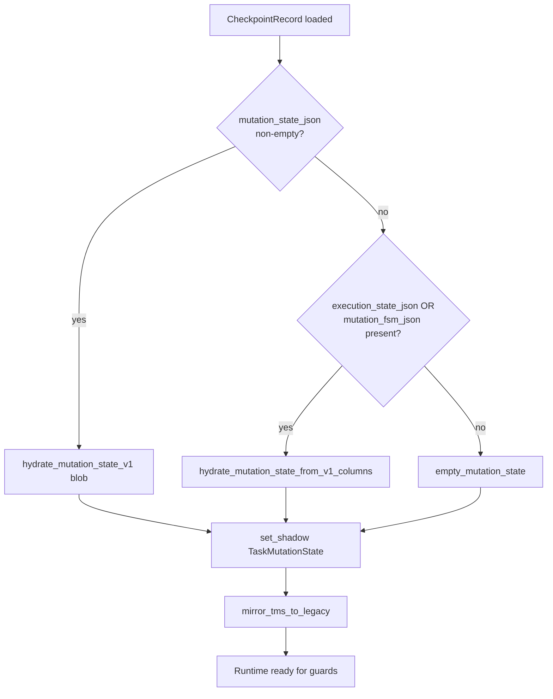
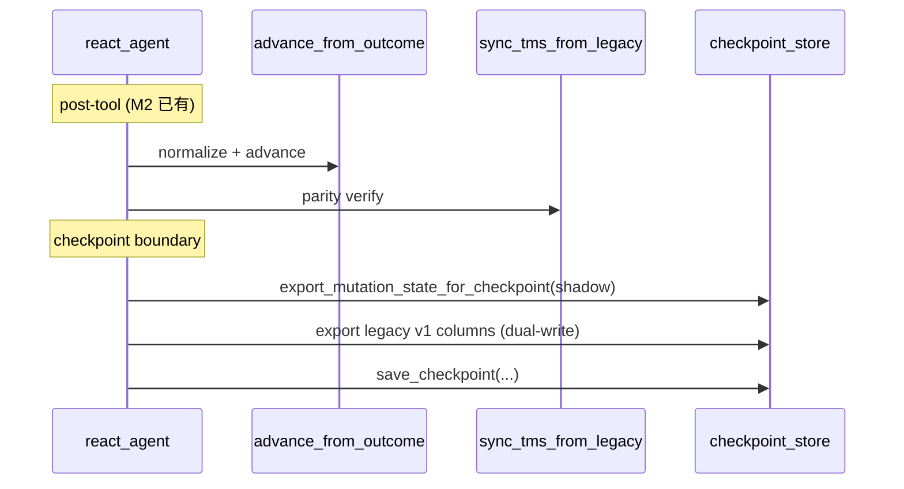

# PR-M3 — Checkpoint Schema v2 & TMS Persistence Design

> **Status**: **Design · v0.10 PR-M3** · (2026-07-21)  
> **Baseline**: PR-M2 @ `412b625` · 459 pytest passed  
> **Parent**: [task_mutation_state.md](task_mutation_state.md) · [task_mutation_state_m1.md](task_mutation_state_m1.md) · [tool_outcome_m2.md](tool_outcome_m2.md) · [task_checkpoint.md](task_checkpoint.md) · [V0.10_ROADMAP.md](../archive/V0.10_ROADMAP.md)  
> **Out of scope (M3)**: 运行时代码 · commit · task-scoped backup (M4) · legacy module deletion (M5) · verification slice · dedup redesign · SoT cutover

---

## English Summary

**PR-M3** adds checkpoint column **`mutation_state_json`** and makes TMS the **persistence authority** for mutation session state on save/resume. Checkpoint layer **only serializes and hydrates** — it never advances workflow, parses tool messages, or runs dedup. Resume hydration order: **v2 blob → v1 legacy columns merge → empty TMS**. During M3–M4, legacy modules remain **runtime SoT for guards**; after hydrate, TMS is **mirrored back into legacy** so existing guard/dedup paths keep working. Feature flag **`CHECKPOINT_MUTATION_STATE_V2_ENABLED`** (default **off**) preserves v0.9 save behavior for rollback; **read path always accepts v2 when present**.

---

## 1. PR-M3 目标与 scope guard

### 1.1 目标

| # | 交付 |
|---|------|
| G1 | SQLite `task_checkpoints.mutation_state_json` 列（schema v2 **列级**） |
| G2 | Save：从 TMS shadow export 写入 `mutation_state_json`（flag on） |
| G3 | Resume：**统一 hydrate 入口** → TMS shadow → legacy mirror |
| G4 | v0.9 checkpoint forward compat（`execution_state_json` + `mutation_fsm_json`） |
| G4 | Migration / rollback：feature flag + dual-write 过渡期 |
| G5 | Audit：hydrate source、mismatch、unsupported schema |

### 1.2 M3 不做

| 项 | 归属 |
|----|------|
| 删除 `execution_state_json` / `mutation_fsm_json` 列 | M5 |
| checkpoint 读路径改 guard / dedup SoT | M5 |
| Task-scoped backup / global `last_backup.json` 移除 | M4 |
| `advance_from_outcome` 行为变更 | 已完成 (M2) |
| TMS `schema_version` 语义 breaking change | v0.11+ |
| SQLite 数据 backfill 脚本 | 不需要 — 旧行只读 |
| VerificationSlice 持久化 | V0 |

### 1.3 M3 完成后的系统性质

| 属性 | M3 后状态 |
|------|-----------|
| **状态变化入口** | 仍仅 `ToolOutcome → advance_from_outcome()`（M2） |
| **Runtime guard SoT** | Legacy（M1–M4 不变） |
| **Checkpoint mutation authority** | **`mutation_state_json` 优先**（flag on 时写入） |
| **v0.9 resume** | 必须不 crash；v1 列 hydrate → TMS → legacy mirror |
| **Flag off** | Save/resume 与 v0.9 **行为等价**（不写/不优先 v2 列） |

### 1.4 核心原则（M2 延续）

```
ToolOutcome
    ↓
advance_from_outcome()        ← 唯一业务推进入口
    ↓
TMS shadow + legacy mirror
    ↓
checkpoint save               ← 仅 serialize（M3）
```

**禁止**：

```
checkpoint load
    ↓
parse memory / marker         ❌
    ↓
advance workflow              ❌
```

---

## 2. 现状 vs 目标

### 2.1 v0.9 / M2 今天（baseline `412b625`）

| 层 | 行为 |
|----|------|
| **Save** | `react_agent._save_checkpoint_safe` export `execution_state_json` + `mutation_fsm_json` |
| **Resume** | `restore_execution_state` + `hydrate_mutation_fsm_from_checkpoint`（分离、FSM 专用） |
| **TMS shadow** | 运行时 dual-write；**不**写入 checkpoint |
| **Resume TMS** | `_sync_tms_from_legacy_safe`（legacy → shadow parity） |

### 2.2 M3 目标

| 层 | 行为 |
|----|------|
| **Save (flag on)** | export TMS → `mutation_state_json`；**过渡期**仍写 v1 列（dual-write） |
| **Save (flag off)** | 与 v0.9 相同 — 仅 v1 列 |
| **Resume** | **`hydrate_checkpoint_mutation_state()`** 单入口 → `set_shadow` → **`mirror_tms_to_legacy()`** |
| **Resume (flag off, v2 absent)** | v1 hydrate 算法 → TMS → legacy mirror（与 flag on 读路径一致） |

---

## 3. Checkpoint schema v2

### 3.1 两层 “version” 概念

| 名称 | 常量 | 含义 |
|------|------|------|
| **Checkpoint column schema** | `CHECKPOINT_SCHEMA_VERSION = 2` | DB 行是否使用 `mutation_state_json` 作为 mutation 持久化权威 |
| **TMS blob schema** | `TMS_SCHEMA_VERSION = 1`（M3 不变） | `mutation_state_json` 内部 JSON 的 `schema_version` 字段 |

M3 **不** bump TMS blob 到 version 2。v2 指的是 **checkpoint 存储形态**（新列 + authority 规则），不是 TMS 内存模型 breaking change。

### 3.2 SQLite 变更

```sql
-- init_checkpoint_db / _ensure_checkpoint_schema (同 v0.9 FSM 列模式)
ALTER TABLE task_checkpoints ADD COLUMN mutation_state_json TEXT;
```

| 列 | M3 角色 |
|----|---------|
| `memory_json` | 对话 memory（不变） |
| `context_state_json` | Context budget（不变） |
| `mutation_state_json` | **v2 mutation authority**（M3 新增） |
| `execution_state_json` | v1 legacy；M3 dual-write；M5 停止写入 |
| `mutation_fsm_json` | v1 legacy；M3 dual-write；M5 停止写入 |
| `agent_mode`, `repo_root`, `step`, … | 不变 |

**无** SQLite 数据 migration 脚本。旧行 `mutation_state_json IS NULL` → hydrate 走 v1 路径。

### 3.3 `mutation_state_json` blob 形状

与 M1 `export_mutation_state_v1()` 对齐，**持久化专用**（省略 runtime-only `meta.synced_from`）：

```json
{
  "schema_version": 1,
  "workflow": {
    "state": "BACKED_UP",
    "path": "DIFF_FIRST",
    "proposal_digest": "a1b2c3d4e5f67890"
  },
  "artifacts": {
    "backup": {
      "backup_branch": "agent-backup/20260721-120000",
      "backup_commit": "abc1234",
      "original_branch": "main",
      "created_at_step": 6
    },
    "diff_previewed_paths": ["tools/foo.py"],
    "patch_applied": false,
    "patch_applied_paths": []
  },
  "epoch": 0
}
```

| 字段 | M3 |
|------|-----|
| `schema_version` | `1`（`TMS_SCHEMA_VERSION`） |
| `workflow` / `artifacts` / `epoch` | 与 M1 export 一致 |
| `meta` | **不写入 checkpoint**（resume 不需要；减小 blob） |

Export API（M3 新增）：

```python
def export_mutation_state_for_checkpoint(
    state: TaskMutationState | None = None,
) -> dict[str, Any]:
    """Persistence export — no meta.synced_from."""
```

Import 复用现有 `hydrate_mutation_state_v1()`（已支持 ignore unknown fields）。

### 3.4 `CheckpointRecord` 扩展

```python
@dataclass(frozen=True)
class CheckpointRecord:
    ...
    mutation_state: dict[str, Any] | None   # NEW — parsed mutation_state_json
    execution_state: dict[str, Any] | None  # legacy v1
    mutation_fsm: dict[str, Any] | None     # legacy v1
```

`save_checkpoint(..., mutation_state: dict | None = None)` 新增参数；`_row_to_record` 解析新列。

---

## 4. Hydration 策略

### 4.1 优先级（硬规则）



| 优先级 | 输入 | 函数 | audit `hydrate_source` |
|--------|------|------|------------------------|
| **1** | `mutation_state_json` | `hydrate_mutation_state_v1()` | `v2_blob` |
| **2** | `execution_state_json` ± `mutation_fsm_json` | `hydrate_mutation_state_from_v1_columns()` | `v1_merge` |
| **3** | 皆空 / `{}` | `empty_mutation_state()` | `empty` |

**读路径不依赖 flag**。Flag 只控制 **写** v2 列；一旦磁盘上有 v2，任何版本都应正确读取。

### 4.2 v1 列 merge 算法（`hydrate_mutation_state_from_v1_columns`）

封装 v0.9 FSM hydrate + execution_state 语义，**输出 TMS**（不是分别 restore legacy 再 sync）。

```python
def hydrate_mutation_state_from_v1_columns(
    *,
    mutation_fsm_json: dict | None,
    execution_state_json: dict | None,
    task_id: str | None = None,
) -> tuple[TaskMutationState, HydrateDiagnostics]:
    """
    1. Build artifacts slice from execution_state_json (preferred for backup/patch paths)
    2. Build workflow slice:
       - if mutation_fsm_json snapshot present → use snapshot workflow fields
       - elif execution_state milestones derivable → derive workflow (reuse derive_mutation_fsm_from_execution_state logic)
       - else → ANALYZING / NONE
    3. If snapshot AND derived both exist → snapshots_compatible check
       - compatible → use snapshot workflow
       - incompatible → snapshot workflow + execution_state artifacts; audit mismatch
    4. backup: execution_state backup fields → else project_context global file (M4 前 fallback)
    """
```

| 数据源 | 权威字段 |
|--------|----------|
| `execution_state_json` | `proposal_digest`, `backup_*`, `diff_previewed_paths`, `patch_applied*` |
| `mutation_fsm_json` | `workflow.state`, `workflow.path`, `proposal_digest`（snapshot 优先） |
| 冲突 | **workflow 以 FSM snapshot 为准**（若存在）；**artifacts 以 execution_state 为准**；不一致 → audit，**不**自动 repair |

#### 4.2.1 与 v0.9 `hydrate_mutation_fsm_from_checkpoint` 的关系

| v0.9 | M3 |
|------|-----|
| 先 FSM hydrate，再 `restore_execution_state` | **合并为单一 TMS hydrate**，再一次 legacy mirror |
| `derive_mismatch` audit | **保留** — 在 `HydrateDiagnostics.derive_mismatch` |
| FSM disabled → reset | mirror 时 skip FSM restore；execution_state 仍 restore |

M3 实现后，`react_agent` resume **不再**直接调用 `hydrate_mutation_fsm_from_checkpoint` / `restore_execution_state`；改调统一入口。

### 4.3 Legacy mirror（resume 后必需）

M1–M4 guard / dedup 仍读 legacy。Hydrate 只填充 TMS shadow 不够。

```python
def mirror_tms_to_legacy(state: TaskMutationState) -> None:
    """
    Inverse of build_tms_from_legacy (adapter-internal).
    Populates mutation_fsm context + execution_state from TMS canonical fields.
    Does NOT read checkpoint columns directly.
    """
```

| TMS 字段 | Legacy 目标 |
|----------|-------------|
| `workflow.*` | `mutation_fsm` context（flag on 时） |
| `artifacts.*` | `execution_state` |
| `artifacts.backup` | `execution_state` backup fields + `project_context.set_backup_info`（M4 前） |

**位置**：`context/tms/adapter.py`（与 `build_tms_from_legacy` 对称；不 export 到 legacy 模块）。

调用顺序（resume）：

```
hydrate_checkpoint_mutation_state(record) → TaskMutationState
set_shadow(state)
mirror_tms_to_legacy(state)
sync_tms_from_legacy()   # parity verify only; expect ok
build_resume_hint()      # 仍从 legacy execution_state 读（M3 不变）
```

### 4.4 Empty / degraded hydrate

| 场景 | 行为 |
|------|------|
| 全部 mutation 列为 null | `empty_mutation_state()` + reset legacy |
| v1 列均为 `{}` | 同上；**memory 仍为 resume 主要上下文** |
| `schema_version > TMS_SCHEMA_VERSION` | audit `tms_schema_unsupported`；empty TMS；**不 crash** |
| JSON parse 失败 | audit `checkpoint_mutation_state_invalid`；empty TMS；resume 继续（memory 可用） |
| FSM disabled + v1 FSM 列有值 | 忽略 FSM 列 workflow；仍 hydrate artifacts |

> **文档限制（同 roadmap）**：v0.9 checkpoint 若从未写入 milestone（全 `{}`），hydrate 为空 TMS 是预期；dedup hint 弱，依赖 memory 内容。

---

## 5. Mismatch 与 audit

### 5.1 Hydrate 阶段

| Event | 触发 | 修复？ |
|-------|------|--------|
| `checkpoint_mutation_hydrated` | 每次 resume hydrate 成功 | — |
| `checkpoint_hydrate_source` | 同上，字段 `source`: v2_blob / v1_merge / empty | — |
| `mutation_fsm_hydrate_mismatch` | v1 merge：snapshot vs derived workflow 不兼容 | **仅记录**（与 v0.9 PR-F2 一致） |
| `checkpoint_v1_v2_divergence` | dual-write 行：v2 blob rebuild from v1 ≠ v2 | **v2 wins**；audit 差异 |
| `tms_schema_unsupported` | blob schema_version 过高 | empty TMS |
| `checkpoint_mutation_state_invalid` | JSON / shape 错误 | empty TMS |

**原则**：hydrate 阶段 **record-only**，不做 silent repair 业务状态（避免 checkpoint 层引入 policy）。

### 5.2 Post-hydrate parity

Resume 后 `_sync_tms_from_legacy_safe` 仍运行。若 mirror 正确，parity 应为 ok。若 mismatch：

- audit `mutation_state_parity_mismatch`（已有）
- runtime：`legacy_wins` + shadow resync（M1 策略）

这表示 mirror 实现 bug，而非 checkpoint 业务决策。

---

## 6. Persistence 边界

### 6.1 Checkpoint 层职责

| 允许 | 禁止 |
|------|------|
| JSON serialize / deserialize | `advance_from_outcome()` |
| `set_shadow` / `mirror_tms_to_legacy` | `normalize_tool_outcome()` |
| audit hydrate metadata | dedup skip 决策 |
| validate schema_version | FSM transition / guard |
| ignore unknown JSON fields | 读 `memory_json` 推断 milestone |

### 6.2 Save 路径（flag on）



**Export 来源**：

| 字段 | 来源 |
|------|------|
| `mutation_state_json` | TMS shadow（`get_shadow()`） |
| `execution_state_json` | `_export_execution_state_for_checkpoint()`（legacy，过渡期） |
| `mutation_fsm_json` | `_export_mutation_fsm_for_checkpoint()`（legacy，过渡期） |

Shadow 必须在 save 前已通过 M2 advance + sync 更新。Save **不**触发额外 sync。

### 6.3 Save 路径（flag off）

与 v0.9 完全相同：

- **不**写 `mutation_state_json`（NULL）
- 写 v1 列

### 6.4 Load 路径

`storage/checkpoint_store.py` **只做 IO** — 不调用 hydrate。Hydrate 在 `context/tms/checkpoint_hydrate.py`（或 `adapter.py` 内聚）。

`api/agent_runner.py` / `react_agent.py` 传入完整 `CheckpointRecord` 或 parsed blobs 给 hydrate 入口。

---

## 7. Feature flag 与 migration

### 7.1 新 flag

```python
# config/settings.py
CHECKPOINT_MUTATION_STATE_V2_ENABLED = os.getenv(
    "CHECKPOINT_MUTATION_STATE_V2_ENABLED", "0"
).strip().lower() not in {"0", "false", "no", "off"}
```

| Flag | Save | Resume read |
|------|------|-------------|
| **0**（M3 default） | v1 列 only | v2 若存在仍读（forward compat 测试）；生产旧 checkpoint 无 v2 |
| **1** | v2 + v1 dual-write | 优先级 §4.1 |

**Rollback**：设 `CHECKPOINT_MUTATION_STATE_V2_ENABLED=0` → save 回到 v0.9；已写入的 v2 列仍可读。

### 7.2 Migration 时间线

| 阶段 | Save 行为 | Resume 行为 |
|------|-----------|-------------|
| **v0.9** | v1 列 | v1 hydrate（FSM + ES 分离） |
| **M3 flag=0** | v1 列（同 v0.9） | 新 hydrate 入口；v1 路径等价 |
| **M3 flag=1** | v2 + v1 dual-write | v2 优先 |
| **M4** | 同 M3 flag=1；backup task-scoped | 同 M3 |
| **M5** | v2 only（停写 v1 列） | v2 优先；v1 hydrate 保留至 v0.11 |
| **v0.11** | v2 only | v1 hydrate deprecated |

### 7.3 v0.9 checkpoint 恢复保证

| v0.9 checkpoint 内容 | M3 hydrate 结果 |
|----------------------|-----------------|
| 完整 v1 FSM + ES | TMS ≈ merge；legacy mirror；行为与 v0.9 一致 |
| 仅 ES（dedup on, FSM off） | artifacts 恢复；workflow ANALYZING |
| 仅 `{}` / null | empty TMS；memory 为准 |
| 含 `mutation_fsm_json` mismatch | audit mismatch；仍 resume |

**必须**：不 crash、不丢 memory、不 corrupt SQLite。

### 7.4 Downgrade 场景

| 场景 | 行为 |
|------|------|
| v0.10 code flag=1 写入 v2；rollback 到 flag=0 | 新 checkpoint 无 v2；旧含 v2 行仍可读 |
| v0.10 resume v0.9 checkpoint | v1 merge |
| v0.9 code 读 v0.10 checkpoint | 忽略未知列（SQLite 额外列无害）；读 v1 列 — **v0.9 不读 v2 列**（已知限制：v0.9 无法利用 v2-only 行，需 v0.10 resume） |

---

## 8. 模块变更计划

### 8.1 新增 / 修改

| 模块 | M3 变更 |
|------|---------|
| `storage/checkpoint_store.py` | ADD COLUMN；`CheckpointRecord.mutation_state`；save/load |
| `context/tms/checkpoint_hydrate.py`（新） | `hydrate_checkpoint_mutation_state()` · `HydrateDiagnostics` |
| `context/tms/adapter.py` | `export_mutation_state_for_checkpoint()` · `mirror_tms_to_legacy()` · `hydrate_mutation_state_from_v1_columns()` |
| `context/tms/__init__.py` | export hydrate + mirror API |
| `react_agent.py` | resume/save 接线；移除直接 legacy restore |
| `api/agent_runner.py` | 传递 `mutation_state` 到 react_agent |
| `config/settings.py` | `CHECKPOINT_MUTATION_STATE_V2_ENABLED` · `CHECKPOINT_SCHEMA_VERSION = 2` |
| `docs/design/task_checkpoint.md` | §migration v2 摘要 |

### 8.2 不改

| 模块 | 原因 |
|------|------|
| `tools/outcome_schema.py` | 非 checkpoint 职责 |
| `context/tms/advance.py` | advance 与 persist 分离 |
| `tools/tool_manager.py` | 无 checkpoint 逻辑 |
| Guard / dedup 读路径 | M5 |

### 8.3 依赖方向

```
storage/checkpoint_store.py
    ↓ (raw JSON only)
context/tms/checkpoint_hydrate.py
    ↓
context/tms/adapter.py
    ↓
legacy modules (mirror only on resume)

tools/outcome_schema.py  ✗→  checkpoint
checkpoint  ✗→  advance
```

---

## 9. Public API（M3）

```python
# context/tms/__init__.py

CHECKPOINT_SCHEMA_VERSION = 2  # re-export from settings or types

@dataclass(frozen=True)
class HydrateDiagnostics:
    source: Literal["v2_blob", "v1_merge", "empty"]
    derive_mismatch: bool = False
    v1_v2_divergence: bool = False
    warnings: list[str]

def hydrate_checkpoint_mutation_state(
    *,
    mutation_state: dict | None,
    execution_state: dict | None,
    mutation_fsm: dict | None,
    task_id: str | None = None,
) -> tuple[TaskMutationState, HydrateDiagnostics]:
    """Single resume entry — does not touch memory_json."""

def apply_checkpoint_mutation_state_to_runtime(
    state: TaskMutationState,
    *,
    task_id: str | None = None,
    react_step: int | None = None,
) -> None:
    """set_shadow + mirror_tms_to_legacy + optional parity audit."""

def export_mutation_state_for_checkpoint(
    state: TaskMutationState | None = None,
) -> dict[str, Any]:
    """Persistence export for mutation_state_json column."""
```

---

## 10. react_agent 接线

### 10.1 Resume（替换 §2.1 分离 restore）

```python
# Before (v0.9 / M2)
hydrate_mutation_fsm_from_checkpoint(initial_mutation_fsm, initial_execution_state)
restore_execution_state(initial_execution_state)

# After (M3)
from context.tms import (
    apply_checkpoint_mutation_state_to_runtime,
    hydrate_checkpoint_mutation_state,
)

state, diag = hydrate_checkpoint_mutation_state(
    mutation_state=initial_mutation_state,
    execution_state=initial_execution_state,
    mutation_fsm=initial_mutation_fsm,
    task_id=task_id,
)
apply_checkpoint_mutation_state_to_runtime(state, task_id=task_id, react_step=resume_from_step)
# audit diag.source, diag.derive_mismatch, ...
_sync_tms_from_legacy_safe(task_id, resume_from_step)  # parity verify
```

### 10.2 Save

```python
mutation_state = None
if settings.CHECKPOINT_MUTATION_STATE_V2_ENABLED:
    from context.tms import export_mutation_state_for_checkpoint
    mutation_state = export_mutation_state_for_checkpoint()

save_checkpoint(
    ...,
    mutation_state=mutation_state,
    execution_state=execution_state,
    mutation_fsm=mutation_fsm,
)
```

### 10.3 Task start（非 resume）

不变：`reset_execution_state` + `reset_mutation_fsm` + `reset_mutation_state()`。

---

## 11. Implementation sub-PRs

| ID | 内容 | 风险 |
|----|------|------|
| **M3-a** | Schema：`mutation_state_json` 列 + `CheckpointRecord` + flag | 低 |
| **M3-b** | `hydrate_mutation_state_from_v1_columns` + unit tests（v0.9 fixtures） | 中 — merge 语义 |
| **M3-c** | `mirror_tms_to_legacy` + round-trip with `build_tms_from_legacy` | 中 |
| **M3-d** | `hydrate_checkpoint_mutation_state` + audit events | 中 |
| **M3-e** | `react_agent` / `agent_runner` resume + save 接线 | 高 — integration |
| **M3-f** | `test_checkpoint_migration.py` + 扩展 `test_mutation_fsm_checkpoint.py` | 中 |

每 sub-PR：459+ pytest green；flag=0 无行为回归。

---

## 12. Test plan

| ID | 场景 |
|----|------|
| T1 | v2 round-trip：save (flag=1) → load → TMS fields 等价 |
| T2 | v0.9 fixture checkpoint（仅 v1 列）→ hydrate → mirror → legacy export 等价 |
| T3 | v2 列 + v1 列并存；v2 优先 |
| T4 | `derive_mismatch`：FSM snapshot ≠ derived → audit；workflow 取 snapshot |
| T5 | 全 empty mutation 列 → empty TMS；resume 不 crash |
| T6 | `schema_version=99` → empty TMS + audit |
| T7 | flag=0 save 不写 v2；resume v0.9 路径回归 |
| T8 | flag=1 dual-write；v1 列仍可被 v0.9 代码读取（列存在） |
| T9 | `mirror_tms_to_legacy` → `build_tms_from_legacy` parity（round-trip） |
| T10 | Resume 后 run_tool dedup/guard 行为与 v0.9 一致（flag 组合矩阵） |

Fixtures：从 `test_mutation_fsm_checkpoint.py` · `test_checkpoint_store.py` · `test_tms_adapter.py` 复用 v0.9 快照。

---

## 13. Acceptance criteria（design sign-off）

- [ ] `mutation_state_json` 列 + `CHECKPOINT_SCHEMA_VERSION=2`  documented
- [ ] Hydrate 优先级：v2 → v1 merge → empty
- [ ] Checkpoint 层 **不参与** advance / dedup / marker parse
- [ ] `mirror_tms_to_legacy` 定义清晰；resume 后 guard 仍可用
- [ ] v0.9 checkpoint resume **不 crash**
- [ ] `CHECKPOINT_MUTATION_STATE_V2_ENABLED=0` save 行为等同 v0.9
- [ ] dual-write 过渡期 + v1 hydrate 保留至 v0.11 边界
- [ ] Mismatch：**audit + 明确 authority**（v2 wins / snapshot workflow / ES artifacts）
- [ ] 依赖方向：checkpoint → tms → legacy；无 schema→tms 反向

---

## 14. Design decisions（待 review 确认）

| # | 决策 | 建议 | 备选 |
|---|------|------|------|
| D1 | M3 flag default | **`0`**（零行为变更部署） | default `1` 加速 v2  adoption |
| D2 | dual-write v1 列 | **M3 保留**（rollback + v0.9 读 v1） | v2 only save |
| D3 | v2 与 v1 分歧 | **v2 wins** | rebuild v2 from v1 |
| D4 | `mirror_tms_to_legacy` 位置 | `adapter.py` | 新 `legacy_mirror.py` |
| D5 | blob 是否含 `meta` | **不含** | 含 task_id 便于 debug |
| D6 | hydrate 失败 | **empty TMS + continue** | fail resume |

**推荐**：D1=0，D2=dual-write，D3=v2 wins，D4=adapter，D5=无 meta，D6=continue。

---

## 15. References

| 文档 | 关系 |
|------|------|
| [task_mutation_state.md §5.4–5.5](task_mutation_state.md) | v1 hydrate 算法 · 时间边界 |
| [task_mutation_state_m1.md §12](task_mutation_state_m1.md) | schema migration policy |
| [tool_outcome_m2.md §8.2](tool_outcome_m2.md) | `_update_execution_state_safe` 保留 |
| [mutation_fsm_pr_f2.md](mutation_fsm_pr_f2.md) | v0.9 FSM hydrate 行为 baseline |
| [V0.10_ROADMAP.md §PR-M3](../archive/V0.10_ROADMAP.md) | 里程碑验收 |

---

**Next**: Design review → PR-M3 implementation (M3-a … M3-f).
