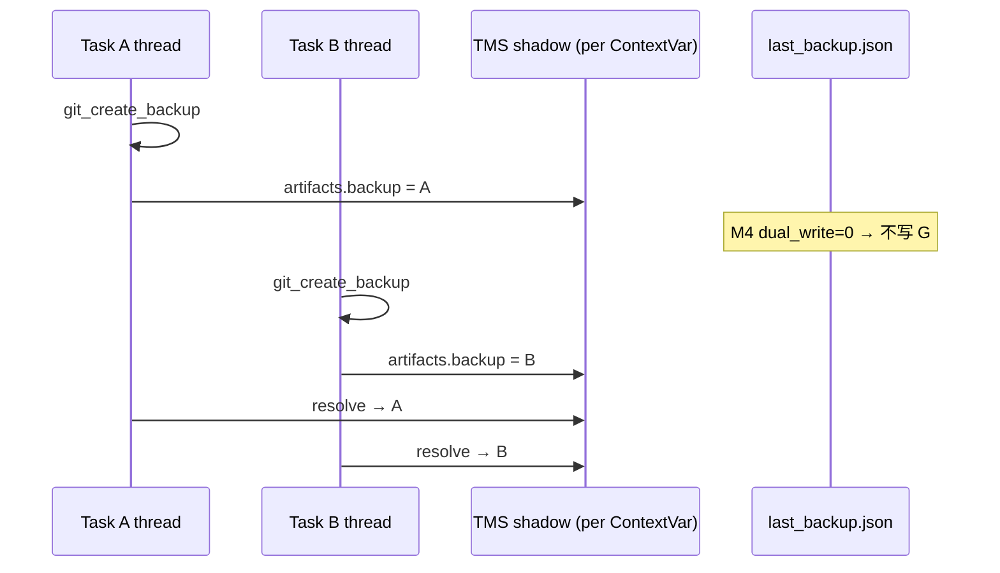

# PR-M4 — Task-Scoped Backup Design

> **Status**: **Design · v0.10 PR-M4** · (2026-07-21)  
> **Baseline**: PR-M3 @ `e42bbb5` · 470 pytest passed  
> **Parent**: [task_mutation_state.md](task_mutation_state.md) · [task_mutation_state_m3.md](task_mutation_state_m3.md) · [V0.10_ROADMAP.md](../archive/V0.10_ROADMAP.md)  
> **Out of scope (M4)**: 运行时代码 · commit · legacy 删除 (M5) · worktree 隔离 (P2) · 删除 `last_backup.json` (M5/v0.10.1 deprecate) · dedup redesign · verification loop

---

## English Summary

**PR-M4** makes **`ArtifactSlice.backup`** the **primary read/write authority** for mutation backup refs within a task session. `git_create_backup` / `git_rollback` / backup gates (`apply_patch`, `write_repo_file`) resolve backup via **TMS shadow** (already persisted in `mutation_state_json` since M3), not the global `logs/last_backup.json`. Global backup file remains a **read fallback** for CLI sessions without `task_id` and during migration (`TASK_SCOPED_BACKUP_ENABLED=0`). Concurrent API tasks no longer overwrite each other's backup metadata.

---

## 1. PR-M4 目标与 scope guard

### 1.1 问题陈述（M3 后仍存在的 bug）

| 现象 | 根因 |
|------|------|
| 并发 API task A/B 互相覆盖 backup | `git_create_backup` → `set_backup_info()` 写 **全局** `last_backup.json` + 进程内 global 变量 |
| Task B resume 后 rollback 可能指向 Task A 的 backup | hydrate 时 `mirror_tms_to_legacy` 写 global；或 gate 读 global |
| `apply_patch` backup gate 与 TMS 不一致 | `_has_backup_record()` 读 `project_context.get_backup_*()` |
| Checkpoint 已含 task backup，但 runtime gate 不读 TMS | M3 只解决 persist/hydrate，未改 backup **读路径** |

### 1.2 目标

| # | 交付 |
|---|------|
| G1 | Backup ref **读写**以 TMS `artifacts.backup` 为 task 内 SoT |
| G2 | `git_create_backup` / `git_rollback` outcome details + TMS advance 携带正确 backup ref |
| G3 | `apply_patch` / `write_repo_file` backup gate 读 TMS（flag on） |
| G4 | 并发两 task 各 backup 不串；resume 后 rollback 指向 **本 task** backup |
| G5 | Global `last_backup.json` 降级为 fallback；audit 含 `task_id` + backup ref |
| G6 | Feature flag + rollback：`TASK_SCOPED_BACKUP_ENABLED=0` 行为等同 v0.9 |

### 1.3 M4 不做

| 项 | 归属 |
|----|------|
| 删除 `context/project_context.py` backup API | M5 / v0.10.1 deprecate |
| 删除 global dual-write  entirely | M5 |
| Git worktree / sandbox 隔离 | v0.11 P2 |
| 改 `PATCH_REQUIRE_BACKUP` 默认值 | 不变 |
| checkpoint schema v3 | 不需要 — M3 blob 已含 `artifacts.backup` |
| 多 writer 并发 patch 同一 repo | 文档限制，非 M4 |

### 1.4 M4 完成后的系统性质

| 属性 | M4 后（flag on） |
|------|------------------|
| Task 内 backup SoT | **TMS `artifacts.backup`** |
| 持久化 | M3 `mutation_state_json` + dual-write v1 列（M3–M4） |
| Global file | **只读 fallback**（无 task_id / flag off / TMS backup 空） |
| 状态变化入口 | 仍仅 `advance_from_outcome()` — backup 是 artifact，不是独立 advance |
| 并发语义 | **修复** — 多 task 不再共享 mutable global backup |

### 1.5 核心原则（延续 M2/M3）

```
git_create_backup
    ↓
ToolSuccessResult (details: backup_branch, backup_commit, …)
    ↓
advance_from_outcome()  →  TMS.artifacts.backup
    ↓
checkpoint serialize (M3)
```

**禁止**：

```
git_create_backup → set_backup_info(global) 作为唯一写入   ❌ (M4 改)
apply_patch → get_backup_branch() global only             ❌ (M4 改)
```

---

## 2. 现状 vs 目标

### 2.1 今天（M3 @ `e42bbb5`）

| 步骤 | 行为 |
|------|------|
| `git_create_backup` | Git 操作 + **`set_backup_info()` 写 global** + `tool_success` details |
| `advance_from_outcome` | 写 TMS `artifacts.backup` + legacy mirror |
| `mirror_tms_to_legacy` (resume) | `restore_execution_state` + **`set_backup_info(global)`** |
| `_has_backup_record()` | `get_backup_branch()` / `get_backup_commit()` — **global** |
| `git_rollback` | 读 **global** backup |
| Checkpoint | backup 已在 `mutation_state_json.artifacts.backup` |

### 2.2 M4 目标（flag on）

| 步骤 | 行为 |
|------|------|
| `git_create_backup` | Git 操作 + details → advance → **TMS 为权威**；global dual-write **可选/deprecated** |
| Backup gate | **`resolve_task_backup_ref()`** 读 TMS → fallback global |
| `git_rollback` | 同 resolver |
| `mirror_tms_to_legacy` | 写 legacy execution_state；**不再**写 global（或 flag 控制 dual-write） |
| Resume | M3 hydrate 已恢复 TMS backup — M4 gate 与之一致 |

---

## 3. Backup 解析 API（M4 核心）

### 3.1 新模块位置

`context/tms/backup.py`（或 `adapter.py` 内聚 — **推荐独立小模块** 便于测试）

```python
@dataclass(frozen=True)
class ResolvedBackupRef:
    backup_branch: str
    backup_commit: str
    original_branch: str
    source: Literal["tms", "legacy_execution", "global_file", "none"]
    task_id: str | None = None


def resolve_task_backup_ref(
    *,
    task_id: str | None = None,
) -> ResolvedBackupRef | None:
    """
    Priority (TASK_SCOPED_BACKUP_ENABLED=1):
      1. TMS shadow artifacts.backup
      2. legacy execution_state backup fields (M1–M4 compat)
      3. global last_backup.json (CLI / migration fallback)
    Flag off: invert 2/3 precedence to match v0.9 (global before TMS).
    """
```

| 规则 | 说明 |
|------|------|
| **有 task_id + flag on** | TMS 优先；不读 global 除非 TMS 空 |
| **无 task_id（CLI）** | global file fallback（v0.9 兼容） |
| **flag off** | 与 v0.9 相同 — global + execution_state；TMS 不参与 gate |

### 3.2 与 checkpoint 关系

Resume 后 TMS 已从 M3 hydrate 填充 `artifacts.backup` → resolver 直接读 shadow **无需**再读 checkpoint 行。

新 task（非 resume）→ shadow 空 → gate 按 fallback 规则。

---

## 4. 写入路径

### 4.1 `git_create_backup`（`tools/git_tools.py`）

| 变更 | 说明 |
|------|------|
| Git 操作 | 不变 |
| `set_backup_info()` | flag on：**不调用**或 optional deprecated dual-write（`BACKUP_GLOBAL_DUAL_WRITE=0` default） |
| `tool_success` details | 已含 `backup_branch` / `backup_commit` / `original_branch` — 保持 |
| `advance_from_outcome` | 已写 TMS — **M4 验证 + 测试** |

可选 M4 增强 — `BackupRef.created_at_step`：

```python
details={
    "backup_branch": ...,
    "backup_commit": ...,
    "original_branch": ...,
    "created_at_step": current_react_step,  # 来自 audit context 或 run_tool 注入
}
```

### 4.2 `git_rollback`（`tools/git_tools.py`）

```python
ref = resolve_task_backup_ref(task_id=get_task_id())
if ref is None:
    return "无法回滚：没有可用的备份记录。…"
# use ref.backup_branch, ref.backup_commit
```

Audit：`git_rollback` event 增加 `backup_source: tms|global_file`.

### 4.3 `mirror_tms_to_legacy`（`context/tms/adapter.py`）

| M3 | M4 |
|----|-----|
| resume 时 `set_backup_info(global)` | flag on：**移除** global write；仅 `restore_execution_state` |
| | flag off：保留 v0.9 global write |

避免 resume Task A 把 backup 刷进 global 影响 Task B。

### 4.4 Global dual-write 策略

| Flag | `set_backup_info` on backup create |
|------|-----------------------------------|
| `TASK_SCOPED_BACKUP_ENABLED=0` | **是**（v0.9） |
| `=1`, `BACKUP_GLOBAL_DUAL_WRITE=0` | **否** |
| `=1`, `BACKUP_GLOBAL_DUAL_WRITE=1` | 是（过渡；audit `backup_global_dual_write`） |

**M5 目标**：删除 dual-write 与 global 读 fallback（CLI 文档改为必须 task_id 或显式 `--task`）。

---

## 5. Backup gate 改造

### 5.1 受影响 call site

| 模块 | 函数 | 今天 | M4 |
|------|------|------|-----|
| `tools/patch_apply.py` | `_has_backup_record()` | global | `resolve_task_backup_ref()` |
| `tools/safe_write.py` | `_has_backup_record()` | global | 同上 |
| `tools/tool_manager.py` | dedup / pre-check | 间接 execution_state | 不变（M5） |

### 5.2 `PATCH_REQUIRE_BACKUP`

**不变** — 仍为 apply 硬门控；仅 **backup ref 来源** 从 global 改为 TMS-first。

### 5.3 FSM 与 backup gate

仍 **冗余但互补**（v0.9 设计）：

- FSM：`BACKED_UP` workflow state
- Gate：resolved backup ref 存在

M4 后两者应对同一 task 的同一 backup 一致；不一致时 audit `backup_gate_mismatch`（record-only）。

---

## 6. Feature flag 与 migration

### 6.1 新 flags

```python
# config/settings.py
TASK_SCOPED_BACKUP_ENABLED = os.getenv("TASK_SCOPED_BACKUP_ENABLED", "0") ...
BACKUP_GLOBAL_DUAL_WRITE = os.getenv("BACKUP_GLOBAL_DUAL_WRITE", "0") ...  # 仅当 task-scoped on
```

| 组合 | 行为 |
|------|------|
| scoped=0 | **v0.9 完全等价** |
| scoped=1, dual_write=0 | TMS SoT；无 global 写；gate 读 TMS |
| scoped=1, dual_write=1 | TMS SoT + global 镜像（CLI 兼容过渡） |

### 6.2 迁移时间线

| 阶段 | 行为 |
|------|------|
| v0.9 | global only |
| M3 | backup 在 checkpoint TMS blob；runtime 仍 global |
| **M4 flag=0** | 与 v0.9 相同 |
| **M4 flag=1** | TMS-first；并发 bug 修复 |
| M5 | 移除 global 写；缩小 fallback |
| v0.10.1+ | deprecate `last_backup.json` in docs |

### 6.3 Rollback

`TASK_SCOPED_BACKUP_ENABLED=0` → 立即回到 global 读写；checkpoint 内 TMS backup 仍正确 hydrate，但不参与 gate。

---

## 7. 并发场景（验收用例）

### 7.1 两 API task 并发 backup



### 7.2 Resume + rollback

1. Task A backup → checkpoint save（M3 `mutation_state_json` 含 backup A）
2. Task B backup（不覆盖 A 的 checkpoint）
3. Resume Task A → hydrate → TMS backup A → rollback 指向 A

---

## 8. Audit 事件

| Event | 触发 |
|-------|------|
| `backup_ref_resolved` | gate / rollback 解析； fields: `source`, `task_id`, branch, commit |
| `backup_global_dual_write` | dual_write=1 时写 global |
| `backup_gate_mismatch` | TMS backup 与 global 不一致且 global 被 fallback 读到 |
| 已有 `git_backup` / `git_rollback` | 增加 `backup_source` |

---

## 9. 模块变更计划

| 模块 | M4 变更 |
|------|---------|
| `context/tms/backup.py`（新） | `resolve_task_backup_ref`, `ResolvedBackupRef` |
| `context/tms/__init__.py` | export backup API |
| `context/tms/advance.py` | 可选：填充 `created_at_step` |
| `context/tms/adapter.py` | `mirror_tms_to_legacy` 条件化 global write |
| `tools/git_tools.py` | read/write 路径 |
| `tools/patch_apply.py` | `_has_backup_record` |
| `tools/safe_write.py` | `_has_backup_record` |
| `config/settings.py` | flags |
| `context/project_context.py` | docstring deprecate；逻辑 minimal change |
| `test_task_scoped_backup.py`（新） | 并发 + resume + flag matrix |

**不改**：checkpoint schema、hydrate 优先级、advance 语义。

---

## 10. Implementation sub-PRs

| ID | 内容 | 风险 |
|----|------|------|
| **M4-a** | `resolve_task_backup_ref` + unit tests | 低 |
| **M4-b** | flags + `git_tools` read/write | 中 |
| **M4-c** | `patch_apply` / `safe_write` gate | 中 |
| **M4-d** | `mirror_tms_to_legacy` global write 条件化 | 中 |
| **M4-e** | 并发 integration tests | 高 |
| **M4-f** | audit + docs deprecate global | 低 |

---

## 11. Test plan

| ID | 场景 |
|----|------|
| T1 | flag on：两 task  sequential backup；各自 resolver 返回不同 branch |
| T2 | flag on：Task A checkpoint resume → rollback 使用 A 的 commit |
| T3 | flag on：Task B 运行时不影响 A 的 TMS shadow（ContextVar 隔离） |
| T4 | flag off：行为与 `test_backup_persistence.py` 一致 |
| T5 | scoped=1, dual_write=0：`last_backup.json` 不在 create 时更新 |
| T6 | scoped=1：`apply_patch` 在 TMS 有 backup、global 无时通过 gate |
| T7 | CLI 无 task_id：fallback global file |
| T8 | `advance_from_outcome` 后 TMS backup 与 git 输出一致 |

---

## 12. Acceptance criteria（design sign-off）

- [ ] TMS `artifacts.backup` 为 task 内 backup 读写的 **primary SoT**（flag on）
- [ ] 并发 task backup **不互相覆盖**
- [ ] Resume + rollback 使用 **本 task** checkpoint/hydrated backup
- [ ] `apply_patch` gate 读 TMS-first（非 global-only）
- [ ] `TASK_SCOPED_BACKUP_ENABLED=0` 零行为变更
- [ ] Global file 保留 fallback；M4 不删除 `project_context` API
- [ ] 不引入 checkpoint v3；不改动 advance/hydrate 边界
- [ ] Audit 可区分 backup 来源（tms / global_file）

---

## 13. Design decisions（待 review 确认）

| # | 决策 | 建议 | 备选 |
|---|------|------|------|
| D1 | flag default | **`0`**（与 M3 一致） | default `1` 立即修复并发 |
| D2 | global dual-write default | **`0`** | default `1` CLI 过渡 |
| D3 | resolver 模块 | **`context/tms/backup.py`** | 放在 adapter |
| D4 | mirror 写 global | flag on **不写** | 继续写（保留 bug） |
| D5 | `created_at_step` | M4 **填充** | defer M5 |
| D6 | legacy execution_state backup | resolver 层 **保留** 为 fallback | 仅 TMS |

**推荐**：D1=0，D2=0，D3=独立模块，D4=不写 global，D5=填充，D6=保留 fallback。

---

## 14. References

| 文档 | 关系 |
|------|------|
| [task_mutation_state_m3.md §4.3](task_mutation_state_m3.md) | mirror 写 global — M4 调整点 |
| [task_mutation_state.md §9.1](task_mutation_state.md) | 并发与 backup scoping |
| [V0.10_ROADMAP.md §PR-M4](../archive/V0.10_ROADMAP.md) | 里程碑验收 |
| [mutation_fsm_pr_f1.md](mutation_fsm_pr_f1.md) | FSM vs PATCH_REQUIRE_BACKUP 互补 |

---

**Next**: Design review → PR-M4 implementation (M4-a … M4-f).
