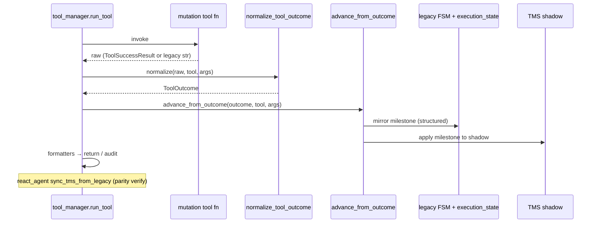

# PR-M2 — ToolOutcome & advance_from_outcome Design

> **Status**: **Design · v0.10 PR-M2** · (2026-07-21)  
> **Baseline**: PR-M1 @ `8a0ee2f` · 441 pytest passed  
> **Parent**: [task_mutation_state.md](task_mutation_state.md) · [task_mutation_state_m1.md](task_mutation_state_m1.md) · [V0.10_ROADMAP.md](../archive/V0.10_ROADMAP.md)  
> **Out of scope (M2)**: 运行时代码 · commit · checkpoint v2 (M3) · SoT cutover (M5) · verification (V0) · dedup structured skip (M5)

---

## English Summary

**PR-M2** introduces symmetric **`ToolOutcome`** (`ToolSuccessResult` | `ToolRejectResult`) and a **single advancement entry** `advance_from_outcome()` in `context/tms/`. Mutation tools emit structured success with **`MilestoneToken`** (closed enum); **`message` is display-only**. Legacy string outputs are normalized **only** in `normalize_tool_outcome()`. During M2, **legacy remains runtime SoT for guards**; `advance_from_outcome()` **mirrors** milestone effects into legacy **and** TMS shadow (dual-write). Read/analyze tools stay plain `str`. Three formatters unify memory / CLI / audit+SSE.

---

## 1. Problem statement

### 1.1 v0.9 / M1 pain

| Issue | Location today |
|-------|----------------|
| Success = plain string + Chinese substring markers | `mutation_fsm.advance_*` · `execution_state.update_from_tool_result` |
| Three parallel advance paths after tool run | `tool_manager._mutation_fsm_advance` · `react_agent._update_execution_state_safe` · `sync_tms_from_legacy` |
| Reject structured (opt-in) but success unstructured | `tools/result_schema.py` |
| Golden / audit fragile on `"Git 备份完成"` etc. | tests · audit substring |

### 1.2 M2 goal (not M5)

| M2 delivers | M2 does **not** deliver |
|-------------|-------------------------|
| Stable **`MilestoneToken`** drives advancement | TMS replaces legacy as SoT |
| **`advance_from_outcome()`** single entry | Remove legacy modules |
| Mutation tools return **`ToolSuccessResult`** | Read/analyze tools → JSON |
| **`normalize_tool_outcome()`** sole legacy string compat | FSM guard reads TMS |
| Dual-write: outcome → legacy mirror + TMS shadow | checkpoint v2 persist |

---

## 2. Architecture — single advancement pipeline

### 2.1 Target flow (M2)



### 2.2 Forbidden pattern (M2+)

```
tool
 ├── mutation_fsm.advance_mutation_fsm_on_success()   ❌ remove from tool_manager
 ├── execution_state.update_from_tool_result()         ❌ remove from react_agent
 └── sync_tms_from_legacy() alone as advance           ❌ sync is verify/mirror only
```

### 2.3 Adapter-first rule

| Layer | M2 responsibility |
|-------|-------------------|
| `tools/*.py` | Return `ToolSuccessResult` or error string (errors normalized at boundary) |
| `tools/outcome_schema.py` (new) or extend `result_schema.py` | Types + normalize + formatters |
| `context/tms/advance.py` (new) | **`advance_from_outcome()`** + legacy mirror |
| `context/tms/adapter.py` | Unchanged public sync; post-advance parity |
| `context/mutation_fsm.py` | **Mirror target** — accept structured milestone input from advance only |
| `context/execution_state.py` | **Mirror target** — same |

New code **must not** call legacy advance helpers directly — only `advance_from_outcome()`.

---

## 3. Schema boundary

### 3.1 Type model

```python
class ToolRejectResult(TypedDict):
    ok: Literal[False]
    code: str                    # REJECT_CODE_* registry (existing)
    message: str                 # display + memory (when structured off)
    details: dict[str, Any]

class ToolSuccessResult(TypedDict):
    ok: Literal[True]
    code: str                    # SUCCESS_CODE_* registry (machine)
    message: str                 # display ONLY — never read for advance/audit logic
    milestone: str | None        # MilestoneToken.value; None = no state advance
    details: dict[str, Any]      # paths, backup refs, stats — audit-safe subset

ToolOutcome = ToolSuccessResult | ToolRejectResult
LegacyRawResult = str | ToolOutcome   # tool fn return type during migration
```

**No third success shape.** Plain `str` exists only as tool implementation detail until normalized.

### 3.2 Success `code` vs `milestone`

| Field | Audience | Purpose |
|-------|----------|---------|
| `code` | audit, tests, programmatic | Stable per-tool outcome identity (`backup_created`) |
| `milestone` | **internal** FSM/TMS only | Closed enum token; **only** field that triggers `advance_from_outcome` |
| `message` | CLI, ReAct memory (human) | Localized / prose; **must not** affect guards, dedup, FSM |

**Rule**: `advance_from_outcome()` **ignores** `message` and `code` for state mutation; it reads **`milestone`** only (after `parse_milestone_token()`).

### 3.3 `details` contract

| Rule | Reason |
|------|--------|
| No raw file contents | memory / audit size |
| No full tool args dump | security |
| Allowed: `paths[]`, `backup_branch`, `backup_commit`, `proposal_digest`, `stats`, `tool` | mirror to legacy artifacts |

Audit extracts from `details`; FSM/TMS **must not** scrape `message` as fallback.

---

## 4. MilestoneToken registry (closed enum)

Defined in `context/tms/types.py` (M1). M2 **extends usage**, not free strings.

| MilestoneToken | Success `code` | Tool(s) | TMS workflow | Legacy mirror |
|----------------|----------------|---------|--------------|---------------|
| `PROPOSED` | `proposal_generated` | `propose_code_changes` | → PROPOSED | FSM + execution digest |
| `DIFF_GENERATED` | `diff_generated` | `generate_unified_diff` | → DIFF_PREVIEWED, path DIFF_FIRST | FSM + preview paths |
| `BACKUP_CREATED` | `backup_created` | `git_create_backup` | → BACKED_UP | FSM + backup ref |
| `PATCH_APPLIED` | `patch_applied` | `apply_patch` | → PATCHED | FSM + patch paths |
| `FILE_WRITTEN` | `file_written` | `write_repo_file` | → PATCHED, path WRITE_FALLBACK | FSM + patch paths |
| `ROLLBACK_TO_BACKUP` | `rollback_completed` | `git_rollback` | → BACKED_UP (workflow) | FSM rollback |
| `DEDUP_SKIPPED` | `dedup_skipped` | dedup policy (M5) | **no advance** | defer M5 |

**Invalid / unknown milestone** → audit `invalid_milestone_token` · no advance · no legacy mirror.

**Not user-facing**: tokens never appear in CLI print or HTTP `TaskResponse`; only in structured audit fields when `STRUCTURED_TOOL_OUTCOME_ENABLED=1`.

---

## 5. Mutation tool scope

### 5.1 In scope (must return `ToolSuccessResult` on success)

| Tool | Module | Notes |
|------|--------|-------|
| `propose_code_changes` | `change_proposal.py` | milestone on structured proposal only |
| `generate_unified_diff` | `diff_engine.py` | preview success only |
| `git_create_backup` | `git_tools.py` | |
| `apply_patch` | `patch_apply.py` | |
| `write_repo_file` | `safe_write.py` | |
| `git_rollback` | `git_tools.py` | |

### 5.2 Out of scope (remain `str`)

`list_repo_files`, `read_repo_file`, `search_in_repo`, `analyze_repo_structure`, `find_file_dependencies`, `git_status`, `summarizer`, `calculator`, non-ReAct tools.

`run_tool` gate rejects (`ToolRejectResult`) already structured when flag on — unchanged source, unified via `ToolOutcome`.

### 5.3 Error paths

Tool internal failures may still return error **strings** at M2; `normalize_tool_outcome()` classifies:

| Pattern | Normalized to |
|---------|---------------|
| Already `ToolRejectResult` | pass-through |
| Already `ToolSuccessResult` | pass-through |
| Known error prefixes (`参数错误`, FSM prefix, etc.) | `ToolRejectResult` via existing helpers |
| Unknown string without success milestone mapping | success **without** milestone (`milestone=None`) — no advance |

---

## 6. `normalize_tool_outcome()` — sole legacy compat layer

### 6.1 Signature (design)

```python
def normalize_tool_outcome(
    raw: LegacyRawResult,
    *,
    tool: str,
    args: dict[str, Any] | None,
) -> ToolOutcome:
    """
    ONLY site allowed to map legacy Chinese markers → MilestoneToken.
    """
```

### 6.2 Resolution order

```
1. isinstance ToolRejectResult → return
2. isinstance ToolSuccessResult → validate milestone enum → return or downgrade
3. str → LEGACY_MARKER_TABLE[tool] substring rules (deprecated)
4. str → error heuristics → ToolRejectResult
5. str → ToolSuccessResult(ok=True, code="legacy_string", milestone=None, message=str)
```

### 6.3 Legacy marker table (deprecated · test-locked)

| Tool | Legacy trigger (substring) | milestone | emit audit |
|------|---------------------------|-----------|------------|
| `propose_code_changes` | `修改方案` | PROPOSED | `legacy_outcome_normalized` |
| `generate_unified_diff` | `diff` / `Diff` in text + valid paths in args | DIFF_GENERATED | same |
| `git_create_backup` | `Git 备份完成` | BACKUP_CREATED | same |
| `apply_patch` | `Patch 应用完成` | PATCH_APPLIED | same |
| `write_repo_file` | `文件写入完成` | FILE_WRITTEN | same |
| `git_rollback` | `Git 回滚完成` | ROLLBACK_TO_BACKUP | same |

**M2 后 ban**: no new rows; tools must emit structured success. Table frozen + coverage tests.

### 6.4 Compat window removal (M5)

Remove marker table; unknown string → `milestone=None` + warn audit.

---

## 7. `advance_from_outcome()` API

### 7.1 Signature (design)

```python
# context/tms/advance.py

@dataclass(frozen=True)
class AdvanceResult:
    advanced: bool
    milestone: MilestoneToken | None
    legacy_mirrored: bool
    tms_updated: bool

def advance_from_outcome(
    outcome: ToolOutcome,
    *,
    tool: str,
    args: dict[str, Any] | None,
) -> AdvanceResult:
    """
    Single advancement entry (M2).
    - Rejects / no milestone → no-op
    - Else: apply to TMS shadow + mirror to legacy (dual-write)
    Never reads outcome.message.
    """
```

### 7.2 Internal steps

```
1. if is_reject(outcome): return no-op
2. token = parse_milestone_token(outcome.get("milestone"))
3. if token is None or token == DEDUP_SKIPPED: return no-op
4. if token invalid: audit + return no-op
5. apply_milestone_to_tms(token, outcome.details, tool, args)
6. mirror_milestone_to_legacy(token, outcome.details, tool, args)
7. return AdvanceResult(advanced=True, ...)
```

### 7.3 TMS apply (`apply_milestone_to_tms`)

Move logic from M0 §3.2 invariants into structured form:

| token | TMS changes |
|-------|-------------|
| PROPOSED | workflow PROPOSED; digest from details; new digest clears artifacts |
| DIFF_GENERATED | DIFF_PREVIEWED + DIFF_FIRST; merge paths from details/args |
| BACKUP_CREATED | BACKED_UP; set ArtifactSlice.backup from details |
| PATCH_APPLIED / FILE_WRITTEN | PATCHED; patch_applied + paths |
| ROLLBACK_TO_BACKUP | workflow BACKED_UP; clear patch_applied |

Uses **`MILESTONE_TO_WORKFLOW`** + path-specific rules (WRITE_FALLBACK on backup-from-PROPOSED).

### 7.4 Legacy mirror (`mirror_milestone_to_legacy`)

**One-way: outcome → legacy** (not legacy → outcome).

Refactor strategy (M2 impl):

| Option | Choice |
|--------|--------|
| A. Call existing advance with synthetic messages | ❌ keeps string coupling inside legacy |
| B. New `apply_milestone_token(token, details, tool, args)` in legacy modules, called only from mirror | ✅ **M2 target** |
| C. Duplicate all legacy logic in TMS only | ❌ breaks dual-write |

Mirror implements **B**: thin structured entry points on `mutation_fsm` / `execution_state` that M5 can delete when legacy goes away.

### 7.5 SoT during M2

| Concern | M2 behavior |
|---------|-------------|
| FSM **guard** (`check_mutation_fsm_allowed`) | Still reads **legacy** ContextVar |
| execution_state **dedup skip** | Still reads **legacy** |
| After successful tool | **advance_from_outcome** writes **both** legacy + TMS |
| `sync_tms_from_legacy` in react_agent | **Parity verify** post-advance (should match; pristine skip applies) |

Guard cutover to TMS → **M5**, not M2.

---

## 8. `run_tool` integration (M2)

### 8.1 New pipeline segment

Replace current block:

```python
# v0.9 / M1
result = _invoke_registered_tool(...)
_mutation_fsm_advance(name, args, result)
result = finalize_tool_result(result)
```

With:

```python
raw = _invoke_registered_tool(...)
outcome = normalize_tool_outcome(raw, tool=name, args=args)
advance_from_outcome(outcome, tool=name, args=args)
result = finalize_tool_outcome(outcome)   # replaces finalize_tool_result
log_tool_call(..., outcome, ...)
return result
```

### 8.2 react_agent changes

| Change | Reason |
|--------|--------|
| **Keep** `_update_execution_state_safe` as legacy entry; **implement via** `normalize_tool_outcome` → `advance_from_outcome` | migration-period rollback safety; avoids mass call-site churn before M5 |
| **Keep** `_sync_tms_from_legacy_safe` after tool | parity / drift detection |
| Order preserved | legacy advance inside `_update_execution_state_safe` → sync → checkpoint |

**Review adjustment (2026-07-21):** M2 changes the **implementation source** of state updates, not the public legacy API surface. Do **not** delete `_update_execution_state_safe` until M5 cutover.

### 8.3 Dedup skip (M2)

Still returns plain string from `_execution_state_dedup_skip`. M2:

```python
# normalize maps to:
ToolSuccessResult(
    ok=True,
    code="dedup_skipped",
    message=skip_message,
    milestone=None,
)
```

No advance. Structured dedup skip without milestone → **M5**.

---

## 9. Three export formatters

Single module: `tools/outcome_schema.py` (or extended `result_schema.py`).

### 9.1 API

```python
def format_outcome_for_display(outcome: ToolOutcome) -> str: ...
def format_outcome_for_memory(outcome: ToolOutcome) -> str: ...
def extract_outcome_audit_fields(outcome: ToolOutcome) -> AuditOutcomeFields: ...
```

### 9.2 Behavior matrix

| Consumer | Function | `STRUCTURED_TOOL_OUTCOME_ENABLED=0` | `=1` (D1 default, M2 implements) |
|----------|----------|-------------------------------------|----------------------------------|
| **CLI print** | `format_outcome_for_display` | `message` only | `message` only |
| **ReAct memory** | `format_outcome_for_memory` | `message` only (default, v0.9 compat) | JSON line when `MEMORY_STRUCTURED_TOOL_RESULT_ENABLED=1` (experimental) |
| **Audit `tool_call`** | `extract_outcome_audit_fields` | text + optional reject_code | + `success_code`, `milestone`, `details` subset |
| **SSE** | same as audit via `log_tool_call` | unchanged transport | + structured fields in event payload |

**Ban**: `react_agent` must not use `str(result)` or `format_tool_result_for_*` after M2 — use outcome formatters on normalized outcome from `run_tool` return.

### 9.3 Memory format (review adjustment)

**M2 default:** memory receives **`message` text only** — ReAct memory is LLM context, not a database. Structured fields belong in **audit** and **golden/code assertions**, not injected into prompts by default.

Optional experiment flag (default off):

```python
MEMORY_STRUCTURED_TOOL_RESULT_ENABLED = False  # config/settings.py
```

When enabled, memory may receive a compact JSON line (see prior draft). Do **not** enable by default in M2.

### 9.4 Audit fields (success)

```json
{
  "event": "tool_call",
  "tool": "git_create_backup",
  "status": "success",
  "result": "Git backup created successfully.",
  "success_code": "backup_created",
  "milestone": "BACKUP_CREATED",
  "details": { "backup_branch": "...", "backup_commit": "..." }
}
```

**Never** derive `milestone` from `result` text in audit layer.

---

## 10. Flags (M2)

| Flag | M2 default | Notes |
|------|------------|-------|
| `STRUCTURED_TOOL_REJECT_ENABLED` | `0` (until D1) | reject path already exists |
| `STRUCTURED_TOOL_OUTCOME_ENABLED` | `0` | M2 adds; D1 flips to `1` |
| `TMS_ADAPTER_ENABLED` | `1` | unchanged |
| `LEGACY_OUTCOME_NORMALIZE_ENABLED` | `1` | M2 new; disable marker table (break compat) |

---

## 11. PR-M2 implementation split

| Sub-PR | Deliverable | Risk |
|--------|-------------|------|
| **M2-a** | `outcome_schema` types + normalize + formatters + tests | low |
| **M2-b** | `advance_from_outcome` + legacy mirror structured entry | medium |
| **M2-c** | Mutation tools → `ToolSuccessResult` | medium |
| **M2-d** | `run_tool` / `react_agent` wire-up; remove old advance hooks | high — golden |
| **M2-e** | Golden + FSM tests migrate to code/milestone asserts | medium |

Each sub-PR: pytest green; no M3/M5 scope.

---

## 12. Acceptance criteria (design sign-off)

- [ ] `ToolOutcome` = success | reject only after normalize
- [ ] `advance_from_outcome()` documented as **sole** advance entry
- [ ] `message` excluded from advance / guard / dedup / audit logic
- [ ] `MilestoneToken` closed enum drives TMS + legacy mirror
- [ ] Legacy marker parsing **only** in `normalize_tool_outcome()`
- [ ] M2 keeps legacy SoT for guards; dual-write on advance
- [ ] Three formatters cover memory / CLI / audit+SSE
- [ ] Mutation tool list explicit; read tools stay `str`
- [ ] `_update_execution_state_safe` retained; internally calls `advance_from_outcome`; sync kept for parity

---

## 13. Test plan (M2 implementation)

| ID | Scenario |
|----|----------|
| T1 | Each mutation tool success → correct `milestone` + TMS shadow |
| T2 | Legacy string input → normalize → same milestone as structured |
| T3 | Reject outcome → no advance on legacy or TMS |
| T4 | `advance_from_outcome` ignores message-only changes |
| T5 | Invalid milestone string → no advance + audit |
| T6 | run_tool end-to-end: guard still legacy; mirror consistent |
| T7 | sync after advance: parity ok (non-pristine) |
| T8 | Golden 24: migrate assertions to `code` / audit fields |
| T9 | formatters: display=message; memory flag on/off |
| T10 | No new legacy imports outside allowlist |

---

## 14. Risks & mitigations

| Risk | Mitigation |
|------|------------|
| Dual-write drift (TMS vs legacy mirror) | parity sync + `PARITY_STRICT` in tests |
| Golden brittle on memory format | assert audit + milestone, not prose |
| Mirror refactor breaks FSM guards | guard still legacy; mirror uses same state vars |
| normalize table incomplete | one test per tool per legacy marker |
| Premature TMS guard cutover | explicit defer M5 in scope guard |

---

## 15. M2 → M3 handoff

| M2 leaves | M3 picks up |
|-----------|-------------|
| TMS shadow updated by advance | export `mutation_state_json` v2 from shadow |
| Legacy mirror still required | checkpoint hydrate v1 → v2 |
| `STRUCTURED_TOOL_OUTCOME_ENABLED=0` default | D1 default-on after M2 green |

---

## 16. Document history

| Date | Status | Notes |
|------|--------|-------|
| 2026-07-21 | **Design · PR-M2** | Post M1 `8a0ee2f` · adapter-first · single advance entry |
