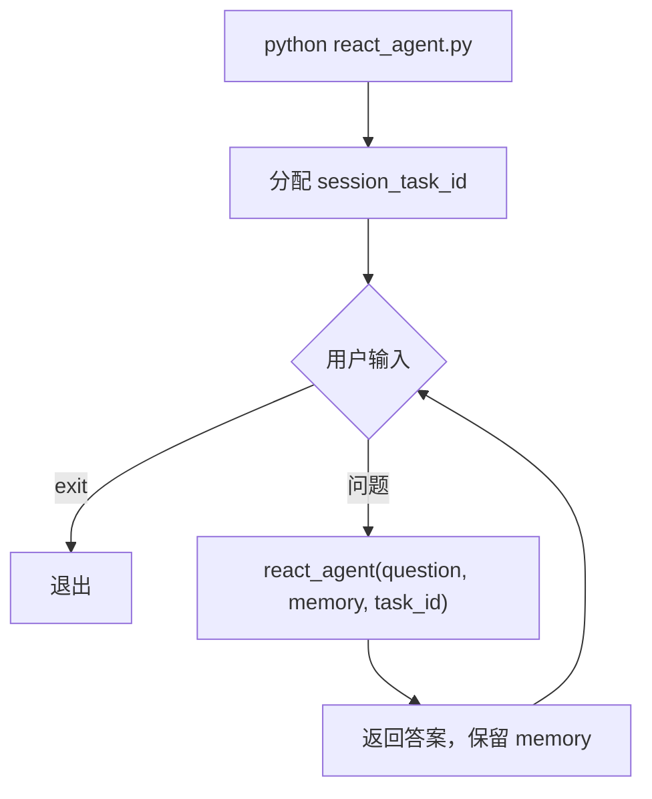
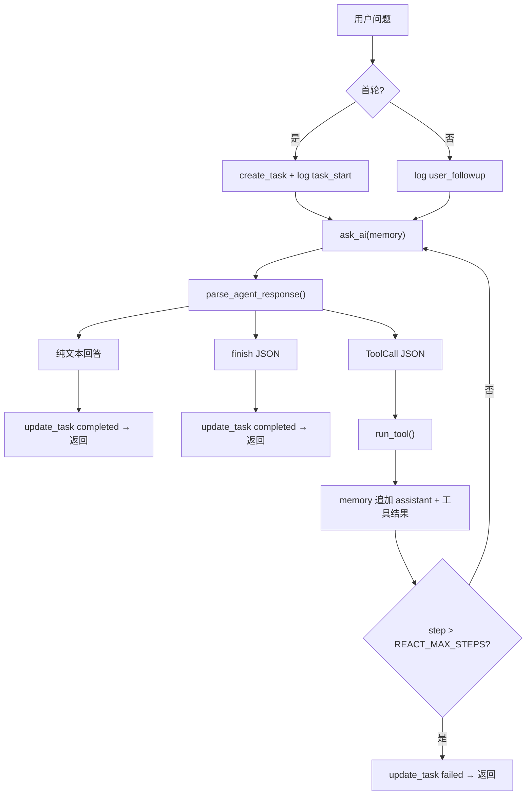
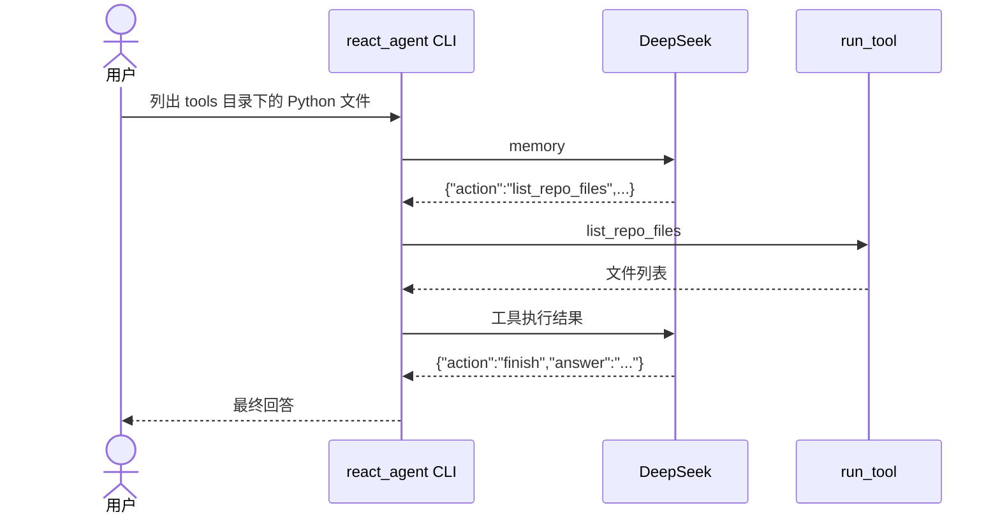
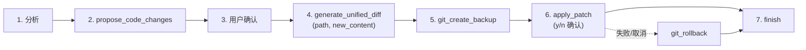
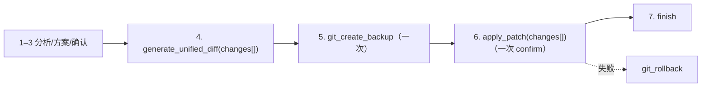
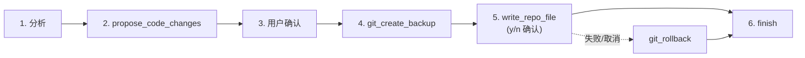
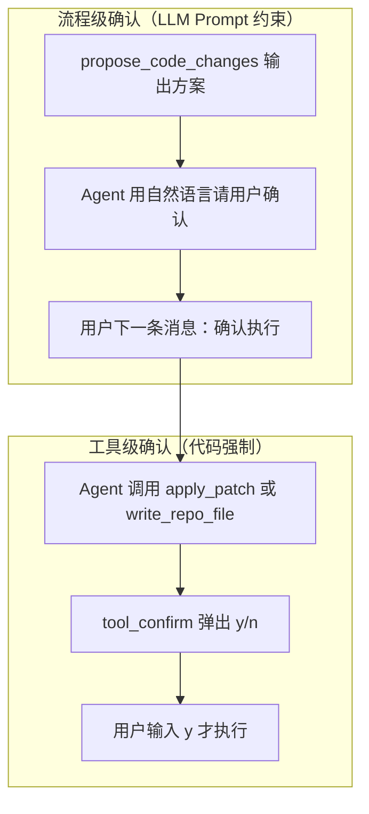
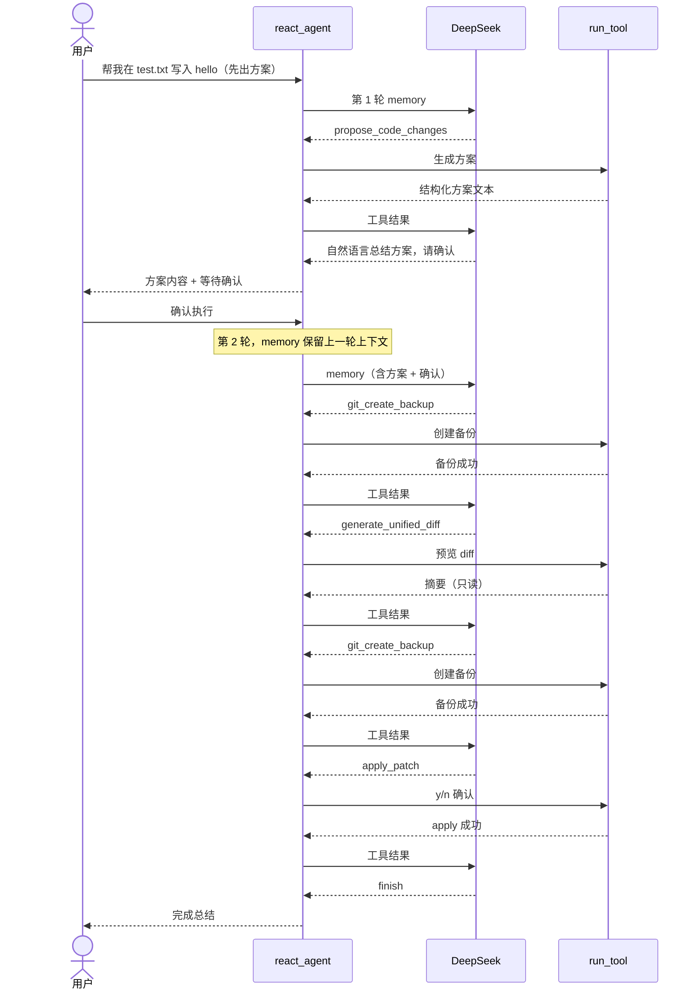
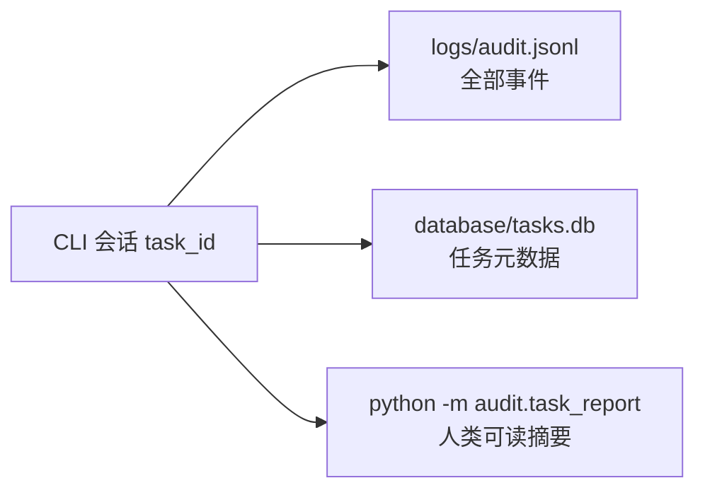
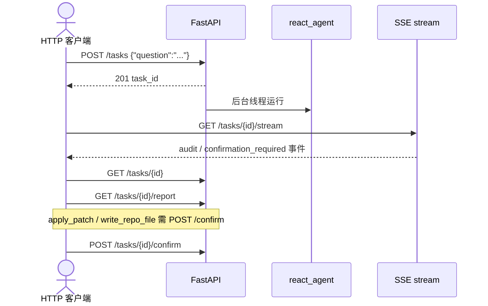

# Agent 工作流程

> **版本**：v0.10.2（Verification loop）· **v0.10.1** Guard default-on  
> **依据**：当前代码库实际实现  
> **相关文档**：[架构设计](architecture.md) · [Demo 指南](demo.md) · [GitHub Demo](GITHUB_DEMO.md) · [项目状态](PROJECT_STATUS.md) · [Mutation FSM](design/mutation_fsm.md) · [Structured tool results](design/structured_tool_results.md)

---

## 1. 总体流程

RepoPilot 提供 **CLI** 与 **HTTP API** 双入口，共享同一套 ReAct 引擎、工具注册表与审计链路。

**CLI**：`python react_agent.py` 启动多轮会话。每次会话分配一个 `task_id`，会话内所有轮次共用同一 ID。

**HTTP API**：`uvicorn api.main:app` 或 `docker compose up` 启动服务。每个 `POST /tasks` 请求创建独立任务，后台线程运行 Agent；客户端通过 REST + SSE 查询进度与确认写操作。



---

## 2. 单轮 ReAct 循环

每一轮用户输入触发一次 `react_agent()` 调用，内部为 ReAct 循环：



### 2.1 LLM 输出三种形态

| 形态 | 解析结果 | 行为 |
|------|----------|------|
| 纯文本 | `str` | 直接作为回答返回，任务标记 completed |
| `{"action":"finish","answer":"..."}` | `FinishResponse` | 返回 answer，任务 completed |
| `{"action":"工具名","args":{...}}` | `ToolCall` | 执行工具，结果追加到 memory，继续循环 |

### 2.2 步数限制

- 默认上限：**20 步**（`REACT_MAX_STEPS`）
- 超出后返回提示信息，任务标记 **failed**
- 审计记录 `max_steps_reached` 事件

### 2.3 ReAct 步边界：Cancel 与 Checkpoint（v0.6+）

每个 tool 执行完毕、结果写入 memory 之后，在进入下一步 LLM 调用之前：

```
run_tool 返回
    → memory 追加 assistant + 工具结果
    → [is_cancel_requested?] 是 → 保存 checkpoint → task_cancelled → 退出
    → [CHECKPOINT_ENABLED=1?] 是 → save_checkpoint（含 execution_state opt-in）
    → [EXECUTION_STATE_DEDUP_ENABLED=1?] 更新 mutation milestone
    → step += 1 → 继续或达到 REACT_MAX_STEPS 上限
```

| 机制 | 说明 |
|------|------|
| **Cancel** | 协作式；不中断正在运行的 tool（含 `git apply`）；HTTP `POST /tasks/{id}/cancel` 设 flag |
| **Checkpoint** | 默认开启；持久化 memory、step、agent_mode、context budget、execution_state |
| **Resume** | HTTP `POST /tasks/{id}/resume`；从最近 checkpoint 继续；可选追问 |

CLI **无** cancel/resume 命令；详见 [architecture.md §3.3.6](architecture.md#336-task-cancel--resumev06-c3)。

---

## 3. 只读任务流程

适用于：查看代码、分析结构、搜索关键字、理解模块等 **不涉及文件修改** 的任务。



**典型工具链**：

```
list_repo_files / read_repo_file / search_in_repo
    → analyze_repo_structure / find_file_dependencies
    → finish
```

**约束**（`llm.py` Prompt）：

- 读取仓库文件必须使用 `read_repo_file`
- 不要使用 `file_reader`

---

## 4. 代码修改任务流程

适用于：修改代码、增加功能、修复 bug、重构等 **涉及文件写入** 的任务。

v0.4 起提供两条路径：**推荐** unified diff；**备选** 整文件覆盖（v0.3 兼容）。v0.5 起同一 diff 工具支持 **单文件 legacy** 与 **多文件 `changes[]` batch**（见 §4.1b）。二者均需 `propose_code_changes` 与用户聊天确认，且 mutation 工具经 CLI y/n 或 API confirm。

### 4.1 推荐流程：Diff-first — 单文件（默认）



| 步骤 | 执行者 | 说明 |
|------|--------|------|
| 1–3 | 同下 | 分析 → 方案 → **用户**聊天确认 |
| 4. Diff 预览 | Agent | `generate_unified_diff(path, new_content)` — **不写入**、不执行 git |
| 5. Git 备份 | Agent | `git_create_backup` — **`apply_patch` 前必须** |
| 6. 应用 | Agent + **用户** | `apply_patch(path, new_content)` — `git apply --check` → apply；**y/n / API confirm** |
| 7. 总结 | Agent | `finish` |
| 回滚 | Agent | 失败、取消或用户要求时 `git_rollback` |

**单文件边界**：默认使用 `path` + `new_content`；单文件无需 `changes[]`。

### 4.1b 推荐流程：Diff-first — 多文件 batch（≥2 文件）



| 步骤 | 说明 |
|------|------|
| 4 | `changes: [{path, new_content}, ...]` — 只读 batch 预览；与 legacy **二选一** |
| 5–6 | **一次** backup + **一次** apply；禁止 N 次单文件 `apply_patch` 代替 |
| 失败 | **无 partial apply**；check 失败工作区不变；**无 auto rollback** |

### 4.1c 诚实边界（单文件 + batch 共用）

- 单文件默认 `path` + `new_content`；多文件（≥2）用 `changes[]` on **同一工具**
- `path/new_content` 与 `changes` **二选一**
- **无** partial apply、冲突 merge、交互式 hunk 编辑
- **`git apply` 非 DB 事务**；apply 内 **无 auto rollback**（显式 `git_rollback`）
- LLM **不得**输出 raw unified diff 代替工具
- 上限：`PATCH_MAX_FILES`（默认 10）、`PATCH_MAX_CHANGED_LINES`（batch 总和）

### 4.2 备选流程：整文件覆盖（v0.3 兼容）



| 步骤 | 执行者 | 说明 |
|------|--------|------|
| 1. 分析 | Agent（工具） | 可选：`read_repo_file`、`analyze_repo_structure`、`find_file_dependencies` |
| 2. 出方案 | Agent（工具） | **必须**调用 `propose_code_changes` |
| 3. 用户确认 | **用户** | 下一条消息确认；Agent 不得用 `finish` 代替 |
| 4. Git 备份 | Agent | `git_create_backup` |
| 5. 写入 | Agent + **用户** | `write_repo_file` 整文件覆盖；**y/n** 确认 |
| 6. 总结 | Agent | `finish` |
| 回滚 | Agent | 失败/取消时 `git_rollback` |

无备份记录时 `write_repo_file` **仅警告**，不阻断（与 `apply_patch` 默认强制备份不同）。

### 4.3 双重确认机制

这是 v0.1.0 的核心安全设计，两层确认 **相互独立**：



| 确认层 | 触发条件 | 实现位置 | 拒绝行为 |
|--------|----------|----------|----------|
| 流程级 | 修改任务 | `llm.py` Prompt 规则 | Agent 不应提前 backup/write |
| 工具级 | 调用 `apply_patch` 或 `write_repo_file` | `security/tool_confirm.py` | 返回「用户已取消执行工具」 |

> **注意**：Agent 用 `finish` 问「是否执行？」**不等于**工具级 y/n 确认。y/n 在 **`apply_patch` / `write_repo_file`** 被调用时出现。`generate_unified_diff` 无需 confirm。

### 4.4 多轮 CLI 中的修改流程（diff-first 示例）

修改任务通常跨越 **多轮用户输入**：



整文件路径将 `generate_unified_diff` / `apply_patch` 替换为 `write_repo_file` 即可（仍须先 backup）。

---

## 5. propose_code_changes 工作方式

`tools/change_proposal.py` 在方案阶段 **独立调用 LLM**（不经过 ReAct 循环内的同一轮）：

1. 加载上下文：指定 `target_files` 或默认 `analyze_repo_structure`
2. 构造 Prompt，要求 LLM 输出 JSON（`summary` + `proposals[]`）
3. Pydantic 校验 `ChangeProposalList`
4. 写入 `change_proposal` 审计事件
5. 返回格式化文本（**不执行任何文件改动**）

v0.6+ 加载路径使用 `_load_context_with_budget`（`CONTEXT_BUDGET_ENABLED=1`）；v0.7+ 可选 semantic expand（`RAG_ENABLED=1`）。

每条 proposal 包含：`file`、`change_type`（modify/add/delete）、`description`、`risk`、`preview`。

当前 **不生成 unified diff 方案正文**（方案阶段），`preview` 为 LLM 概述；实际 diff 由 **`generate_unified_diff` 工具**基于磁盘内容 + `new_content` 生成。

---

## 6. Git 备份与回滚

### 6.1 git_create_backup

```
1. 检查 Git 仓库与 HEAD commit
2. 创建分支 agent-backup/<时间戳>
3. 提交当前工作区变更到备份分支
4. 切回原分支
5. 写入 logs/last_backup.json
6. 写入 git_backup 审计事件
```

### 6.2 git_rollback

```
1. 从 last_backup.json 读取 backup_commit
2. 校验 commit 存在
3. 切回 original_branch（如需要）
4. git reset --hard <backup_commit>
5. 写入 git_rollback 审计事件
```

> `git reset --hard` 会丢弃当前分支上未备份的变更，属于破坏性操作。

### 6.3 apply_patch 与备份

- 默认 **`PATCH_REQUIRE_BACKUP=1`**：无 `logs/last_backup.json` 记录时 **拒绝** apply
- 内部顺序：重建 diff → 校验 → `git apply --check` → `git apply`
- 失败 **不**自动 rollback（由 Agent 调用 `git_rollback`）

### 6.4 write_repo_file 与备份的关系

- 无备份记录时：**允许写入**，但返回警告「建议先调用 git_create_backup」
- 审计事件 `file_write` 中记录 `backup_present: true/false`

---

## 7. 写入安全规则

`tools/safe_write.py` 在写入前执行 `validate_write_target()`：

| 检查项 | 规则 |
|--------|------|
| 路径 | 必须在 `REPO_ROOT` 内，不可越界 |
| 忽略目录 | 不可写入 `logs/`、`database/` 等 |
| 敏感文件 | 阻断 `.env`、`*.pem` 等 |
| 扩展名 | 必须在 `WRITABLE_EXTENSIONS` 内（**不含 `.json`**） |
| 大小 | UTF-8 编码后不超过 `MAX_WRITE_BYTES`（默认 100KB） |
| 目录 | 父目录必须已存在，不自动创建 |
| 方式 | 整文件覆盖（非 diff/patch） |
| 确认 | CLI y/n（`CONFIRM_REQUIRED_TOOLS`） |

---

## 8. 可观测性工作流

任务完成后，可通过以下方式追溯：



### 8.1 查看任务

```powershell
python -c "from storage.task_store import list_tasks; print(list_tasks(5))"
python -c "from storage.task_store import get_task; print(get_task('YOUR_TASK_ID'))"
```

### 8.2 生成审计报告

```powershell
python -m audit.task_report YOUR_TASK_ID
```

报告包含：时间范围、事件统计、ReAct 流程时间线、工具调用汇总、写入/Diff/Patch/Git/确认事件。

### 8.3 查看原始审计

```powershell
Get-Content logs\audit.jsonl -Encoding utf8 | Select-Object -Last 10
```

---

## 9. Prompt 约束的禁止行为

以下来自 `llm.py`，由 Prompt 约束（非代码硬编码状态机）：

- 禁止跳过 `propose_code_changes` 直接 `apply_patch` 或 `write_repo_file`
- 禁止用 `finish` 询问是否执行（应等用户下一条消息）
- 禁止跳过 `git_create_backup` 直接 `apply_patch`（默认强制）或写入（Prompt 要求；`write_repo_file` 代码仅警告）
- 禁止输出 raw unified diff 代替 `generate_unified_diff` / `apply_patch`
- 禁止对 `.json` 文件调用 `apply_patch` 或 `write_repo_file`
- 禁止用 `finish` 声称已写入但未实际调用 `apply_patch` 或 `write_repo_file`

---

## 10. HTTP API 工作流

适用于远程集成、自动化脚本或无需交互终端的场景。



### 10.1 与 CLI 的差异

| 项 | CLI | HTTP API |
|----|-----|----------|
| 任务粒度 | 会话级 `task_id` | 每 POST 一个任务 |
| 写确认 | 终端 y/n | `POST /tasks/{id}/confirm` + SSE 事件 |
| 实时事件 | 终端打印 | `GET /tasks/{id}/stream`（SSE） |
| 模式覆盖 | 环境变量 `AGENT_MODE` | body 可选 `"mode": "readonly"` |
| Cancel / Resume | ❌ 不支持 | `POST /tasks/{id}/cancel`、`POST /tasks/{id}/resume` |
| Checkpoint | 自动保存（`CHECKPOINT_ENABLED=1`） | 同左 + HTTP resume |

### 10.2 冒烟验证

```powershell
python -m api.main
python scripts/api_smoke_test.py
# 仅健康检查（Docker/CI 无 LLM 时）:
python scripts/api_smoke_test.py --health-only
```

### 10.3 HTTP Task cancel

适用于长时间 running 任务需中止的场景（**仅 HTTP API**）。

```
POST /tasks/{task_id}/cancel
```

| 阶段 | 行为 |
|------|------|
| API | 设置 `cancel_requested=1`；返回 `cancel_requested: true`（任务仍 `running`） |
| Agent 边界 | 上一 tool 返回后检测 flag → `mark_task_cancelled` → status **`cancelled`** |
| 审计 | `cancel_requested`（API）+ `task_cancelled`（agent） |

**409**：任务非 `running` 或已 `cancelled`。Cancel **不**强制中断正在执行的 mutation tool。

### 10.4 HTTP Checkpoint resume

适用于任务因步数上限、用户取消或进程重启后，从最近 checkpoint 继续。

```
POST /tasks/{task_id}/resume
Content-Type: application/json

{"question": ""}   # 可选追问；空字符串表示无追加问题
```

| 步骤 | 行为 |
|------|------|
| 1 | `get_latest_checkpoint(task_id)` |
| 2 | `schedule_resume_task` 后台线程恢复 memory、step、agent_mode |
| 3 | 恢复 context budget + execution_state（v0.8） |
| 4 | memory 注入 dedup hint（`EXECUTION_STATE_DEDUP_ENABLED=1`） |
| 5 | 继续 ReAct 循环 |

用户追问含「重新备份」等关键词时清除 backup milestone，允许重新 `git_create_backup`。

**409**：无 checkpoint 或任务状态不允许 resume。

---

## 11. AGENT_MODE

运行时可在 **full**（默认）与 **readonly** 之间切换。

| 模式 | 允许 | 禁止 |
|------|------|------|
| `full` | 全部 **14** 工具 | — |
| `readonly` | 读/分析 + `propose_code_changes` + `git_status` + **`generate_unified_diff`**（**10** 个） | `git_create_backup`、`apply_patch`、`write_repo_file`、`git_rollback` |

**优先级**：`POST /tasks` body `mode` > 环境变量 `AGENT_MODE` > 默认 `full`。

- `GET /health` 返回当前默认 `agent_mode`
- SQLite `tasks.agent_mode` 持久化，审计报告含模式字段
- 实现见 `config/agent_mode.py`；工具层在 `run_tool` 拦截

---

## 12. 与遗留流程的区别

| | ReAct 主流程 | 遗留 legacy/agent.py |
|--|-------------|----------------------|
| 入口 | `react_agent.py` | `legacy/agent.py` |
| 模式 | ReAct + 工具 | RAG + Chroma |
| 读文件 | `read_repo_file`（安全边界） | `pdf_reader` / `read_text` 等 |
| 改代码 | propose → backup → write → rollback | 不支持 |
| 审计 | JSONL + SQLite + task_report | 无 |

---

## 13. 已知限制

与 [PROJECT_STATUS.md](PROJECT_STATUS.md) 一致：

| 限制 | 说明 |
|------|------|
| Diff / patch | 单文件默认 `path` + `new_content`；**v0.5+** 多文件 `changes[]`（同一工具，一次 backup + 一次 apply；见 [V0.5_ROADMAP.md](archive/V0.5_ROADMAP.md)） |
| 整文件 fallback | `write_repo_file` 仍可用；无 backup 时仅警告（与 `apply_patch` 默认强制 backup 不同） |
| 单份备份 | 仅 `last_backup.json` 记录最近一次 |
| 会话级 task_id | CLI 同一会话多轮共用一个 ID（API 每 POST 独立） |
| 脱敏未完整 | 路径拦截 + 内容/审计 redact 已接入；非完整 DLP，长文本仍截断 |
| 无 Web UI | 仅 CLI + HTTP API |
| Cancel/Resume | HTTP API only；CLI 无等价命令 |
| Checkpoint dedup | `EXECUTION_STATE_DEDUP_ENABLED=0` 默认；resume 可能重复 backup/apply |
| Mutation FSM | `MUTATION_FSM_ENABLED=1` 默认（v0.10.1）；设 `=0` 可回退无 ordering reject |
| Structured reject | `STRUCTURED_TOOL_REJECT_ENABLED=1` 默认（v0.10.1）；设 `=0` 可回退 string-only reject |
| verify | `verify_change` soft（v0.10.2）；仅 PATCHED 可调用；失败不回滚 workflow；可跳过直接 finish |
| Live eval | opt-in **4** cases；见 [testing_live_llm_eval.md](testing_live_llm_eval.md) |
| Docker | 镜像内为独立 git baseline，非挂载宿主机 `.git` |
